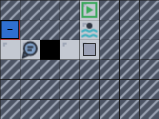
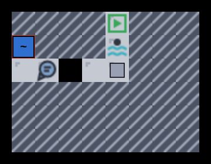

# Content sets PASS-1: declared passability, walkable / blocked, end to end

Branch `content-pass1`, based on `origin/content-tile3` `42b755ce31` (TILE-3, land OK, queued as TRAIN 158 and not on
main yet). The design is PASS-D's (`content-sets-passability-design.md`, the planner's plans directory), § 3 "PASS-1".

⚖ Robert, 2026-11-18T18:00:14Z:
- values: *"One per slice (Recommended)"*, so this slice adds `walkable` and `blocked` only;
- where: *"Pack declares, world copies (Recommended)"*;
- look vs logic: *"Separate, no lying looks (Recommended)"*.

Planner rulings: painting floor over a blocked kind's cell is refused by name ("erase the kind first"); the declaration
lives in the structure layer as a `terrain` entry that the concept `presents` (Z.1).

## Commits

| # | SHA | What |
|---|---|---|
| 1/5 | `fb81e960b8` | `packStructure` / `packConcepts`: the `terrain` structure kind and concept kind, `TERRAIN_PASSES`, `terrainPassOf` |
| 2/5 | `2bb209ce99` | The lookup: `tileKindKeys` carries each kind's `pass`, read through the structure layer |
| 3/5 | `fd6e10e4cb` | The field: `tileKinds[].pass`, its check against the grid, the look/logic refusals, drift |
| 4/5 | `7661cf062f` | The editor: bake and lower, erase restores floor, floor over blocked refused, copy/paste |
| 5/5 | `56cef25cc9` | The proof: `mazeTilePass.test.js` |
| docs | `b10c612499` | `maze.md`, `concepts.md`, `gotchas.md`, three READMEs, the regenerated README index and `docsIndex` |
| — | this commit | This report and its screenshots |

## 1. The parts as built

### 1.1 `packStructure` / `packConcepts` (1/5)

- `packConcepts.STRUCTURE_KINDS` and `PACK_CONCEPT_KINDS` gain `terrain`. `STRUCTURE_ID_PATTERN` is now built from
  `STRUCTURE_KINDS`; it was a literal list.
- `packConcepts.TERRAIN_PASSES = ['walkable', 'blocked']` and `DEFAULT_TERRAIN_PASS = 'walkable'`. This module owns the
  names, as it owns `PACK_TILE_BASES`. It is a closed list that grows one value per slice: PASS-2 adds `needs` and
  PASS-3 `one-way`, to the same list.
- `packStructure.STRUCTURE_FIELDS.terrain = ['kind', 'src', 'pass']`. `pass` is **required**, and a value outside
  `TERRAIN_PASSES` is refused by name (`pass "one-way" is not one of walkable, blocked`). `pass` on any other kind is
  refused by the existing field rule.
- `packStructure.terrainPassOf(concept, structure)` reads a concept's pass through the structure layer: the presented
  terrain entry's `pass`, or `walkable` when the concept presents none. A terrain entry that is presented but held by
  no loaded structure is refused by name, so a missing logic layer never reads as walkable.
- A concept that presents a terrain entry must be of kind `terrain`. This is the existing Z.1 two-form `presents`
  rule, unchanged.
- Test fixture on disk: `packStructure/fixtures/packs/ground/` (one terrain entry per value, plus a concept with no
  terrain). The "every entry kind present" and "every field used" pins now load it.

Files: `packConcepts/packConcepts.js`, `packStructure/packStructure.js`, both tests, the fixture.

### 1.2 The lookup (2/5)

- `mazeTileArt.tileKindKeys(packConcepts, structure)` gives each declared kind `{ artKey, base, pack, pass }`.
- A kind whose terrain cannot be resolved gets `pass: null` and `passError` (the refusal's sentence). Placement refuses
  it by name, and its draw is unaffected.
- With roles, `loadMazeTileArt` also reads the `structure` layer (`createStructure` runs only when some pack in the
  stack has one). That load feeds the editor's bake and the views' drift report. Nothing re-derives a world's logic
  from it.

Files: `mazeRoom/mazeTileArt.js`, plus one expectation in `mazeTileKind.test.js`: a TILE-2 fixture kind now carries
`pass: 'walkable'`.

### 1.3 The field (3/5)

- **The grid is the bake.** A placed `blocked` kind **is** a wall under the kind, and every other value stands on
  floor. In a deserialized world the editor therefore writes no second per-cell store. `world.tileKinds` stays
  `Map("x,y" → kind)`, and the baked pass is read back off the grid (`mazeSerializer.tileKindPassAt`).
  - This also covers `cloneWorld`, `worldsEqual`, the occupancy walker and the round trip with no new copy step: a
    second Map would have needed all four taught, and `occupiedWorldCells` would have counted its keys as occupied.
- **The payload** writes `{x, y, kind, pass: "blocked"}`, and writes no `pass` for a walkable kind, so every TILE-3
  payload stays byte-equal (`mazeSerializer.tileKindsList`). The `TILE_GRID_SIDECAR_FIELDS.tileKinds` item schema
  gains `pass` with `enum: WRITTEN_TILE_KIND_PASSES`, which is `TERRAIN_PASSES` minus the default.
- **`withTileKinds`** (`tileKindsFromList`) checks each entry's `pass` against its cell. `blocked` must be on a wall
  and anything else on floor. TILE-3's `notFloor` refusal became `passMismatch`. A `pass` a payload never writes is
  refused as malformed, and that includes an explicit `"walkable"`.
- **The round trip** carries it unchanged: `open` and `save` serialize the edited world's grid, and the grid holds the
  wall. TILE-3's re-stamp exclusion for `tileKinds` stays.
- **Drift:** see § 3.

Files: `mazeRoom/mazeSerializer.js`, `mazeRoom/mazeTileKinds.js`, `mazeRoom/mazeLabView.js`, `mazeRoom/mazeRoomUI.js`,
plus the restated TILE-3 pins in `mazeTileKinds.test.js` and `mazeTileKindEditor.test.js`.

### 1.4 The editor (4/5)

- **`_setTileKind`** bakes the declared pass and lowers it in the same op. A blocked kind calls
  `setTile(world, x, y, TILE_WALL)`. A walkable kind leaves the cell floor, and restores floor when it replaces a
  blocked kind. Re-placing a kind whose baked pass has drifted takes the pack's current value.
  - It takes a **floor** cell, or a cell a kind already holds (the kind owns that cell).
  - A blocked kind is never laid on a painted wall, so erasing it always gives back the floor it took. The design's
    "or on a wall cell it then owns" is resolved this way.
- **`clearEntity`** removes the kind and restores floor.
- **`setTile floor`** on a blocked kind's cell is refused (`blocked-tile-kind`). On a walkable kind's cell it stays
  TILE-3's no-op.
- **`placeableTileKinds`** offers every kind that `tileKindRefusal` does not refuse. A blocked wall-based kind is now
  offered.
- **`readMazeCell`** reports a kind's cell tile as `floor`, the floor the kind took. A paste therefore writes floor,
  and `setTileKind` lowers it again. Without this, a paste of a blocked kind would write the wall first and then be
  refused (`wall-tile`).

Files: `mazeRoom/mazeRoomEditor.js`, `mazeRoom/mazeEditAdapter.js`.

## 2. The refusals

New in PASS-1, or restated from TILE-3, each pinned in `mazeTilePass.test.js` unless noted:

| Where | Reason | Sentence (`TILE_KIND_REFUSALS` / parser) |
|---|---|---|
| structure parser | pass outside the set, or missing | `pack "…" structure manifest: entry "…": pass "one-way" is not one of walkable, blocked (a terrain entry declares its passability)` (`packStructure.test.js`) |
| structure parser | a field a terrain does not take | `field "needs" is not one a terrain takes (kind, src, pass)` (`packStructure.test.js`) |
| `terrainPassOf` | presents a terrain entry no structure holds | `concept "…" presents "…", which no structure in the stack holds` (`packStructure.test.js`) |
| concepts parser | a terrain presented by a non-terrain concept | `presents the terrain "…", but its own kind is object` (existing rule; `packStructure.test.js`) |
| payload (`withTileKinds`) | `pass` not written by a payload (`walkable`, `one-way`, …) | `tileKinds: entry 0: pass "walkable" is not one a payload writes (blocked; "walkable" is never written)` |
| payload | the cell does not match the baked pass (was `notFloor`) | `passMismatch`: `… is baked pass "blocked", but the cell is floor (a blocked kind stands on the wall it lowers to; any other on floor)` (also `mazeTileKinds.test.js`) |
| declared (`tileKindRefusal`) | wall base, not blocked (TILE-3's blanket rule, now conditional) | `wallBase`: `tile kind "…" has base "wall" but declares pass "walkable": a wall look must be blocked (⚖ 2026-11-18, no lying looks)` (also `mazeTileKinds.test.js`, `mazeTileKindEditor.test.js`) |
| declared | floor base, not walkable | `floorBaseNotWalkable`: `… has base "floor" but declares pass "blocked": a plain floor look must be walkable …` |
| declared | pass unreadable | `passUnread`: `tile kind "…": its passability cannot be read (…)` |
| editor | floor painted over a blocked kind | `floorOverBlocked`: `Tile (x,y) holds the blocked tile kind "…"; painting floor there is refused: erase the kind first.` |
| editor | a painted wall cell, the entrance, a thing's cell | TILE-3's `wall-tile` and `occupied`, re-pinned with a blocked kind |

`marker` and `character` bases go with either value (STATUE: a marker that is blocked; RUG: a marker that is walkable).

## 3. Drift

- A pack change never rewrites a saved world. `mazeTileKinds.placedTileKindDrift(world, declared)` lists every placed
  kind whose baked pass differs from the loaded packs' current declaration:
  `[{ x, y, kind, baked, declared, reason: 'tile-kind-pass-drift', description }]`, with the sentence
  `tile kind "…" at (x,y) was placed as "blocked", but the loaded packs now declare it "walkable": the saved world
  keeps "blocked" (re-place the kind to take the pack's value)`.
- **Lab:** the sentence is appended to the tile-kind picker's note on every draw.
- **Maze Room panel:** one `console.warn` per (world, stack), and `getTileKindStatus().drift`.
- The cell is not re-lowered and the load is not refused. The pin (§ 4 of the test) changes the fixture's structure
  after the save, in both directions, and checks:
  - the reload succeeds;
  - the grid is unchanged;
  - the serialized `tileKinds` are byte-equal;
  - drift is listed;
  - re-placing the kind is the one way the world takes the new value.

## 4. The proof

`frontend/modules/mazeRoom/mazeTilePass.test.js` uses a **test-only in-memory** fixture pack, `pass1-fixture`. It has a
`structure` layer of terrain entries, with concepts of kind `terrain` presenting them:

| kind | base | pass |
|---|---|---|
| PILLAR | wall | blocked |
| RUG | marker | walkable |
| STATUE | marker | blocked |
| LIAR_WALL | wall | walkable (refused) |
| LIAR_FLOOR | floor | blocked (refused) |
| GHOST | marker | presents a terrain entry no structure holds (refused) |

The world is the meta trial's maze region that holds a thing, read off the data. The cells are also read off the data:
the first free cell with a free floor neighbour the player reaches, so that the step into it is testable. That gave
(2,2) for the pillar and (4,2) for the rug. The path is TILE-3's:
1. `mazeRegionRoundTrip.open`;
2. the lab's set session (room 0);
3. the palette's `opFor`, with **Tile kind** selected per kind;
4. `closeRoomSession`;
5. `mazeRegionRoundTrip.save`;
6. the registry deserializer, and a second `open`.

The checks:
- The payload carries `[{2,2,pillar,pass:"blocked"}, {4,2,rug}]`, and the thing has not moved.
- **Against a hand-painted wall** on the same cell (palette **Wall**, no kind), the save's `tiles`, `exits` and
  `locations` are equal. That cell's wall **does** move the exits relative to the unedited save, and that is pinned, so
  the equality is not vacuous.
- **The walkable kind changes nothing:** a rug-only save's tiles, exits and locations equal the unedited save's, and it
  writes no `pass`.
- **The readers:**
  - `bfsSolver` from the entrance gives `unreachable` for the pillar and reaches the rug;
  - `step` from the neighbour into the pillar gives `null`, and `whyBlocked` matches `/wall/`;
  - `isFloor` is false;
  - `findPath` to the pillar gives `null`, and the path to the rug avoids the pillar's cell;
  - on the plain world, `findPath` reached the pillar's cell (the control).
- **Both views**, with no art and with the `meta` theme: `drawMazeTileKinds` reports both kinds `as: 'base'`. The
  Maze Room panel's draw contains `paintMazeTileBase(wall)` at the pillar and `paintMazeTileBase(marker)` at the rug.
  So does the composite cell, offset. No warning is logged and nothing throws.
- **Mutation check:** with the lowering line (`setTile(world, x, y, under)`) removed, 4 of the file's 9 tests red: the
  editor test, copy/paste, the proof and drift.
- No committed preset or pack gains the fixture (§ 5).

**Screenshots** (`content-sets-pass1/`), drawn with Playwright in a page on a local static server. The fixture lived in
page memory, so nothing was written to disk. The flow was:
1. `loadMazeTileArt(['maze', 'meta'])` plus the fixture's `tileKindKeys`;
2. `applyEditOp(setTileKind)` ×2, which said `Placed tile kind pass1-fixture:terrain/pillar at (2,2) (blocked: a wall
   under it).` and `Placed tile kind pass1-fixture:terrain/rug at (4,2).`;
3. `serializeMazeWorld`;
4. the registry reload;
5. the draw.

The page logged no errors or warnings.

| | |
|---|---|
| The Maze Room panel's draw (`drawWorld` + `drawMazeTileKinds` + things), `meta` theme: the pillar's wall base (black) at (2,2), left of the sign's neighbour; the rug's marker base at (4,2) |  |
| The composite map cell, the same world and theme |  |

**Fog** (design § 2.6, to be measured): `mazeRoomUI._computeVisibleAt` marks the player's cell and its four neighbours
seen, *regardless of walls*. So a blocked kind on its wall cell shows once the player stands beside it, and the overlay
draws it then. This was measured by reading the code, not in a browser.

## 5. Closure, byte-equality, op-log identity

| Instrument | Result |
|---|---|
| `--print-engine-closure`, base `42b755ce31` and tip | **identical**: `engineMd5 bec369878feb67081187edca62baa951`, 42 files. None of the changed files is in it, and `mazeTilePass.test.js` § 5 pins the seven PASS-1 files out of it. No closure file changed, so the derived table is not stale (`payloadMd5` is untouched, because no preset moved) |
| **Op-log probe**, keyed on relative paths, over three trees: `origin/main` `e390574969` and base `42b755ce31` (both `git archive` exports of `frontend` + `scripts`, with the same `shared` submodule commit `71b77deb8a` copied in), and the tip. It covers every maze region of every committed `*_rules.json`: the panel draw (`drawWorld` + tile kinds + things) in plain and fog views under no art and the `meta` art, plus the composite cell under both. On main, which predates TILE-3, the tile-kind pass is absent | all three: 38 documents, 1,188 regions, 4,815,966 ops. Hashes main = base = tip: none `320e803df3a09d94b526dfbde23ce293`, meta `bf5a0548e76dc66aebccba71ee3b8822`, composite `293be8744efe6b22a40724fe61b1213d`. (The op count differs from TILE-3's 5,743,490 because this probe ran two art variants, not three) |
| `make-seedling-spiral-room-preset.mjs --state=concept-trial --check` / `--state=meta-trial --check` | both OK |
| `action-nodes-compile.mjs --check` | OK, byte-identical |
| `check-sidecar-fields.mjs` | ALL PASS: 2,264 entries over 10 substrates, 0 issues (30 warnings, the same count a base tree gives) |
| `generate-procgen-reference.mjs --check` / `check-procgen-docs.mjs` / `check-maze-lab.mjs` | ALL MATCH / ALL CHECKS PASSED / ALL CHECKS PASSED (the box was free) |
| Presets and packs against base | `git diff 42b755ce31 -- frontend/presets frontend/packs`: only `frontend/packs/README.md`. No preset or pack data byte differs |
| Gitlinks changed | **0** |

## 6. Gates (local)

- **Bounded vitest:** `frontend/modules/{mazeRoom, apworldEditor, packConcepts, packStructure, contentPacks,
  procgenCore, procgenDocs}` and `scripts/procgen/lintGateLabels.test.js`. 225 files, 6,498 tests, all passed. This
  run included the new test file and the docs commit.
- No glossary term was added, so the glossary count and `lint-gate-labels.allow.json` are unchanged.
- CI at the code tip: § 6.1.

### 6.1 CI at `b10c612499` (the code + docs tip, before this report), all success

- ut 44369824314.
- JSUT 44369824436: suite 1348/28735 (28,735 passed, 0 failed), slow 36/438.
- TT 44369841209: every on-push batch HEADROOM OK. Largest:
  - fast 276.2 s of 600 s (46%);
  - fast bundled 263.2 s (44%);
  - seedling-js 214.7 s (36%);
  - apworld 200.6 s (33%);
  - seedling-js-solver 196.3 s (33%);
  - seedling-wasm 180.5 s (30%);
  - playback-bot 98.8 s (16%).
- feature-checks 44369847143.
- Gitlinks changed: 0.

## 7. Test paths

- `frontend/modules/mazeRoom/mazeTilePass.test.js` (new): the lookup, every refusal, the editor, the payload, the proof,
  drift, the closure.
- `frontend/modules/packStructure/packStructure.test.js`: the terrain kind, its refusals, `terrainPassOf`; the fixture
  `fixtures/packs/ground/`.
- `frontend/modules/packConcepts/packConcepts.test.js`: `PACK_CONCEPT_KINDS` carries `terrain`.
- `frontend/modules/mazeRoom/mazeTileKinds.test.js`, `mazeTileKindEditor.test.js`, `mazeTileKind.test.js`: TILE-3's
  pins, restated as `passMismatch`, the conditional `wallBase`, and `pass` in `tileKindKeys`.

## 8. What the code overturned

1. **No second per-cell store.** The design and the brief describe a "baked copy" on each placement. In a deserialized
   world the lowering itself is the bake: a blocked kind is exactly a wall under the kind. The world keeps
   `Map("x,y" → kind)`, and the payload's `pass` is written off the grid. This avoids teaching `cloneWorld`,
   `worldsEqual`, `occupiedWorldCells` and the round trip about a second Map. That would have been a live defect in
   `occupiedWorldCells`, which walks every world key but `tiles` and `tileKinds`. PASS-2's `needs` will not be
   readable off the grid alone (it is floor plus a rule obstacle the kind owns), so PASS-2 decides whether the
   obstacle id is enough or a stored copy is needed.
2. **A blocked kind is not laid on a painted wall.** The design allowed "a floor cell (or a wall cell it then owns)".
   Erase restores floor, so a kind laid on a painted wall would open that wall on erase. The editor therefore takes
   floor cells only, plus cells a kind already holds.
3. **Copy/paste needed a change the design did not list.** `readMazeCell` read a blocked kind's cell as `wall`, so the
   paste's `setTile wall` ran before `setTileKind`, which then refused the wall cell. The cell now reads as the floor
   the kind took.
4. **`STRUCTURE_ID_PATTERN` was a literal kind list.** Adding a kind to `STRUCTURE_KINDS` alone would have left every
   terrain id unparseable. It is now built from the list.
5. **`terrain` needs `pass` required.** An entry whose only job is to declare passability declares it, so an absent
   `pass` is refused rather than read as walkable.

## 9. Next slice's line

**PASS-2, `needs`.** A terrain entry gains `needs: <mechanic concept id>`, resolved through the concept table to a
rule. The editor lowers it to `tilekind_gate_<n>` in `obstacleLib` on a floor cell. It is refused by name for a
mechanic the world cannot realise. The proof is that its compile equals a hand-placed rule obstacle, and it is never a
location. The open point from § 8.1: how a reloaded world knows which obstacle a `needs` kind owns.
