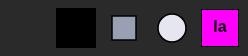
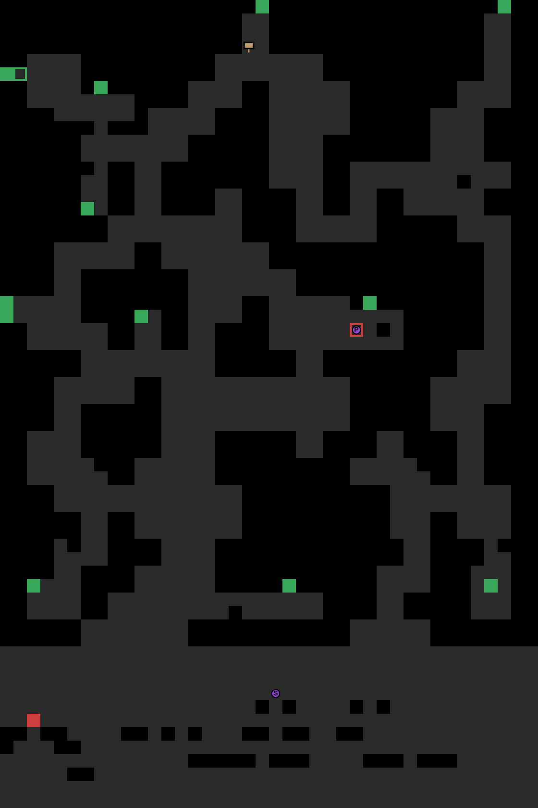
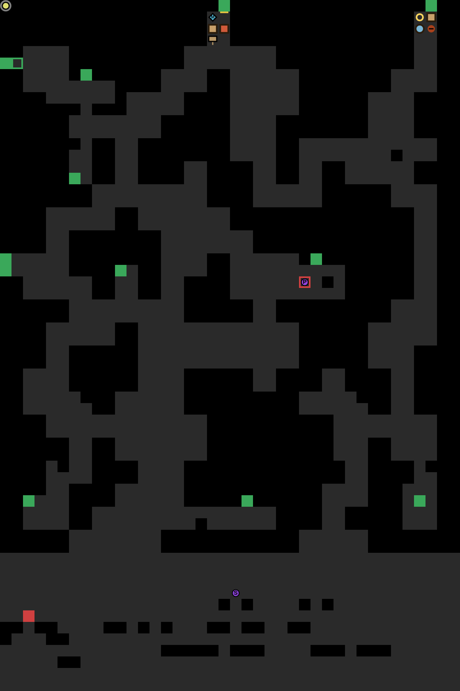
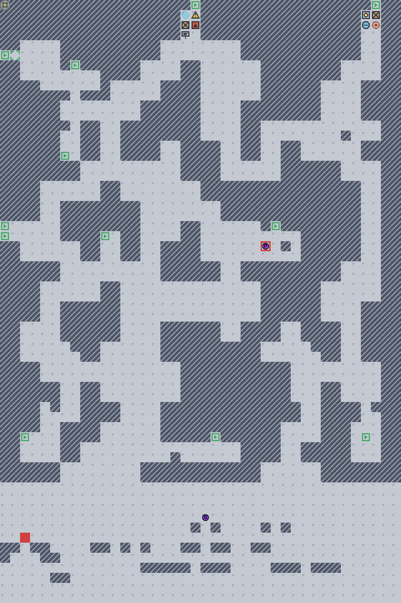

# Content sets TILE-1: one shared tile fallback, and the composite map draws every tile kind

Branch `content-tile1`, based on `origin/main` `dce1e4b795` (train 123, which contains `content-packs-pl1` `8fe80ab34e`).
This is a drawing-only slice: no generator change, no world document change, and the engine closure is unchanged.

⚖ The user asked for this on 2026-11-15: *"I don't want adding a new custom tile type in the library to require
updating the default graphics."* Then: *"yes, please brief the shared tile fallback as the next small slice, with the
composite map drawing all tile kinds after it."*

## Commits

| # | SHA | What |
|---|---|---|
| 1/4 | `9bd2a6ad65` | The fallback chain and the bases in `mazeTileArt.js`. The one-region painter routes every kind through the chain. The mana, trap and player draws move out of `drawWorld` into exported drawers, and they and `drawLiveMarkers` take an optional cell origin. |
| 2/4 | `df8ef123a1` | The composite cell draws every kind through the chain and the same drawers. `MAZE_COMPOSITE_UNDRAWN` names the one exemption. `geom.tileArt` lets a host pass art it already holds. |
| 3/4 | `3677d16ed5` | The coverage pin, `mazeTileFallback.test.js` (3). |
| 4/4 | `2177743354` | Docs (`maze.md`, `packs/README.md`, the regenerated docsIndex) and the `content-theme-maze-look` map step. |
| — | this commit | This report and its screenshots. |

## The chain, as built

`mazeTileArt.drawMazeTile(ctx, tileArt, kind, x0, y0, px, { own, base, artKey })` answers with the first step that
applies. It returns the step's name, and `mazeTileStep` answers the same question without drawing.

1. **art**: the theme's frame for the kind. For a `MAZE_ART_KEYS` row this is `tileArtFrame`, the old seam's lookup.
   For a kind the table does not know, it is the declared `artKey`.
2. **default**: the caller's `own()`. For every row this is the painter's existing `COLORS` shape, moved unchanged into
   a closure. Both views pass it.
3. **base**: the row's `base` (or, for a kind the table does not know, the declared one), drawn by
   `paintMazeTileBase`.
4. **placeholder**: `paintMazeTilePlaceholder`. It never throws, and it logs `[mazeTileArt] tile kind "<k>" has no art,
   no default draw and no base` once per kind.

`drawTileArt` stays. The sign in `mazeThingOverlay.js` still uses it, and it still refuses a name that is not in the
table: a typo in a painter must not read as "no art". The chain is what takes an unknown kind without throwing.

### The base set (`MAZE_TILE_BASES`, closed)

| base | one default draw |
|---|---|
| `floor` | the whole cell filled, `#2a2a2a` (= `COLORS.floor`, pinned) |
| `wall` | the whole cell filled, `#000000` (= `COLORS.wall`, pinned) |
| `marker` | an inset square (0.2–0.8 of the cell), `#9aa0b4`, ink-edged 1.5 |
| `character` | a disc of radius 0.35, `#e6e6f0`, ink-edged 1.5 |

### Each kind's base

| kind | base | kind | base |
|---|---|---|---|
| `floor` | floor | `block` | marker |
| `wall` | wall | `blockStruck` | marker |
| `exit` | floor | `blockDormant` | marker |
| `entrance` | floor | `button` | marker |
| `manaTile` | marker | `buttonDown` | marker |
| `player` | character | `pulser` | marker |
| `trap` | marker | `pull` | marker |
| `sign` | marker | | |

### The placeholder

The cell inset by 1 px, filled magenta `#ff00ff`, with a 1 px black edge and the kind's first two letters in bold black.
`mazeTileFallback.test.js` checks that no colour in `COLORS`, in the composite `COLORS`, or among the bases is
magenta, and that the marker and character colours are not in either `COLORS` table either. A fallback therefore never
looks like a kind's own drawing.

(The floor base is drawn on a `#2a2a2a` backdrop, so it does not show against it. That is correct for floor.)

## Where a pack would declare a new kind's base

Nothing in the maze draws a kind outside the table yet. No world field carries one, and `world.things` already has its
own art → look fallback. So I built the chain only as far as taking `{ base, artKey }` from the caller. When a pack
introduces a tile kind, its **concept row** in the pack's `concepts` layer would carry `base` next to the `art` key it
already carries. That is the row `thingArtKeys` / `conceptArtKeys` read today. The painter that places the kind would
pass both to `drawMazeTile`. A kind that names no base, or a base outside the set, gets the placeholder. It never throws.

## The composite map

`drawMazeCompositeRegion` now asks the chain for floor, wall, exit and entrance. Then, at the cell's origin, it calls
the one-region view's own drawers: `drawConsumableTile` (mana and cross-game consumables), `drawArrowTraps`, and
`drawLiveMarkers` (pulsers, pulls, buttons up and down, and the three block kinds). Things are drawn last, as before.
The map has no play state, so it shows the world's own block layout, every lane and pulser silent, every pull's gate
shut (an empty inventory, as the gates already were), and nothing collected.

**No player on the composite map** (`MAZE_COMPOSITE_UNDRAWN.player`, which also states the reason in code). The map
draws a world's layout, not a play state. Its geometry carries no player position, and the one-region view also draws
no player before play (`plainView`'s `playerPos: null`). Drawing a player at the entrance would claim a position that
nobody holds.

## ⛔ Pixel identity of the one-region view

There are two proofs, and both hold.

1. **The existing art and render tests are unchanged and pass:** `mazeRoomRender.test.js` (its op-log hash pins),
   `mazeTileArt.test.js`, `mazeMetaArt.test.js`, `mazeConceptArt.test.js`, `mazeLiveMarkers.test.js`,
   `mazeBlockKindArt.test.js`, `mazeLatchArt.test.js`, `mazeThingOverlay.test.js`, and `mazeCompositeArt.test.js`
   (TIDY-1's captured plain pin).
2. **A base-vs-tip draw-op comparison.** I copied the tree, put `origin/main`'s three changed modules
   (`mazeTileArt.js`, `mazeRoomRender.js`, `mazeCompositeMap.js`) back in place, and drew every maze region of every
   committed preset through `drawWorld` with the recording context. That covered 36 documents and 1,182 regions, in
   two views each: plain with the player and a facing tick, and fog with partial visibility and collected consumables.
   Each was drawn under three art variants: none, the real `meta` theme stack, and a stub that carries every key. The
   recording context logs every call and property write, so equal logs paint equal pixels. Both trees produced the
   same 5,239,175 ops:

   | variant | base | tip |
   |---|---|---|
   | no art | `bb21a73c77fb88b87947345e45bc13e1` | `bb21a73c77fb88b87947345e45bc13e1` |
   | `meta` theme | `7ca504ac0b53212715fd7e6e05d6ead6` | `7ca504ac0b53212715fd7e6e05d6ead6` |
   | every key (stub) | `4394cd149b742b1d3a64883e1522a309` | `4394cd149b742b1d3a64883e1522a309` |

   `meta_trial` is one of the 36 documents. Its regions are drawn under the `meta` variant, so this covers the themed
   world too.

## Screenshots (`content-sets-tile1/`)

**The committed composite maps do not change, and this overturns the brief.** The brief said the slice *"visibly
changes EVERY world's composite map, plain worlds included."* It does not. I scanned every committed preset whose
sidecars carry a `grid_cell` (the only worlds that have a composite map) for mana tiles, consumable tiles, traps,
pulls, pulsers, buttons and blocks, and found **none**. Those kinds live only in the Seedling playthrough presets, and
those have no grid (the hub says *"No map for this world"*). So every committed map draws the same pixels at base and
at tip. I captured each map's canvas off the APWorld Editor's Map tab (`toDataURL`), on a server for each tree:

| world | base | tip | md5 (base = tip) |
|---|---|---|---|
| `meta_trial` | [base](content-sets-tile1/meta_trial-base.png) | [tip](content-sets-tile1/meta_trial-tip.png) | `f80c2570b2eabd21b9034af6a8147164` |
| `concept_trial` | [base](content-sets-tile1/concept_trial-base.png) | [tip](content-sets-tile1/concept_trial-tip.png) | `08ceb2e326697d01459a74361e334dc0` |
| `procgen_maze` (plain) | [base](content-sets-tile1/procgen_maze-base.png) | [tip](content-sets-tile1/procgen_maze-tip.png) | `0ed9df51685c1c4dc9aab522822d49d9` |

To show the change itself, I drew a **staged** region (the one the coverage pin builds; nobody plays it) with the real
composite cell painter in the browser, at 2× scale. The region is the roomiest playthrough region whose entrance is not
an exit, with a mana tile, an arrow trap, the three block kinds, a button up and one held down by a block, a pulser, a
pull and a sign added. They are along the top edge.

| | image |
|---|---|
| base, default graphics: only the sign (a thing) and the old four kinds |  |
| tip, default graphics: every kind in its own `COLORS` look |  |
| tip, the `meta` theme: every kind from the theme's art |  |

New ones in the next real composite map will come from a pipeline run that adds mana or consumable tiles (the
content-module path), or from a future world that has a grid and carries blocks or traps.

## In-app rows and the feature check

- `content-theme-maze-look`: the map step no longer says the map skips 10 kinds. Now it says the map draws every tile
  kind the Maze Room draws, by the same fallback, except the player (with the reason), and that these maze cells hold
  only floor, walls, exits and the entrance. That is measured: their maps are byte-identical at base and tip.
- `meta-trial-composite-map-art` and its siblings do not pin which kinds the map covers. They pin items, things and
  floor drawn from the theme, and the plain world drawing no image. All of that still holds (the plain world gained no
  kinds), so no row changed.

## Tests

- `frontend/modules/mazeRoom/mazeTileFallback.test.js` (new):
  1. the four steps in order; an unknown kind with a declared art key or base; the placeholder for no base and for an
     invalid base, with no throw and one log per kind; `mazeTileStep`;
  2. every row's base is from the closed set; floor and wall are the painter's colours; the marker, character and
     placeholder colours belong to no kind;
  3. **the coverage pin**: the staged every-kind region in both views. With art for every key, each view blits every
     row's key, except the exemptions, which it must not draw. With no art, each view draws every row's own colour and
     never a base colour, the placeholder or a warning. The kinds and exemptions are read off `MAZE_ART_KEYS` and
     `MAZE_COMPOSITE_UNDRAWN`. No count is written into a label or an assertion.

## Gates (at `2177743354`, the code tip)

- **Bounded vitest:** `frontend/modules/mazeRoom`, `procgenCore/compositeMapRenderer.test.js`,
  `frontend/modules/tutorials` and `frontend/modules/procgenDocs`: 105 files, 2,916 tests, all passed. Of the composite
  map's own tests (the files that call `drawMazeCompositeRegion`), `mazeCompositeArt` and `mazeConceptPaint` are in
  `mazeRoom/`. `procgenDocs` first went red on `generated.test.js` (the docsIndex word counts after the `maze.md`
  edit). Running `generate-procgen-reference.mjs --write` regenerated it, and the folder was then 8 files, 495 tests,
  all passed.
- **The engine closure:** `--print-engine-closure` gives the same output at base and tip (`engineMd5
  bec369878feb67081187edca62baa951`, 42 files). No file in this diff is in the closure.
- **No generator or document change:** the diff touches no generator, preset or world document.
- **`check-meta-trial-play` / `check-concept-trial-play`:** ALL CHECKS PASSED, both, against a server on port 8130.
- **Feature checks** (`test-substrates-manual.yml`, batch `feature-checks`, run 43808228004): success.
  `[PROGRESS 10/10] feature-check-content-theme-maze-look PASSED 1.3s`; totals 10 run, 10 passed;
  `HEADROOM OK test-substrates/feature-checks: 72.8 s of 600.0 s (12%)`.
- **TT** (`test-templates.yml`, run 43808230678): success. The headroom lines:
  `fast` (bundled) 259.2 s of 600.0 s (43%); `fast` 265.3 s (44%); `seedling-js` 214.7 s (36%); `seedling-js-solver`
  180.2 s (30%); `apworld` 158.4 s (26%); `seedling-wasm` 147.9 s (25%); `playback-bot` 72.0 s (12%). Every one is OK.
- **`unittests`** (push, run 43808228275): success. **JavaScript Unit Tests** at the final tip: quoted in the report
  back.

## What the code overturned

1. **"Visibly changes every world's composite map"**: it changes **no** committed map. No committed world that has a
   map carries any of the 10 kinds (measured above). The change shows only on a staged region, or on a future
   world that has both a grid and those kinds.
2. **The pixel-identity bar held without a special case.** Every row's own draw moved into an `own` closure unchanged,
   and the cell origin is `0 + x * px`, which is exactly `x * px`. The op logs match to the op (above).
3. **`tileArtFrame` still throws on an unknown name.** The brief described that throw as the gap, but it is the typo
   guard for painters calling the row seam. The new chain is what takes an unknown kind safely, so the throw stays,
   and `mazeTileArt.test.js` still pins it.
