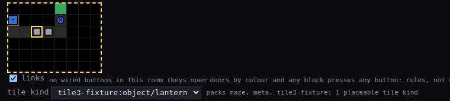
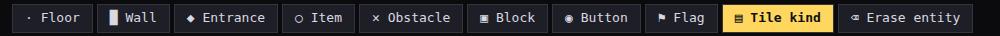
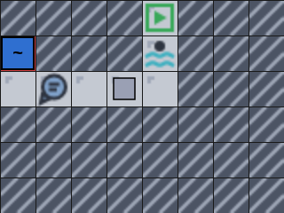
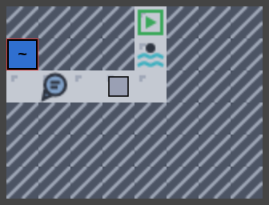
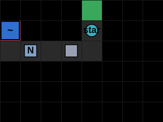
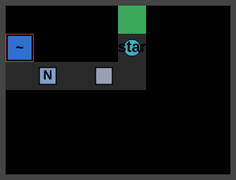

# Content sets TILE-3: the maze editor places a pack-declared tile kind

Branch `content-tile3`, based on `origin/content-tile2` `3cc9fa2a51` (TILE-2, frozen and queued). This follows
TILE-2's report § 3.1, option B.

⚖ Robert, 2026-11-17T22:59:21Z:
- placement: *"Editor first, then generator (Recommended)"*;
- passability: *"I will eventually want passability to be declared, and I might want more types than just passable and
  impassable, but we can go with "placed kinds are walkable" for now."*

## Commits

| # | SHA | What |
|---|---|---|
| 1/4 | `b1d3cd9809` | **The field.** `tileKinds` (`mazeTileKinds.js`): the schema row, the deserializer copies, the round trip, refusals by name |
| 2/4 | `d28f833353` | **The painters.** The Maze Room panel and the composite map cell draw placed kinds through the chain |
| 3/4 | `c91824e924` | **The editor.** The `setTileKind` op, the **Tile kind** palette entry, copy/paste, the lab's `?packs=` and its picker |
| 4/4 | `37e50acecf` | **The proof.** `mazeTileKindEditor.test.js` |
| docs | `563ee4799c` | `maze.md`, `packs/README.md`, the `?packs=` URL-grammar row and its glossary term, the regenerated reference |
| — | this commit | This report and its screenshots |

## 1. The field

A region payload may carry `tileKinds: [{x, y, kind}]`. `kind` is a pack concept key whose row declares a tile `base`
(TILE-2).

- **Its declaration.** A `TILE_GRID_SIDECAR_FIELDS` row: optional, with an item schema of `x`, `y` and `kind`, and no
  other field. `check-sidecar-fields.mjs` holds every committed entry to it: ALL PASS. `rules.schema.json` needs **no**
  change, because its `playable_payload` is opaque and points at the substrate's declaration. So the re-merge risk the
  brief expected there does not arise.
- **Written** by `serializeMazeWorld`, and only when the world has a kind, so a world without one is byte-equal.
  `serializeMazeLevel` (the lab level's payload) writes it the same way, so `worldsEqual` sees a placed or removed kind.
- **Read back.** The engine's `deserializeMazeWorld` is in the engine closure and copies named fields, so it drops the
  field. `withTileKinds` copies it back, the way `thingsDeserializer` does for `things`, in four places:
  - the registry entry's `deserializeWorld`, which every view reads;
  - the SET arm's entry capture (`mazeSetAdapter`);
  - the round trip's `open`;
  - `procgenMaze.deserializeMazeLevel`.
- **`cloneWorld`** copies the Map. A spread would have shared it between a world and its clone.
- **The round trip.**
  - `open` carries the kinds into the lab's library entry, and an unedited save writes them back unchanged.
  - The re-stamp no longer copies the document's `tileKinds` back over a save that removed them. It copies back "any
    key the original had and the save does not", which would otherwise undo a removal. A mutation of that line reds
    the pin.
- **⛔ No logic** (the ruling: placed kinds are walkable). The grid under a kind stays floor, and nothing that reads
  reachability sees the field. The pin puts a kind on **every** free cell and checks that `extractPathsAndObstacles` +
  `compileRegion` give the same JSON. The proof also checks that the save's re-derived exits and locations equal an
  unedited save's.

**Refused by name** (`TILE_KIND_REFUSALS`):

| where | refusal |
|---|---|
| the payload (`withTileKinds`, no packs needed) | not an array; an entry that is not an object; an unknown field; no integer `x`, `y`; a kind that is not a pack concept key; out of bounds; **not a floor cell**; two kinds on one cell |
| against the loaded packs (`tileKindRefusal`) | **a kind no loaded pack declares** (`tile kind "…" is declared by no loaded pack (the stack declares …)`); **a wall-based kind** (`… has base "wall": a placed kind is walkable (⚖ 2026-11-17), so a wall look would lie about the cell`) |
| the editor | no packs loaded; a wall cell; an **occupied** cell (`occupiedWorldCells`, `mazeThings`' occupancy rule read off the world: anything else that names the cell, including things) |
| the round trip's save | a kind on a region **thing**'s cell. The lab never sees things, so it cannot refuse the press there; the save refuses it rather than `reseatThings` silently moving the thing |

**A draw never throws.** In a view, a kind the stack does not declare draws TILE-1's placeholder. A wall-based kind
draws its base. The Maze Room panel's `getTileKindStatus()` lists the placed kinds the loaded packs refuse, so an
in-app row can read them.

## 2. The painters

`mazeTileKindOverlay.drawMazeTileKinds(ctx, world, view)` is a sibling pass beside `drawWorld`, following the
`mazeThingOverlay` pattern. For each placed kind it calls
`drawMazeTile(ctx, tileArt, kind, …, mazeTileKind(kind, { tileKinds }))`. It skips a kind under the fog until seen, and
on the player's cell, the same way it treats a thing.
- **Maze Room panel:** it draws right after `drawWorld`, but only once the world's stack has resolved, so the panel
  never shows a placeholder that the load would then replace. A stack that declares kinds triggers a redraw when it
  lands, even with no art.
- **Composite map cell:** it draws after the markers and before the things, using the cached load's declared kinds.
  `geom.tileKinds` lets a host pass them in, as `geom.tileArt` already does.
- **A world with no placed kind draws nothing more.** The pass records zero ops, and the composite cell's log is the
  same with and without declared kinds handed in (pinned).

## 3. The editor

- **The op.** `setTileKind {x, y, kind}` joins `EDIT_OPS`, so `mazeEditAdapter.test.js`'s sample table gained its row.
  It is checked against the declared kinds that `applyEditOp(…, { tileKinds })` receives. Placing a kind on a cell
  that already holds the same kind says "already holds", and a different kind replaces it.
- **A cell that holds a kind takes nothing else.** Every other op on it is refused (`occupied-tile-kind`), except
  `setTile floor` and `clearEntity`, and **Erase entity** removes the kind.
- **The palette entry** **Tile kind** (`PALETTE_TYPES.TILE_KIND`) uses the editor's `selectedTileKind`.
  `setTileKinds(declared)` offers every declared kind except a wall-based one (`placeableTileKinds`).
- **Copy, paste and move** carry a kind: `readMazeCell` reports it as a part of the cell, and `mazeWriteOps` writes it
  back. The adapter takes the declared kinds, as an object or as a getter.
- **The lab page:**
  - `?packs=a,b` loads that stack with `loadMazeTileArt` and the maze's roles. Its declared kinds feed both arms'
    editors and one page adapter, which reads the current set at each apply, so a session opened before the packs
    landed still checks against them.
  - A **tile kind** picker sits beside the canvas, outside both palette boxes, which are enumerated (`#labPalette`,
    `#labSetPalette`). Its note says how the load went.
  - The canvas draws the placed kinds.
  - `?packs=` is in the generated URL grammar. Its row needs a glossary term, so the glossary gains `content-pack`;
    the glossary test's pinned count goes from 166 to 167, with the reason written in the test.
- `check-maze-lab.mjs` now reads the palette count from `PALETTE_ENTRIES`. It had been a literal 9, the kind of number
  a test should get from the data.
- **The Maze Room panel's own palette does not offer Tile kind.** That editor has no kind picker, and the brief scopes
  the tool to the lab.

## 4. The proof

`mazeTileKindEditor.test.js` uses a **test-only in-memory fixture pack** `tile3-fixture`. It declares
`tile3-fixture:object/lantern` (base `marker`; an art key no theme carries) and `tile3-fixture:object/pillar` (base
`wall`). Committed packs come from disk and the fixture from memory. No committed preset or pack gains it:
`git diff 3cc9fa2a51 -- frontend/presets` is empty, and `frontend/packs` changes only `README.md`.

- **Every refusal of part 1 pinned:**
  - no packs;
  - undeclared;
  - wall-based;
  - wall cell;
  - the entrance;
  - a thing's cell;
  - entity and wall ops on a kind's cell;
  - plus `mazeTileKinds.test.js`'s payload refusals and the save's thing refusal.
- **In a real world.** The test uses the meta trial's maze region that holds a thing, read off the data, and runs this
  path:
  1. `mazeRegionRoundTrip.open` builds the one-entry library;
  2. the lab's set session opens room 0, as `mazeLabView` does;
  3. the palette's `opFor` creates the press;
  4. `closeRoomSession` folds the room back into the library;
  5. `mazeRegionRoundTrip.save` writes the payload;
  6. the reload goes through the registry deserializer, and a second `open`.

  The payload carries `tileKinds: [{x, y, kind: lantern}]`. The re-derived exits and locations equal an unedited
  save's, and the thing is unmoved. Both views, with no theme art and with the `meta` theme, contain exactly
  `paintMazeTileBase(marker)` at the kind's cell (offset on the composite map). No warning is logged and nothing
  throws.

**Screenshots** (`content-sets-tile3/`). The browser was Playwright. The fixture pack and the library were served by
route interception, so nothing was written to disk. The lab page is the real one; its SET arm was opened on the round
trip's library with `?packs=maze,meta,tile3-fixture`:

| | |
|---|---|
| The lab after two **Tile kind** presses on free cells: two marker bases (the room draws no theme art in the lab) |  |
| The SET arm's palette with the new entry armed |  |
| The saved, reloaded payload in the Maze Room panel's draw (`drawWorld` + `drawMazeTileKinds` + things), the `meta` theme: the marker square right of the sign |  |
| The same on the composite map cell, the `meta` theme |  |
| Both views with the default `maze` pack only (no art) |   |

The page reported no errors. The picker note read `packs maze, meta, tile3-fixture: 1 placeable tile kind` (the
pillar is wall-based, so it is not offered), and the status line read
`Placed tile kind tile3-fixture:object/lantern at (2,2).`

No in-app row was added (optional in the brief). The two views' draws are pinned in node, and the lab's palette count
is covered by `check-maze-lab`.

## 5. Closure, byte-equality and op-log identity

| Instrument | Result |
|---|---|
| `--print-engine-closure` at base and tip | **identical** (`engineMd5 bec369878feb67081187edca62baa951`, 42 files); no file of the diff is in it, and `mazeTileKinds.test.js` pins that neither new module is |
| **Op-log probe.** Run in this tree at the tip, and again with every changed file reverted to `3cc9fa2a51` and the new ones removed. It covers every maze region of every committed `*_rules.json`: the panel draw (`drawWorld` + things + the new pass, when present) in plain and fog views under three art variants, plus the composite cell from the registry's world under the same three | 38 documents, 1,188 regions, 5,743,490 ops on both sides. Hashes base = tip: none `b509a58983c56972508a17dc28804562`, `meta` `d49dd3ea56bcef9da2438dd5c50a08dc`, every-key `14be373af5d733009cd41174cfe93479`, composite `31d296316b6de630b87823e7e419f345` |
| `make-seedling-spiral-room-preset.mjs --state=concept-trial --check` / `--state=meta-trial --check` | both OK |
| `action-nodes-compile.mjs --check` | OK, byte-identical |
| `check-sidecar-fields.mjs` | ALL PASS: 2,264 entries over 10 substrates, 0 issues |
| The round trip's existing byte-for-byte unedited-save pins (`apworldEditor/`) | pass |

## 6. Gates (local)

- **Bounded vitest:** `mazeRoom` (all of it, including the editor tests `mazeRoomEditor`, `mazeEditAdapter`,
  `mazeEditTools`, `mazeEditorSurface` and the three new files), `apworldEditor`, `procgenCore`, `contentPacks`,
  `packConcepts` and `textAdventureSubstrateWrapper`: 223 files, 6,096 tests, all passed before the new test files
  were added. The new files add 32 tests, all passing. `procgenDocs`: 8 files, 496 tests, all passed.
- `generate-procgen-reference.mjs --check`: ALL 7 GENERATED MODULES AND 5 MARKDOWN REGIONS MATCH THE CODE.
- `check-procgen-docs.mjs`: ALL CHECKS PASSED. `check-maze-lab.mjs`: ALL CHECKS PASSED (the box was free).
- CI at the final tip: quoted in the report back.

## 7. Test paths

- `frontend/modules/mazeRoom/mazeTileKinds.test.js` (new): the field, its refusals, the round trip, no logic, the
  closure.
- `frontend/modules/mazeRoom/mazeTileKindOverlay.test.js` (new): both views; absent means nothing drawn; fog and the
  player.
- `frontend/modules/mazeRoom/mazeTileKindEditor.test.js` (new): the op, the palette, every refusal, copy/paste, the
  proof, and `?packs=`.
- `frontend/modules/mazeRoom/mazeEditAdapter.test.js`: the `setTileKind` sample row and its options.
- `frontend/modules/procgenDocs/glossary.test.js`: 167, with its reason.
- `scripts/procgen/check-maze-lab.mjs`: the palette count is read, not a literal.

## 8. What the code overturned

1. **`rules.schema.json` is not touched.** The brief expected a schema edit and a re-merge there, but the payload is
   opaque in that schema and the field is declared on the substrate (`TILE_GRID_SIDECAR_FIELDS`).
2. **"Placing under a thing is refused" cannot happen in the lab.** The lab never sees a region's things: they ride
   the round trip, and the capture path drops them. The refusal therefore lives at the APWorld editor's **save**, by
   name. In the lab itself, the occupancy rule refuses everything the room holds.
3. **The re-stamp would have undone a removal.** The round trip copies back "any key the original had and the save
   does not" (written for `fogEnabled`). Without an exclusion, removing the last kind in the lab would have come back
   on save. It is excluded and pinned.
4. **The engine's deserializer drops the field**, and it is in the closure. Every reader therefore goes through
   `withTileKinds` (four call sites). A reader that calls the engine directly sees no kinds. The lab's overview
   thumbnails (`mazeSetLab.makeDrawRoomStill`) are such a reader and are left as they are.
5. **A glossary term was needed.** The URL grammar requires every parameter to name one, and none defined a content
   pack.

## 9. Next slice's line

The two later steps from Robert's rulings, both his to schedule:
- **A generator rule that places declared kinds.** It needs rulings on which concepts qualify (any row with a base, or
  a maze `tile` role), how many go in a region, and by what hash, since there is no RNG draw.
- **Declared passability**, with more than two values per Robert. That is logic, so it brings the field into the
  engine closure's concerns and the derived-rule pins.

Smaller follow-ups:
- The APWorld editor could pass the document's content stack to the lab, so `?packs=` is filled for the user (today
  the lab is told by hand).
- The Maze Room panel's own palette could offer **Tile kind** once it has a picker.
