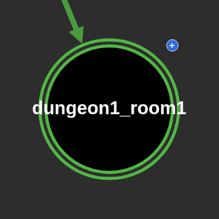
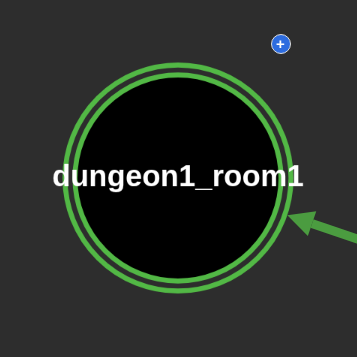

# Region Graph: the + / − badge follows a node that changes size

**Status: built, gated.** A collapsible group's + / − badge now re-places itself when its node changes SIZE without
moving. Before, it stayed at the old corner until something else (a pan, a zoom, a drag, a layout) moved it.

Planner: archipelago-cc-23. Reviewer and landing queue: js-23.
Cut from `region-graph-direction-layout` @ `2c939354c5` (train 222; js-23's GO), so this branch builds on the merged row
as it will land. `git merge-base HEAD origin/main` at launch = `16acf42ce6d9dab534d1af59c2641e24443f1abf`.
The slice's own diff vs `2c939354c5` is four files (§5). The **packet tip is `fbfbb6de4e`**, and every gate in §4 ran
there. This report and its shots are committed after it; they touch no code that CI runs.

## ⚖ The ruling (session 84c8ab35)

- **2026-11-26T19:13:17.431Z**: *"Yes, please make the badge fix."* — the answer to the planner's report of
  direction-layout's note (its report §10b): *"When a region's node changes size without moving, for example when
  switching to the Region Map look, its + badge can end up about 5 px off the corner. It still covers the corner and
  taps still hit it, so it's cosmetic. It's a one-line fix."*

## 1. The cause

`frontend/modules/regionGraph/groupBadgeLayer.js` placed each badge on its node's rendered top-right corner, one
animation frame after a `position` event on a node, or a `viewport` / `resize` / `layoutstop` on the graph. A node that
changes size in place fires none of those. The map look gives a node a `width` / `height` style bypass and takes it
away again. A class can change a size, and so can a data-mapped size. An open box grows round a member that grew.
Each of these resizes a node with no position or viewport event, so the badge kept the old corner. direction-layout
measured dx −4.8, dy 3.8 px on an 85 × 64 node.

Cytoscape's only event for a size change is `style`. Its `updateStyle` emits `style` for every element whose style it
recomputes: a class change, a data change, a bypass (`ele.style(…)`), a `removeStyle`. With compound nodes, it also
emits for the parents and descendants. `style` also fires for changes that keep the size: selection, colour, hover.

## 2. The fix

The layer also listens to `style` on nodes (`cy.on('style', 'node', …)`):

- A `style` on a node that carries a badge, or on a member inside a badge box, asks for **a size check** on the next
  frame. A `style` on any other node returns at once: no frame, no work.
- The frame shares the existing one-rAF coalescing. A move or view change still runs `sync()` unconditionally. A size
  check alone compares each badge node's model size (`boundingBox({ includeLabels: false })`, `w×h`) with the size
  the last `sync()` placed it at, and calls `sync()` only if one differs. A colour change on a badge node costs one
  frame with a few size reads and **no sync**.
- The size is read in the frame, not in the handler, because Cytoscape marks the style dirty after it emits.
- Nothing else changed. The badge's look, its size (`BADGE_SIZE_PX` 20) and hit square (`BADGE_HIT_PX` 36) are the
  same, as are the hidden-below-`showRegionNames` rule, the button's events and every other reader. In any view but
  `collapsible` the layer holds no badges, so the handler returns at its first line.

## 3. The numbers

**Before / after, in the real app** (`scripts/dev/shot-region-graph-badge-resize.mjs`, local :8143, seedling_atlas,
collapsible, zoom 3 on closed `dungeon1_room1`). The probe gives the node the map look's size bypass for a square cell
(`MAP_NODE_LONG_PX` × `MAP_NODE_LONG_PX` = 72 × 72, from 72 × 52). That fires 0 position or viewport events. The probe
waits two frames, then measures the badge centre against the node's rendered top-right corner:

| | settled | resized (72 × 52 → 72 × 72) | bypass removed |
|---|---|---|---|
| before (layer at `2c939354c5`) | dx 0, dy 0 | **dx 0, dy 30.00** | dx 0, dy 0 (the node came back to the badge) |
| after (this slice) | dx 0, dy 0 | **dx 0, dy 0** | dx 0, dy 0 |

At zoom 3 the node's top edge rose 30 rendered px (20 model px ÷ 2 × 3), and before the fix the badge stayed below
it.

**Vitest** (`subRegionView.collapsible.test.js`, a headless Cytoscape with its style ON and `requestAnimationFrame`
stubbed so frames are counted):
- A resize by bypass (0 position / viewport events): the badge is off the corner until the frame runs. Exactly one
  frame is scheduled, and it runs **one** sync, after which the badge is on the corner (|d| < 1e-6). Removing the
  bypass gives one more sync, and the badge is on the corner again.
- A colour bypass on a badge node plus a size-less class on another one: one frame, **0 syncs**.
- A size bypass on a node with no badge (not a group, not in a box): **0 frames**.
- An open box resized by a member's size bypass: one sync, and the − badge is on the box's corner.
- Control: both new tests FAIL on the layer at `2c939354c5`.

**In-app** (`test_region_graph_sub_region_merged`): one added condition after the + badge settles in collapsible
(after the map look): `|dx|, |dy| ≤ 0.5 px`. It reads the same `badgeState()` the hit-test already computed, so it adds no
wait: **~0 s**, under the 0.2 s cap. Locally both boots read |dx| 0.00, |dy| 0.00.
Caveat: locally the old layer read 0.00 too. The resize race that direction-layout saw in CI does not happen on this box
when the row runs alone. The probe and the vitest are the discriminating checks, and the in-app condition guards the
CI case.

## 4. Gates

**Packet tip `fbfbb6de4e`** = this slice + main `d05f789087` (merged twice: `754b1909bb`, then `d05f789087`) +
direction-layout's FINAL head `b3376a2f61` (merged at js-23's and direction-layout's word; it moved twice during this slice,
`0ccd10dae8` then `b3376a2f61`, both test-only changes in the merged row). Every gate below ran at that exact SHA.

- **JSUT** run 45898248511 (headSha `fbfbb6de4e`): success. Suite **1454 files / 30383 tests**, 0 failed; slow battery
  42 / 470. vs main `d05f789087` (run 45879470548: 1453 / 30348): **+1 F / +35 T**. This slice's own share is **+0 F / +2 T**
  (`subRegionView.collapsible.test.js` 22 → 24). The rest comes from 222's merged files: `directionLayout.test.js` (+1 F,
  32 T) and +1 T elsewhere in 222.
- **unittests** run 45898248612: success.
- **TT** run 45898248304: success (every on-push batch green).
- **Repeat ×8 of `test_region_graph_sub_region_merged`** at the tip: **ES 8/8** (45898254816), **bundled 8/8**
  (45898251541).
  Earlier tips, for the record: at `441daab062` 8/8 and 8/8 (45895589831, 45895586530). At `247146817c`, ES 8/8 and
  bundled **7/8** (45883799315). That one red was in the merged + map **square-click** step: *"an uncovered point lies on
  a location square (1 squares; centres covered by: nothing)"*. js-23 attributed it to 222's step: in `merged` the badge
  layer holds no badges, so the new handler returns at its first line. direction-layout fixed it on its side (a stable
  paint whose squares lie on their nodes), and that fix is in this tip.
- **Headroom** (fast batch, 600 s budget). Main `d05f789087`, 3 TT samples (45899664039, 45894784399, 45879472826):
  fast 327.1 / 329.1 / 331.8 s, **median 329.1**; fast-bundled 342.3 / 319.5 / 330.8 s, **median 330.8**.

  | tip sample | fast | Δ median | fast-bundled | Δ median |
  |---|---|---|---|---|
  | TT 45898248304 | 331.9 s (55%) | +2.8 | 321.3 s (54%) | −9.5 |
  | re-sample TT 45901650293 | 339.9 s (57%) | +10.8 | 320.0 s (53%) | −10.8 |

  Both are well inside +20 s and 70%. The added in-app condition costs ~0 s (it adds no wait).
- **Closure ∩ diff = ∅**: 0 of the 42 files of `node scripts/procgen/seedlingDerivedRuleTable.js --print-engine-closure`
  are in `git diff --name-only origin/main...HEAD`. **engineMd5 `74ae60f575531492ed9eaec1839e1fe3`** at the tip = base.
- **0 gitlinks** in the diff (`git diff origin/main...HEAD --submodule=short` has no `+Subproject`).
- **Bounded vitest** (⚖ 52): `npx vitest run frontend/modules/regionGraph/ <every test importing a touched file>
  --maxWorkers=3`, 21 files / 311 tests green at the tip. The files: the regionGraph directory, testDiscovery,
  bundledTestCases, testLogic, quickLaunchImportOrder, documentLibrary, inAppSummary, compare-runs.
- A JSUT red at `247146817c` (45883742530) was this slice's own vitest: `toEqual({dx: 0, dy: 0})` read dy 1.4e-14 (the
  layer writes `left = c − 18` and the test reads it back + 18). It is fixed in the test (`8f195fa9e1`, |d| < 1e-6).

## 5. Files

Diff vs `2c939354c5` (the slice's own; until 222 lands, a diff vs main also shows 222's files):
- `frontend/modules/regionGraph/groupBadgeLayer.js`: the `style` listener, the size check and `syncCount`.
- `frontend/modules/regionGraph/subRegionView.collapsible.test.js`: the two vitest cases (and `badgeUi({ styled })`).
- `frontend/modules/tests/testCases/regionGraphPanelTests.js`: the one in-app condition (and the stale comment that
  said the badge "can sit a few px off").
- `scripts/dev/shot-region-graph-badge-resize.mjs`: the before / after probe and shot.
- This report and `badge-resize-shots/`.
0 gitlinks.
