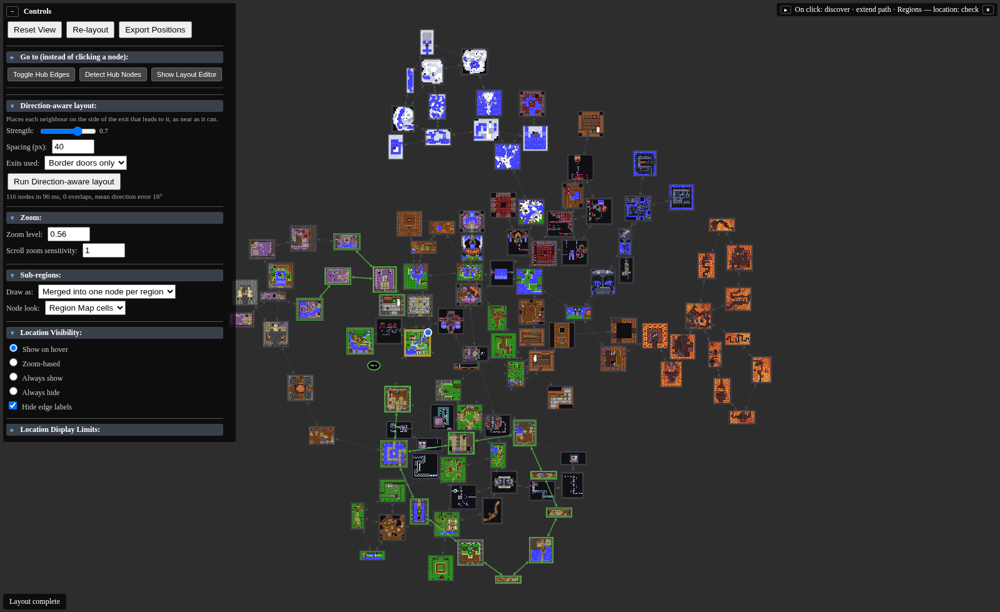
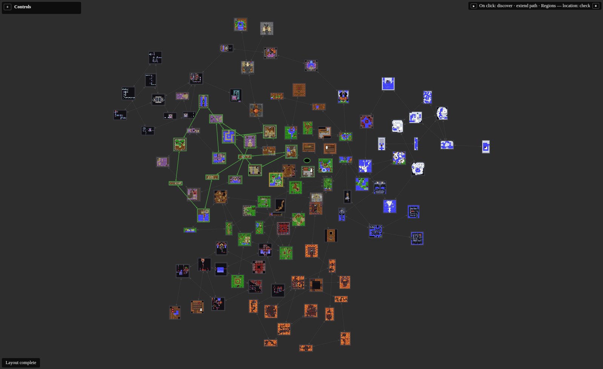
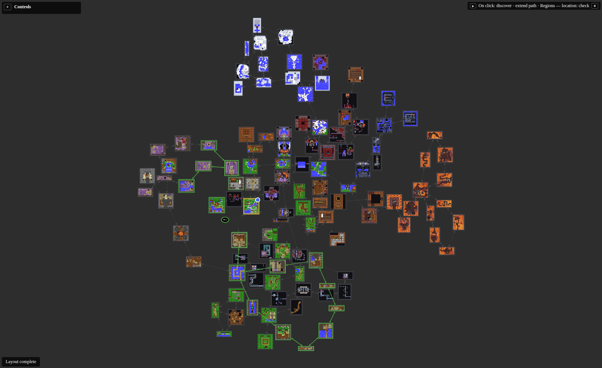
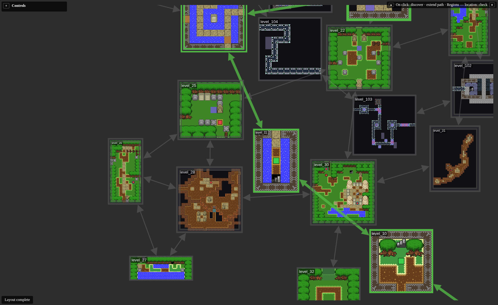
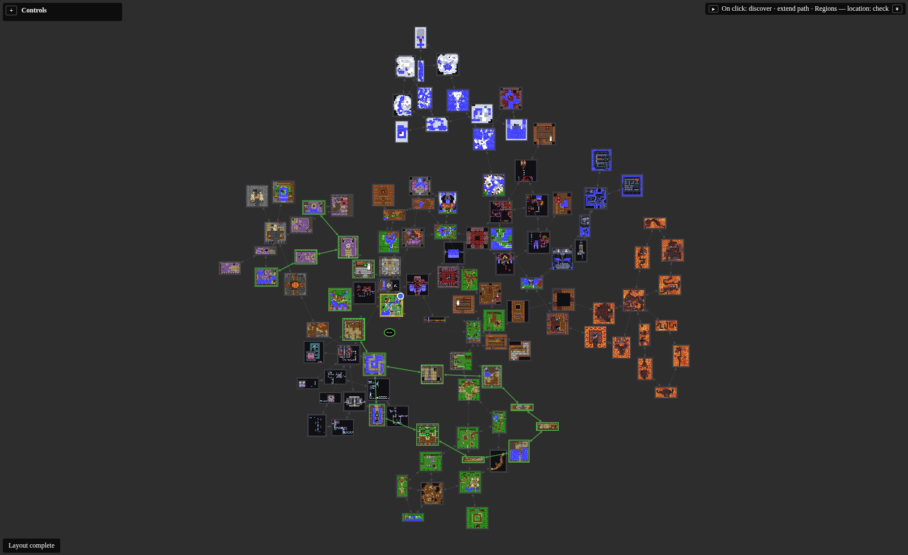
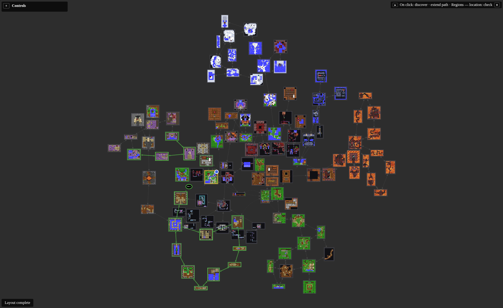
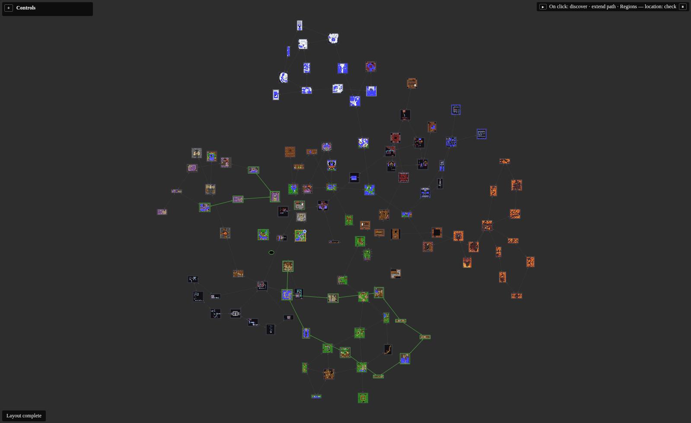

# Region Graph: the Direction-aware layout

**Status: built, gated.** The Region Graph has a new layout, **Direction-aware**. It places each neighbouring region
on the side of the exit that leads to it, the way a map would, as a soft preference: nothing is pinned, and when two
neighbours want the same spot (or the exits disagree) each lands as near its own exit's direction as the others allow.
Three settings let you experiment: **Strength**, **Spacing** and **Exits used**.

Base: `0defd21f75` (`git merge-base HEAD origin/main` at launch = `0defd21f75472cd3d0443ac3ff699dc8c5412e59`).
origin/main did not move during the slice, so no merge was needed. The **packet tip is `8b251b353c`**, and every gate
in §9 ran there. This report and its shots are committed after it; they touch no code that CI runs.
Planner: archipelago-cc-23. Reviewer and landing queue: js-23.

## ⚖ The rulings (session 84c8ab35)

- **2026-11-26T02:25:14.974Z** (its 2nd paragraph): *"after that, I'll want to experiment with some advanced layout
  settings for the Region Graph. Is there a way to tell it to prefer for neighboring regions to be placed according to
  the direction of their exits?"*
- **2026-11-26T02:33:46.839Z**: *"One complication we encountered in arranging the nodes in the Region Map is that some
  regions have exits to two different regions along the same side. I'll want the new layout code to be able to handle
  this by putting the nodes as close as it can to the preferred layout, not by having the nodes in fixed positions
  relative to each other."*
- **2026-11-26T02:29:27.084Z** (the map-look narrowing): the map look applies only in `merged`. So the rectangle
  no-overlap test runs in merged + map, and the ellipse one in every view.

So the preference is SOFT. Hard relative-placement constraints (fcose's `relativePlacementConstraint`, "B is right of
A") were ruled out as the mechanism, and none is used.

js-23's review (GO WITH 5 EDITS) is answered here:
- edit 1, node looks: §5 (map rectangles in merged + map; ellipse boxes in all four views);
- edit 2, the longest main-thread block: §7 (554 ms at most, under 1 s: no chunking);
- edit 3, the in-app cost: §8 (seedling_atlas `merged`, the step placed at once, ~21 ms locally; ≈ +0.1–0.4 s ES and ≈ 0 bundled in CI);
- edit 4, collapsible: §4 (it KEEPS positions on open / close; pinned);
- edit 5, determinism: §3 (node ids sorted, no `Math.random`, no clock; pinned across insertion orders).

## 1. What the user sees

**Controls → Direction-aware layout** (a new section), or **Direction-aware (exit sides)** in the Layout Editor's
**Layout Preset** list:

seedling_playthrough, Draw as **Merged**, Node look **Region Map cells**, 116 nodes:

| Force-Directed (fcose), today | Direction-aware, default (strength 0.7) |
|---|---|
|  |  |

With fcose a level's neighbours land anywhere round it (mean direction error 86–100°, about what a random placement
gives). With Direction-aware the snowy levels sit together at the top, the lava levels on the right, the overworld
below, and each neighbour sits on the side its door is on (mean error 18°).

The two-on-one-side case, zoomed: `level_26` (left) has two doors on its east edge, one near the top (to `level_25`)
and one near the bottom (to `level_28`). `level_25` lands up-right and `level_28` down-right, both on its east side,
apart:

A world without door positions keeps its look: alttp opens with its default layout, unchanged
(`alttp-default.png`), and Direction-aware there is a plain spring layout (0 edges with a direction, 0 overlaps).
The 390 px phone (merged + map, Direction-aware): `phone-390-direction.png` (no horizontal scroll).

## 2. The settings, and what each does

| Setting | Key | Range | Default | What it does |
|---|---|---|---|---|
| **Strength** | `moduleSettings.regionGraph.directionStrength` | 0 – 1 (slider, step 0.05) | 0.7 | The weight of the direction pull against the plain length spring. 0 ignores the exits (a spring layout); 1 is as map-like as the graph allows. |
| **Spacing (px)** | `moduleSettings.regionGraph.directionSpacing` | 0 – 300 | 40 | The gap aimed for between two neighbours' borders (and the repulsion's scale). |
| **Exits used** | `moduleSettings.regionGraph.directionExits` | `border` \| `all` | `border` | Which exits give a direction: doors on a level's border (walk-off-the-edge), or every door with a position (staircases and teleporters inside a level too). |

Each is a declared key in the panel's settings schema; its `default` there is the only default (no call-site
default), and an out-of-range or wrong-type value reads clamped or as the default. A write never rebuilds the graph:
it re-runs the layout if Direction-aware is the one shown, else it is used next time.

To start experimenting:

| Strength 0.3 | Strength 1 | Strength 0.7, Spacing 120 |
|---|---|---|
|  |  |  |
| mean 27°, p90 59° | mean 15°, p90 30° | mean 16°, p90 35° |

- **Strength** below ~0.3 starts to let the length springs win; at 1 the arrangement is the most map-like, and
  conflicts (a loop of exits that cannot all be satisfied) show up as the few long edges.
- **Spacing** spreads everything out, and gives the pulls more room: at 120 the direction error is lower than at 40.
- **Exits used = All doors** adds the doors inside levels. On seedling_playthrough that is 108 more exits; they pull
  towards where the door sits in its level, which for a teleporter often has nothing to do with where its target is,
  so the map reads less cleanly (the Region Map's own arrangement scores 46–50° against "all" but 29–34° against
  "border").

## 3. The mechanism

`frontend/modules/regionGraph/directionLayout.js` (pure: no DOM, no Cytoscape, no substrate named).

**The preferred offset per exit (`doorOffset`).** The door tile `(x, y)` (`regionMapModel.exitTileOf`, in its level's
tiles) and the level's extent `W × H` (the Region Map model's cell extent: `compositeMap.regionExtent`, through the
registry):

    u = (x + ½) / W − ½,   v = (y + ½) / H − ½            (+u right, +v down)
    side  = E / W when |u| ≥ |v| (sign of u), else S / N (sign of v)
    along = 2v on E / W, 2u on N / S                       (−1 .. 1: the top / left end .. the bottom / right end)
    dir   = normalise(the side's outward normal + DOOR_TILT · along · the side's direction)   DOOR_TILT = 0.5
    weight = 1 for a door on the border, else min(1, 2·max(|u|, |v|))

So the middle of the east edge points straight right, its top end up-right (≈ 24°), its bottom end down-right: two
doors on one side point to two spots, and never past the side's own 45° wedge. No tile, no extent, or a door at the
exact centre: no preference.

**The preference per drawn edge (`edgePreferences`).** An edge S–T sums every S→T exit's weighted direction and every
T→S exit's NEGATED one (T's west door means T is east of S). A merged node stands for its members, so its edges take
every member's exits (B's merge rule keeps every exit). Weight = `|Σ wᵢ·dᵢ| / n`, so disagreeing exits weaken each other.

**The layout (`directionLayout`): a vector-spring relaxation.** Every edge is a spring whose rest state is a VECTOR:
with strength s and an edge preference (d, ω), it pulls the target towards `source + L·d` with weight s·ω, and towards
distance L with weight 1 − s·ω. L is the centre distance at which the two drawn boxes just clear along that direction,
plus the spacing. All pairs repel (Fruchterman–Reingold, k²/r, k² = 0.02·L̄²), overlapping boxes (plus half the spacing)
are pushed apart, a weak gravity holds each component together, and moves are capped by a linear cooling temperature
(300 iterations). The start is a BFS seed from the highest-degree node that already puts each neighbour on its
preferred side. Components lay out alone and are shelf-packed. A last pass separates any boxes still overlapping (pairs
pushed apart, then a 5 % scale about the centre if it stalls): it always ends at 0 overlaps.

Why this and not the alternatives: no bundled layout has a per-edge preferred VECTOR (fcose / cose-base expose an
ideal LENGTH per edge, and relative-placement constraints, which are hard and ruled out). A direction-seeded start
relaxed by fcose with `randomize: false` was the other candidate; fcose then pulls only on length, so the direction
survives only as far as the seed does, and the strength would have nothing to weigh. The vector spring IS the soft
preference: it is a force, not a constraint, and its weight is the Strength setting. No new library.

The tuning (repulsion 0.02, gravity 0.05, 300 iterations, tilt 0.5) was chosen on seedling_playthrough: repulsion is
the knob that matters (0.25 → 0.02 took merged's mean error at strength 0.7 from 45° to 20°); 600 iterations bought
nothing.

**Deterministic.** Nodes are sorted by id and edges oriented smaller→larger id and sorted before anything is read; the
seed's ties break by id; no `Math.random`, no clock, no caller-ordered Map/Set iteration. Pinned: two panel builds give
the same positions digest, and so do the inputs reversed, rotated, and with every edge's ends swapped. The browser
runs reproduce every angle error to 0.1° across two runs.

**Writes positions like every layout.** The panel's glue (`layoutControlsManager.js`: `directionLayoutInputs` →
`buildDirectionLayout` → `runDirectionLayout`) reads the graph AS DRAWN (`outerWidth` × `outerHeight`, so the map
look's rectangles in merged + map), runs the result as a Cytoscape `preset` layout (animated 1 s, fit), and the panel's
own layoutstop handler saves the positions into the view's own store (`separate` / `merged` / `collapsible`). The
player marker is a locked node no layout moves, so this layout re-seats it on its region when it stops (pinned).

## 4. Views and node looks

- **separate / nested**: every region its own node; a `nested` box's members carry their box as a `group` and are
  pulled a little towards their common centre, so a box stays compact. The box itself is placed by its members (not
  laid out).
- **merged**: a group node takes its members' exits.
- **collapsible**: closed groups as merged, open members as nested. Opening or closing a group **KEEPS the positions**
  (the panel's own open / close placement, groups-c §4): the layout does not re-run. Pinned: an open + close runs no
  layout and moves no other node, and a re-run of the layout afterwards gives the same digest as before.
- **Node look**: graph (the ellipse's box) everywhere; Region Map cells (the rectangle, `mapNodeSize`) in merged.
- Saved positions stay per value, as before.

## 5. The counts per preset

| preset | exits | with a direction (border) | without | border doors | regions with 2+ targets on one side | levels with 2+ targets on one side |
|---|---|---|---|---|---|---|
| seedling_playthrough | 320 | 208 | 112 | 208 | 4 (rules regions) | **13** (display levels) |
| seedling_playthrough_maze | 322 | 0 | 322 | 0 | 0 | 0 |
| alttp | — (no sidecars) | 0 | — | 0 | 0 | 0 |

With **All doors**, seedling_playthrough has 316 exits with a direction (4 without: no tile or no extent).

⚠ **The maze presets get no direction.** Their exits carry door tiles (`x, y`), but the maze substrate declares no
`compositeMap.regionExtent`, so the model has no level size to place a door against. Adding one would also re-size the
Region Map's maze cells (it sizes cells by that hook), which is the Region Map's layout and out of scope. Follow-up 1.

## 6. Two exits on one side

On the frozen seedling_playthrough, `merged`, default settings: **13 levels** have border doors to two or more
different levels on one side, **26 neighbours** in all. Every one lands **within 45°** of its own preferred direction
(N = 45°: the side's own wedge; the worst is 40.3°), the two (or more) of each level at different spots, with 0 overlaps
(vitest §6). The 13: `level_113` N, `level_12` N and W, `level_26` E, `level_29` W, `level_52` W, `level_62` S,
`level_71` E and S, `level_74` S, `level_78` N, `level_89` N, `level_92` S.

## 7. The numbers (browser, Chromium headless, this box)

Mean / 90th-percentile angle error between each edge's preferred and actual direction (edges with a preference), the
overlaps between drawn boxes, the time of the one main-thread block (`totalMs`: inputs + layout) and the longest task
seen (PerformanceObserver `longtask`). Exits used = border, spacing 40. fcose = the Force-Directed preset, 3 runs.

**seedling_playthrough, separate** (307 nodes, 575 edges, 107 with a direction; ellipse boxes):

| layout | mean | p90 | overlaps | totalMs | longest task |
|---|---|---|---|---|---|
| fcose (3 runs) | 88 / 87 / 80° | 165 / 162 / 157° | 12 / 7 / 4 | 587 / 362 / 377 | — |
| strength 0 | 89.5° | 158.8° | 0 | 345 | 378 ms |
| strength 0.3 | 44.7° | 109.0° | 0 | 298 | 326 ms |
| **strength 0.7 (default)** | **28.4°** | **64.1°** | **0** | 337 (280 repeat) | 369 ms |
| strength 1 | 20.3° | 43.0° | 0 | 560 | 594 ms |

**seedling_playthrough, merged + map** (116 nodes, 139 edges, 99 with a direction; the map rectangles):

| layout | mean | p90 | overlaps | totalMs | longest task |
|---|---|---|---|---|---|
| fcose (3 runs) | 95 / 100 / 86° | 165 / 172 / 165° | 1 / 0 / 3 | 63 / 64 / 56 | — |
| strength 0 | 97.6° | 161.4° | 0 | 108 | 118 ms |
| strength 0.3 | 27.3° | 58.8° | 0 | 73 | 90 ms |
| **strength 0.7 (default)** | **18.4°** | **38.8°** | **0** | 70 | 79 ms |
| strength 1 | 15.2° | 30.0° | 0 | 65 | 79 ms |

**seedling_playthrough_maze** (307 nodes in both views: no sub-regions; 0 edges with a direction, §5): Direction-aware
is the plain spring layout there, 0 overlaps at every strength, 249–330 ms (longest task ≤ 368 ms); fcose overlaps
4–7 (separate) and 10–17 (merged) boxes, 411–647 ms.

- **The 3 s STOP is far away**: the largest block on the 307-region `separate` view is **594 ms** (strength 1; 369 ms
  at the default). Under 1 s, so the layout runs in one block, not in chunks.
- The browser numbers match the vitest-side measure on the same data (merged 0.7: 18.4° here; the headless prototype
  harness gave 19.7° before the final weight rule).
- strength 0 is a plain spring layout, NOT fcose: same error level as fcose (both ≈ random against the doors) but 0
  overlaps. Pinned: at strength 0 the positions are exactly those with every preference removed.

## 8. The in-app row

`test_region_graph_sub_region_merged` (seedling_atlas, the smallest preset with groups) gains one step, in merged + map
(after the map-look step, before collapsible): it runs the Direction-aware layout ONCE through the panel
(`runDirectionLayout({ animate: false })`: placed at once, not over the 1 s animation), reads 0 overlaps in the layout's
own report AND between the drawn boxes on the canvas, then RESTORES everything it moved: every node's position, the
view (zoom, pan), the player marker, the preset select, `ui`'s current layout and merged's saved positions (a pending
layoutstop save is dropped), and reads 0 nodes off their place. On this box: 5 nodes, 2 edges with a direction,
0 overlaps, **21 ms**, row 2.7 s.

**In CI** the row takes 1.6 / 1.9 / 1.6 s on the ES-module boot (3 tip samples) against 1.4 / 1.5 / 1.5 s on main, and
1.5 / 1.5 / 1.5 s bundled against 1.7 / 1.6 / 1.6 s: **≈ +0.1–0.4 s ES, ≈ 0 bundled**, under the 1.5 s cap.

⚠ The first tip, `ca7f79adf0`, did not restore the view: its preset layout fit the graph, and the row's later collapsible
step (the + badge hit-test) failed on the ES boot (TT 45763382873). The restore of positions, view and player is the fix
(`8b251b353c`).

## 9. Gates (at the tip `8b251b353c`)

- **JSUT** run 45764346074: green, **1450 files / 30300 tests** (0 failed), slow battery 40 / 461. Base `0defd21f75`
  (run 45751171257): 1449 / 30267. **+1 F / +33 T** = `directionLayout.test.js` (32) + 1 row of
  `regionView/nodeSelectedRetired.test.js`, which scans every app file of `regionGraph/`, `regionMap/`, `regionView/`
  (the new `directionLayout.js` enrols there).
- **unittests** 45764346327: green.
- **TT** (test-templates, dispatched) 45764345785, 45765268107 and 45767166153: all 9 jobs green, 3 times.
- **tutorials** 45764349035 and **tutorials-tracker** 45764351657: green.
- **Headroom** (fast batch, 600 s budget). Main `0defd21f75`, 3 TT samples (45757886196, 45763428973, 45763431625):
  fast 321.0 / 316.7 / 324.3 s, **median 321.0**; fast-bundled 330.2 / 339.3 / 339.6 s, **median 339.3**.

  | tip sample | fast | Δ median | fast-bundled | Δ median |
  |---|---|---|---|---|
  | TT 45764345785 | 336.0 s (56%) | +15.0 | 330.2 s (55%) | −9.1 |
  | re-sample (TT 45765268107; bundled: `-f batch=fast -f bundled=true` 45765162535) | **352.4 s (59%)** | **+31.4** | 329.8 s (55%) | −9.5 |
  | extra sample, js-23's ruling (TT 45767166153) | 329.8 s (55%) | +8.8 | 326.6 s (54%) | −12.7 |

  The re-sample crossed +20 s: a **STOP**, reported to js-23. Its rows summed +32.7 s spread over the roster (the
  largest an unrelated maze row, +5.0 s); two Region Graph rows were slower in both of the first two ES samples
  (`test_region_graph_click_default` +2.1 s, `test_graph_data_loading` +1.4 s). **js-23's ruling (b)**: measure those two
  rows alone, 8 repeats each, tip vs main (`test-substrates-repeat.yml`), and packet only if the tip is ≤ 0.5 s over:

  | row (ES boot, 8 repeats) | tip `8b251b353c` | main `0defd21f75` | Δ median |
  |---|---|---|---|
  | click_default | 4.3 4.5 4.5 4.2 4.4 4.6 4.4 4.4 (45766814163), median 4.4 | 4.5 4.3 3.9 4.1 4.7 4.6 4.8 4.2 (45766820892), median 4.4 | **0.0 s** |
  | graph_data_loading | 3.2 3.1 3.2 3.3 3.2 3.2 3.2 3.2 (45766817518), median 3.2 | 4.3 4.1 4.1 4.1 4.1 4.0 4.0 4.1 (45766823858), median 4.1 | **−0.9 s** |

  Runner noise, then, and the extra TT sample (above) is +8.8 s. On the box too (base files swapped in, same server):
  click_default 12.4 / 12.8 s base vs 12.6 / 12.4 tip. None of the suspects named by the planner is on that path: the
  settings handler returns early only on the three direction keys, the settings load once at panel setup, and nothing
  computes offsets on a load or rebuild. Every span is under 60%.
- **Closure ∩ diff = ∅**: 0 of the 42 files of `node scripts/procgen/seedlingDerivedRuleTable.js --print-engine-closure`
  are in `git diff --name-only origin/main...HEAD`. **engineMd5 `74ae60f575531492ed9eaec1839e1fe3`** at the tip = base.
  **0 gitlinks.**
- **Bounded vitest** (§10) and the in-app row on this box: green. No local heavy build was run.

## 10. Tests

- **Vitest** `frontend/modules/regionGraph/directionLayout.test.js`, 32 tests, over synthetic worlds and the FROZEN
  fixtures (seedling_playthrough, alttp, procgen_maze, seedling_atlas; never a live preset digest): the offset rule
  (side, place along the side, interior and centre doors); the per-edge rule (reverse exits negated, merged members);
  determinism (two builds; reversed / rotated / swapped inputs; no clock or `Math.random` in the module); strength 0;
  no overlaps for 4 presets × 4 views (ellipse) and merged + map (rectangles); the 13 levels / 26 neighbours within 45°;
  the settings (schema defaults, registration, clamping); positions written only by `saveNodePositions`; the player
  re-seat; collapsible keeps positions.
- **Bounded vitest** (⚖ 52): `regionGraph/`, `regionMap/`, `regionView/`, `tutorials/`, `storagePanel/` and every test
  importing a touched file (`testBatches.test.js`, `testWebgpu.test.js`): 45 files, 661 tests, green.

**Doc-census pins moved: none.** The user page (`docs/json/user/modules/regionGraph.md`, a new § Direction-aware
layout) and the developer page (`docs/json/developer/modules/regionGraph.md`, a Key Files line and a Layout Management
bullet) changed below their first paragraph: `generate-docs-index.mjs --check` is current.

## 10b. Addendum: the merged row's races (after the slot was granted)

The merged sub-region row (`test_region_graph_sub_region_merged`) flaked after map-look extended it: the + badge hit
test failed in train 220's TT on the bundled boot (run 45867180328), and content-6 measured 7/8 on the ES boot
(45871205912). Re-opened in this slice by the planner (every Region Graph row must stay green).

- **Rate before**, repeat ×8 bundled at `4c0ea92de2` (45875566214): **0/8**. 8/8 on THIS slice's restore check (it
  counted the player marker, which the step re-seats on purpose: a bug of mine, visible only when the row runs alone),
  2/8 on map-look's square click.
- **The mechanism**: with no saved positions (the row alone, or after a rebuild that cleared them), the merged and
  the collapsible switches start an ANIMATED layout (`runLayout` → cose, ~1 s). The row read a square's screen spot,
  or the badge's rect and `elementFromPoint`, while the nodes and the fit were still moving; one more red was the
  collapsible fit leaving zoom 0.50, where badges are hidden by design. A user's tap is not affected: the badge and the
  squares are re-placed before each paint, so a tap lands on what was painted (no app change; js-23 agreed).
- **The fix (test only)**: `layoutWatch(cy)` counts `layoutstart` / `layoutstop` from just before each switch, and the
  row waits for the layout to stop (not for `isLayoutRunning`, cleared ~1 s later); it sets its own view for the badge
  (zoom ≥ 1, centred on the node) and waits for no pending badge sync, the badge on its node's corner and inside the
  graph; it clicks a point of a square that Cytoscape's hit-test gives to the square's node and `squareAtNode` maps back
  (map-look §12: a covered square sends the tap elsewhere). Each condition names what it saw when it fails. No sleeps, no
  retries.
- **Rate after**, repeat ×8 at `64b5ae6558`: **bundled 8/8** (45877480016), **ES 8/8** (45877483710); re-gated at the
  merge of main `16acf42ce6`, `5bb4d82896` (see the packet).
- An app observation (not a missed tap): a node style change that resizes a node (no position / viewport event)
  leaves its badge a few px off the exact corner (dx −4.8, dy 3.8 on an 85 × 64 node); it still covers the corner.

## 11. Follow-ups

1. **Maze directions.** Give the maze substrate a `compositeMap.regionExtent` (its payload has `width` / `height`) —
   but that also sizes the Region Map's maze cells by level, so it is a Region Map decision first.
2. **Sub-region to sub-region edges in `separate`.** Exits inside one level (sub-region to sub-region) carry no sidecar
   door, so they get no preference. The sub-regions' tile partition (`subRegionTiles`) could give each a centre to
   point from; that needs a registry hook (no substrate may be named here).
3. **Edges ending at door tiles** (map-look §11): still drawn to the node border.
4. **A "Re-layout" that remembers the chosen layout.** Today a rebuild with no saved positions auto-picks cose /
   hierarchical / the procgen grid, for every layout; Direction-aware follows that rule. A remembered layout choice
   would be a setting of its own.
5. A strength above 1, or a per-side weight, if the user wants the map even tighter.
