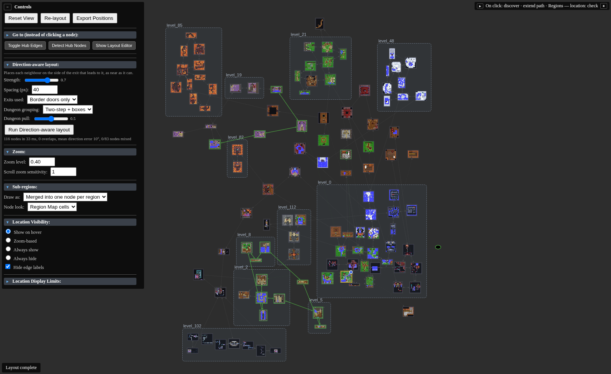
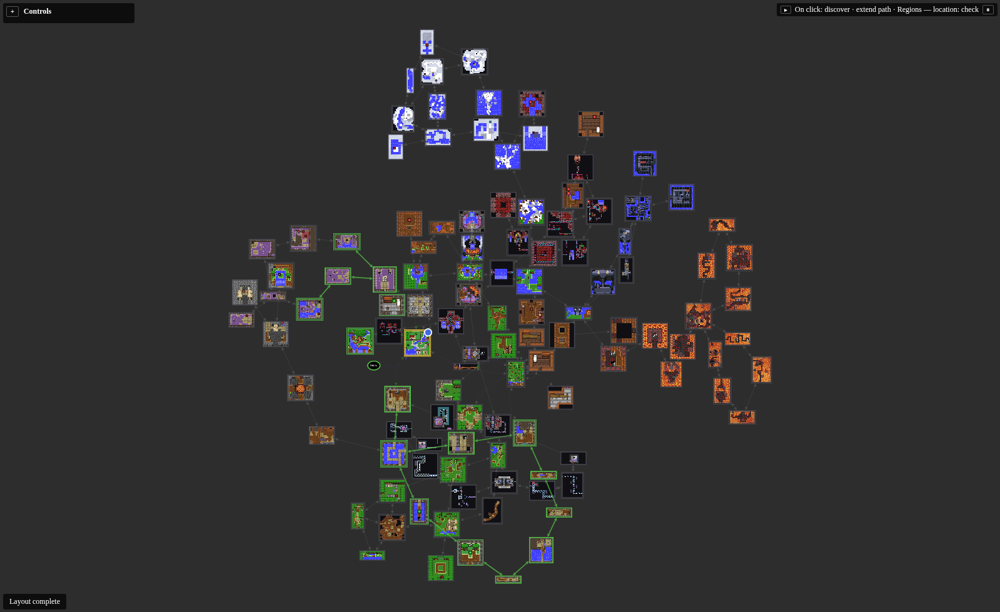
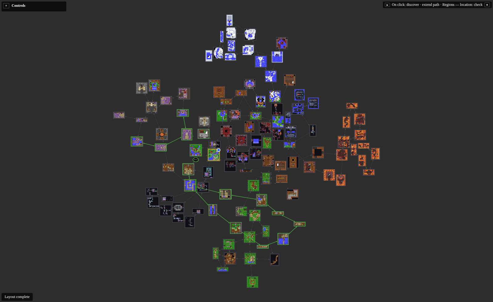
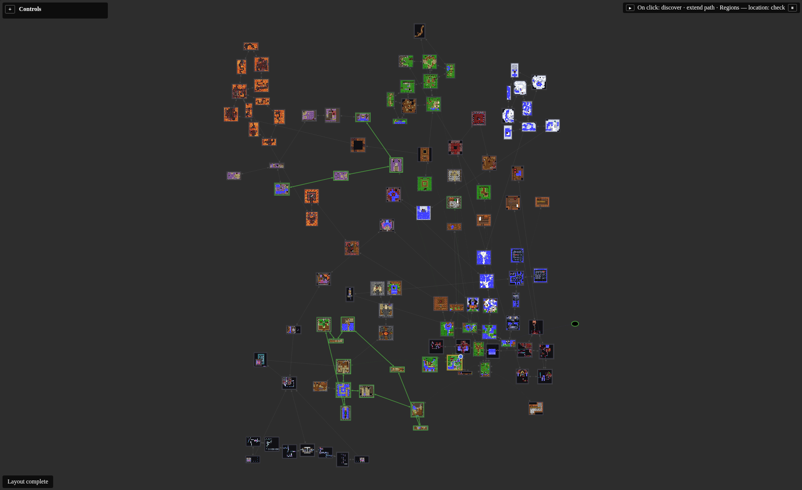
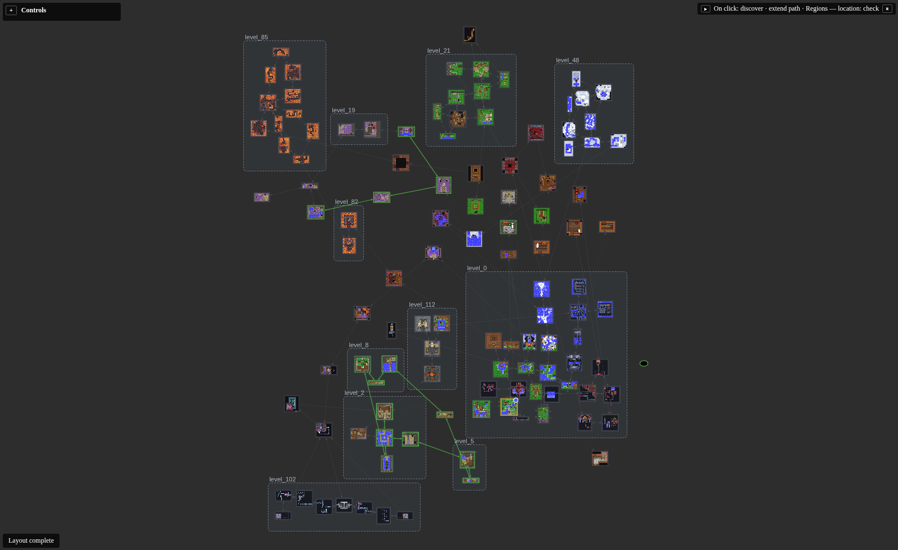
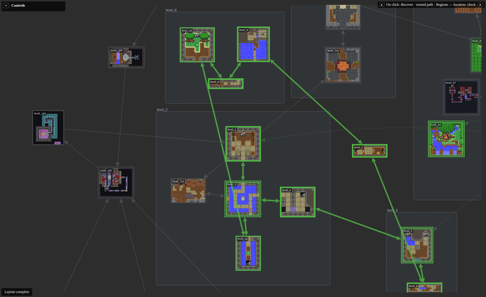
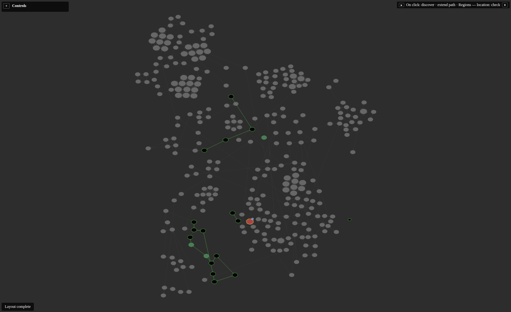

# Region Graph: Dungeon grouping for the Direction-aware layout

**Status: built, gated.** The Direction-aware layout gains one setting, **Dungeon grouping**, with four values: the
layout as it was (**Off**, the default), **Soft pull together**, **Two-step layout** and **Two-step + boxes**. A second
setting, **Dungeon pull**, sets how strong the soft value is.

Base: `102dcbeb16` (`git merge-base HEAD origin/main` at launch = `102dcbeb169dc3d039419f64e9538aede92ee270`, main after
train 227). origin/main did not move during the slice, so no merge was needed. The **packet tip is `6c2a563ed2`**, and
every gate in §8 ran there. This report and its shots are committed after it; they touch no code that CI runs.
Planner: archipelago-cc-23. Reviewer and landing queue: seedling-js-planning-24 (js-24; js-23 GO'd the brief).

## ⚖ The rulings (session 84c8ab35)

- **2026-11-26T18:05:17.944Z**, after the direction-layout shots: *"That looks good, thanks. The individual
  connections look right, but nodes from one dungeon are mixed together with nodes from another dungeon. Is there a
  way that we could separate them more into groups?"*
- **2026-11-26T18:07:07.610Z** (AskUserQuestion: "Two-step layout", "Soft pull together", "Two-step + boxes"): *"I want
  to try each of these options, and to have a setting to toggle between them, and also the way it works now."*

js-23's two adds are answered here: the headroom noise rule in §8, and the node with no group and the player marker in
§3.

## 1. What the user sees

**Controls → Direction-aware layout → Dungeon grouping** (a select) and **Dungeon pull** (a slider), above the Run
button. Picking a value re-runs the layout when Direction-aware is the one shown, like the other three settings.

seedling_playthrough, Draw as **Merged**, Node look **Region Map cells**, strength 0.7, spacing 40, border doors, in
each value:

| Off (as before) | Soft pull together (pull 0.5) |
|---|---|
|  |  |
| **Two-step layout** | **Two-step + boxes** |
|  |  |

- **Off**: today's layout. 48 of the 83 nodes in a dungeon of two or more sit nearer another dungeon's node than any
  of their own.
- **Soft**: the dungeons mostly gather (19 mixed), but a node pulled towards its dungeon pulls its exits off their
  sides: the direction error goes from 18° to 23° (mean).
- **Two-step**: each dungeon is one tight cluster (0 mixed) and **the exits point better than before** (mean 10.5°,
  p90 22°, against 18° / 39°): a dungeon laid out alone has no other dungeon's nodes in the way. The cost is space:
  the blocks keep a gap, and the long edges between dungeons cross the open space between them.
- **Two-step + boxes**: the same positions, plus a faint dashed box round each of the 11 dungeons of two or more
  nodes, named above its top edge.

Two neighbouring dungeons up close (`level_8`, 3 levels, and `level_2`, 5 levels: the nearest pair of linked dungeons, 16 px apart):

**Separate** (307 nodes) in **Two-step** (each sub-region in its level's dungeon; 2 of 286 mixed):

**alttp** opens unchanged with its default layout (`alttp-default.png`), and Direction-aware there gives the same
positions in all four values (§2). The **390 px phone**, merged + map, Two-step + boxes
(`phone-390-twoStepBoxes.png`): 11 boxes shown, no horizontal scroll. The phone run logged the known boot
`SecurityError` from an iframe panel (groups-a §1); the desktop runs logged no error.

## 2. What a dungeon is, and the counts

A dungeon is a **Region Map group**: `buildRegionMapModel(...).groupOf` (display key → group id), which is
`regionLayout.js` `groupsR1`, the connected components over `join` links. A `down`, `up` or `warp` link (a doorway
into a dungeon) never joins. No second grouping is written: `dungeonGroups.js` `dungeonReader` reads the model the map
look already builds (`mapLookLayer.regionMapModel()`).

- A **merged** (or collapsed) node: its `groupKey` is a display key → its group.
- A **region** node (a sub-region in `separate`, a `nested` or open `collapsible` member): its rules region's display
  region (the model cell holding it) → that level's group. So in `separate` a sub-region belongs to its level's group
  (vitest §2: every drawn sub-region of every level reads its level's group).
- A node the model does not place (**the Menu**): no dungeon.

| preset (frozen) | view | nodes | dungeons | no dungeon | sizes (largest first) | edges joining two dungeons |
|---|---|---|---|---|---|---|
| seedling_playthrough | merged | 116 | **43** | 1 (Menu) | 28, 11, 9, 9, 8, 5, 4, 3, 2, 2, 2, then 32 of 1 | > 0 |
| seedling_playthrough | separate | 307 | **43** | 1 | 92, 60, 28, 20, 12, 11, 7, 6, 6, 5, 5, 5, … | > 0 |
| seedling_atlas | merged | 5 | **3** | 1 | 2, 1, 1 | > 0 |
| seedling_atlas | separate | 11 | **3** | 1 | 6, 3, 1 | > 0 |
| procgen_maze (AP_3) | separate | 11 | **1** | 1 | 10 | **0** |
| alttp | separate | 239 | **3** | 1 | 236, 1, 1 | **0** |

**alttp has no layout data**, so the Region Map uses its generic graph, where every exit is a `join`: its groups ARE
its connected components (236, plus two regions no exit reaches). The maze preset is one group. Neither has a drawn
edge between two dungeons (an edge to the Menu does not count: it says nothing about where two dungeons sit), so every
grouping is **inert** there and returns `none`'s positions exactly. Proved two ways: vitest §2 (every value's digest =
none's, `stats.grouping.inert`, on the frozen alttp and maze), and in the browser on the live alttp (all four values
give identical positions, `allEqualNone: true`).

## 3. The four values (`dungeonGroups.js` `groupedDirectionLayout`)

| value | label | what it does |
|---|---|---|
| `none` | Off (as before) | **The same `directionLayout` call as before**, same arguments. Byte-identical: the positions digests of 7 preset × view × look cases, computed with the BASE files on the frozen fixtures, are pinned (vitest §1). |
| `soft` | Soft pull together | ONE relaxation (`directionLayout` with its new `dungeonPull` option): each iteration, every node with a dungeon is pulled towards its dungeon's centre (weight pull·0.12) and pushed from every node of ANOTHER dungeon nearer than 2·L (weight pull·0.6, linear in the overlap of that reach). Nodes with no dungeon take no part. At pull 0 the term is not run at all, so the positions are `none`'s (vitest §3). |
| `twoStep` | Two-step layout | (1) each dungeon laid out ALONE: the same relaxation over its own internal edges; (2) each dungeon becomes a rigid **block** (its nodes' boxes plus a pad of `10 + spacing/2` px) and the blocks are laid out by the same relaxation over the block graph: one block edge per pair of linked dungeons, preferring the SUM of its links' preferred directions (weight `|Σ wᵢdᵢ| / n`, as for a merged node's edge), length only where no link has a direction. Its final separation pass leaves **0 overlapping blocks**, and as every node is inside its own block, **no node lies inside another dungeon's block** (vitest §4, every view). |
| `twoStepBoxes` | Two-step + boxes | `twoStep`'s positions exactly (same digest), plus the boxes (§4). |

**A node with no dungeon** (the Menu node; a node the model does not place) is a **block of one** in `twoStep`, placed
like any other block, and is never boxed (vitest §4: blocks = dungeons + ungrouped). **Discovery placeholders** are
region nodes with a `regionName`: they keep their level's dungeon.

**The player marker** is a locked node: it is not an input of any layout (vitest §6: not in the laid-out nodes), and
when the run stops `runDirectionLayout` re-seats it on its current region's node (as for `none`). That node is inside
its own dungeon's block, so the marker is never placed in another dungeon's block.

**Settings** (declared keys in the panel's settings schema, `regionGraph/index.js`; the schema's `default` is the only
default, read with no call-site default; an out-of-range or wrong-type value reads clamped or as the default):

| setting | key | values | default |
|---|---|---|---|
| **Dungeon grouping** | `moduleSettings.regionGraph.dungeonGrouping` | `none` (Off (as before)), `soft` (Soft pull together), `twoStep` (Two-step layout), `twoStepBoxes` (Two-step + boxes) | `none` |
| **Dungeon pull** | `moduleSettings.regionGraph.dungeonGroupStrength` | 0 – 1 (slider, step 0.05); used by `soft` only | 0.5 |

Both are leaves of the existing settings blob, saved per key: **no new localStorage key**, nothing to declare, and the
storage census does not move (`storageCensus.test.js`, `storageDeclarationPins.test.js` green in the bounded run). A
write re-runs the layout if Direction-aware is the one drawn (`isDirectionSettingKey`), else it is used next time; it
never rebuilds the graph.

**Determinism**: dungeons and blocks are sorted by key; both modules read no clock and no `Math.random` (vitest §5).
Two panel builds give the same digest per value, and so do the inputs reversed, rotated, and with every edge's ends
swapped (vitest §5); in the browser, two runs of `twoStep` give identical positions in every view measured.

## 4. The boxes (`dungeonBoxLayer.js`)

- **An overlay, not an element.** One `div` layer inside the graph container, **under Cytoscape's canvas** (z-index −1
  in an isolated stacking context, re-appended after the map look's canvas so a box shows over the map art), one
  dashed `div` per dungeon of 2+ drawn nodes, `pointer-events: none`. The compound parents `nested` uses for its
  sub-region boxes are untouched, so the two never collide: `nested` + `twoStepBoxes` keeps its 60 compound boxes,
  and each compound box's members are all in ONE dungeon (their level's), so a sub-region box sits inside one dungeon
  box (vitest §6).
- **Every reader skips it** because no reader can see it: the element set is unchanged (the canonical element digest
  is the same with and without the boxes), the node count is unchanged, no element has the box class, `staticData`
  holds no box, saved positions hold drawn nodes only (vitest §6); the picker, the pathfinder, counts, hub detection
  and saved positions all read the element set or `staticData`. No predicate needed extending.
- **Where**: each box is its members' current boxes (labels excluded) plus the same pad as the block, converted to
  screen pixels one frame after `position` / `viewport` / `resize` / `layoutstop`, so it follows a drag, the
  animation, pan and zoom. A member that discovery hides is left out; a box with none shown is hidden.
- **The label**: the group's id, which is the Region Map's group ROOT: the start's level when the group holds it, else
  the first level a `down` (then an `up`) link from another group enters, else its first member (e.g. `level_0`,
  `level_85`). No substrate provides a group name. It is drawn just above the box's top edge, so at any zoom it covers
  no node, and reads `???` while any member shown is an undiscovered placeholder.
- **Lifetime**: the boxes belong to ONE Direction-aware run. Any later layout's `layoutstart`, a rebuild, or a run in
  another value clears them (vitest §6).

## 5. The table: mixing against direction accuracy

Browser, Chromium headless, this box, at strength 0.7, spacing 40, border doors (`scripts/dev/shot-region-graph-
dungeon-groups.mjs`). **Mixed** = of the nodes in a dungeon of 2+ drawn nodes, those with a node of ANOTHER dungeon
nearer (centre to centre) than their nearest own-dungeon node. **Angle error** = between each edge's preferred and
actual direction (edges with a preference). **Block** = the longest main-thread task seen (PerformanceObserver
`longtask`); **ms** = the layout's own block (`report.totalMs`: inputs + layout).

**seedling_playthrough, merged + map** (116 nodes, 43 dungeons; 83 nodes in a dungeon of 2+):

| value | mixed | mean | p90 | overlaps | block overlaps | in another's block | boxes | ms | block |
|---|---|---|---|---|---|---|---|---|---|
| none | **48 / 83** | 18.4° | 38.8° | 0 | — | — | 0 | 164 | 181 |
| soft, pull 0.25 | 34 / 83 | 21.1° | 48.6° | 0 | — | — | 0 | 120 | 144 |
| **soft, pull 0.5** | **19 / 83** | 23.0° | 52.9° | 0 | — | — | 0 | 175 | 192 |
| soft, pull 1 | 12 / 83 | 29.2° | 68.8° | 0 | — | — | 0 | 391 | 412 |
| **twoStep** | **0 / 83** | **10.5°** | **22.2°** | 0 | 0 | 0 | 0 | 32 | none > 50 |
| **twoStepBoxes** | **0 / 83** | 10.5° | 22.2° | 0 | 0 | 0 | **11** | 33 | 57 |

**seedling_playthrough, separate** (307 nodes, 43 dungeons; 286 in a dungeon of 2+):

| value | mixed | mean | p90 | overlaps | block overlaps | in another's block | boxes | ms | block |
|---|---|---|---|---|---|---|---|---|---|
| none | **105 / 286** | 28.4° | 64.1° | 0 | — | — | 0 | 551 | 607 |
| soft, pull 0.25 | 60 / 286 | 25.7° | 50.7° | 0 | — | — | 0 | 751 | 800 |
| **soft, pull 0.5** | **36 / 286** | 32.1° | 65.3° | 0 | — | — | 0 | 835 | **891** |
| soft, pull 1 | 12 / 286 | 34.8° | 82.1° | 0 | — | — | 0 | 693 | 727 |
| **twoStep** | **2 / 286** | **14.2°** | **31.1°** | 0 | 0 | 0 | 0 | 141 | 192 |
| **twoStepBoxes** | **2 / 286** | 14.2° | 31.1° | 0 | 0 | 0 | **23** | 118 | 205 |

**seedling_atlas, merged + map** (5 nodes, 3 dungeons: 2, 1, 1, plus the Menu): 0 / 2 mixed in every value; mean
error 0.1° (none), 1.4° (soft 0.5), 0.0° (twoStep); 0 overlaps; `twoStepBoxes` draws **1** box; every run under 10 ms.

- **What separation costs**: `soft` buys its grouping with direction accuracy (each pull step bends more exits);
  `twoStep` costs nothing in accuracy (it gains: 18.4° → 10.5° merged, 28.4° → 14.2° separate), and costs space
  between dungeons and longer edges between them.
- **The 2 mixed nodes in separate twoStep** are still inside their own block (0 in another's block): mixing counts
  centre distances, so a node on its block's edge can have a nearer node across the gap than inside its own block.
- **Timing**: the longest block is **891 ms** (soft, pull 0.5, the 307-node `separate`), under 1 s, so no chunking;
  the 3 s STOP is far away. `twoStep` is the fastest value (it relaxes 43 small graphs and one 44-block graph instead
  of one 307-node graph).

## 6. Views and node looks

Every `subRegionView` value (separate, nested, merged, collapsible with `level_108` open) and both node looks (graph
everywhere, Region Map cells in merged) work with every value: 0 node overlaps in all 20 combinations; in twoStep /
twoStepBoxes, 0 block overlaps and 0 nodes in another dungeon's block in every view (vitest §4). `nested` keeps its
compound boxes' members together (its existing 0.1 group pull) inside the per-dungeon layout, and all of a box's
members share its level's dungeon. `collapsible`: an open group's members are region nodes in their level's dungeon,
a closed group's merged node is in its group key's dungeon.

## 7. The in-app row

`test_region_graph_sub_region_merged` (seedling_atlas `merged` + map, the smallest fixture with two dungeons linked)
extends its Direction-aware step: after the existing run it sets **Dungeon grouping = twoStepBoxes through the
setting** (session-only, `ctx.setSetting`; the preset is put back first, so the write does not start an animated
re-run), runs the layout once at once (`runDirectionLayout({ animate: false })`: it settles inside the call), and
reads: 3 dungeons (2, 1, 1), **1 box drawn** in the DOM overlay (labelled `dungeon1_room1`) = the dungeons of 2+,
**0** node overlaps, 0 block overlaps, 0 nodes in another dungeon's block, and the element set unchanged (10 = 10).
Then it writes the setting back to its default (`none`), clears the boxes, reads 0 left, and the existing restore
puts every position, the view, the player, the preset and the saved positions back. On this box the added step took
**64 ms** (row 3.5 s, PASSED). In CI: §8.

## 8. Gates (at the tip `6c2a563ed2`)

- **JSUT** run 46033754918 (push, headSha `6c2a563ed2`): green, **1460 files / 30559 tests** (0 failed), slow
  battery 42 / 470. Base `102dcbeb16` (run 45947930795): 1459 / 30527. **+1 F / +32 T** = `dungeonGroups.test.js`
  (30) + 2 rows of `regionView/nodeSelectedRetired.test.js`, which scans every app file of `regionGraph/` (the new
  `dungeonGroups.js` and `dungeonBoxLayer.js` enrol there).
- **unittests** 46033754899: green.
- **TT** (test-templates, dispatched) **46033818023** and **46039656266**: all 9 jobs green, twice.
- **tutorials** 46033821958 and **tutorials-tracker** 46033826074 (`test-substrates-manual.yml`, read job by job: the
  batch each ran is in its job name): green. **fast, bundled** (`-f batch=fast -f bundled=true`) 46033830152: green.
  Every Region Graph row and walk is in those batches: green on both boots.
- **Headroom** (fast batch, 600 s budget). Main `102dcbeb16`, 3 TT samples (46028782625 push, 45947931052,
  46033985188): fast 326.8 / 343.8 / 331.2 s, **median 331.2**; fast-bundled 333.8 / 337.8 / 335.7 s, **median 335.7**.

  | tip sample | fast | Δ median | fast-bundled | Δ median |
  |---|---|---|---|---|
  | TT 46033818023 (bundled also `-f batch=fast -f bundled=true` 46033830152) | 326.8 s (54%) | −4.4 | 326.5 s (54%); 313.1 s (52%) | −9.2; −22.6 |
  | re-sample, TT 46039656266 | 335.1 s (56%) | **+3.9** | 336.1 s (56%) | **+0.4** |

  Well under the +20 s STOP and the 70% line, and fast-bundled is under 60%: js-23's noise rule was not needed.
- **The in-app row in CI**: `test_region_graph_sub_region_merged` PASSED **2.5 s** on both boots in both tip TTs and
  the bundled dispatch, against 2.4–2.5 s at main (3 runs, both boots): **≈ +0–0.1 s**, under the 1.5 s cap.
- **Closure ∩ diff = ∅**: 0 of the 42 files of `node scripts/procgen/seedlingDerivedRuleTable.js --print-engine-closure`
  are in `git diff --name-only origin/main...HEAD`. **engineMd5 `74ae60f575531492ed9eaec1839e1fe3`** at the tip = base.
  **0 gitlinks.**
- **Bounded vitest** (§9) and the in-app row on this box: green. No local heavy build was run (no `npm run build`, no
  `--bundled`): the bundled evidence is CI's.

## 9. Tests

- **Vitest** `frontend/modules/regionGraph/dungeonGroups.test.js`, 30 tests, over the FROZEN fixtures (rules and the
  Seedling atlases they point at, `loadFrozenAtlas` with the shipped atlases `vi.mock`ed, as `directionLayout.test.js`):
  `none` = the base digests (7 cases); the groups per preset and the sub-region → level rule; alttp and the maze inert
  in every value; soft at 0 = none (merged, separate); twoStep / twoStepBoxes with 0 block overlaps and 0 intruders in
  every view and both looks; all 20 view × value combinations with 0 overlaps; the Menu a block of one; determinism
  per value (two builds; reversed / rotated / swapped inputs); no clock or `Math.random`; the boxes (count, each holds
  its members, none overlap, the element set and saved positions unchanged, cleared by another layout / a rebuild /
  another value, `nested` + boxes keeps its compound boxes); the player marker; the settings (schema defaults,
  registration, clamping, no call-site default, a write re-runs, never rebuilds).
- `directionLayout.test.js` (32) unchanged and green: the direction layout's own settings and defaults did not move.
- **Bounded vitest** (⚖ 52), `--maxWorkers=3`: `regionGraph/`, `regionMap/`, `regionView/`, `procgenCore/regionLayout*`,
  `tutorials/`, `storagePanel/`, and every test that imports a touched file or scans `testCases/`
  (`tests/bundledTestCases`, `testBatches`, `testDiscovery`, `testLogic`, `testWebgpu`,
  `quickLaunch/quickLaunchImportOrder`, `procgenCore/documentLibrary`): **53 files, 827 tests, green**.

**Doc-census pins moved: none.** The user page (`docs/json/user/modules/regionGraph.md`, a new #### Dungeon grouping
under § Direction-aware layout) and the developer page (`docs/json/developer/modules/regionGraph.md`, a Key Files line
and a Layout Management bullet) changed below their first paragraph: `generate-docs-index.mjs --check` is current.

## 10. Follow-ups

1. **Tighter block packing.** `twoStep` reuses the relaxation for the blocks, whose repulsion scales with the mean
   block size, so the dungeons sit further apart than they need to, and the Menu block lands at the edge. A block
   pass with a smaller repulsion (or a compaction step that slides blocks towards their linked neighbours until they
   touch the gap) would use the space better.
2. **Anchored block springs.** A block edge pulls centre to centre; pulling the two LINKED NODES (each block's door
   node) towards the preferred offset would line up the inter-dungeon edges as well as the dungeons.
3. **Labels at a low zoom.** On the phone, a label above a box can touch the box above it when the gap between them
   is narrow on screen. Hiding labels below the region-name zoom, as the badges do, is one line.
4. **The boxes after a rebuild.** A view switch that reloads `twoStep` positions from the store draws no boxes until
   the layout is run again (the boxes belong to a run). Re-drawing them when the restored positions came from a
   `twoStepBoxes` run would need the run's value saved with the positions.
5. The soft value's pull / push weights (0.12 / 0.6, reach 2·L) are tuning, not settings; a separate push setting
   would let `soft` trade grouping for directions more finely.
