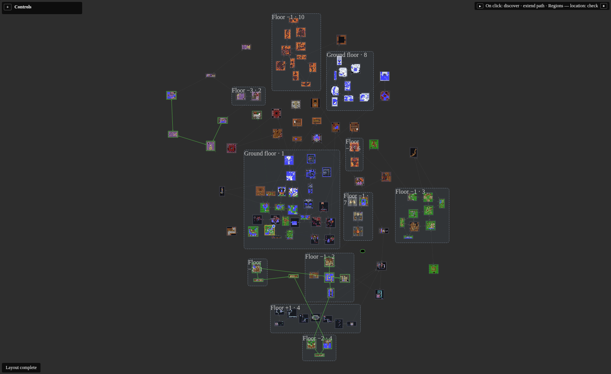
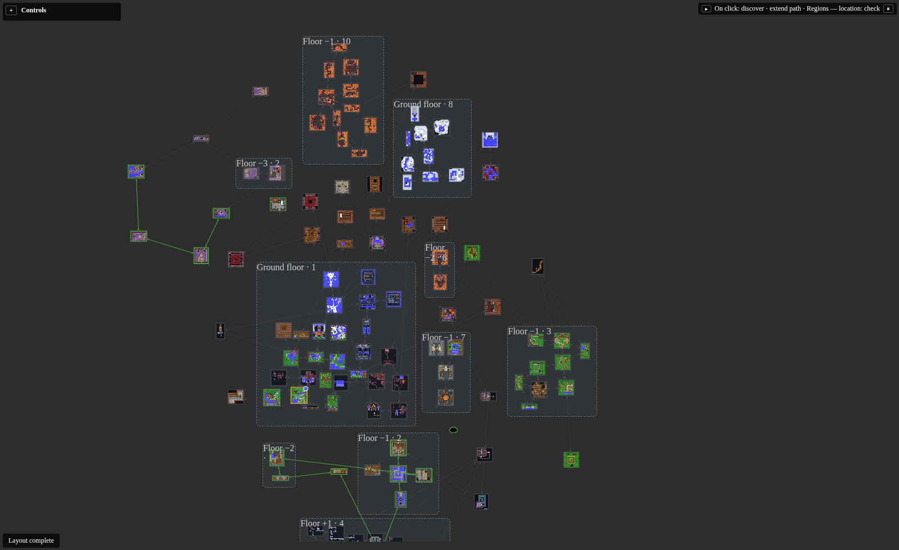
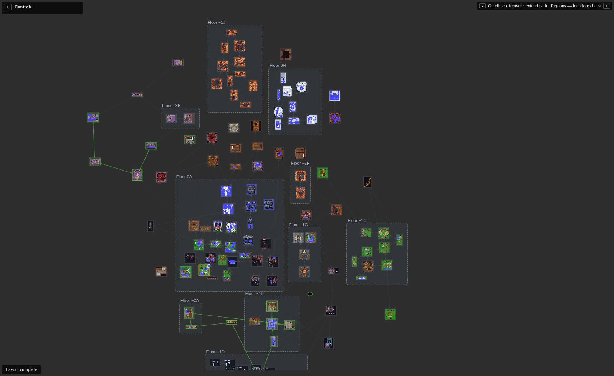
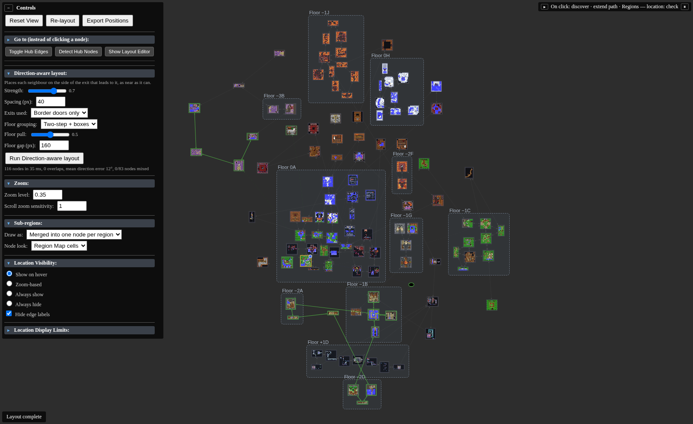
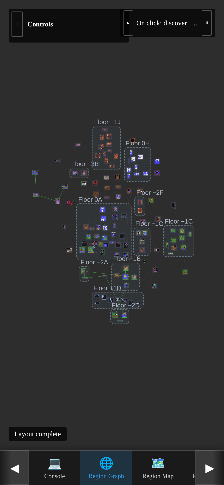

# Region Graph: floor letters, and "Dungeon grouping" renamed "Floor grouping"

Slice `region-graph-floor-rename-letters`, base `b6863466be` (origin/main). Planner archipelago-cc-23, reviewer js-24.
No layout change and no solver change: the same positions and the same floor numbers. Only the labels and the names changed.

## The user's rulings (session 84c8ab35)

- **2026-11-28T03:33:37.957Z:** *"Yes, I want to arrange the blocks on the map by floor, so higher floors sit above lower
  ones. I want to replace the number after the floor with a letter, to make it easier to read, like Floor 1A. I want regions
  connected by a doorway to appear in separate blocks in the region graph, and maybe also get a different letter at the end of
  their floor number. If we haven't renamed "dungeons" to "floors" yet, then I want to do that. …"* (Arranging the blocks
  by floor is a separate slice, `region-graph-floor-stacking`, cut from this slice's rename tip `1478ca628e`.)
- **2026-11-28T03:38:16.825Z** (AskUserQuestion): letter style **"Floor 0A, Floor −1B"**: the ground floor is Floor 0, and
  every block gets a letter, even when it is the only block on its floor. Rename: **"There are currently no users. There is
  no need to worry about backwards compatibility for the saves. Rename anything where the current name is confusing."**

## What the user sees now

In the Region Graph's Controls, under **Direction-aware layout**, the select now reads **Floor grouping:** and the slider
reads **Floor pull:** (they were "Dungeon grouping:" and "Dungeon pull:"). The four values are unchanged: Off (as before),
Soft pull together, Two-step layout, Two-step + boxes. The tooltips say "floor group" where they said "dungeon".

With **Two-step + boxes**, each box is labelled with its floor and a letter:

| Case | Before | Now |
|---|---|---|
| The start's floor, the only group on it | `Ground floor` | `Floor 0A` |
| The start's floor, the 8th group reached | `Ground floor · 8` | `Floor 0H` |
| One floor up | `Floor +1 · 4` | `Floor +1D` |
| One floor down, 2nd group reached | `Floor −1 · 2` | `Floor −1B` |
| 27th and 28th groups on a floor | `Floor 0 · 27`, `· 28` | `Floor 0AA`, `Floor 0AB` |
| A ranged group (a contradiction) | `Floor −3 to −1` | `Floor −3 to −1 A` |
| An unreached group | `Floor ?` | `Floor ? A` |

- **Letters** run A … Z, then AA, AB, … AZ, BA, … ZZ, AAA (spreadsheet-column order; `floorSolver.js` `floorLetter`).
  A floor's groups are lettered in the order they are reached from the start, as the `· k` numbers were (A = nearest).
  Unreached groups, which nothing reaches, are lettered by id.
- **"+" is kept** ("Floor +1A", not "Floor 1A"). With Floor 0 as the ground floor, "+1" and "−1" read as mirror images of
  each other, and "Floor 1A" next to "Floor −1A" makes the sign easy to miss on the upper floors. The minus is U+2212, as before.
- **The letter is glued to a single floor** ("Floor −1B") **but set off by a space after a range or "?"** ("Floor −3 to −1 A",
  "Floor ? A"), so it never reads as belonging only to the last floor of the range. ⚑ This is a choice; see the questions below.
- The group's first level (its old label) is still on the box's tooltip and `data-root`.

Shots (`floor-letters-shots/`, desktop 1600 × 1000, seedling_playthrough, merged + Region Map cells, Two-step + boxes;
"before" is the same layout and the same solve, labelled by the base commit's own `floorLabels`):

| Before | After |
|---|---|
|  |  |
|  |  |

- The controls: 
- The 390 px phone (no horizontal scroll; 11 boxes): 

Measured labels on the boxes shown (`shots-run.json`): before `Ground floor · 1`, `Floor +1 · 4`, `Floor −1 · 7`,
`Floor −3 · 2`, `Floor −1 · 2`, `Floor −1 · 3`, `Ground floor · 8`, `Floor −2 · 1`, `Floor −2 · 4`, `Floor −2 · 6`,
`Floor −1 · 10`; after `Floor 0A`, `Floor +1D`, `Floor −1G`, `Floor −3B`, `Floor −1B`, `Floor −1C`, `Floor 0H`,
`Floor −2A`, `Floor −2D`, `Floor −2F`, `Floor −1J`. The phone run logged the known boot `SecurityError` from an iframe
panel (groups-a §1); the desktop run logged none. On the phone the box labels crowd where boxes sit close together
(the arrangement, which `region-graph-floor-stacking` changes; not the label text).

### Doorways already make separate blocks

The user asked for *"regions connected by a doorway to appear in separate blocks … and maybe also get a different
letter"*. That is already how the groups are built: a group is a connected component over `join` links
(`procgenCore/regionLayout.js` `groupsR1`), and a `down` / `up` / `warp` link (stairs, pit, doorway, teleporter) never
joins two levels. So levels behind a doorway are always a block of their own, and now each such block gets its own letter.
On seedling_playthrough (merged; pinned in `floorSolver.presets.test.js`): **43 groups on 7 floors; 5 floors carry more
than one letter**: Floor 0 has 19 (A–S), Floor −1 has 10, Floor −2 has 6, Floor +1 has 4, Floor −3 has 2; Floors −4 and
−5 have one each. On each floor the letters run A, B, C, … with none skipped. (Maze levels judge doorways less well;
`maze-arrival-spawns` fixes that.)

## The rename

No migration (the ruling): a value saved under an old key is not read; it reads as the schema default (pinned in
`floorGroups.test.js` § 7).

| Old | New |
|---|---|
| `regionGraph/dungeonGroups.js` (+ `.test.js`) | `regionGraph/floorGroups.js` (+ `.test.js`) |
| `regionGraph/dungeonBoxLayer.js` | `regionGraph/floorBoxLayer.js` |
| `moduleSettings.regionGraph.dungeonGrouping` | `moduleSettings.regionGraph.floorGrouping` |
| `moduleSettings.regionGraph.dungeonGroupStrength` | `moduleSettings.regionGraph.floorGroupStrength` |
| (`moduleSettings.regionGraph.floorGap`) | unchanged |
| UI "Dungeon grouping:", "Dungeon pull:" | "Floor grouping:", "Floor pull:" |
| `#dungeonGrouping`, `#dungeonGroupStrength`, `#dungeonGroupStrengthValue` | `#floorGrouping`, `#floorGroupStrength`, `#floorGroupStrengthValue` |
| `DUNGEON_GROUPING_KEY` / `_SCHEMA` / `_LABELS`, `DUNGEON_GROUP_STRENGTH_KEY` / `_SCHEMA` | `FLOOR_GROUPING_*`, `FLOOR_GROUP_STRENGTH_*` |
| `DungeonBoxLayer`, `DUNGEON_BOX_CLASS`, `DUNGEON_BOX_LAYER_CLASS` | `FloorBoxLayer`, `FLOOR_BOX_CLASS`, `FLOOR_BOX_LAYER_CLASS` |
| CSS `.rg-dungeon-box`, `.rg-dungeon-boxes`; `data-dungeon` | `.rg-floor-box`, `.rg-floor-boxes`; `data-floor-group` |
| `ui.dungeonBoxes` | `ui.floorBoxes` |
| `dungeonReader`, `dungeonsOf`, `crossDungeonEdges`, `lcm.dungeonOfNode` | `floorGroupReader`, `floorGroupsOf`, `crossFloorGroupEdges`, `lcm.floorGroupOfNode` |
| node / block / box field `dungeon`; `directionLayout` option `dungeonPull` | `floorGroup`; `floorGroupPull` |
| layout report `dungeons`, `dungeonSizes` | `floorGroups`, `floorGroupSizes` |
| in-app log tag `[dungeonGroups]` | `[floorGroups]` |
| prose "dungeon" (comments, tooltips, test names, the user page) | "floor group" |

A *floor group* is one of the Region Map's groups (one block); several floor groups can share a floor, told apart by
their letter. The code keeps "floor" for the floor number (`floors.js`, `floorSolver.js`) and "floor group" for the block.

Rosters checked before the file rename (js-24 edit 1): `git grep -a -n` of `dungeonGroups` / `dungeonBoxLayer` over
`scripts/test/train-shard-costs.json`, `frontend/modules/tests/testBatches.js`, `.github/workflows/*`,
`scripts/procgen/*census*` and `nodeSelectedRetired`: **no hit**. No readdir-driven row count moved. The three older shot
scripts (`scripts/dev/shot-region-graph-{dungeon-groups,floors,floor-solver}.mjs`) import the new names so they still run.

## What is still named "dungeon", and why

`git grep -a -n -i dungeon -- frontend/modules/regionGraph/ frontend/modules/tests/testCases/regionGraphPanelTests.js` at
the tip, 23 hits, each one of these:

- **The slice tag `region-graph-dungeon-groups`** in `⛓` comments (directionLayout.js:242, floorBoxLayer.js:2,
  floorGroups.js:2, floorGroups.test.js:2, graphDataManager.js:639, index.js:171, layoutControlsManager.js:31, 397, 483,
  527, 553, 561, 632, regionGraphUI.js:59, regionGraphPanelTests.js:839 and its description at :1452) and `dungeon-groups'`
  (floors.test.js:9): the name of a landed slice and its report `dungeon-groups.md`, a citation.
- **The user's own words**, quoted verbatim (floorGroups.js:6, floors.js:13).
- **The no-migration test** (floorGroups.test.js:418, 422, 423): it writes the OLD keys on purpose to show they are ignored.
- **A region id** from a frozen fixture, `dungeon1_room1` (floors.test.js:268): game data, not this grouping.

Outside the Region Graph, left alone as not this grouping: the Dungeons panel (`docs/json/modules/dungeons.md`,
`rules.schema.json` `dungeons`), `colorblindMode.dungeons`, the apworld editor, the Seedling runtime tests
(`TOOLS_DUNGEON`), alttp's `EnemyShuffle.py`. The script file `scripts/dev/shot-region-graph-dungeon-groups.mjs` keeps
its name because `dungeon-groups.md` cites it. The landed reports in `CC/docs/region-graph/` are historical and were not
rewritten; the user page (`docs/json/user/modules/regionGraph.md`) has a line saying the setting was called Dungeon
grouping until 2026-11-28. No name was ambiguous enough to need a ruling.

## Proof

- **Vitest (bounded, ⚖ 52):** `npx vitest run frontend/modules/regionGraph/ --maxWorkers=3`: 20 files, green, plus
  `frontend/modules/regionMap/`, `frontend/modules/storagePanel/` (storageCensus, storageDeclarationPins),
  `frontend/modules/regionView/` and `frontend/modules/quickLaunch/`, all green. New: the letter sequence (A, B, Z, AA, AB,
  AZ, BA, ZZ, AAA, ZZZ, AAAA; 800 distinct; a non-index throws), every label form, 28 groups on one floor running A … Z,
  AA, AB in discovery order, the seedling_playthrough per-floor letter table, and the renamed keys' round trip (the old keys
  ignored). The panel's settings schema registers `floorGrouping` / `floorGroupStrength` (pinned from `index.js`);
  `generate-docs-index.mjs --check` is current.
- **Pins that moved:** label expectations in `floorSolver.test.js`, `floorSolver.presets.test.js`, `floors.test.js`,
  `floorGroups.test.js` (its box-label pattern) and the in-app row. No `procgenDocs/generated/*`, docs census, settings-key
  census or storage census pin moved: none of them lists these files or keys.
- **In-app:** the 15 Region Graph rows of test-substrates, both boots, green; `test_region_graph_sub_region_merged` now
  asserts every box reads `Floor <n><letter>` (or a lettered range) and no two boxes share a label. Its seedling_atlas box
  reads `Floor 0B` (`dungeon1_room1`). The added check is a `Set` over the box labels (≤ 11 on these presets).
- **Engine:** closure ∩ diff = ∅ (`seedlingDerivedRuleTable.js --print-engine-closure`); engineMd5
  `6c8cd75145bdf58d2eed7d7cc9e6b512`, the same as origin/main's. CI run ids at the tip are in the landing packet.

## Questions for the user

1. **The range and unreached forms.** Now: `Floor −3 to −1 A` and `Floor ? A` (a space before the letter). Other choices:
   `Floor −3 to −1A` (shortest, but the A seems to belong to −1), `Floor (−3 to −1)A`, or no letter on a range at all. Which
   reads best? (Neither form appears on any committed preset today: they need a contradiction or an unreachable group.)
2. **"+1" or "1"?** Now `Floor +1A`. Would you rather have `Floor 1A` for floors above the ground floor?

## Follow-ups

- `region-graph-floor-stacking` (cut from `1478ca628e`) arranges the blocks by floor, higher floors above, which should
  also stop the labels crowding on the phone.
- `maze-arrival-spawns`: maze levels' doorways, so maze worlds split into blocks (and letters) the way Seedling does.
