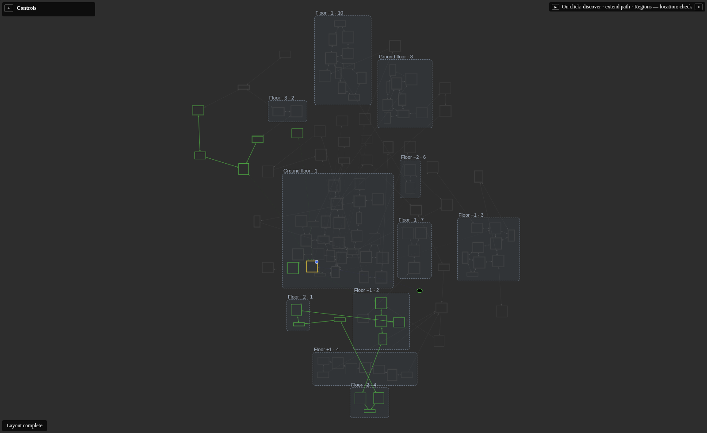
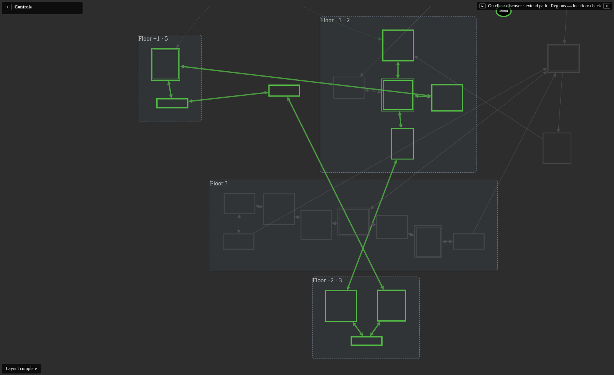
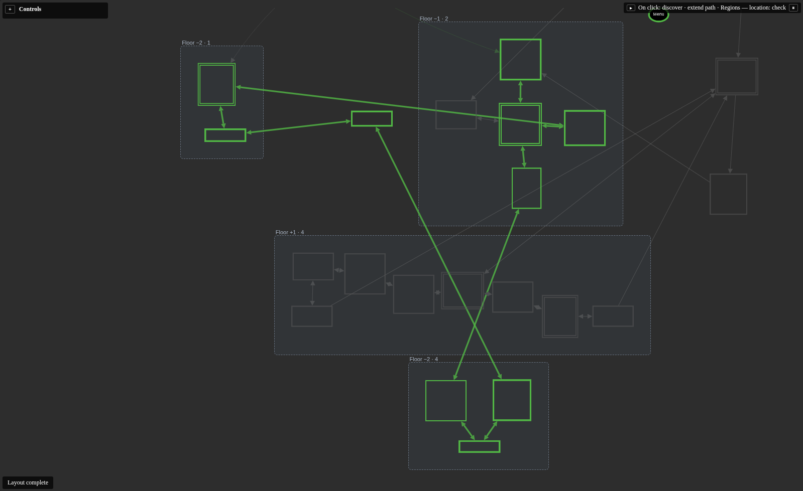

# Region Graph: Floor numbers from a constraint solve

**Status: built, gated.** The floor numbers on the two-step Dungeon grouping's boxes come from a **constraint solve
over every link between two groups**: stairs, pits, and now doorways and teleporters too. They no longer come from a
walk over the stairs alone where the first number found wins. Every Seedling group now gets a floor. The 20 "Floor ?"
groups are gone, because a doorway now counts as a link that may change floor. The two former conflicts
(`level_5`, `level_7`) resolve, with **one staircase spanning two floors**. The floor-count bounds and the ambiguities
are in this report only (ruling 3). Nothing in the app shows them.

The shots and the browser timings were taken at `9d66027382`. The tip differs from it in Region Graph code only by one
test's name (`b94e43f7a1`); the merges touched no Region Graph file.

Base: region-graph-floors' frozen land tip `63985e6987` (it carries dungeon-groups `001abda603`, and rides train 231).
`git merge-base HEAD origin/main` at launch was `960ff0a862970581123e17f0f115e7bf1a23a32e`. origin/main then moved to
`4f0be2e6a2` (train: mystery-play), merged cleanly as `fe29ece313`, and then to `07787a892c` (train: rules-engine-nit-b,
train 230), merged cleanly as `aafde3522b`. Before each merge, floors' tip was checked: still `63985e6987`, not pulled
or re-tipped. **The packet tip is `aafde3522b`** (the second merge), and every CI gate in §8 ran there. This report and its shots are committed after it, and touch no code that CI runs. Planner:
archipelago-cc-23. Reviewer and landing queue: seedling-js-planning-24 (js-24).

## ⚖ The rulings (session 84c8ab35)

- **2026-11-27T19:37:08.935Z:** *"Next, I want to discuss how we can resolve the ambiguity in what floor each region is
  on. The starting region is ground floor. Stairs up and down go up or down a floor. Pits go down a floor. What if we
  make it context-dependent whether a doorway that isn't stairs changes the floor? Going through a door should count
  as transitioning to a new area anyway, and should be treated differently from walking off the edge of the screen. Is
  there a way that we can track the ambiguities, and get a number for the largest number of total floors if we count
  each ambiguous case as a floor transition? And then, can we set up some of the transitions as transitioning more
  than one floor, to resolve the ambiguity? And for remaining ambiguities, rather than displaying a question mark for
  the floor number, can we display a range of floors it could possibly be, depending on interpretation?"*
- The planner proposed a difference-constraint model: an edge walk has Δ = 0, stairs up Δ ≥ +1, stairs down or a pit
  Δ ≤ −1, a doorway Δ ∈ [−1, +1]. Each group's feasible floors form an interval. Show the most compact consistent
  assignment, list the contradictions, and give the min / max floor count.
- **2026-11-27T19:43:32.300Z**, the user's answers:
  1. *"We can start with -1 to +1. If we find that allowing a wider range would give better results, then we can do
     that."*
  2. *"If there is a set of picks that makes the layout consistent, then we can display those picks instead of the
     range. Otherwise we should show the range."*
  3. *"Let's put it only in a report for now."*
  4. *"Yes, treat teleporters as ambiguous, like doors."*

## 1. What the labels mean now

| label | meaning |
|---|---|
| **Ground floor**, **Floor +1**, **Floor −2** | the solve's **pick** for that group: one consistent assignment of every group (ruling 2) |
| **… · k** | several groups share that label; k = the order they are reached from the start over the links (stairs, pits, doorways), 1 the nearest |
| **Floor −3 to −1** | a **range**: the links contradict each other, and this group's floor depends on which ones are set aside (§5). No committed preset has one. |
| **Floor ?** | no link from the start reaches the group at all (alttp's 2 groups that have no cross-group link) |

The box tooltip still carries the group's root level id (`data-root`, `title`), unchanged.

seedling_playthrough, **Merged**, Node look **Region Map cells**, **Two-step + boxes**, Direction-aware defaults. The
layout is the same in both shots; only the labels changed. "Before" relabels the boxes with region-graph-floors' own BFS
numbering, which the shot script runs in the page from `git show 63985e6987:…/floors.js`.

| Before (BFS from the start, stairs only) | After (the constraint solve) |
|---|---|
|  |  |

The 11 boxes:

| root | before | after |
|---|---|---|
| `level_0` (the start's) | Ground floor · 1 | Ground floor · 1 |
| `level_2` | Floor −1 · 2 | Floor −1 · 2 |
| `level_21` | Floor −1 · 3 | Floor −1 · 3 |
| `level_5` | Floor −1 · 5 | **Floor −2 · 1** |
| `level_85` | Floor −1 · 7 | Floor −1 · 10 |
| `level_8` | Floor −2 · 3 | Floor −2 · 4 |
| `level_82` | Floor −2 · 5 | Floor −2 · 6 |
| `level_19` | Floor −3 · 2 | Floor −3 · 2 |
| `level_48` | **Floor ?** | **Ground floor · 8** |
| `level_102` | **Floor ?** | **Floor +1 · 4** |
| `level_112` | **Floor ?** | **Floor −1 · 7** |

The · k numbers grew because the 20 groups reached only by doorways now share floors with the rest. **Range labels:
none exists on any committed preset** (0 contradictions everywhere, §4), so there is no range shot. The range label is
pinned on a fixture instead (`floorSolver.test.js` §2: "Floor −1 to +1", "Floor −2 to +2").

## 2. The model in plain words

- **One floor number per group.** A group is a dungeon, the levels joined by walking off a screen edge (R1), so
  **walking never changes floor**. The start's group is the ground floor, 0.
- **A connection** is a pair of levels in two different groups, with every link between them. A staircase and its way
  back are one connection, so they count once. Each link limits Δ, the floor difference from one side to the other:

  | link | Δ |
  |---|---|
  | stairs up | **≥ +1**: one floor up, or more |
  | stairs down, a pit | **≤ −1** |
  | doorway, teleporter (any `warp`, rulings 1 and 4) | **−1 … +1**: `DOORWAY_FLOOR_BOUND` = 1, ONE named constant |

  How the adapter decides `warp`: a `join` exit that `seedlingEdgeTransitionOf` says is NOT an edge transition (its
  arrival lands ≥ 2 tiles from the opposite border) becomes `warp`. An exit it cannot judge stays `join`. Every
  `warp` is "a doorway" here, teleporters included.
- **Consistent** = every connection's limit holds. Stairs have **no cap**: that is how "more than one floor"
  resolves a conflict.
- **But "stairs go up or down a floor".** Without a cap, a stair can always be stretched further. Most groups could
  then sit on infinitely many floors: on seedling_playthrough **24 of 43 groups have an unbounded interval** (measured,
  pinned). An interval like that tells nobody anything. So the reading is the user's own: *"set up SOME of the
  transitions as transitioning more than one floor, to resolve the ambiguity"*. A stair's **stretch** is |Δ| − 1. An
  **admissible** assignment is a consistent one with the **least total stretch**. **Every interval, ambiguity and
  floor count in this report is over the admissible assignments.** No other cap is needed: the admissible set is
  bounded (a direction that kept every limit and the total stretch would have to move both ends of every stair
  together, so it moves nothing), and no cap is ever hit.
- **Each group's interval [lo, hi]** = the floors it takes in some admissible assignment. **It is contiguous.** The
  admissible set is again a system of difference constraints (§3), so lo and hi are shortest paths to and from the
  start. Pin any v with lo ≤ v ≤ hi as f(g) = v: the only new cycles weigh v − lo ≥ 0, hi − v ≥ 0, or 0, so the pinned
  system is still consistent and has an integer solution (difference constraints are totally unimodular). Checked
  against brute force on 10 fixtures of 6–8 groups: every value in every interval is taken (`floorSolver.test.js`
  §3).
- **The floor count** ("count each ambiguous case as a floor transition"). The maximum span over admissible
  assignments = max over a, b of d(b → a), + 1, exact (max f(a) − f(b) is that shortest path). The minimum = the least
  K with "every floor within K − 1 of every other" still consistent. The pick's span is the pick's max − min + 1.

## 3. The solve

**Mechanism: min-cost flow by cycle-cancelling** (`floorSolver.js`, no library). Minimising a linear objective, or
Σ|Δ| over some connections, subject to difference constraints is the LP dual of a min-cost flow:
- an arc u → v of weight w is an uncapacitated arc of cost w;
- a group with objective coefficient c sends out c units;
- a |Δ| term is two zero-cost arcs of capacity 1.

Start from a feasible flow and cancel negative residual cycles (Bellman-Ford) until none is left. **The optimal set is
then itself a difference system**, the residual arcs (complementary slackness says exactly which constraints must be
tight). So each stage hands the next a narrower difference system, and the intervals, spans and pick all come from
shortest paths.

- **Feasibility first**: Bellman-Ford on the connections' arcs. A negative cycle is a contradiction (§5).
- **Worst-case cost**: each cancelled cycle lowers an integer objective by ≥ 1. That is ≤ S* cycles in stage 1 and ≤
  the number of doorways in stage 2, each one Bellman-Ford pass, O(V·E). Stage 3 is a linear search over K, each step
  O(V·E). Stage 4 is two Bellman-Fords per group, and the measures add one Floyd–Warshall, O(V³). Here V ≈ 43 groups
  and E ≈ 2 arcs per connection (55 connections). **Every relaxation is counted**: seedling_playthrough spends
  **307,424**, under `SOLVE_BUDGET` = 4,000,000.
- **The fallback** (js-24's edit 2). Past the budget, the solve stops at the last finished stage, and stage 4 (nearest
  0, sorted ids) runs on that stage's set (`exact: false`). This is a deterministic heuristic, because the budget is an
  operation count, not a clock. It is pinned on a fixture (budget 200: still consistent, the same on a re-run). **No
  committed preset falls back.**
- **The cost in the browser** (`scripts/dev/shot-region-graph-floor-solver.mjs`, this box, Chromium headless; the
  panel's own `report.floors.solveMs`, so on the bundled boot it times the bundle's code). Cap: **50 ms** on
  seedling_playthrough `separate`. merged and separate are the SAME group graph (43 groups, pinned: the same solve);
  separate's cost is the layout's, not the solve's.

  | boot | view | first solve | warm median (10) | warm max | exact |
  |---|---|---|---|---|---|
  | unbundled | merged | 22.6 ms | 4.2 ms | 6.8 ms | yes |
  | unbundled | **separate** | **3.5 ms** | **3.7 ms** | 4.3 ms | yes |
  | bundled | merged | 28.9 ms | 3.5 ms | 8.1 ms | yes |
  | bundled | **separate** | **11.8 ms** | **3.7 ms** | 12.9 ms | yes |

  The first solve on a page pays the JIT warm-up. Every figure is under the cap. The in-app row (seedling_atlas)
  reads **4.4 ms** here.

## 4. The pick: the objective

Ruling 2: where one consistent assignment exists, show it. The **pick** is lexicographic and deterministic:
1. **least total stair stretch** Σ(|Δ| − 1), which defines the admissible set;
2. **least Σ|Δ| over the pure doorways**, at ±1 the **fewest floor-changing doorways**;
3. **least span** (fewest floors);
4. **then each group in sorted id order takes the value of its remaining interval nearest 0**, pinned before the
   next. This is unique: an interval holding both −k and +k holds 0.

Total stretch, not the count of stretched stairs: the total is linear, so it stays inside the flow. On every committed
preset the two agree (one stair, stretched by 1). Determinism is pinned: links and groups reversed give the same pick,
intervals and labels; there is no clock and no `Math.random` in the file; brute force agrees with the pick on all 10
fixtures, at ±1 and ±2.

## 5. Contradictions: the drop rule

**The rule: drop the FEWEST connections that make the system consistent.** The search is a bounded search tree: every
negative cycle met must lose one of its connections, so try each, at k = 1, 2, … `MAX_DROP` = 3. It finds **every**
minimum drop set (each one an **alternative**), up to `MAX_ALTERNATIVES` = 32. Each alternative is solved as above.

- **The contradictions listed** are the distinct negative cycles met, each with its groups and connections.
- **A RANGED group** lies on such a cycle, or its pick differs between the alternatives. It gets [min lo, max hi] of
  its intervals across the alternatives, labelled "Floor −1 to +1".
- **Every other group's pick is the same in every alternative**, so the picks shown are one consistent assignment.
- **A one-floor range** reads as that floor's name: on the fixture, the start's group reads "Ground floor · 1".
- **With no drop set of ≤ 3**: drop the first connection of each cycle met, in turn, and say so (`dropRule: 'greedy'`).

**Pinned** (`floorSolver.test.js` §2). The loop S ↓ A, A ↓ S (pits round to the start, no way up) drops one
connection, with 2 alternatives. A, the group on the loop, reads "Floor −1 to +1". P, off S by a doorway, keeps the
pick "Ground floor". Q, off A by a doorway, reads "Floor −2 to +2". Two independent loops need 2 drops, giving 4
alternatives, and both cycles are listed. **Against brute force** (§3b, 3 inconsistent random fixtures):
- no smaller drop set is consistent;
- the alternatives are exactly the consistent drop sets of the minimum size;
- each ranged group's range is the union of the alternatives' intervals.

**On the committed presets: 0 contradictions**, at ±1 and ±2.

## 6. The presets

Generated by `FLOOR_SOLVER_REPORT=<file> npx vitest run frontend/modules/regionGraph/floorSolver.presets.test.js`,
over the FROZEN fixtures (rules and atlases). The same file pins these numbers. The column "unbounded w/o least
stretch" counts the groups whose interval would be infinite if stairs could stretch freely (§2). Solve times are node,
warm.

| preset (view) | bound | groups | picked | ranged | unreached | floors: min / **pick** / max | stair stretch (total) | stairs stretched / must / can | doorways: ambiguous / forced / changing in the pick | contradictions | unbounded w/o least stretch | solve (node) |
|---|---|---|---|---|---|---|---|---|---|---|---|---|
| seedling_playthrough (merged) | ±1 | 43 | 43 | 0 | 0 | 7 / **7** / 8 | 1 | 1 / 1 / 1 | 19 / 5 / 8 | 0 | 24 | 4.2 ms, 307424 ops |
| seedling_playthrough (merged) | ±2 | 43 | 43 | 0 | 0 | 7 / **7** / 10 | 1 | 1 / 1 / 1 | 19 / 5 / 7 | 0 | 24 | 5.1 ms, 307165 ops |
| seedling_playthrough (separate) | ±1 | 43 | 43 | 0 | 0 | 7 / **7** / 8 | 1 | 1 / 1 / 1 | 19 / 5 / 8 | 0 | 24 | 4.6 ms, 307424 ops |
| seedling_playthrough (separate) | ±2 | 43 | 43 | 0 | 0 | 7 / **7** / 10 | 1 | 1 / 1 / 1 | 19 / 5 / 7 | 0 | 24 | 5.5 ms, 307165 ops |
| seedling_atlas (merged) | ±1 | 3 | 3 | 0 | 0 | 1 / **1** / 3 | 0 | 0 / 0 / 0 | 2 / 0 / 0 | 0 | 0 | 0.1 ms, 177 ops |
| seedling_atlas (merged) | ±2 | 3 | 3 | 0 | 0 | 1 / **1** / 5 | 0 | 0 / 0 / 0 | 2 / 0 / 0 | 0 | 0 | 0.1 ms, 177 ops |
| procgen_maze (separate) | ±1 | 1 | 1 | 0 | 0 | 1 / **1** / 1 | 0 | 0 / 0 / 0 | 0 / 0 / 0 | 0 | 0 | 0.0 ms, 7 ops |
| procgen_maze (separate) | ±2 | 1 | 1 | 0 | 0 | 1 / **1** / 1 | 0 | 0 / 0 / 0 | 0 / 0 / 0 | 0 | 0 | 0.0 ms, 7 ops |
| alttp (separate) | ±1 | 3 | 1 | 0 | 2 | 1 / **1** / 1 | 0 | 0 / 0 / 0 | 0 / 0 / 0 | 0 | 0 | 0.2 ms, 7 ops |
| alttp (separate) | ±2 | 3 | 1 | 0 | 2 | 1 / **1** / 1 | 0 | 0 / 0 / 0 | 0 / 0 / 0 | 0 | 0 | 0.1 ms, 7 ops |

- **Picked / ranged / unreached**:
  - seedling_playthrough: **43 / 0 / 0** (BFS: 23 numbered, 20 "Floor ?", 4 conflicting links on 2 groups);
  - seedling_atlas: **3 / 0 / 0** (BFS: 1 / 2 unreached; its box `dungeon1_room1` was "Floor ?" and is now
    "Ground floor · 2");
  - procgen_maze: 1 group, the ground floor;
  - alttp: 1 / 0 / **2 unreached** ("Floor ?": its Region Map model has no `down` / `up` / `warp` link at all, so
    nothing reaches its 2 small groups).
- **The floor count, seedling_playthrough: min 7, pick 7, max 8.** The pick is already the most compact: −5 … +1. If
  every ambiguous doorway counts as a floor change, the most it can reach is 8.
- **The ambiguities, seedling_playthrough** (the full list is in the appendix):
  - **19 doorways whose Δ is not forced**. In the pick, 4 of them change floor (`level_100`–`level_101`,
    `level_57`–`level_58`, `level_66`–`level_70`, `level_93`–`level_98`); the other 15 stay level. Each of those 4
    closes a loop with a stair, where SOME doorway on the loop must change floor. Which one is a choice: fewest
    changes, then fewest floors, then nearest 0 by sorted id. So each is listed as not forced.
  - In the pick, **8 doorways change floor** in all: those 4, plus the 4 forced ones that are not 0.
  - **5 doorways forced**: `level_101`–`level_106` +1, `level_101`–`level_109` +1, `level_12`–`level_83` +1,
    `level_37`–`level_43` −1, `level_12`–`level_24` 0.
  - **1 stair must span more than one floor**: `level_12` ↓ `level_5`, Δ −2. It is stretched in the pick, and in
    every admissible assignment. No other stair can stretch.
- **The maze presets**: the frozen fixture set has one, `procgen_maze` (1 group, no cross-group link). The live maze
  presets were not measured: the brief pins frozen fixtures only, and a maze world has no stairs or doorways in its
  Region Map model.

### `level_5` / `level_7`: before vs after

*(Zoomed on the groups `level_5`, `level_7`, `level_2`, `level_8`. Before: `level_5`'s box is "Floor −1 · 5", and
`level_8`'s is "Floor −2 · 3". After: "Floor −2 · 1" and "Floor −2 · 4". `level_7` is the single node between them.)*

- **`level_5`.** Before, it was **−1** by the first route (`level_12` stairs down from the ground floor's group); the
  second route (`level_0` ↓ `level_2` at −1, then `level_4` ↓ `level_5`) wanted −2 and was reported as a conflict.
  **After: −2, forced** (interval [−2, −2]).
  - `level_2` must be −1 (the stair from the ground floor, unstretched).
  - `level_4` ↓ `level_5` then needs ≤ −2.
  - So the **`level_12` stairs down to `level_5` span two floors**. That is the one stretch the whole preset needs
    (total stretch 1): the "more than one floor" of the ruling.
- **`level_7`.** Before, it was **0** (`level_5` at −1, then `level_6` stairs up), conflicting with −1 by the
  `level_8` route. **After: −1, forced.**
  - With `level_5` at −2, `level_6`'s stairs up give ≥ −1.
  - `level_7`'s stairs down to `level_8` (at −2, below `level_2` by `level_11`'s stairs) give ≥ −1.
  - The least stretch puts both at exactly one floor, so −1.
  - Moving `level_5` down one floor is what made `level_7`'s two routes agree.

## 7. The "wider range" experiment: doorways ±2

The same table at `bound: 2` (§6, the ±2 rows; every group's ±2 interval is in the appendix). Reported, not shipped:
`DOORWAY_FLOOR_BOUND` stays 1.
- **Contradictions: 0 → 0. Stretched stairs: 1 → 1** (`level_12` ↓ `level_5`). The stretch comes from a cycle of
  stairs alone, which no doorway bound touches. So **±2 does not give "better results"** in the ruling's sense (fewer
  contradictions or stretched stairs) on any committed preset.
- It only widens the ambiguity: seedling_playthrough's max floor count goes **8 → 10**, seedling_atlas's 3 → 5, and
  the free doorways' intervals double (−1 … 1 → −2 … 2). The pick does not move: still −5 … +1, span 7. Under the
  least-doorway objective, a wider bound is never used when it is not needed.
- **Recommendation: keep ±1.** A world whose doorways genuinely skip floors (a contradiction that ±2 dissolves) would
  be the reason to revisit; none exists yet.

## 8. Gates (at the tip `aafde3522b`, the merge of origin/main `07787a892c`)

- **JSUT** run **46071101589** (push, headSha `aafde3522b`): green, **1468 files / 30659 tests** (0 failed), slow battery
  42 / 470, every browser-gate shard green (11). Base main `07787a892c` (run 46059817048, read through
  `ci-vitest-summary.mjs`): 1464 / 30565. **+4 F / +94 T**:
  - dungeon-groups' own +1 / +32 and floors' +1 / +19 (the base tip, riding 231, not yet on main);
  - this slice's **+2 F / +43 T**: `floorSolver.test.js` (35) and `floorSolver.presets.test.js` (9); `floors.test.js`
    18 → 16 (its BFS cases moved to the solver's file); and 1 row of `regionView/nodeSelectedRetired.test.js`, which
    scans every app file of `regionGraph/` (the new `floorSolver.js` enrols there).
- **unittests** 46071101590: green.
- **TT** (test-templates, dispatched) **46071101825**: all 9 jobs green, read job by job: fast, fast bundled boot,
  apworld, playback-bot, seedling-js, seedling-js-solver, seedling-wasm, ALTTP regression, on-push.
- **tutorials** 46071105002 and **tutorials-tracker** 46071107944 (`test-substrates-manual.yml`, each job named by
  its batch): green. **fast, bundled** (`-f batch=fast -f bundled=true`) 46071110582: green. Every Region Graph row
  and walk is in those batches, so green on both boots.
- **Headroom** (fast batch, 600 s budget). The baseline is the 3 TT samples at main `07787a892c`: 46070614466 push,
  46059820249 on the train branch at the same SHA, and 46071122942, dispatched on main.

  | | main samples | main median | tip (TT 46071101825) | Δ | re-sample (46071110582) | Δ |
  |---|---|---|---|---|---|---|
  | fast | 343.3 / 326.5 / 315.3 s | 326.5 | 328.1 s (55%) | **+1.6** | — | — |
  | fast-bundled | 316.9 / 334.9 / 316.7 s | 316.9 | 337.9 s (56%) | **+21.0** | 338.4 s (56%) | **+21.5** |

  fast is well inside. **fast-bundled went over +20 s in both samples**, so per the guard: my rows that moved in both
  samples, against main's median, were found from the per-row `[PROGRESS]` lines. They are the Region Graph rows of
  the file this slice touched: `test_region_graph_click_default` +1.4 s, `test_graph_data_loading` +1.3 s,
  `test_cytoscape_library_loading` +0.7 s, and `…_sub_region_merged` +0.1 / 0.0 s. The other movers were rows of
  other modules (a maze level +2.7 s, the rule converter +1.4 s, jta +1.0 s). **repeat=8**, bundled, on those 4 rows
  (`test-substrates-repeat.yml`), tip vs main, **twice** (the first pair's tip ran on a uniformly slower runner: the
  whole run 18 s vs 14.5 s):

  | pair | tip run | main run | `…_merged` tip / main | `click_default` tip / main | run wall tip / main |
  |---|---|---|---|---|---|
  | 1 | 46082195258 (8/8) | 46082197702 (8/8) | 3.0 / 2.6 s | 4.55 / 3.4 s | 18.0 / 14.5 s |
  | 2 | 46083134515 (8/8) | 46083136945 (8/8) | 2.7 / 3.1 s | 3.5 / 4.8 s | 15.0 / 19.0 s |
  | **pooled, 16 each** | | | **2.9 / 2.85: Δ 0.05 s** | **4.3 / 4.3: Δ 0.0 s** | |

  The second pair reverses the first, and pooled the median Δ is ≤ 0.5 s: **noise**. The fast-bundled excess is
  runner variance. main's own three bundled samples spread 316.7–334.9 s, and the tip's two sit with its slow one.
  fast-bundled is at 56%, **under 60%**, and under the 70% line.
- **The in-app row in CI**: `test_region_graph_sub_region_merged` PASSED **2.5 s** (fast) and **2.5–2.6 s** (bundled)
  at the tip, against **2.4–2.6 s** (fast) and **2.4–2.6 s** (bundled) at main (3 runs each): **≈ +0.0 s per boot**,
  under the 0.3 s cap.
- **Closure ∩ diff = ∅** (js-24's edit 1). `node scripts/procgen/seedlingDerivedRuleTable.js --print-engine-closure`,
  run AT the merge, lists 42 files; none is among the 39 files of `git diff --name-only origin/main...HEAD`, nor of the
  tree diff. **engineMd5 `6c8cd75145bdf58d2eed7d7cc9e6b512`** at the merge = origin/main's: nit B (train 230, the
  engine mover) had landed as `07787a892c`, merged here; this slice never moves it. **0 gitlinks** vs main.
- **The base**: floors' tip `origin/region-graph-floors` = `63985e6987`, unchanged at both merges (not pulled, not
  re-tipped).
- ⚠ **A miss, caught by CI**: the first gated tip `fe29ece313` (the merge of `4f0be2e6a2`) went red in JSUT shard 2
  (run 46064168959) on `scripts/procgen/lintGateLabels.test.js`. A floorSolver test name stated a count its own body
  asserted ("… 4 alternatives …"), which `lint-gate-labels` forbids. It was renamed (`b94e43f7a1`), and the lint now
  runs in the bounded list. Every other gate at `fe29ece313` was green (TT 46064168676, tutorials, tutorials-tracker,
  fast bundled). The re-gate was at the second merge.
- **No local heavy build** beyond `npm run build` (the bundled boot, under `flock /tmp/swfrecomp-cpu.lock`). **No
  `train_only`.** No setting or storage key added, so there is no census to run.

## 9. Tests

- **`frontend/modules/regionGraph/floorSolver.test.js`, 35 tests** (synthetic models):
  - §1, the model:
    - a consistent fixture with a stretched stair (S ↓ A ↓ B, B ↑ S: B at −2, its stair back spans 2; a stair and its
      twin are one connection);
    - a doorway that must change floor (beside a pit) and one that must not (its far side pinned by stairs);
    - an unreached group ("Floor ?", counted), and no start at all.
  - §2, contradictions: the drop rule, the alternatives, the cycle listed, the range labels, two loops needing two
    drops.
  - §3, **brute force** on 10 random fixtures of 6–8 groups, at ±1 and ±2 (20 tests). Every assignment in a box is
    enumerated, pruned only by the partial stretch, which only grows. The intervals, min / max span, least stretch
    and the pick must equal it. Contiguity: every value in every interval is taken.
  - §3b, the drop rule against brute force (3 inconsistent fixtures).
  - §4, the spans on a known answer: S — A — B by doorways gives pick 1, min 1, max 3, and max 5 at ±2. The bound is
    ONE constant (`DOORWAY_FLOOR_BOUND` = 1, the default; the source names it 3 times: the export and two defaults).
  - §5, determinism (two insertion orders), the budget fallback, the names.
- **`floorSolver.presets.test.js`, 9 tests**, over the frozen presets:
  - the headline numbers at ±1 and ±2 for the 5 preset × view cases;
  - merged = separate;
  - the seedling ambiguities (55 connections, 19 / 5 doorways, 1 stair) and the 24 unbounded;
  - `level_5` / `level_7`, and their labels.
  - It writes §6 and the appendix on demand.
- **`floors.test.js`** moved with the slice: its BFS numbering tests (§2) are replaced by the panel glue on
  seedling_playthrough. 43 picked, −5 … +1, spans 7 / 7 / 8, the box labels (`level_48` "Ground floor · 8"), the DOM
  box's root. seedling_atlas's box reads "Ground floor · 2" (it was "Floor ?"). Its determinism test runs the solver
  on reversed links. Every layout digest is unchanged: **the layout did not move** (§4 of floors.md still green;
  `none` / `soft` byte-identical).
- **The in-app row** `test_region_graph_sub_region_merged` (seedling_atlas merged + map, twoStepBoxes) now reads a
  label the solve produced. Its condition: no box reads "Floor ?", every group is picked, 0 ranged, 0 unreached, 0
  contradictions. It logs the solve's time. This box: `the boxes are labelled by floor: [["Ground floor ·
  2","dungeon1_room1"]]; 3 floor(s) picked, 0 ranged, 0 unreached, 0 vertical link(s), 0 contradiction(s), solve 4.40
  ms`, PASSED **3.4 s** (unbundled) and **6.6 s** (bundled, first row after boot), with `…_nested` beside it.
- **Bounded vitest** (⚖ 52), `--maxWorkers=3`, at the merge `aafde3522b`: `regionGraph/`, `regionMap/`, `regionView/`,
  `procgenCore/regionLayout*`, `tutorials/`, `storagePanel/`, `flashPanel/flashClickActions`,
  `scripts/procgen/lintGateLabels.test.js`, and every test file that `grep -a -l` finds naming a touched file or
  `testCases`: **80 files, 1813 tests, green**.
  - Before the merge, the same list plus `mazeRoom/tileSpike/sphereOrderLevels.test.js` gave 78 / 79. Its L12 test
    timed out at 60 s, and alone too (63 s). It imports none of this slice's files (the grep matched the word
    "floors"); this box was loaded (load average 12–24). Left out of the merge run; CI's JSUT is its verdict (§8).
- `node --check` on every touched `.js` / `.mjs`. `generate-docs-index.mjs --check` is current.

**Generated pins moved: none.** No generated file carries a floor number. **No new setting, no storage key**: the
storage census does not move (`storagePanel/` in the bounded run).

**Docs:**
- the user page, `docs/json/user/modules/regionGraph.md` #### Floors: the labels, the three-step choice, ranges,
  "Floor ?";
- the developer page: a `floorSolver.js` Key Files line, and `floors.js`'s line no longer names the BFS.

**Untouched**: `none` / `soft` (byte-identical digests, floors.test.js §4); the layout mechanism (block positions,
directions, Floor gap); the Region Map; `procgenCore/mapCamera.js`, `regionLayout.js`, `regionLayoutResolve.js`
(lab-owned); `flashPanel/seedlingCompositeMap.js` and every substrate file.

## 10. Follow-ups

1. **Order the floor blocks by floor** (a layout change, out of scope). The numbers now say which block is above which.
   A block step that places floor k + 1 above floor k (or keeps each floor in a band) would make the stacking
   visible. Today the blocks still sit where the stairs' directions put them.
2. **Show the ambiguity in the app** (ruling 3: report only, for now). The interval, or "could be −1 … +1", on hover,
   or a muted style for a group whose floor is not forced (19 doorways' worth on Seedling).
3. **A degenerate range reads as a plain floor.** A contradiction group whose range is one floor ("Floor −2 to −2")
   reads "Floor −2", the same as a pick. Say if it should look different.
4. **Total stretch vs the number of stretched stairs.** Stage 1 minimises the total (linear, inside the flow). The two
   differ only when one stair stretched by 2 competes with two stretched by 1; no preset has that.
5. **Doorway hints.** 15 doorways stay level in the pick only because nothing forces them. A rule for doorway
   direction from the game (e.g. a door at a dungeon's entrance leads down) would settle more of them, but it is
   game knowledge, so the user should rule on it first.
6. **Wider doorways (±2)**: no gain today (§7). Revisit only if a world's contradiction dissolves at ±2.
7. The floors follow-ups stand: rename the control, block packing, the root id on hover, anchored floor springs,
   floors in `soft`, parse `testCases/*.js` in vitest.
8. **`sphereOrderLevels.test.js` L12** ran 63 s alone on a loaded box against a 60 s timeout (§9). It is not this
   slice's file, and it is green in CI's JSUT at the tip; flagged for its owner as a local-box margin.

## Appendix: every group and every ambiguity

<!-- generated: FLOOR_SOLVER_REPORT=<file> npx vitest run frontend/modules/regionGraph/floorSolver.presets.test.js -->

### A. seedling_playthrough: every group (pick, interval at ±1, interval at ±2)

| group | members | label | pick | interval ±1 | interval ±2 |
|---|---|---|---|---|---|
| `level_70` | 1 | Floor +1 · 1 | +1 | -1 … 1 | -2 … 2 |
| `level_83` | 1 | Floor +1 · 2 | +1 | 1 | 1 |
| `level_100` | 1 | Floor +1 · 3 | +1 | 1 … 2 | 0 … 4 |
| `level_102` | 8 | Floor +1 · 4 | +1 | 1 … 2 | -1 … 3 |
| `level_0` | 28 | Ground floor · 1 | 0 | 0 | 0 |
| `level_1` | 1 | Ground floor · 2 | 0 | -1 … 1 | -2 … 2 |
| `level_24` | 1 | Ground floor · 3 | 0 | 0 | 0 |
| `level_33` | 1 | Ground floor · 4 | 0 | -1 … 1 | -2 … 2 |
| `level_34` | 1 | Ground floor · 5 | 0 | -1 … 1 | -2 … 2 |
| `level_35` | 1 | Ground floor · 6 | 0 | -1 … 1 | -2 … 2 |
| `level_36` | 1 | Ground floor · 7 | 0 | -1 … 1 | -2 … 2 |
| `level_48` | 9 | Ground floor · 8 | 0 | -1 … 1 | -2 … 2 |
| `level_58` | 1 | Ground floor · 9 | 0 | -1 … 1 | -2 … 2 |
| `level_64` | 1 | Ground floor · 10 | 0 | -1 … 1 | -2 … 2 |
| `level_68` | 1 | Ground floor · 11 | 0 | -1 … 1 | -2 … 2 |
| `level_86` | 1 | Ground floor · 12 | 0 | -1 … 1 | -2 … 2 |
| `level_92` | 1 | Ground floor · 13 | 0 | -1 … 1 | -2 … 2 |
| `level_110` | 1 | Ground floor · 14 | 0 | 0 | 0 |
| `level_32` | 1 | Ground floor · 15 | 0 | 0 | 0 |
| `level_69` | 1 | Ground floor · 16 | 0 | -2 … 0 | -3 … 1 |
| `level_84` | 1 | Ground floor · 17 | 0 | 0 | 0 |
| `level_99` | 1 | Ground floor · 18 | 0 | 0 … 1 | -1 … 3 |
| `level_101` | 1 | Ground floor · 19 | 0 | 0 … 1 | -2 … 2 |
| `level_13` | 1 | Floor −1 · 1 | -1 | -1 | -1 |
| `level_2` | 5 | Floor −1 · 2 | -1 | -1 | -1 |
| `level_21` | 9 | Floor −1 · 3 | -1 | -1 | -1 |
| `level_43` | 1 | Floor −1 · 4 | -1 | -1 | -1 |
| `level_97` | 1 | Floor −1 · 5 | -1 | -1 | -1 |
| `level_98` | 1 | Floor −1 · 6 | -1 | -1 … 0 | -2 … 2 |
| `level_112` | 4 | Floor −1 · 7 | -1 | -2 … 0 | -3 … 1 |
| `level_57` | 1 | Floor −1 · 8 | -1 | -2 … 0 | -3 … 1 |
| `level_7` | 1 | Floor −1 · 9 | -1 | -1 | -1 |
| `level_85` | 11 | Floor −1 · 10 | -1 | -1 | -1 |
| `level_5` | 2 | Floor −2 · 1 | -2 | -2 | -2 |
| `level_14` | 1 | Floor −2 · 2 | -2 | -2 | -2 |
| `level_20` | 1 | Floor −2 · 3 | -2 | -2 | -2 |
| `level_8` | 3 | Floor −2 · 4 | -2 | -2 | -2 |
| `level_31` | 1 | Floor −2 · 5 | -2 | -2 | -2 |
| `level_82` | 2 | Floor −2 · 6 | -2 | -2 | -2 |
| `level_15` | 1 | Floor −3 · 1 | -3 | -3 | -3 |
| `level_19` | 2 | Floor −3 · 2 | -3 | -3 | -3 |
| `level_16` | 1 | Floor −4 | -4 | -4 | -4 |
| `level_17` | 1 | Floor −5 | -5 | -5 | -5 |

### A. seedling_playthrough: the ambiguities (Δ = floor of the second group − the first's)

| connection (display keys) | groups | kinds | Δ in the pick | Δ range ±1 | Δ range ±2 | note |
|---|---|---|---|---|---|---|
| `level_0` – `level_1` | level_0 – level_1 | warp | 0 | -1 … 1 | -2 … 2 | doorway: not forced |
| `level_0` – `level_86` | level_0 – level_86 | warp | 0 | -1 … 1 | -2 … 2 | doorway: not forced |
| `level_100` – `level_101` | level_100 – level_101 | warp | -1 | -1 … 0 | -2 … 2 | doorway: not forced |
| `level_101` – `level_110` | level_101 – level_110 | warp | 0 | -1 … 0 | -2 … 2 | doorway: not forced |
| `level_111` – `level_112` | level_2 – level_112 | warp | 0 | -1 … 1 | -2 … 2 | doorway: not forced |
| `level_12` – `level_33` | level_0 – level_33 | warp | 0 | -1 … 1 | -2 … 2 | doorway: not forced |
| `level_12` – `level_34` | level_0 – level_34 | warp | 0 | -1 … 1 | -2 … 2 | doorway: not forced |
| `level_12` – `level_35` | level_0 – level_35 | warp | 0 | -1 … 1 | -2 … 2 | doorway: not forced |
| `level_12` – `level_36` | level_0 – level_36 | warp | 0 | -1 … 1 | -2 … 2 | doorway: not forced |
| `level_12` – `level_5` | level_0 – level_5 | down + up | -2 | -2 | -2 | stair: MUST span > 1 |
| `level_36` – `level_69` | level_36 – level_69 | warp | 0 | -1 … 1 | -2 … 2 | doorway: not forced |
| `level_46` – `level_58` | level_0 – level_58 | warp | 0 | -1 … 1 | -2 … 2 | doorway: not forced |
| `level_47` – `level_48` | level_0 – level_48 | warp | 0 | -1 … 1 | -2 … 2 | doorway: not forced |
| `level_57` – `level_58` | level_57 – level_58 | warp | +1 | -1 … 1 | -2 … 2 | doorway: not forced |
| `level_62` – `level_64` | level_0 – level_64 | warp | 0 | -1 … 1 | -2 … 2 | doorway: not forced |
| `level_65` – `level_68` | level_0 – level_68 | warp | 0 | -1 … 1 | -2 … 2 | doorway: not forced |
| `level_66` – `level_70` | level_0 – level_70 | warp | +1 | -1 … 1 | -2 … 2 | doorway: not forced |
| `level_87` – `level_92` | level_0 – level_92 | warp | 0 | -1 … 1 | -2 … 2 | doorway: not forced |
| `level_91` – `level_92` | level_0 – level_92 | warp | 0 | -1 … 1 | -2 … 2 | doorway: not forced |
| `level_93` – `level_98` | level_0 – level_98 | warp | -1 | -1 … 0 | -2 … 2 | doorway: not forced |

Forced doorways at ±1: `level_101` – `level_106` (Δ +1), `level_101` – `level_109` (Δ +1), `level_12` – `level_24` (Δ 0), `level_12` – `level_83` (Δ +1), `level_37` – `level_43` (Δ -1).

### A. seedling_atlas: every group (pick, interval at ±1, interval at ±2)

| group | members | label | pick | interval ±1 | interval ±2 |
|---|---|---|---|---|---|
| `overworld_start` | 1 | Ground floor · 1 | 0 | 0 | 0 |
| `dungeon1_room1` | 2 | Ground floor · 2 | 0 | -1 … 1 | -2 … 2 |
| `starting_house` | 1 | Ground floor · 3 | 0 | -1 … 1 | -2 … 2 |

### A. seedling_atlas: the ambiguities (Δ = floor of the second group − the first's)

| connection (display keys) | groups | kinds | Δ in the pick | Δ range ±1 | Δ range ±2 | note |
|---|---|---|---|---|---|---|
| `overworld_start` – `owls_nest_entrance` | overworld_start – dungeon1_room1 | warp | 0 | -1 … 1 | -2 … 2 | doorway: not forced |
| `overworld_start` – `starting_house` | overworld_start – starting_house | warp | 0 | -1 … 1 | -2 … 2 | doorway: not forced |

### A. procgen_maze: every group (pick, interval at ±1, interval at ±2)

| group | members | label | pick | interval ±1 | interval ±2 |
|---|---|---|---|---|---|
| `region_2_2` | 10 | Ground floor | 0 | 0 | 0 |

### A. alttp: every group (pick, interval at ±1, interval at ±2)

| group | members | label | pick | interval ±1 | interval ±2 |
|---|---|---|---|---|---|
| `Links House` | 236 | Ground floor | 0 | 0 | 0 |
| `Dark Death Mountain Bunny Descent Area` | 1 | Floor ? | — | — | — |
| `Desert Northern Cliffs` | 1 | Floor ? | — | — | — |
