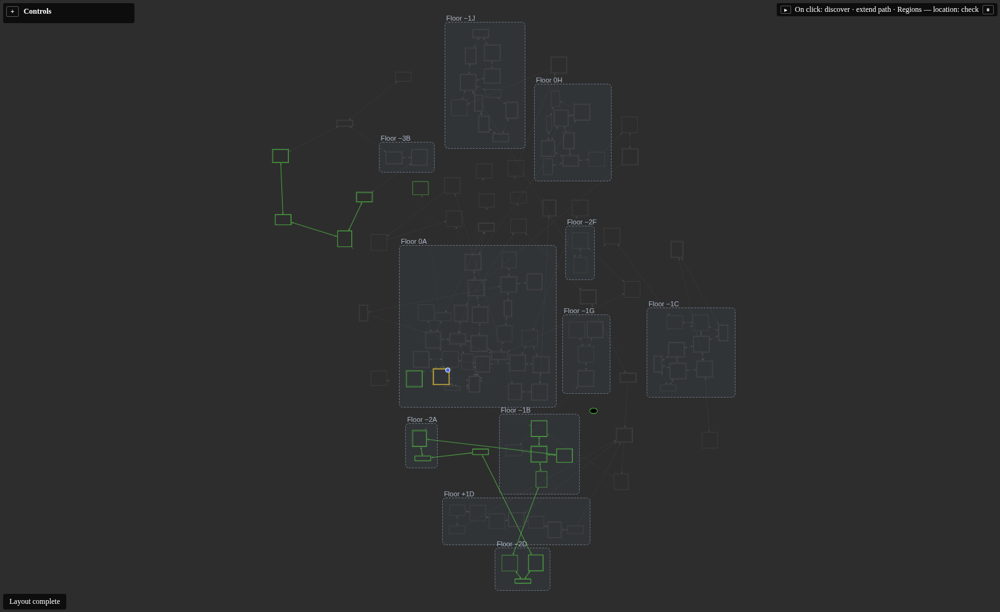
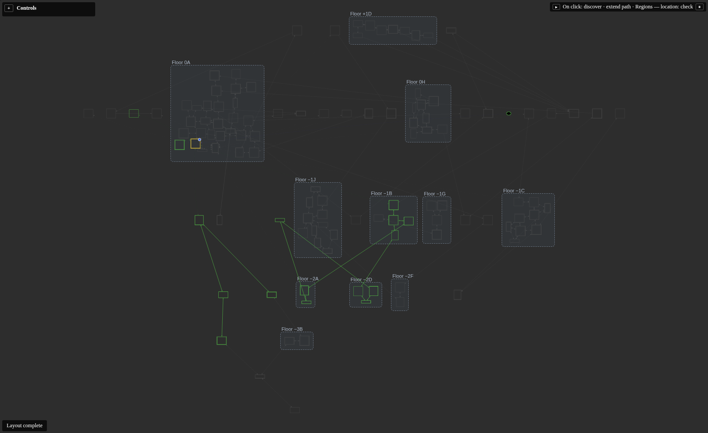
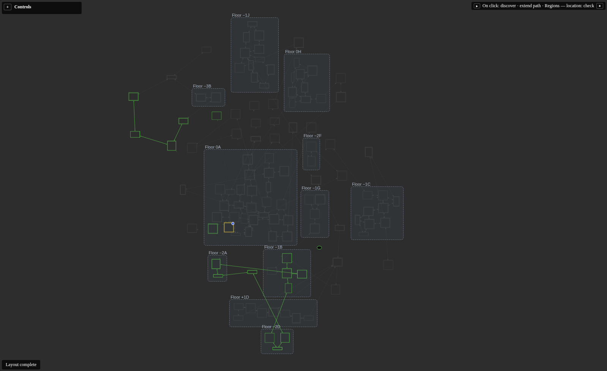
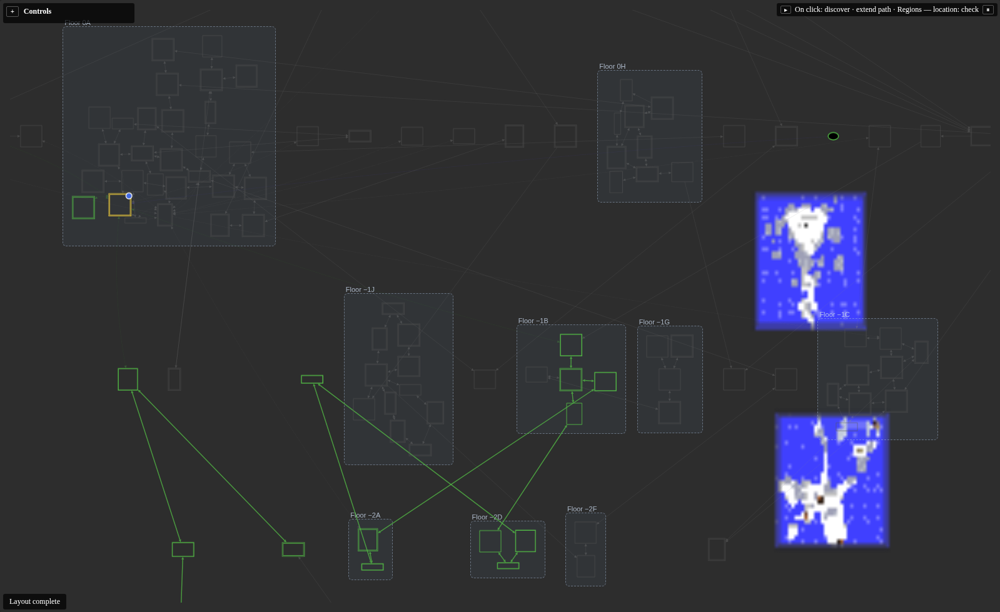
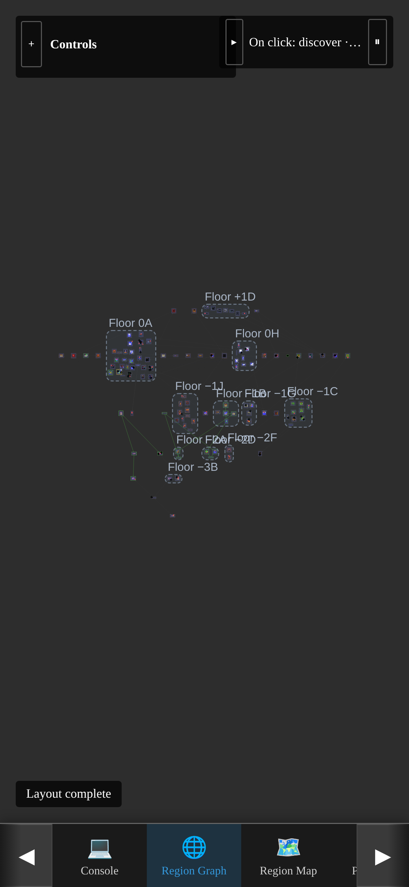

# Region Graph: the floor blocks stacked by floor (higher floors above lower ones)

Slice `region-graph-floor-stacking`, cut from `region-graph-floor-rename-letters`' rename tip `1478ca628e` (declared FINAL
for renames); merged that slice's tip `b43b2ff9b7` (its report and shots only) and origin/main `aa749df335`. Planner
archipelago-cc-23, reviewer js-24. Code: `frontend/modules/regionGraph/floorGroups.js` (`floorBandsOf`, `stackByFloor`,
`floorOrderCheck`), `layoutControlsManager.js` (passes the bands, reports `floorOrder`). No lab-owned file
(`procgenCore/regionLayout.js`, `regionLayoutResolve.js`, `mapCamera.js`), no solver, no label, no Region Map change.

## The user's rulings (session 84c8ab35)

- **2026-11-27T17:46:25.944Z** (the floors slice): *"I choose option a. Adjacent regions would work the way they do now. And
  I want to apply this just to the region graph for now."*
- **2026-11-28T03:33:37.957Z:** *"Yes, I want to arrange the blocks on the map by floor, so higher floors sit above lower
  ones."*
- **2026-11-28T03:46:31.484Z** (AskUserQuestion): **"Replace (Recommended)"**: floor grouping with blocks always stacks by
  floor; the stair-direction block placement goes away; no new setting.
- **2026-11-28T03:55:11.570Z** (AskUserQuestion): **"Floor order wins (Recommended)"**: strict bands; a stair's east / west
  side only sets the block's left-right order within its band. The between-block direction error rising is accepted (it is
  reported below, not treated as a regression).

## What the user sees now

With **Floor grouping** = **Two-step layout** or **Two-step + boxes**, the floors read top to bottom: **Floor +1**'s blocks
in a row at the top, then **Floor 0**'s, **Floor −1**'s, … down to the lowest floor, each row a **Floor gap** below the one
above (default 160 px; one more gap for each empty floor between two used ones). Inside a block nothing changed: levels you
walk between stay side by side, north above south. Along a row, the blocks keep the left-right order the doors and stairs
give them: a staircase in the east of a level still puts the floor it leads to further right, but now in that floor's own
row. Off and Soft pull together are unchanged. A world whose groups are all on one floor (A Link to the Past, a maze,
seedling_atlas) is laid out exactly as before.

| Before (blocks where the stairs' directions put them) | After (stacked by floor) |
|---|---|
|  |  |
|  |  |

seedling_playthrough, merged + Region Map cells, Two-step + boxes, desktop 1600 × 1000, Direction-aware defaults. The
second row zooms on the blocks of Floors −2 … 0 (`Floor 0A, 0H, −1B, −1C, −1G, −1J, −2A, −2D, −2F`). Before, Floor +1D sat
below Floor −2A and Floor −1J at the top; after, the rows run +1, 0, −1, −2, −3 from the top. The map cells are drawn as
their bake lands; some are still placeholders in these frames.

The 390 px phone (no horizontal scroll; 11 boxes): 

## The design (approved by archipelago-cc-23 before the build)

Step 1 is unchanged (each floor group laid out alone). Step 2:
1. The block relaxation runs exactly as before (stair directions, `floorGap` on the floor links). Its result now sets only
   each block's **left-right order and x**.
2. Each block gets a **band**: a picked floor → that floor; a **range** group ("Floor −3 to −1 A") → the middle of its range,
   rounded up (−3 … −2 → −2); an **unreached** group ("Floor ? A") → its own band at the bottom; a node with no floor group
   (the Menu) → floor 0's band.
3. Bands top to bottom, highest floor first; each as tall as its tallest block, blocks centred on it; `floorGap` between two
   used floors plus one `floorGap` per empty floor between them; the unreached band `floorGap` below the lowest floor.
4. Within a band: sorted by the relaxed x (ties by key), packed left to right with at least the spacing between blocks
   (each left edge = max(its relaxed left edge, the previous right edge + spacing)), then shifted so the blocks' mean x is
   their relaxed mean x.
5. **Guard:** no numbering, or blocks on fewer than 2 numbered floors → the relaxation's placement, byte for byte.

Bands, not a weaker "floor spring": a spring only biases the relaxation and cannot promise 0 order violations; the bands
give 0 violations and 0 block overlaps by construction. The **order check** (`floorOrderCheck`): every pair of blocks whose
floors are strictly ordered (one's range wholly above the other's) must sit wholly above it on screen; a range group is
exempt against a floor inside its range; unreached groups and the Menu are not held to it.

The **Floor gap** setting keeps its key and range; its meaning is now the gap between two floors' rows (its description
says so). The panel's report gains `floorOrder: { pairs, violations, stacked }` and `floorBlockFloors`.

## The counts

seedling_playthrough, Direction-aware defaults, Two-step layout (vitest over the frozen rules and atlases,
`floorStacking.test.js`; the browser run's numbers in `floor-stacking-shots/shots-run.json` agree within a few pairs):

| | merged · map: before | after | separate · graph: before | after |
|---|---|---|---|---|
| block pairs on ordered floors | 665 | 665 | 665 | 665 |
| … the wrong way up | **406** | **0** | **381** | **0** |
| node overlaps / block overlaps / intruders | 0 / 0 / 0 | 0 / 0 / 0 | 0 / 0 / 0 | 0 / 0 / 0 |
| mean angle error **inside** blocks (n) | 9.2° (81) | 9.2° (81) | 14.0° (86) | 14.0° (86) |
| … flat links **between** blocks (n) | 25.8° (16) | 69.7° (16) | 36.9° (19) | 69.5° (19) |
| … stair / pit links between blocks (n) | 31.2° (28) | 72.3° (28) | 48.5° (35) | 73.1° (35) |
| … every edge with a direction | 12.1° | 21.9° | 18.2° | 26.3° |

(merged · graph: 442 → 0, the same pattern.) The bands on seedling_playthrough: `+1: 4 blocks, 0: 20, −1: 10, −2: 6, −3: 2,
−4: 1, −5: 1`. The between-block error rises because a link between two floors now runs mostly up / down the screen; that
is the 03:55:11.570Z ruling, accepted.

**Cost:** the solve 2.9 ms (merged) / 5.2 ms (separate) in the browser, 28 ms on the first, cold run; ≤ 6.5 ms in vitest
(cap 50 ms). The whole layout 29.5 ms merged, 145 ms separate (307 nodes). Stacking is a sort and a sweep per band: no
measurable change against the same run unstacked (30.8 ms merged).

**What does not change** (pinned): `none` / `soft` positions never read the bands (byte-identical; the soft digests in
`floors.test.js` hold); `twoStep` with the floor links off (the dungeon-groups digests) holds; alttp, procgen_topdown,
procgen_maze and seedling_atlas give the same `twoStep` / `twoStepBoxes` positions stacked or not (`bands: null`).
**Determinism:** two insertion orders of nodes and edges (reversed, rotated, flipped edges) → the same positions digest,
for every value (`floorGroups.test.js` §5, now passing the bands) and the synthetic case; a repeat run in the browser gives
the same positions.

## Proof

- **Vitest (bounded, ⚖ 52):** `npx vitest run frontend/modules/regionGraph/ frontend/modules/regionMap/
  frontend/modules/storagePanel/ frontend/modules/regionView/ frontend/modules/quickLaunch/ --maxWorkers=3`: 55 files,
  800 tests, green at the merge `439dbf6571`. New: `floorStacking.test.js` (15): the order before / after on merged · map,
  merged · graph and separate · graph for both two-step values; the bands at gaps 0 / 160 / 600; the range and unreached
  rules, an empty floor's extra gap, the in-band order, the order check on a swapped band; the guard; determinism; the
  four unchanged worlds; purity. `generate-docs-index.mjs --check` is current.
- **Pins that moved:** `floors.test.js` §3 (the floor-gap pin of the stair-direction placement) now names its "before"
  (`floorStacking: false`); `floorGroups.test.js` §5 passes the bands to its insertion-order calls, as the panel does.
- **In-app:** `test_region_graph_sub_region_merged` now reports the floor order: 0 pairs the wrong way up, and stacking on
  exactly when the blocks span 2+ floors. ⚠ Its world, seedling_atlas, spans ONE floor, so there the check is the guard
  (`0 ordered pair(s) … stacked false … 1 floor(s) spanned`); the multi-floor order is pinned in vitest. The added check
  is one `reportCondition` (no poll); the row's twoStepBoxes step took 62 ms. All 15 Region Graph rows of
  test-substrates green on both boots at `439dbf6571`; the local `fast` batch 146 / 146 at `73a3d0e1b3`.
- **Engine:** closure ∩ diff = ∅ (`seedlingDerivedRuleTable.js --print-engine-closure`); engineMd5
  `6c8cd75145bdf58d2eed7d7cc9e6b512`, the same as origin/main's.
- **CI at `439dbf6571`:** JSUT push run `46110925008` success (unfiltered suite 30752 passed, 0 failed; slow battery 470 / 470); unittests
  `46110924949` success; train tier (TT, `train_only`) `46110930642`: 3 / 3 shards success; tutorials-tracker
  `46110932796`: 9 / 9, headroom 56.2 s of 600 s (9 %); `fast` on the bundled boot `46110934783`: 147 / 147, headroom
  **328.7 s of 600 s (55 %)** against 315.6 s (53 %) at origin/main `aa749df335` (job 140859882498) — no warning, so no
  repeat=8 attribution was needed. (The local `fast` run graded 454 s (76 %, WARN): this box's speed; CI is the measure.)

## Follow-ups

1. **Labels collide on the phone.** At 390 px, two boxes side by side in a row put their labels on top of each other
   ("Floor −1B" and "Floor −1G"): the labels are a fixed screen size, the blocks are packed by graph size. Labels were out of
   scope; options: shrink or hide labels below a zoom, or pad the in-band gap by the label width at fit.
2. **No multi-floor in-app row.** The order check in the browser runs on seedling_atlas (one floor). A row on
   seedling_playthrough would exercise the bands in-app, at the cost of loading a second world.
3. **Rows are flat.** Each row centres its blocks on one line; the relaxation's up / down offsets inside a floor are
   dropped. A row could keep a bounded share of them (still inside its band) if a floor's blocks read better staggered.
4. **The floor 0 row is long** on seedling_playthrough (20 blocks, most of them single levels behind doorways). Wrapping a
   row past a width would need a rule for which blocks go to the second line.
