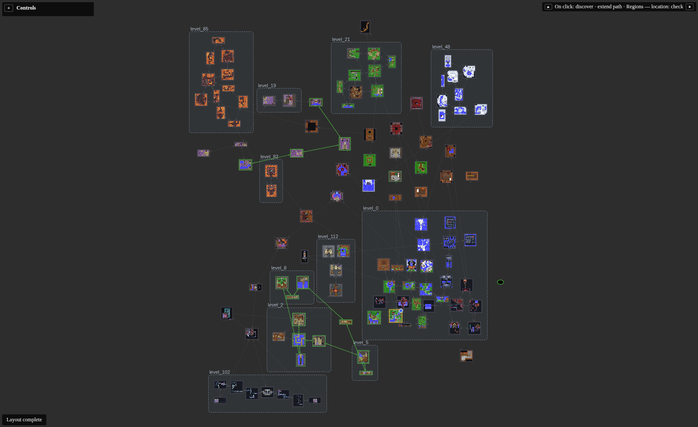
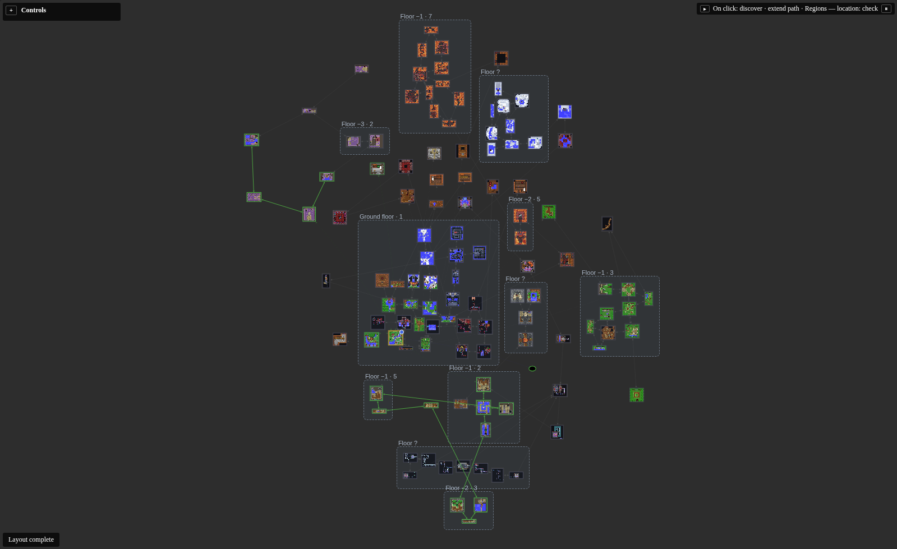
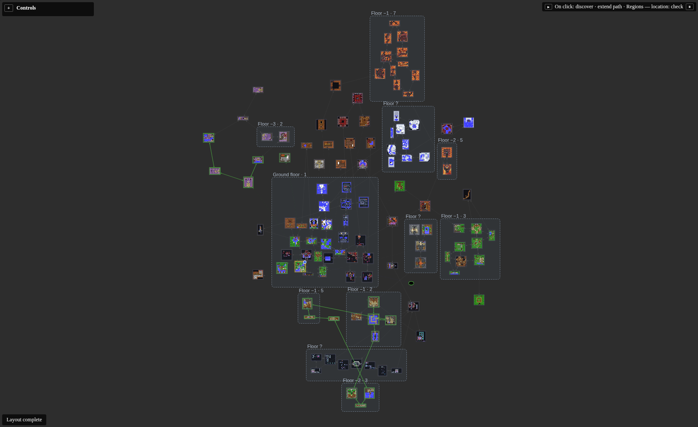
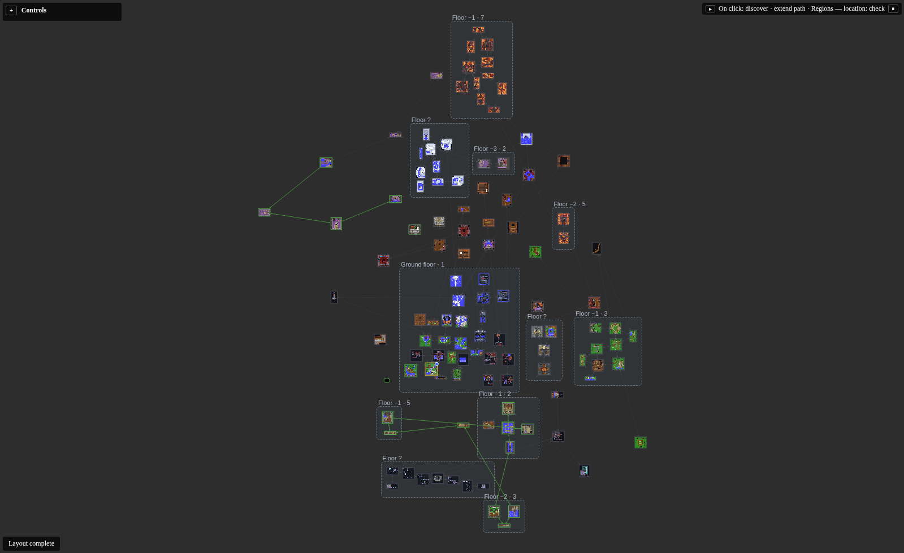
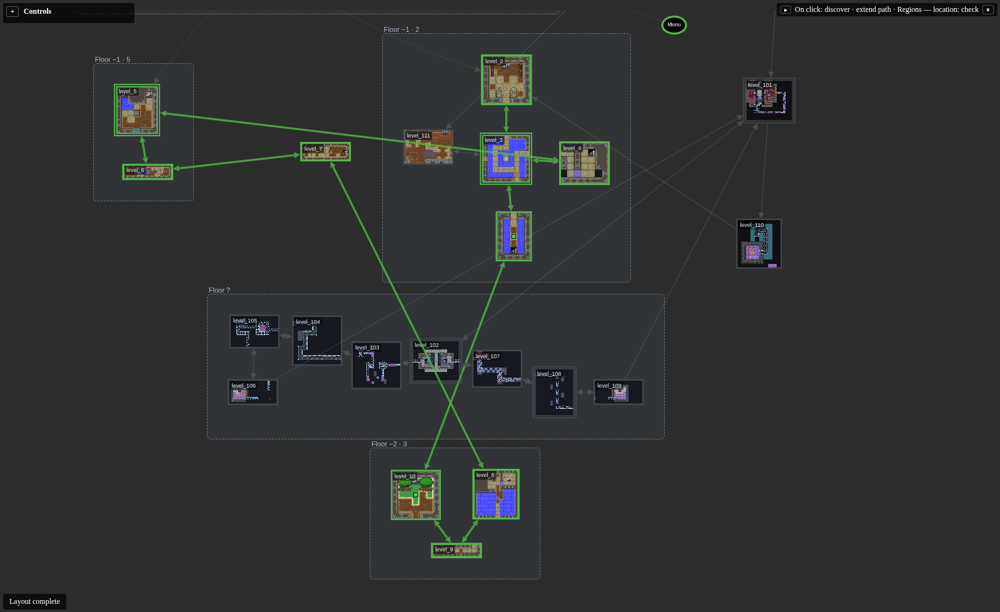

# Region Graph: Floors for the two-step Dungeon grouping

**Status: built, gated.** The two two-step values of the Direction-aware layout's **Dungeon grouping** (**Two-step
layout**, **Two-step + boxes**) now lay out **floors**. Stairs and pits between two dungeons are longer links that
keep a direction, which comes from where the stairs are in their level. Walking links are unchanged. The boxes are
labelled by **floor number**, with the start region's floor as the **Ground floor**. One new setting: **Floor gap**.
**Off** and **Soft pull together** are unchanged, and so is the Region Map.

Base: region-graph-dungeon-groups' frozen land tip `001abda603` (train 230). `git merge-base HEAD origin/main` at launch
was `102dcbeb169dc3d039419f64e9538aede92ee270`. origin/main moved to `960ff0a862` (train: hammer-flip-lhm) during the
slice. It was merged cleanly (`d45412f101`); no file of this slice was touched by it. **The packet tip is
`ccbe945e98`**, and every CI gate in §7 ran there. This report and its shots are committed after it; they touch no
code that CI runs. Planner: archipelago-cc-23. Reviewer and landing queue: seedling-js-planning-24 (js-24).

## ⚖ The rulings (session 84c8ab35)

- **2026-11-27T17:33:36.161Z**, after the dungeon-groups report: *"I should have started with a conversation about
  what counts as a dungeon. How does the current version decide what is a dungeon?"* (Answer: R1, the levels joined
  by `join` exits; stairs and pits never join.)
- **2026-11-27T17:40:33.236Z:** *"To get this fully accurate, we would need to label the regions manually. I'm
  reluctant to do that because that would only work for the original layout, not entrance randomization or anything
  else that changes the layout. One thing I want to try next is changing the layout so that it tracks up and down,
  with stairs and pits. Up and down on the map already represent north and south. I want regions connected by a north
  south link to appear adjacent to each other. I want regions connected by an up down link to be further apart, but
  with the correct direction in the map."*
- **2026-11-27T17:46:25.944Z**, offered (a) where the stairs are in the level, (b) one fixed offset, (c) one fixed
  direction per kind: *"I choose option a. Adjacent regions would work the way they do now. And I want to apply this
  just to the region graph for now. Let's make this a modification to the current dungeon system, where instead of
  labeling by the first region in the group, we label by the floor number, with the starting region being ground
  floor."*

So: **(a)** sets the direction; **flat links unchanged**; **the Region Graph only**; **`twoStep` / `twoStepBoxes`
modified**, with no new value; **floor-number labels**. **Nothing manual**: everything comes from the exits.

## 1. What the user sees

seedling_playthrough, **Merged**, Node look **Region Map cells**, **Two-step + boxes**, Direction-aware defaults
(strength 0.7, spacing 40, border doors):

| Before (dungeon-groups: labels = root level) | After (floors, Floor gap 160) |
|---|---|
|  |  |
| **Floor gap 80** | **Floor gap 320** |
|  |  |

- **Inside a floor nothing moved**: each dungeon is laid out alone by the same relaxation, so the walking links keep
  their directions and spacing. The in-dungeon angle error is the same before and after (8.9° merged, 13.7°
  separate; §5).
- **Between floors**: before, the stairs had no direction at all (under the default "Border doors only", 3 of the 87
  vertical exits gave one, being on their level's border), so a floor could land on any side of the floor its
  stairs lead to: the vertical-link angle error was **95°** (merged), i.e. no better than chance. Now it is **30°**
  (merged) and **48°** (separate) at the default gap, and the floors sit **2× (merged) / 4× (separate)** as far apart as
  two walking neighbours.
- **The labels** read **Ground floor · 1**, **Floor −1 · 2**, **Floor −2 · 3**, **Floor ?**, … (§3).

**One staircase pair up close** (`seedling-stair-zoom.png`): `level_11` (in **Floor −1 · 2**, root `level_2`) has its
stairs down at the SOUTH of its level (tile v = +0.29, u = 0), and `level_10`'s stairs back up are at the north of
its level (v = −0.29). Both say "the lower floor is south". `level_10`'s floor, **Floor −2 · 3** (root `level_8`),
lands 408 px away, 20.8° off due south:

**Separate** (307 nodes), Two-step + boxes: 23 boxes, 0 overlaps (`seedling-separate-twoStepBoxes.png`).
**The Floor gap control** (`seedling-floor-controls.png`) sits under Dungeon pull.
**alttp** opens with its default layout, unchanged (`alttp-default.png`), and its Direction-aware run in `twoStep`,
`twoStepBoxes` and `twoStep` at gap 600 gives exactly `none`'s positions in the browser (`allEqualNone: true`, inert,
no box). **The 390 px phone**, merged + map, Two-step + boxes (`phone-390-twoStepBoxes.png`): 11 boxes, floor labels,
0 overlaps, no horizontal scroll. The phone run logged the known boot `SecurityError` from an iframe panel (groups-a
§1, dungeon-groups §1); the desktop runs logged no error.

## 2. What is vertical, and its direction (option a)

**Vertical link** = a rules exit whose display pair is a `down` or `up` link of the Region Map model's own layout
graph (`model.layout.graph.links`), between two DIFFERENT groups. The kind is read per display pair. On the frozen
seedling_playthrough **every directed display pair carries one kind** (0 pairs with two, measured), so an exit's kind
is its pair's. In Seedling, `down` = `out_stairsdown_*` / `out_pit_*` and `up` = `out_stairsup_*` (the adapter's own
`seedlingExitLayoutKind`; nothing here names the substrate). A stair inside one group (the group is joined by a walk
elsewhere) stays a flat link. There are 3 such exits, left as they were.

**The direction rule** (`floors.js` `stairOffset`): the same normalisation as a door (`directionLayout.js`
`doorOffset`): tile `(x, y)` in a level of `W × H` tiles → `u = (x + ½)/W − ½`, `v = (y + ½)/H − ½`. But it uses the
**vector rule**, not the door's edge-side rule: direction `(u, v)/|(u, v)|`, from the level's centre to the stair.
Stairs in the east of a level put the floor they lead to further east.
- **Weight** `min(1, 2·max(|u|, |v|))`: the interior-door weight, so a stair near the centre says little.
- **At the centre**: |u| ≤ 0.05 **and** |v| ≤ 0.05 (the middle tenth of the level both ways) gives **no direction**,
  length only. So does a missing tile or extent.
- **Per drawn edge**: the exits' weighted directions summed, a T→S exit negated (`edgePreferences`' rule).
- **Per floor pair** (the block edge): the edges' vertical directions summed.

**Counts** (frozen fixtures = live presets; vitest §1 and the browser agree):

| preset | vertical exits | with a direction | at the centre | no tile / extent | stairs inside a group (flat) |
|---|---|---|---|---|---|
| seedling_playthrough | **87** | **82** | **5** | 0 | 3 |
| seedling_atlas | 0 | 0 | 0 | 0 | 0 |
| alttp | 0 | 0 | 0 | 0 | 0 |
| procgen_maze | 0 | 0 | 0 | 0 | 0 |

**What the base already did with stairs** (asked by the brief). `directionLayout.js` gives an exit a preference only
through `doorOffset`. Under the default **Border doors only**, an interior stair has none: of the 87 vertical exits,
**3** are on their level's border and had one, 80 are interior, and 4 sit exactly at the centre. Under **All doors**,
the interior ones get the door rule (side normal, tilted, interior weight `min(1, 2·max(|u|, |v|))`). On these 83
exits that is 10.8° off the vector rule on average. Inside a group no stair had any effect, since every stair crosses
groups except the 3 above. Between groups, dungeon-groups' block edge summed whatever `pref` the drawn edges had.
For stairs at the default, that was almost nothing.

## 3. Floor numbers and labels

**Numbering** (`floors.js` `floorNumbers`): over the GROUP graph of vertical links, BFS from the start region's
group (floor **0**).
- Crossing a `down` link from → to: to = from − 1. An `up` link: to = from + 1. Crossed backwards, the opposite.
- Neighbours are visited in sorted group-id order, and the **first assignment wins**.
- A link that reaches an already-numbered group at a different number is a **conflict**, reported with both paths.
- A group no vertical path from the start reaches gets no number.

**Labels** (`floorName`, `floorLabels`):
- **Ground floor**, **Floor +1**, **Floor −1** (U+2212), … and **Floor ?** for an unnumbered group.
- **Several groups on one floor share its number, plus " · k"**, where k is the group's place in BFS discovery order
  on that floor: · 1 is the first reached from the start, the one fewest stair links away. I picked discovery order
  because it is view-independent (the same label in merged and separate) and it means something: · 1 is the nearest.
  Id order would be arbitrary, and a position order (left to right) would change with the floor gap.
- **The unnumbered all read "Floor ?"**, with no suffix: discovery order from the start says nothing about a group
  the start never reaches.
- **The root level id is kept on the box**: `data-root` and the box's `title`, plus `root` in `dungeonBoxLayer.report()`.
  ⚠ The box layer sits UNDER Cytoscape's canvas with `pointer-events: none` (dungeon-groups §4), so the title does
  not show on hover. The id is there for tools and tests, not yet for the eye (follow-up 3).

**seedling_playthrough** (43 groups): **23 numbered**, from **Floor −5** to **Floor +1**, and **20 unreached**
("Floor ?": two of them are boxed in merged, `level_48` (9 levels) and `level_102` (8), which you enter by a doorway
(a `warp`), not stairs; the rest are single levels). Of its 11 boxes in merged: Ground floor · 1 (`level_0`, the
start's), Floor −1 · 2 (`level_2`), Floor −1 · 3 (`level_21`), Floor −1 · 5 (`level_5`), Floor −1 · 7 (`level_85`),
Floor −2 · 3 (`level_8`), Floor −2 · 5 (`level_82`), Floor −3 · 2 (`level_19`), and three Floor ? (`level_48`,
`level_102`, `level_112`).

**Conflicts: 4 links, on 2 groups** (`level_5`, `level_7`). The game's levels are not stacked consistently. Two
examples:
- **`level_5`** is numbered **−1** first: `level_0` →(`level_12` stairs down to `level_5`) **−1**, where
  `level_12` is in the ground floor's own group. A second link reaches it at **−2**: `level_0` →(`level_0` down to
  `level_2`) **−1** →(`level_4` down to `level_5`) **−2**. Both the ground floor and the `level_2` dungeon go one floor
  down into the same group; the second link (and its `level_5` → `level_4` up twin) is the conflict, and it keeps
  **−1**.
- **`level_7`** is numbered **0** first: `level_0` →(down to `level_5`) **−1** →(`level_6` stairs up to `level_7`)
  **0**. A second route reaches it at **−1**: `level_0` →(down to `level_2`) **−1** →(`level_11` down to `level_10`,
  crossed backwards from its up twin) the `level_8` dungeon at **−2** →(`level_7` down to `level_8`, crossed
  backwards) **−1**. It keeps **0** ("Ground floor · 5"; a single level, so no box).

seedling_atlas: 1 numbered (the start, `overworld_start`), 2 unreached: its one box, `dungeon1_room1`, is
**Floor ?** (entered by a doorway). alttp and the maze: no vertical link, so every group but the start's is unreached,
and every value is inert there (no box at all; §4).

## 4. The floor gap, and what does not change

**The block step** (`dungeonGroups.js` `twoStepLayout`, step 2). A block edge (one per pair of linked dungeons) that
carries **any vertical edge** is a **floor link**:
- it prefers the **sum of its vertical directions** (weight `|Σ wᵢdᵢ| / n` over its vertical edges; length only when
  none has a direction);
- it rests at the **Floor gap** instead of the spacing. `directionLayout` takes an optional per-edge `gap`; absent, it
  is the spacing, so every other call is byte-identical.

Every other block edge (a warp-only pair) and every in-dungeon layout is exactly as before. The blocks still end
with 0 block overlaps and 0 nodes inside another dungeon's block (vitest §3, every browser run).

| setting | key | values | default |
|---|---|---|---|
| **Floor gap** | `moduleSettings.regionGraph.floorGap` | 0 – 600 graph px (number, step 10); used by `twoStep` / `twoStepBoxes` only | **160** |

The setting is declared in the panel's settings schema (`regionGraph/index.js`, `floorGap: { ...FLOOR_GAP_SCHEMA }`).
The schema's `default` is the only default, and an out-of-range value reads clamped, a wrong type as the default. It
is a leaf of the existing `moduleSettings` blob, saved per key, as `dungeonGrouping` and `dungeonGroupStrength` are:
**no new localStorage key**, and the storage census does not move (`storageCensus.test.js`,
`storageDeclarationPins.test.js` green in the bounded run). A write re-runs the layout when Direction-aware is drawn
(`isDirectionSettingKey`), and never rebuilds. **Why px, why 160**: px like the spacing next to it. Floor gap = 0
already places a floor link at the same distance as a warp-linked pair. 160 puts the mean floor link at about
**2×** a walking link in merged and **4×** in separate. Above it, the length grows with the gap and the direction
holds (§5), so 160 reads clearly as "further apart" without spreading the graph thin.

**What does not change** (vitest §4, digests measured with the BASE files swapped in):
- **`none`**: dungeon-groups' 7 pinned digests, unchanged (its §1 still green).
- **`soft`**: never reads the floors. Its digests at pull 0.5 and 1, in 5 preset × view cases, are the base's. I did
  not apply the vertical rule to `soft`: it is one relaxation with no blocks, so "further apart" there would mean a
  longer spring per stair edge inside the mixed layout, a different design. Flagged as a question (follow-up 6).
- **`twoStep` with the floor links off** (`buildDirectionLayout(…, { floorLinks: false })`, used for the "before"
  shots) is dungeon-groups' `twoStep`, byte for byte, in the same 5 cases.
- **Worlds with no vertical link**: seedling_atlas `twoStep` at gaps 0 / 160 / 600 = its base digest. alttp and the
  maze stay inert (no drawn edge joins two dungeons) in both two-step values at any gap, with no box. The browser
  agrees on the live alttp.
- **The Region Map**: no file under `regionMap/`, `procgenCore/` or any substrate changed. `floors.js` reads the
  model `buildRegionMapModel` already returns. The lab-owned `mapCamera.js`, `regionLayout.js` and
  `regionLayoutResolve.js` are untouched.

## 5. The table

Browser, Chromium headless, this box, Direction-aware defaults (`scripts/dev/shot-region-graph-floors.mjs`, at the
packet tree). **Before** = `twoStep` with the floor links off, i.e. dungeon-groups' twoStep.
- **Flat** = edges with an exit direction and no vertical link: **inside** one dungeon, or **between** two (a warp).
- **Vertical** = edges with a stair / pit between two dungeons, measured against their vertical direction (the same
  measure for before and after).
- **Lengths** are mean centre-to-centre px.
- **ms** = the layout's own block (`report.totalMs`); **block** = the longest main-thread task (PerformanceObserver
  `longtask`; — = none over 50 ms).

**seedling_playthrough, merged + map** (116 nodes; 97 flat edges with a direction, of which 16 between dungeons; 28
vertical edges with a direction):

| run | flat mean / p90 | inside / between (mean) | **vertical mean / p90** | flat len | **vertical len** | overlaps | block ov. | in another | ms | block |
|---|---|---|---|---|---|---|---|---|---|---|
| before (dungeon-groups twoStep) | 10.4° / 22.2° | 8.9° / 18.5° | **95.2° / 166.3°** | 238 | 468 | 0 | 0 | 0 | 138 | 173 |
| floor gap 0 | 11.4° / 25.1° | 8.9° / 24.0° | 38.4° / 87.8° | 243 | 380 | 0 | 0 | 0 | 157 | 182 |
| floor gap 80 | 11.0° / 25.1° | 8.9° / 21.6° | 33.8° / 83.9° | 238 | 407 | 0 | 0 | 0 | 118 | 159 |
| **floor gap 160 (default)** | 11.8° / 25.8° | 8.9° / 26.7° | **29.9° / 76.9°** | 241 | **473** | 0 | 0 | 0 | 49 | 71 |
| floor gap 320 | 11.3° / 24.3° | 8.9° / 24.0° | 30.5° / 77.4° | 248 | 608 | 0 | 0 | 0 | 59 | 85 |

**seedling_playthrough, separate** (307 nodes; 105 flat, 19 between; 35 vertical):

| run | flat mean / p90 | inside / between (mean) | **vertical mean / p90** | flat len | **vertical len** | overlaps | block ov. | in another | ms | block |
|---|---|---|---|---|---|---|---|---|---|---|
| before (dungeon-groups twoStep) | 14.3° / 31.1° | 13.7° / 17.0° | **92.1° / 159.7°** | 157 | 576 | 0 | 0 | 0 | 111 | 164 |
| floor gap 0 | 17.9° / 35.7° | 13.7° / 36.9° | 54.3° / 114.9° | 161 | 580 | 0 | 0 | 0 | 129 | 177 |
| floor gap 80 | 18.3° / 37.4° | 13.7° / 38.9° | 48.7° / 110.4° | 161 | 638 | 0 | 0 | 0 | 120 | 168 |
| **floor gap 160 (default)** | 17.7° / 35.7° | 13.7° / 35.5° | **47.7° / 119.1°** | 160 | **660** | 0 | 0 | 0 | 143 | 198 |
| floor gap 320 | 18.0° / 34.8° | 13.7° / 37.2° | 44.4° / 106.2° | 161 | 805 | 0 | 0 | 0 | 122 | 162 |

**seedling_atlas, merged + map** (5 nodes; no vertical link): every run 0.0° / 0.1° flat, 158 px, 0 overlaps, the same
positions before and at every gap (vitest §4), layout ≤ 21 ms.

- **The vertical links now point**: 95° → 30° (merged) and 92° → 48° (separate) at the default. Before, they pointed
  no better than chance (90°). Their p90 stays high (77° / 119°) because a floor is a RIGID block. When several
  staircases between two floors (or a floor's links to three others) disagree, one block offset cannot satisfy them
  all; anchoring the springs at the stairs' own nodes (dungeon-groups follow-up 2) is what would cut that tail.
- **Longer**: the floor link grows with the gap in both views; at 160 it is 2.0× (merged) and 4.1× (separate) the
  walking link.
- **Flat links inside a floor are unchanged** (8.9° / 13.7° in every row: the same in-dungeon layouts). **The cost
  is on the warp links between dungeons** (18.5° → 26.7° merged, 17.0° → 35.5° separate): a block now answers to its
  floor links too, so a doorway link between two dungeons bends more. That is the "flat" mean's whole rise
  (10.4° → 11.8°, 14.3° → 17.7°).
- **Timing**: the longest block is **198 ms** (separate, gap 160), under the 891 ms of dungeon-groups' worst value and
  far from the 3 s STOP. Floors add one pass over the exits and a BFS over 43 groups.
- **Determinism in the browser**: two runs at gap 320 gave identical positions in every view measured (`repeatSame`).

## 6. The in-app row

`test_region_graph_sub_region_merged` (seedling_atlas `merged` + map) already sets **Dungeon grouping =
twoStepBoxes** and reads the boxes and 0 overlaps. Its new condition reads that **every box is labelled by its floor**
(`/^(Ground floor|Floor [+−]\d+|Floor \?)( · \d+)?$/`), keeps its root on the box (`data-root` ≠ the label), that
the floors were numbered from the start (≥ 1 numbered), and that there are 0 conflicts. It reads
`[["Floor ?","dungeon1_room1"]]; 1 floor(s) numbered from the start, 2 unreached, 0 vertical link(s), 0 conflict(s)`.
The existing restore then writes Dungeon grouping back to its default and clears the boxes; Floor gap is never
written by the row, so there is nothing more to restore. This box: **PASSED 3.5 s** (the row took 3.5 s at
dungeon-groups too), the added check under 1 ms. In CI: §7.

## 7. Gates (at the tip `ccbe945e98`)

- **JSUT** run 46048641153 (push, headSha `ccbe945e98`): green, **1463 files / 30590 tests** (0 failed), slow battery
  42 / 470. Base main `960ff0a862` (run 46032669048): 1461 / 30539. **+2 F / +51 T**:
  - dungeon-groups' own +1 / +32 (its base tip, not yet on main);
  - this slice's +1 F / +19 T: `floors.test.js` (18), plus 1 row of `regionView/nodeSelectedRetired.test.js`, which
    scans every app file of `regionGraph/` (the new `floors.js` enrols there).
- **unittests** 46048641170: green.
- **TT** (test-templates, dispatched) **46048651420** and the re-sample **46054518945**: all 9 jobs green, twice
  (fast, fast bundled boot, apworld, playback-bot, seedling-js, seedling-js-solver, seedling-wasm, ALTTP regression,
  on-push). Read job by job.
- **tutorials** 46048654738 and **tutorials-tracker** 46048658025 (`test-substrates-manual.yml`, each job named by its
  batch): green. **fast, bundled** (`-f batch=fast -f bundled=true`) 46048662063: green. Every Region Graph row and walk
  is in those batches: green on both boots.
- **Headroom** (fast batch, 600 s budget). Main `960ff0a862`, 3 TT samples (46046640960 push, 46032672662, 46048477276
  dispatched): fast 337.2 / 338.2 / 317.2 s, **median 337.2**; fast-bundled 341.0 / 330.0 / 337.3 s, **median 337.3**.

  | tip sample | fast | Δ median | fast-bundled | Δ median |
  |---|---|---|---|---|
  | TT 46048651420 (bundled also `-f batch=fast -f bundled=true` 46048662063) | 320.1 s (53%) | −17.1 | 326.8 s (54%); 335.7 s (56%) | −10.5; −1.6 |
  | re-sample, TT 46054518945 | 327.5 s (55%) | **−9.7** | 325.2 s (54%) | **−12.1** |

  Under the +20 s STOP and the 70% line, and fast-bundled is under 60%. No repeat=8 was needed.
- **The in-app row in CI**: `test_region_graph_sub_region_merged` PASSED **2.5 s** (fast) and **2.5–2.6 s** (bundled)
  in both tip TTs and the bundled dispatch, against **2.4–2.5 s** and **2.5–2.7 s** at main (3 runs each): ≈ **+0.1 s**
  per boot, under the 0.5 s cap.
- **Closure ∩ diff = ∅**: 0 of the 42 files of `node scripts/procgen/seedlingDerivedRuleTable.js
  --print-engine-closure`, run AT the tip, are among the 25 files of `git diff --name-only origin/main...HEAD`.
  **engineMd5 `74ae60f575531492ed9eaec1839e1fe3`** at the tip = base. **0 gitlinks.**
- **Queue overlap** (js-24's edit 2): `git merge-tree --write-tree` of the tip with origin/main (`960ff0a862`) and with
  region-map-maze-hooks' tip (`af3537dc87`): both clean, and **no file in common** with maze-hooks: no overlap in
  `regionGraph/fixtures` (untouched here) or the docs census.
- **Bounded vitest** (§8) and the in-app rows on this box (`…_nested` 2.3 s, `…_merged` 3.5 s, PASSED): green. No local
  heavy build was run (no `npm run build`, no `--bundled`): the bundled evidence is CI's.

## 8. Tests

- **Vitest** `frontend/modules/regionGraph/floors.test.js`, **18 tests**, over the FROZEN fixtures (rules and the
  Seedling atlases, `loadFrozenAtlas` with the shipped atlases `vi.mock`ed) and small synthetic models:
  - §1, the direction rule: an interior stair east of centre → east, north-west → its own angle (not snapped to a
    side); at / within 0.05 of the centre → none; no tile → null. `verticalExits` reads the kind off the model,
    counts cross-group only, and a T→S exit is negated on its edge. The per-preset counts.
  - §2, numbering on a 6-group fixture with up, down, a pit (a down), a conflict (both paths) and a warp-only
    unreached group; the labels (shared floor · k, Floor ?). seedling_playthrough's 23 / 20 / 4 conflicts on 2
    groups / −5…+1, its box labels and the DOM box's `data-root` / title.
  - §3, the floor gap: synthetic, gap 0 → 600 strictly longer and within 30° of east, the in-floor link unchanged;
    seedling merged, longer with the gap, the vertical error under half the base's, the in-floor error unchanged,
    0 / 0 / 0 overlaps.
  - §4, `soft` (0.5, 1) and `twoStep` with floor links off = the base digests, in 5 cases; `none` never reads
    floors; seedling_atlas at three gaps = base; alttp and the maze inert, with no box.
  - §5, determinism: two builds at three gaps, both views; reversed link order → the same numbering; no clock or
    `Math.random`.
  - §6, the setting: schema default / clamp / type, registered, `isDirectionSettingKey`, read with no call-site
    default, the control present.
- `dungeonGroups.test.js` (30) moved with the ruling, and nothing else changed:
  - its determinism test now hands the raw layout the same vertical edges the panel does;
  - its box test reads the floor label and the root;
  - its settings test reads `floorGap: 160` alongside the two grouping settings.
- **Bounded vitest** (⚖ 52), `--maxWorkers=3`: `regionGraph/`, `regionMap/`, `regionView/`,
  `procgenCore/regionLayout*`, `tutorials/`, `storagePanel/`, and every test that imports a touched file or scans
  `testCases/` (`flashPanel/flashClickActions`, `procgenCore/documentLibrary`, `quickLaunch/quickLaunchImportOrder`,
  `tests/bundledTestCases`, `testBatches`, `testDiscovery`, `testLogic`, `testWebgpu`,
  `scripts/procgen/walkSeedlingWholeGame`, `scripts/test/compare-runs`, `scripts/test/inAppSummary`): **58 files,
  899 tests, green**.
- ⚠ **A miss, caught before any gate was quoted**: the first push (`d45412f101`) had an apostrophe inside the in-app
  row's single-quoted description. `regionGraphPanelTests.js` failed to import, and the local in-app run found no
  Region Graph row. None of the 58 bounded files imports that module (the discovery tests read the file list, not the
  module). Fixed in `ccbe945e98` with `node --check` over every touched file, and every run at the broken tip was
  cancelled or discarded. A parse check of `testCases/*.js` in vitest would catch this class (follow-up 7).

**Generated pins moved: none.** No generated file carries a Region Graph setting key. `generate-docs-index.mjs
--check` is current. The user page (`docs/json/user/modules/regionGraph.md`, a new #### Floors under Dungeon grouping)
and the developer page (a Key Files line and a Layout Management bullet) changed below their first paragraph.

## 9. Follow-ups

1. **Rename the control.** "Dungeon grouping" groups floors now. "Floor grouping", or "Group by floor", would say what
   it does. Out of scope by the brief.
2. **Block packing** (dungeon-groups follow-up 1), which matters more now. The block relaxation does not know a
   floor link should pass over nothing, so an unrelated block (a "Floor ?" dungeon) can land between two linked
   floors, and their long stair links cross it (`seedling-merged-map-after.png`, `seedling-stair-zoom.png`: the `level_102` block between
   Floor −1 · 2 and Floor −2 · 3). A compaction pass, or a repulsion that pushes third blocks off a floor link's segment,
   would fix it.
3. **The root id on hover.** The boxes sit under the canvas with `pointer-events: none`, so their `title` (floor +
   root level) never shows. A label layer ABOVE the canvas (labels only, pointer events on the text) would show it.
4. **Anchored floor springs** (dungeon-groups follow-up 2): pull each floor link's two STAIR nodes towards the
   preferred offset instead of the block centres. It would cut the vertical p90 (77° / 119°), where several staircases
   between rigid blocks disagree.
5. **Conflicting stacks.** 2 seedling groups are reached at two floor numbers. First-assignment-wins is
   deterministic, but a group could show both ("Floor −1 / −2"), or the numbering could take the majority of its
   links. That is for the user to rule on.
6. **Floors in `soft`?** The vertical direction and a longer rest length could apply to stair edges in the one-pass
   `soft` layout too. Not done (`soft`'s digests are pinned and the ruling named the two-step values); ask first.
7. **Parse every `testCases/*.js` in vitest** (§8's miss): one `node --check`-style import per file would have caught
   the broken description before the push.
8. The other dungeon-groups follow-ups stand: labels at phone zoom, boxes after a rebuild, `soft`'s tuning.
