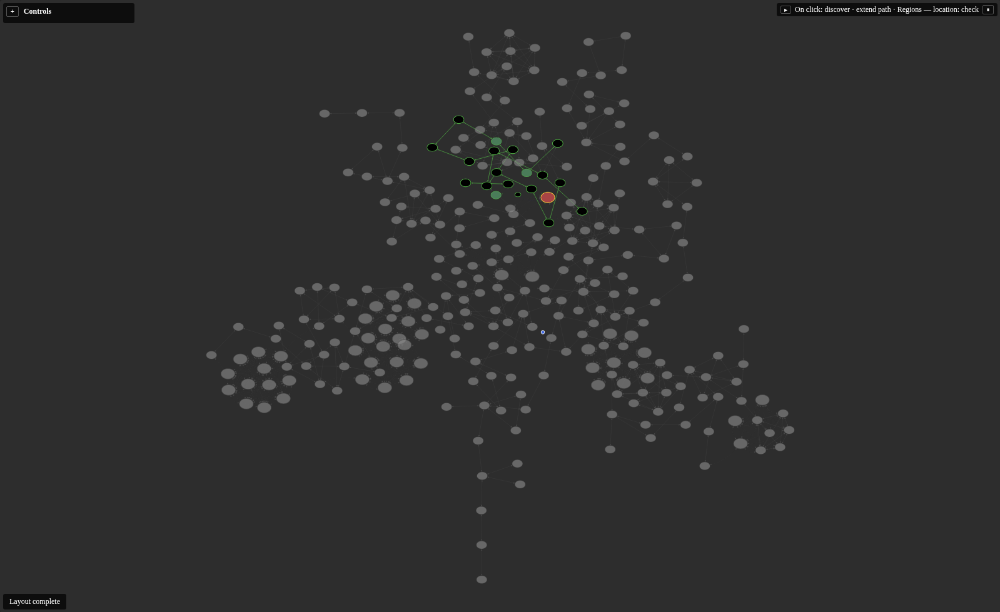
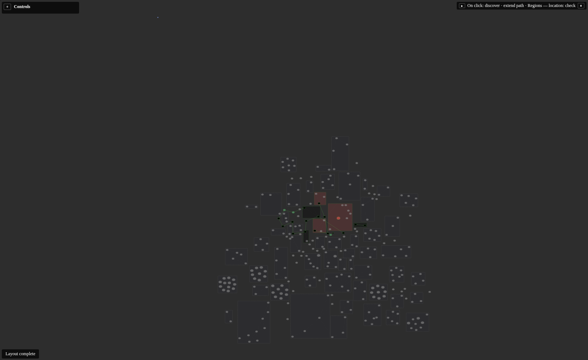
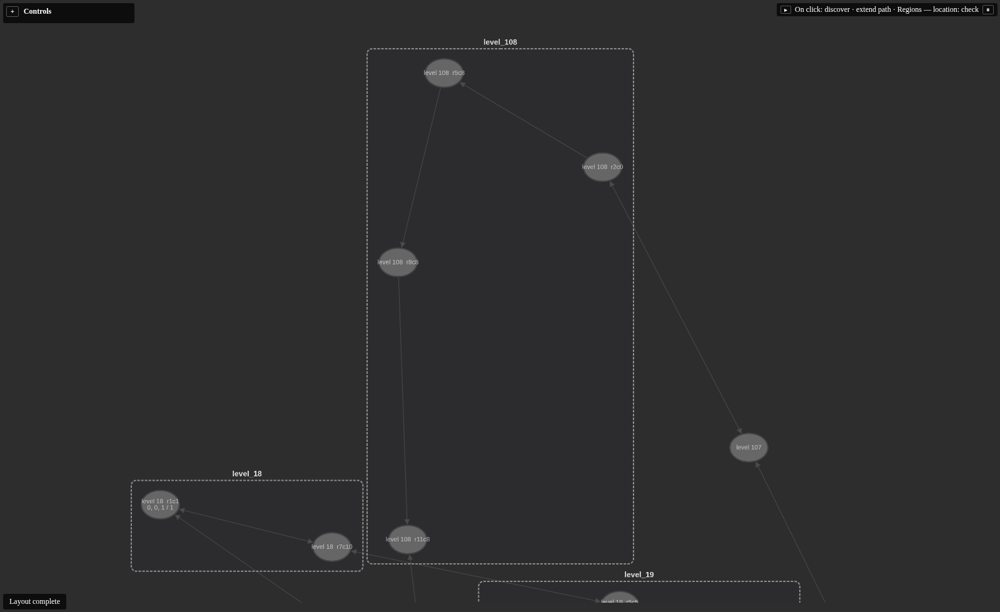
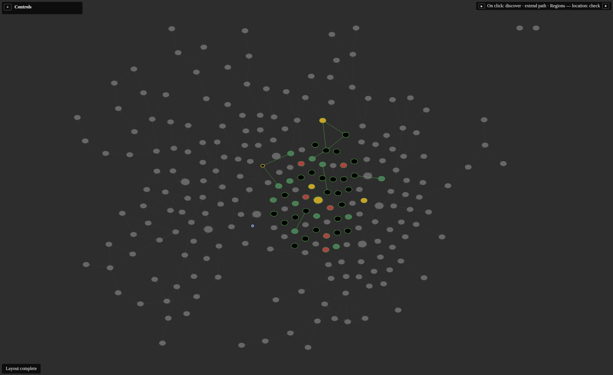
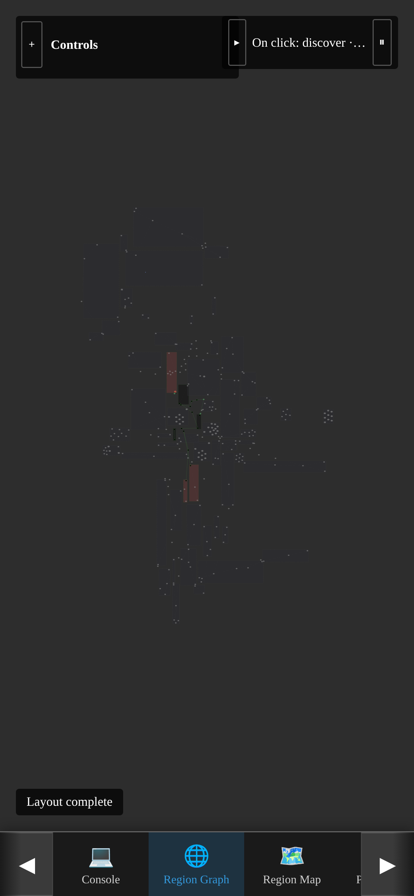

# Region Graph groups A: sub-regions nested in region boxes

**Status: built, gated.** The Region Graph has a new view setting, **Sub-regions → Draw as**
(`moduleSettings.regionGraph.subRegionView`). It has two values: `separate`, today's graph and the default, unchanged
byte for byte; and `nested`, option A, where each region split into sub-regions becomes a box with its sub-regions
inside.

Slice 1 of 3 (A, then B, then C). Base: `6dbadc7364` (`git merge-base HEAD origin/main` =
`6dbadc7364702246fea6474e9b0aee6acc3da08a`; origin/main had not moved at packet time). Code tip: `6a9cdbee7b`, merged with the then-current origin/main `5aaad790eb` (the hammer train): **packet
tip = merge SHA `e71dad3edd`**. The merge took 30 files, none of them this slice's, and moved no submodule.
Planner: archipelago-cc-23. Reviewer and landing queue: js-23.

## ⚖ The ruling (session 84c8ab35, 2026-11-23)

The planner offered four ways to group sub-regions into their whole region:
- A: nested boxes;
- B: one node per region;
- C: collapsed with expand on click;
- D: a toggle between them.

The user ruled: *"For grouping subregions in the region graph, I'll eventually want D, but we can start by implementing
the other options first."*

So each slice adds one VALUE to this one setting. When C lands, switching the setting between all of them IS option D.

js-23's review asked for five edits: the round trip, saved layouts, a row that sets and restores the setting, a default
read only from the schema, and both boots. Each is answered below (§3, §4, §6, §2, §6).

## 1. What the user sees

The shots come from `scripts/dev/shot-region-graph-groups-a.mjs` at `51673ce9fd`, on :8144, in fresh browser profiles.

- **Controls → Sub-regions → Draw as:** a select with *Separate nodes* (the default) and *Nested in region boxes*.
  It sits between Zoom and Location Visibility, with the other view controls.
- **Nested:**
  - Each region split into two or more sub-regions gets a dashed box labelled with its display key (`level_108`), and
    its sub-regions are drawn inside.
  - Edges still end on the exact sub-region.
  - A region with one sub-region has no box.
  - The box's border is green when any sub-region is accessible, and gray when none is. Its tint is the summed
    locations: dark green, gold, red, or black when all are checked.
- **alttp, the maze, and every world without a `displayRegionOf` hook** look the same in both values (§5).
- **Switching the setting** redraws the graph and keeps the regions where they were.
- **Phone, 390 px:** the same graph in the mobile tab. There is no horizontal scroll.
  - The phone run logged one page error: *"SecurityError … Blocked a frame … from accessing a cross-origin frame"*.
    It comes from an iframe panel at boot and is not in any Region Graph code path. The desktop runs logged no error.

Counts, read from the shots run, the in-app row and the vitest; all three agree:

| preset | boxes | members inside | groups of one | regions |
|---|---|---|---|---|
| seedling_playthrough | **60** | **251** | 56 | 307 |
| alttp | **0** | 0 | 239 | 239 |
| procgen_maze (AP_3) | **0** | 0 | 11 | 11 |

## 2. The setting

- **Key:** `moduleSettings.regionGraph.subRegionView`.
- **Label:** *Sub-regions*. The control reads *Draw as*, with option labels *Separate nodes* and *Nested in region
  boxes*.
- **Schema:** `SUB_REGION_VIEW_SCHEMA` in `frontend/modules/regionGraph/subRegionGroups.js`:
  `{ type: 'string', default: 'separate', enum: ['separate', 'nested'] }`. It is registered in `regionGraph/index.js`
  beside `locationVisibility`.
- **The default comes from the schema only (edit 4):**
  - `RegionGraphUI.loadDisplaySettings` calls `settingsManager.getSetting(SUB_REGION_VIEW_KEY)` with no call-site
    default.
  - A stored value the enum does not list reads as `SUB_REGION_VIEW_SCHEMA.default`. That covers an older build
    reading a later slice's `merged`.
  - The vitest `the setting` registers the module's real schema, reads its default (`separate`), and checks that the
    panel's read passes exactly one argument.
- **Room for B and C:** each slice appends its value (`merged`, `collapsible`) to `enum` and adds a label. The
  builder's branch on `subRegionView()` gains a case.
- **Storage (edit 2):**
  - The setting is one more leaf in the existing settings blob, saved per key by `settingsManager`.
  - There is **no new localStorage key**, so there is nothing to declare and the storage census does not move.
    `storageCensus.test.js` and `storageDeclarationPins.test.js` are green in the bounded run.
  - Saved node positions are `RegionGraphUI.nodePositions`, an in-memory `Map` that is **never persisted**.

## 3. How a switch works (edit 1)

A switch **rebuilds** the graph; it does not patch it. Any `moduleSettings.regionGraph.*` write makes
`RegionGraphUI`'s `settings:changed` handler call `loadDisplaySettings`, then `loadGraphData`, which calls
`buildGraphFromRegions`. In `nested`, the builder:
- folds the regions with the view model's `displayGroupsOf` (through `multiMemberGroups`; there is no second fold);
- puts one compound parent per group of 2+ first in the node list;
- sets `data.parent` on each member.

`separate` runs none of this.

- **Switch time on seedling_playthrough** (from the write to the rebuilt graph with 60 boxes): **1919 ms** and
  **2334 ms** in the first version of the in-app row, and 1466 / 2870 ms in the two shots runs. Each includes a
  compound layout pass when the first `separate` layout had not saved its positions yet; a graph with saved positions
  re-uses them (§4). On seedling_atlas (11 regions) the switch takes **141 ms**.
- **Round trip:** `separate → nested → separate` on ONE live graph gives the fresh `separate` element set.
  - The vitest `the round trip returns separate` builds all three on one headless cy.
  - Digest of both: **`8760984c763bdf2e`** (seedling_playthrough, mid state; ids, data, classes).
  - In-app, the row restores the setting and waits for a graph with no box.

## 4. The readers (item 3)

A box is a Cytoscape compound parent:
- class `region-group`, never `region`;
- id `region-group:<key>`, which is never a rules region name;
- data `{ label, groupKey, members, groupCounts }`, with no `regionName`.

`isRegionGroupNode(node)` is the one predicate every reader uses.

| reader | with a box present |
|---|---|
| tap → click actions (`graphInteractionManager.onNodeTap`) | a box runs **nothing** (returns null); a member runs the region actions, once. Vitest + in-app row |
| node picker / Go to (`nodePicker.regionNodes`) | lists nodes with a `regionName`; a box has none, so it is never listed, and Go-to centres on the member |
| centring (`regionGraphCentreAction`, `navigationManager`) | looks nodes up by region name; member ids are unchanged, so they are found as before |
| pathfinding (`shared/pathfinder.js`) | reads `staticData.regions`, which never holds a box; `findPath(member, box)` = null, and no adjacency names one. Vitest |
| path highlighting (`highlightPathEdges`, path labels in `onPathUpdate`) | edges keep their member ids; the label loop skips boxes |
| navigation / player marker (`updatePlayerLocation`) | placed by the member's position (absolute model coordinates for a compound child) |
| status line (`Loaded N regions`) | counts region nodes, not boxes |
| colouring (`onStateUpdate`) | the region loop skips boxes; `updateGroupNodes` recomputes each box from its MEMBERS through the view model (`groupState`), never from node classes |
| zoom labels (`updateZoomBasedVisibility`, `updateRegionLabelsWithCounts`) | skip boxes; a box's label style follows `node.region`'s at each zoom tier |
| discovery placeholders | a box's visibility is the most visible member's: `group-placeholder` (`???`, unless *show undiscovered region names*), and `discovery-hidden` when every member is hidden |
| Loop mode | reads the same click path (`onNodeTap`) and the same path state; no box-specific path |
| location nodes (hover / zoom / force-show) | stay attached to their own member by `parentRegion` and are **not** children of the box. A `drag` / `dragfree` handler on a box re-seats its members' location nodes (no test drives a box drag). Attachment: vitest |
| hub detection | skips boxes (a box has no edges) |
| node overlays (ActionNodes cards) | select `.region`, so boxes never get a card |
| saved positions (`saveNodePositions`, *Export Positions*) | **never hold a box** (vitest). The rebuild's "positions still fit" check counts region nodes, so positions saved in `separate` load in `nested` with no re-layout (vitest: 0 layouts, every member at its saved spot) |

## 5. Layouts (item 4)

Measured on headless Cytoscape with the panel's vendored libraries (`groups-a-layouts-probe.cjs`: 4 boxes × 4
members, 3 groups of one):

| layout | runs with boxes | boxes overlap | non-members inside a box |
|---|---|---|---|
| fcose (*Force-Directed*, hub-optimized) | ✅ | 0 | 0 |
| cose (the auto layout on a non-DAG graph) | ✅ | 0 | 0 |
| breadthfirst | ✅ no error | 2 | 0 |
| circle | ✅ no error | 2 | 0 |
| grid | ✅ no error | 3 | 0 |
| concentric | ✅ no error | 3 | 1 |
| random | ✅ no error | 6 | 60 |
| preset (also *hierarchical-auto*, the procgen grid, a saved layout) | ✅ no error | 6 | 39 |

- The two compound-aware layouts (fcose, cose) arrange the boxes.
- Every other layout places the members as usual, and each box is drawn around wherever its members landed.
- The panel's own preset layouts, **hierarchical-auto** and the **procgen grid**, now skip boxes when they size and
  place rows and cells. A box takes no row slot and no grid cell; this changes nothing in `separate`, which has no
  box.
- A **saved preset layout made without parents** loads: it holds region ids only, and the boxes follow their members.

## 6. Proof

- **Identity (`separate` = base):**
  - Vitest `subRegionView.identity.test.js` was recorded on the BASE commit before any code (commit `f8d8485fe3`). It
    builds through the panel's own builder on a headless Cytoscape: 3 presets × 3 states (start / mid / end), with
    digests of ids + data + classes. It stays green at the tip.

    | preset | start | mid | end |
    |---|---|---|---|
    | seedling_playthrough | `4f315a341e062bf8` | `8760984c763bdf2e` | `1fc2aacecc19bb36` |
    | alttp | `792bf711f6c3d36b` | `9b9f872a2012751e` | `fc1c2cfa0ae4e366` |
    | procgen_maze AP_3 | `47e4ff50a382e106` | `09c8c677aff8563f` | `7605415a11b70d3f` |

  - In-app D0 (`scripts/dev/region-graph-class-snapshot.mjs`, 3 presets × S1–S7):
    - base was `6dbadc7364`'s `frontend/` served on :8145, and the tip was the worktree on :8144;
    - `diff -r` is **byte-identical**: 22 files, aggregate md5 `ebdbd97a42d5bb94d84a81443f07247f` on both sides.
- **Worlds without sub-regions (item 5):** in `nested`, alttp and procgen_maze have 0 boxes, and their digest equals
  `separate`'s at all 3 states (vitest). Every group is a group of one, so the builder adds nothing.
- **Vitest** `subRegionView.nested.test.js` (13 tests) covers:
  - the grouping = `computeRegionView().displayGroups` entries of 2+, members as children;
  - a box is not a region;
  - the edge set is unchanged;
  - the counts;
  - the round trip;
  - the tap handler and the pathfinder skip a box;
  - saved positions;
  - location nodes;
  - the group colour rule;
  - the schema default.
- **In-app row** `test_region_graph_sub_region_nested` (category Region Graph → **fast** batch). It runs on
  **seedling_atlas** (11 regions):
  - It sets `subRegionView = nested` session-only (`ctx.setSetting`).
  - It reads the box count against the same fold at run time: **2 = 2 boxes, 8 members inside, 3 groups of one**.
  - It taps a box: 0 clicks.
  - It taps the nearest reachable member (`dungeon1_room1__r0c4`): the default click action extends the path to it,
    published once.
  - At the end it restores (`ctx.restoreSettings`) and waits for no box.
  - **The row right after it in fast:** `test_region_graph_click_default`. It PASSES at the tip on both boots: locally,
    and in TT (5.1 s / 4.0 s).
  - **Why seedling_atlas:** the first version ran on seedling_playthrough, as the brief asked. It cost
    **19.6 s** in CI fast (9.2 s bundled) and put fast **+24.8 to +38.4 s** over base: a STOP. The planner amended
    the brief and js-23 ruled (2026-11-23) to move the row to seedling_atlas and keep it in fast. The row now takes
    **1.2 s** (fast) and **1.1 s** (fast-bundled) in TT.
  - seedling_playthrough's nested coverage is the vitest (60 / 251 / 56, the round trip, the readers) and the shots.
    The vitest also pins seedling_atlas's 2 / 8 / 3.
- **Local runs at the tip, both boots (edit 5):** the 14 Region Graph rows plus the 4 walks that drive the graph
  (`tutorial-walk-guided-tour`, `-depgraph-extras`, `-tracker-region-graph`, `-tracker-region-map`).
  - At `7e580d7ce4` (the code is the same; the row then ran on seedling_playthrough), **18 / 18 PASS on each boot**:
    `npm test -- --mode=test-substrates --test=…` and the same with `--bundled`.
  - At `6a9cdbee7b`, the moved row and the row after it pass on both boots: 1.9 s / 10.6 s unbundled, 7.6 s / 14.1 s
    bundled, locally.
  - The TT regression job runs one boot. These rows are substrate rows (fast and fast-bundled in TT), so the bundled
    evidence for them is TT's fast-bundled job.

## 7. What B and C need from this

- **The setting and its normaliser:** append `merged` / `collapsible` to `SUB_REGION_VIEW_SCHEMA.enum` and to
  `SUB_REGION_VIEW_LABELS`. Nothing else reads the enum.
- **The group data:** `multiMemberGroups(regionNames, { rules, playerId, registry })` gives
  `Map<displayKey, members[]>`, the view model's fold. `groupNodeElements(groups)` gives the parent elements and the
  member → parent index.
- **The group state:** `groupState(members)` gives `{ counts, reachable, visibility, color, interior }` from the
  members' view-model answers. B's merged node uses it as its own state, and C's collapsed node does the same.
- **The box node:** id `region-group:<key>`, class `region-group`, data `{ groupKey, members, groupCounts }`.
  - **B** replaces the members with one node per group. It needs, at minimum:
    - an id scheme that is not a rules region (reuse `region-group:`);
    - edges re-targeted to that node, with parallel edges merged;
    - every reader in §4 taught that a click on it means "a region in this group", for example its first reachable
      member, or a picker. B is the slice where a group node DOES act, so `onNodeTap` gains a branch.
  - **C** is B by default, plus a click that swaps one group between B's node and A's box. The rebuild path here
    (§3) is the simple way; a patch that adds or removes one group's elements is the faster one.
- **`isRegionGroupNode`** is the single predicate every reader uses. B and C should extend it, not add a second one.
- **D2** (the Region Graph's class read-backs) was not touched: the box colours are computed from the view model, not
  read back.

## 8. Gates (at the merge SHA `e71dad3edd` unless named)

**CI runs at `e71dad3edd`:**

| run | id | result |
|---|---|---|
| JSUT (push) | 45281066248 | ✅ 1427 files / 29997 tests, 0 failed. Main `5aaad790eb`: 1425 / 29979, so **+F 2 files / +T 18 tests** (the identity file's 3 and the nested file's 15) |
| unittests (push) | 45281066193 | ✅ |
| TT (dispatch) | 45281065397 | ✅ 9 / 9 jobs, read job by job (below) |
| `-f batch=tutorials` | 45281070607 | ✅ |
| `-f batch=tutorials-tracker` | 45281074555 | ✅ |

The TT jobs:
- the ALTTP spoiler + regression job: 62 / 62;
- fast and fast-bundled: 136 / 136 each;
- seedling-wasm: 15 / 15;
- seedling-js-solver: 12 / 12;
- apworld: 142 / 142;
- playback-bot: 17 / 17;
- seedling-js: 45 / 45;
- on-push list ✅.

**Headroom** (`check-batch-headroom.js` in each TT job, span over the 600 s budget). The row is
`test_region_graph_sub_region_nested`; the next row is `test_region_graph_click_default`.

| batch | merge `e71dad3edd` | main `5aaad790eb` (45262489881, 45275220889) | Δ | row / next row |
|---|---|---|---|---|
| fast | **322.1 s (54%)** | 311.5 / 331.6 s | +10.6 / −9.5 s | 1.0 s / 4.1 s |
| fast-bundled | **316.1 s (53%)** | 320.1 / 322.4 s | −4.0 / −6.3 s | 1.0 s / 3.7 s |
| playback-bot | 138.0 s (23%) | — | — | (no touched row) |

**The STOP and the move.** At `7e580d7ce4` the row ran on seedling_playthrough, and fast was over budget:

| | seedling_playthrough row, TT 45271695168 at `7e580d7ce4` | base `6dbadc7364` (45261052971 / 45246517829) |
|---|---|---|
| fast | 357.6 s (row 19.6 s) | 319.2 / 332.8 s: **+38.4 / +24.8 s ⛔** |
| fast-bundled | 323.2 s (row 9.2 s) | 326.2 / 311.9 s |

After the move to seedling_atlas (`6a9cdbee7b`), two TT samples against the same base:

| | TT 45273629622 | TT 45274862684 |
|---|---|---|
| fast | 336.0 s | 338.5 s |
| fast-bundled | 334.9 s | 326.1 s |
| row (fast / bundled) | 1.2 / 1.1 s | 1.2 / 1.0 s |

- The means went from fast 326.0 to 337.3 s (+11.3) and bundled 319.1 to 330.5 s (+11.4).
- One pairing was over +20: 334.9 vs 311.9, +23.0 s. That is two base samples 14 s apart, with a row that costs 1 s.
- At the merge SHA, against current main, both batches are within the limit, as the first table shows.

**Engine closure:**
- **Closure ∩ diff = ∅** against `node scripts/procgen/seedlingDerivedRuleTable.js --print-engine-closure` (42
  files): 0 of the 20 files in `git diff --name-only origin/main..HEAD`.
- **engineMd5 `74ae60f575531492ed9eaec1839e1fe3`** at base `6dbadc7364`, at `7e580d7ce4`, and at the merge.
  - For the base: the 17 outer closure files are byte-equal to base.
  - The 25 in `frontend/modules/shared` are behind the same gitlink `71b77deb8a`, which is checked out clean.

**Gitlinks: 0.**

**Bounded vitest** (⚖ 52) at the merge: 40 files / 662 tests ✅. They cover:
- `regionGraph/`, `regionView/`, `tutorials/`, `storagePanel/`, `optionsPanel/`, `quickLaunch/`;
- `centralRegistry`, `settingsManager`, `docsBase`, `bundledTestCases`, `testBatches`, `moduleImportOrder`.

Earlier, at `51673ce9fd`: 45 files / 848 tests over every test importing a touched file (`grep -a -l`).

**Pins moved:** none. `subRegionView.identity.test.js` and `subRegionView.nested.test.js` are new pins. No doc-census
pin moved: `moduleDocsPins`, `tutorials.test.js` and `docsBase` are green with the user page's new section.

**Files:**
- **New:**
  - `regionGraph/subRegionGroups.js`;
  - `regionGraph/regionGraphElements.testkit.js`;
  - the two vitest files;
  - `scripts/dev/shot-region-graph-groups-a.mjs`;
  - `CC/docs/region-graph/groups-a-layouts-probe.cjs`;
  - the shots and this report.
- **Changed:**
  - `regionGraph/{graphDataManager, graphInteractionManager, navigationManager, layoutControlsManager, regionGraphUI,
    index}.js`;
  - `tests/testCases/regionGraphPanelTests.js`;
  - `playwright_tests_config-substrates.json`;
  - `docs/json/user/modules/regionGraph.md`.
- No gitignored planning path is cited. `seedling-bot-log.md` and `architecture.md` are untouched.
