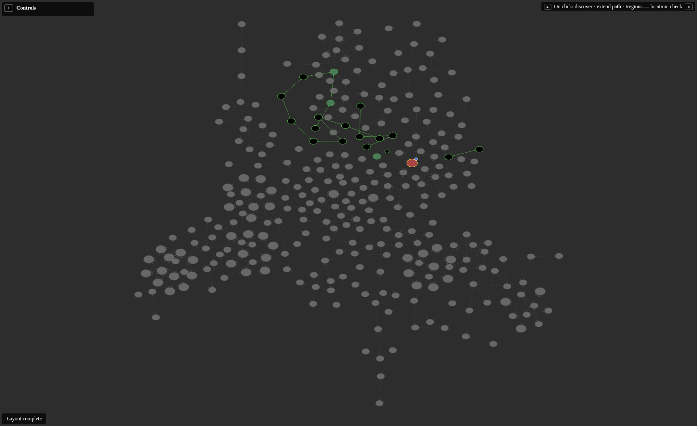
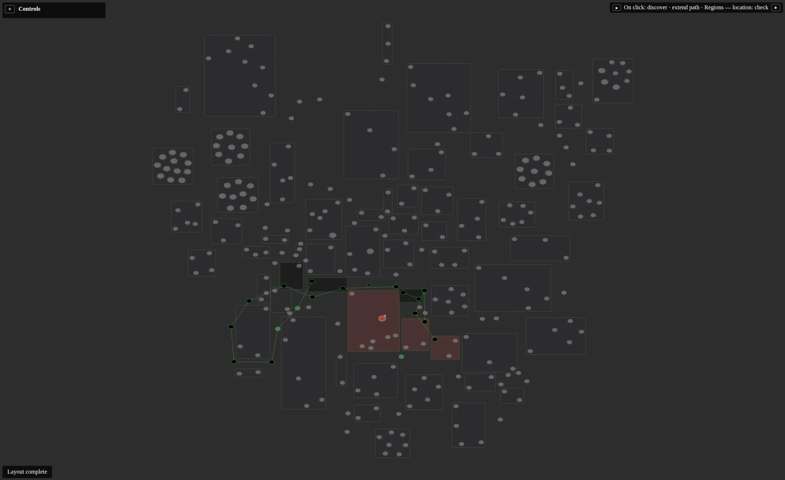
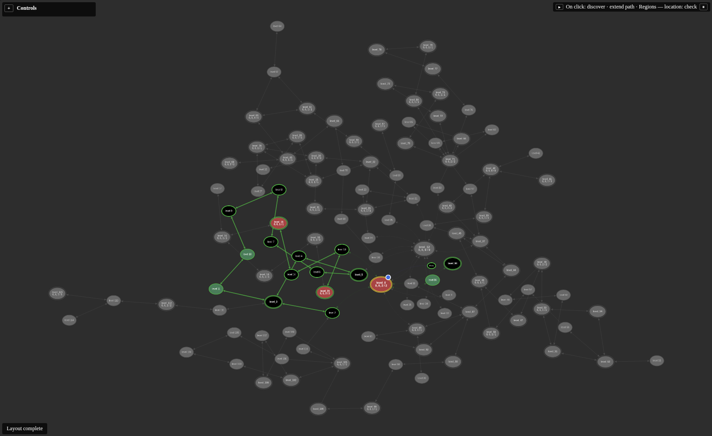
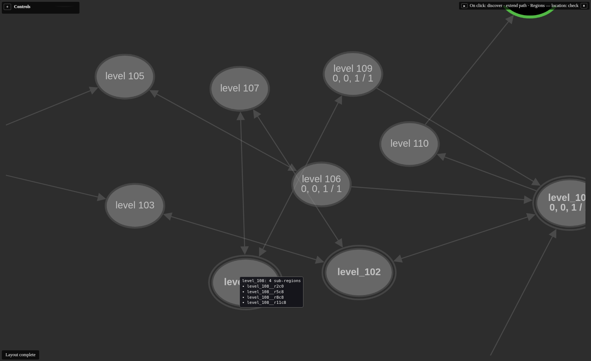
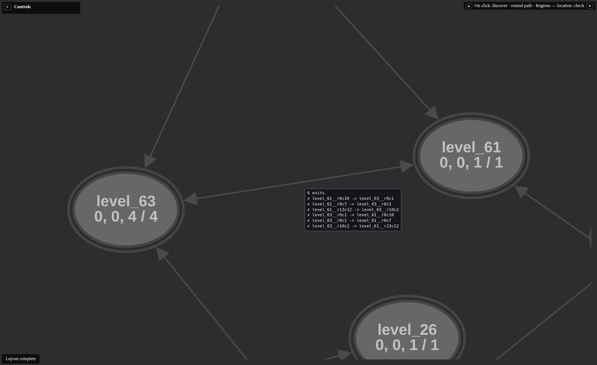
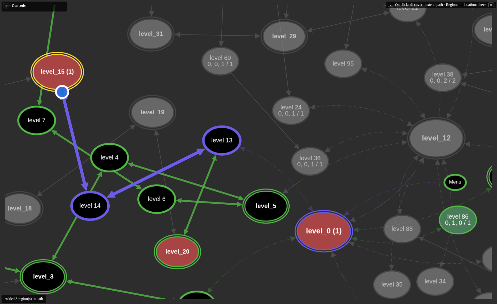
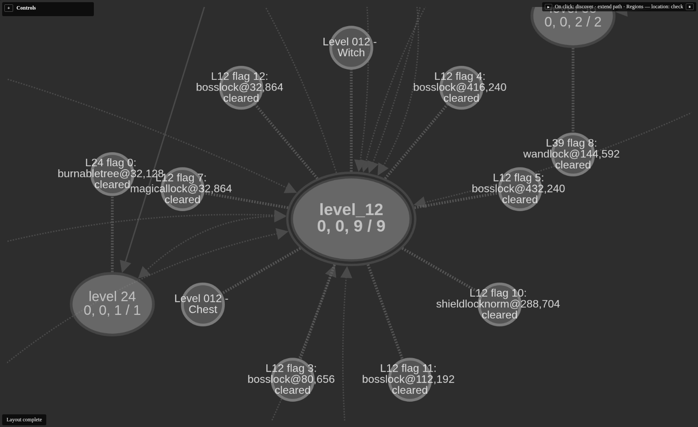
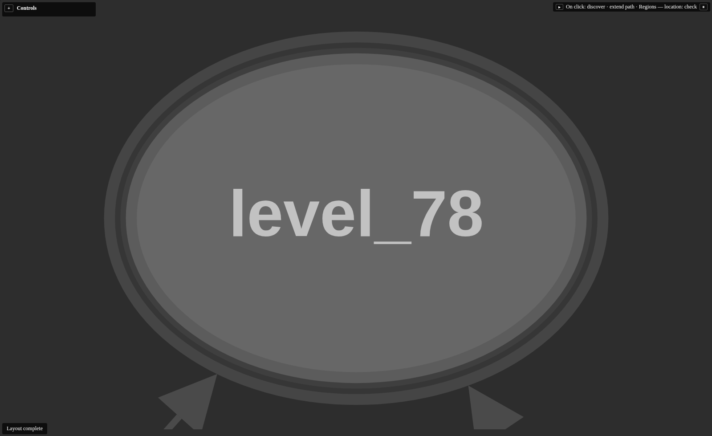
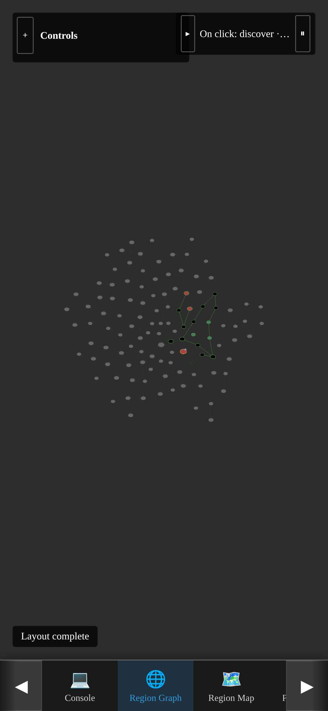

# Region Graph groups B: sub-regions merged into one node per region

**Status: built, gated.** The Region Graph's **Sub-regions → Draw as** setting
(`moduleSettings.regionGraph.subRegionView`) has a third value: `merged`, option B. Each region split into
sub-regions is drawn as ONE node, in place of its sub-regions. `separate` (the default) and `nested` (A) are unchanged,
byte for byte.

Slice 2 of 3 (A, then B, then C). Base: `5ab77cf981` (`git merge-base HEAD origin/main` =
`5ab77cf981043f16b13d3013c5141d1c597c17b5`, origin/main after groups-a landed). Code tip and **packet tip: `d39566b912`**. origin/main had not moved since the cut (`5ab77cf981` at packet time), so there
was nothing to merge and the gates ran at the tip itself. This report and its shots are committed after it, and touch no code.
Planner: archipelago-cc-23. Reviewer and landing queue: js-23.

## ⚖ The rulings (session 84c8ab35)

- 2026-11-23, on the four ways to group sub-regions (A: nested boxes; B: one node per region, with sub-regions merged,
  parallel edges merged, and the sub-regions listed on hover; C: collapsed with expand on click; D: a toggle between
  them): *"For grouping subregions in the region graph, I'll eventually want D, but we can start by implementing the
  other options first."*
- 2026-11-23, after seeing A's screenshots: *"The screenshots look okay. Please continue."*

js-23's review (GO WITH 5 EDITS) is answered in §3 (edits 2 and 3: the edge state, determinism), §4 (edit 1:
`regionOfCell`), §5 (edit 4: paths) and §1 (edit 5: location nodes on a big group).

## 1. What the user sees

The shots come from `scripts/dev/shot-region-graph-groups-b.mjs` at `d39566b912` on :8144, in fresh browser profiles,
with the live rule engine. The fcose shots run the panel's Force-Directed preset each time and fit, so "the same
view" means the same layout recipe, not the same coordinates.

- **Controls → Sub-regions → Draw as:** a third option, *Merged into one node per region*.
- **Merged:**
  - Each region split into two or more sub-regions is ONE node, labelled with the display key (`level_108`) and the
    summed location counts in the region label's format (`checked, accessible, inaccessible / total`). A **double
    border** marks it as several sub-regions.
  - Its colour is A's group rule (`groupState`): the border is green when any sub-region is accessible; the fill is
    the summed counts (dark green, gold, red, or black when all are checked); gray and faded when none is accessible.
  - **Hovering it** lists its sub-regions in a small box by the pointer (`level_108: 4 sub-regions`, then one per
    line). This is a plain DOM box; no new UI framework is involved. It hides on mouse-out, on leaving the canvas,
    and on pan or zoom.
  - **Hovering an edge** that stands for exits lists each exit with its own state, ✓ (traversable now) or ✗ (§3).
  - A group of one draws as a region, exactly as in `separate`.
- **alttp, the maze, and every world without a `displayRegionOf` hook** draw the same in all three values (§6).
- **Switching** rebuilds the graph. `merged` keeps its own saved layout and never moves `separate`'s (§5).
- **Phone, 390 px:** the same graph in the mobile tab, with no horizontal scroll. The phone run logged A's one page
  error (*"SecurityError … Blocked a frame … from accessing a cross-origin frame"*, from an iframe panel at boot; not a
  Region Graph code path). The desktop run logged none.
- **Location nodes on a big group (edit 5).** On seedling_playthrough the largest group by sub-regions is
  **`level_78`: 12 sub-regions, 0 locations**, so its node has no ring (the shot is that one node). The group with the
  most locations is **`level_12`: 6 sub-regions, 9 locations**. Its ring holds the 9 location nodes around the one
  merged node, at the same radius rule as a region (`80 + 15·√n`). At the zoom that fits the ring (3.14), every
  label reads. The layout is unchanged; this is reported, not fixed.

Counts (seedling_playthrough), from the shots run, the vitest and A's report; they agree:

| view | nodes drawn | of which group nodes | edges |
|---|---|---|---|
| separate | 307 | 0 | 575 |
| nested | 307 + 60 boxes | 60 boxes (251 members inside) | 575 |
| merged | **116** | **60** | **139** |

## 2. The setting

- `SUB_REGION_VIEW_SCHEMA.enum` is now `['separate', 'nested', 'merged']`; the label is *Merged into one node per
  region*. The default stays `separate`, from the schema only.
- A stored value the enum does not list still reads as the default: A's vitest now probes `collapsible` (C's value),
  since `merged` is drawn.
- No new localStorage key. The merged layout lives in `ui.mergedNodePositions`, an in-memory `Map` like
  `nodePositions`, never persisted.

## 3. The edge rule (`mergeGroupEdges`, `subRegionGroups.js`)

It runs over the region-to-region edges the panel builds for `separate` (one per region pair, with its forward and
reverse exit), with `nodeOf` = member → group node:

1. An edge with **neither** end in a group is **kept** as it is (the same element, byte for byte).
2. An edge with **both** ends in the **same** group is **dropped**: it is internal. No self-loop is ever drawn.
3. Any other edge is **re-targeted**: each end in a group is replaced by the group node.
4. Re-targeted edges that then join the **same two nodes merge** into one. "Same two nodes" means either way round,
   because the panel draws one edge per node pair, just as it draws one per region pair. The merged edge keeps
   **every exit**, each with its own direction relative to the edge.

A merged edge's data:
- `id = "<source>-<target>"`. A group node id (`region-group:<key>`) is never a region name, so this never collides.
- `exits`: every exit `{ name, from, to, rule, direction }`, **sorted** by (direction, name, from, to).
- `exitNames`: sorted, unique. The player marker's incoming-exit lookup reads it, so a path label finds its exit.
- `forwardExitName` / `reverseExitName`: that direction's names joined with " / ".
- `isBidirectional`: true when exits run both ways.
- `mergedEdges`: how many separate edges it stands for.
- Orientation: the one most of its edges had. A tie goes to the lexicographically smaller source.
- Label: the first two names, then `+N`.
- Discovery: `undiscovered` and `discovery-hidden` only when **every** edge it stands for had them, and its label is
  `???` only when every one was.

**Determinism (edit 3).** Everything is sorted, so nothing depends on insertion order. The vitest
`DETERMINISM` row builds the merged edge set from the synthetic input under 5 shuffles, and from seedling_playthrough's
575 separate edges in their own order, shuffled and reversed. Every run gives the same digest. Seedling's is
**`6cacd699cc6c4dd5`**.

**State (edit 2): BEST STATE WINS.**
- Each exit is evaluated on its own: the view model's `exitState` for that one exit, from its own member region, one
  way.
- The edge is `accessible` when ANY exit is traversable, else `inaccessible` (`mergedEdgeState`).
- When the exits disagree, the edge also carries `mixed-exits`.
- It is hidden only when every exit is hidden (by discovery or by the external edge filter), and `undiscovered` while
  no exit is discovered.
- The hover lists each exit with its own ✓ / ✗.
- The vitest pins the rule, and checks every merged edge on seedling (mid state) against an independent per-exit
  evaluation: the classes, the stored per-exit states, and the hover lines of each mixed edge.

**Counts per preset** (vitest `[merged-counts]`; mid state for the edge set, which does not depend on state):

| preset | regions | groups (2+) | members | nodes drawn | separate edges | kept | dropped | re-targeted | merged away | merged edges | edges drawn |
|---|---|---|---|---|---|---|---|---|---|---|---|
| seedling_playthrough | 307 | 60 | 251 | **116** | 575 | 21 | **423** | **131** | **13** | 118 | **139** |
| seedling_atlas | 11 | 2 | 8 | **5** | 11 | 0 | **7** | **4** | **0** | 4 | **4** |
| procgen_maze AP_3 | 11 | 0 | 0 | 11 | = separate | all | 0 | 0 | 0 | 0 | = separate |
| alttp | 239 | 0 | 0 | 239 | = separate | all | 0 | 0 | 0 | 0 | = separate |

("merged away" = re-targeted − merged edges: the edges folded into another by step 4.) Of seedling's 118 merged
edges, 107 carry 2+ exits (the shots run): most re-targeted edges are a member's exit pair to one outside node.

**Mixed merges** (edges whose exits disagree):
- In the vitest's three synthetic states (mocked rule engine, so these show the rule, not the game):
  - seedling_playthrough: start / mid / end = **0 / 50 / 13**;
  - seedling_atlas: **0 / 2 / 0**;
  - alttp and the maze: 0, since they have no merged edge.
- With the live rule engine, at the preset's start state (the shots run): **0 of 118** on seedling_playthrough. The
  in-app row reads **0** on seedling_atlas.

## 4. The click rule (edit 1)

- A tap on a merged node runs the **REGION** click actions on **`regionOfCell(key, members)`**. That is the key itself
  when it is one of the members, else the first member: the rules region the Region Map's cell click picks for that
  group.
- `onNodeTap` → `handleRegionNodeClick(node, regionName)`. The node gets the select state; `regionView:regionClicked`
  is published once, with that region.
- A `nested` box still runs nothing.
- **Where `regionOfCell` lives now:** `frontend/modules/regionView/regionViewModel.js`, beside `displayGroupsOf`, the
  fold it reads. The Region Graph must not import from `regionMap/`, and the view model is the module both panels
  already share.
  - `regionMap/regionMapClickActions.js` **re-exports** it, so no Region Map import changed (`regionMapUI.js`,
    `regionMapTests.js` and `actionNodesTests.js` import it from there as before). The vitest checks the two are the
    SAME function.
  - The legacy testkit copy `regionMap/legacyRegionMapClicks.testkit.js:81` is **left alone**: it is a frozen copy
    for the equivalence tests.
  - The Region Map's click vitest (`regionMapClickActions.test.js`, which tests `regionOfCell` through the re-export)
    and every `regionMap/` vitest file pass unchanged in the bounded run.
  - The Region Map's in-app click rows run in TT: category *Region Map* in fast and fast-bundled, and *Region Map:
    Seedling* in playback-bot (§8).

## 5. The readers (item 5)

A merged node is NOT a region: class `region-group region-group-merged` (never `region`), id `region-group:<key>`, data
`{ label, groupKey, members, merged: true, groupCounts }`, no `regionName`.
- `isRegionGroupNode(node, kind)` is still the one predicate, extended with an optional kind: `'box'` (A) or
  `'merged'` (B); with no kind it means either.
- `graphNodeIdOf(ui, region)` gives the node that draws a region: its group node in `merged` (`ui.mergedNodeOf`,
  filled by the builder), else the region's own. It is null in every other view.

| reader | in `merged` | proof |
|---|---|---|
| tap → click actions (`onNodeTap`) | a merged node runs the REGION actions on `regionOfCell(key, members)`, once (§4); a location node runs its own region's | vitest + in-app row |
| node picker / Go to (`nodePicker.regionNodes`) | lists every member by its own name, resolving to its group node; Go-to runs the click on THAT member and centres on the group node | vitest |
| centring (`regionGraphCentreAction`: `centreGraphOn`, pending centre, `dropStalePendingCentre`) | looks a region up through `graphNodeIdOf`, so a member centres on its group node | vitest |
| pathfinding (`shared/pathfinder.js`) | unchanged: it reads `staticData.regions` (rules regions). A click routes to `regionOfCell`'s member | vitest |
| path highlighting (`highlightPathEdges`) | each region on the path maps to its node and consecutive repeats collapse (`pathNodeSteps`), so a path through members shows as a path through group nodes with no internal step (§5a) | vitest |
| path counts on labels (`onPathUpdate`) | a merged node shows its members' visits summed: `level_15 (1)`, with the path classes | shots (path) |
| player marker (`updatePlayerLocation`) | sits on the group node of the player's region; a step inside one group has no edge, so it takes the default offset | vitest |
| current region (`highlightCurrentRegion`) | the group node gets `current` | vitest |
| colouring (`onStateUpdate` → `updateGroupNodes`) | from its members through the view model (`groupState`), never from node classes; label = key + summed counts | vitest |
| edge colouring | per exit, best state wins (§3) | vitest |
| discovery placeholders | A's rule: the most visible member's visibility; `???` while a placeholder (named with *show undiscovered region names*), with no counts, as a region; `discovery-hidden` when every member is hidden. A merged edge follows §3 | rule shared with A (`groupState`) |
| Loop mode | uses the same click path (`onNodeTap`) and the same path state; there is no merged-specific path | — |
| location nodes (hover / zoom / force-show, drag, z-order, reseat) | **attach to the group node**: one ring with every member's locations. Each keeps its own `parentRegion` (so a click checks on that member, and its colour is that member's) and names its anchor (`anchorNode`); its edge runs from the group node. Ids are unchanged (`loc_<member>_<name>`) | vitest + shot |
| saved positions | §5b | vitest |
| hub detection (`identifyHubNodes`) | counts a merged node (it has edges); still never a box | vitest |
| layouts | hierarchy and DAG detection take a merged node (depth = its shallowest member's); the procgen grid puts it at its members' mean cell; fcose / cose treat it as a node | shots (fcose) |
| node overlays (ActionNodes cards) | select `.region`, so a merged node gets no card. No world with ActionNodes cards has sub-regions today | — |
| status line | `Loaded N regions` keeps counting the rules regions | — |
| export positions | lists no group node (A's filter), so in `merged` it exports the regions drawn as themselves | — |

### 5a. Paths (edit 4)

- **To and through group nodes** (vitest): from the start region to the group whose click region is farthest. On
  seedling_playthrough (end state) that is 14 regions → **10 nodes**, through 2+ group nodes, and the **9** lit edges
  are exactly the consecutive node pairs. In the live shots run, a tap on `level_15` from `level_0` lit **4** edges
  (`Menu`, `level_0`, `level_13`, `level_14`, `level_15`), none internal.
- **Start and target in the SAME group:** the path maps to one node, so **nothing is highlighted**. The marker stays
  on that group node, and the node's path count rises. Vitest: a member-to-member path inside one group → `[G]`, 0 lit
  edges.
- **Leaving a group and re-entering it (G → X → G):** the steps are G, X, G. The ONE G–X edge is lit (a merged edge
  with exits both ways), and no self-loop exists. Vitest: 1 lit edge, the right one.

### 5b. Saved positions

- `separate` and `nested` share `ui.nodePositions` (region positions), as before.
- **`merged` never writes it.** `saveNodePositions` and `runLayout` in `merged` use **`ui.mergedNodePositions`**, its
  own store: every node drawn (group nodes and the regions beside them), minus location nodes and the player.
- On a switch to `merged`:
  - the merged store is used if it covers the graph;
  - else a group node starts at the centroid of its members' `separate` positions and a region at its own, and the
    builder fits with no re-layout when every node got a position that way;
  - else it lays out.
- **Switching back to `separate` restores its saved layout untouched.** The vitest saves a `separate` layout, builds
  `merged`, moves a group node and saves, rebuilds `merged` (which re-uses its own position), then builds `separate`.
  `nodePositions` is byte-equal to the first save, every region sits at its saved spot, and no layout ran.

## 6. Proof

- **Identity:**
  - `separate` and `nested` are byte-identical to base: A's pins (`subRegionView.identity.test.js`, 3 presets × 3
    states) stay green.
  - **`merged` on alttp equals `separate`** at all 3 states (mid: `9b9f872a2012751e` = A's pin). The same holds on
    procgen_maze (mid `09c8c677aff8563f`). There are 0 group nodes and the edge counts are all "kept": every group is
    a group of one, so the builder changes nothing.
  - **Round trip** `separate → merged → separate` on ONE graph = the fresh `separate`: **`8760984c763bdf2e`**, A's
    seedling_playthrough mid pin. The merged set in between digests to `0fb64911a2883c90`.
- **Vitest** `subRegionView.merged.test.js` (26 tests): the setting; the predicate; the edge rule (drop, keep,
  re-target, merge, orientation, tie, discovery, determinism); the counts per preset; alttp and the maze = separate;
  the round trip; the label and state; best state wins and the hover; `regionOfCell` is one function; the click; the
  three path rows; both saved-position rows; location nodes; marker, current and centring; the picker; hub detection.
- **In-app row** `test_region_graph_sub_region_merged` (category Region Graph → **fast**), right after A's
  `test_region_graph_sub_region_nested`, on **seedling_atlas**:
  - it sets `merged` session-only;
  - it reads **2 group nodes = 2, 5 nodes = 5** against the fold at run time;
  - it checks every group node stands for its fold's members, none drawn, and there is no self-loop;
  - it taps `overworld_start` and reads that the region click ran once, on `regionOfCell` = **`overworld_start__r1c6`**;
  - it RESTORES the default and waits for every region to be its own node.
  - It PASSES locally: **1.3 s**, switch 76 ms.
- **Local runs at the tip, both boots:** every Region Graph row (15, the new one included) plus the 4 walks that drive
  the graph (`tutorial-walk-guided-tour`, `-depgraph-extras`, `-tracker-region-graph`, `-tracker-region-map`):
  **19 / 19 PASS unbundled and 19 / 19 PASS bundled** (`npm test -- --mode=test-substrates --test=…`, and the same with
  `--bundled`), at `d39566b912` on :8144. The new row: 1.3 s / 1.4 s.

## 7. What C needs from this

- **The value:** append `collapsible` to the enum and the labels. A's vitest already probes it as "not drawn yet";
  that pin moves with C.
- **The pieces B adds for C to reuse:**
  - `mergedGroupElements(groups)`: the merged nodes and `nodeOf`;
  - `mergeGroupEdges(edges, nodeOf)`: the edge rule. It takes any `nodeOf`, so C can pass one that leaves the opened
    groups out: an open group's members then keep their own edges, and the closed groups merge;
  - `graphNodeIdOf`: every reader already maps a region through `ui.mergedNodeOf`. C fills it with the closed groups
    only.
- **C = B by default, plus a click that opens one group.** In B a merged node's tap runs the click actions on
  `regionOfCell`. C must choose:
  - the tap opens the group (and the click actions move to the members);
  - or it keeps the actions and opens the group from a separate affordance: a double-tap, the hover box, or a toggle in
    the box.

  Since the user asked for B's click to act, the latter keeps B's behaviour. This is a design question for the
  planner.
- **An opened group** draws A's box (`groupNodeElements` for that group only), so its members are compound children.
  The builder runs the `nested` branch for the open groups and the `merged` branch for the rest, in one pass.
- **Positions:** C needs a position store per open/closed state, or it re-uses `merged`'s for closed groups and
  `separate`'s for opened members. B's `positionStore()` is where that choice goes.
- **Rebuild vs patch:** each switch here rebuilds (A §3). An open/close is per group, so a patch that swaps one group's
  elements is the faster path for C.

## 8. Gates (at the merge SHA `d39566b912` (= tip; origin/main unmoved) unless named)

**CI runs at `d39566b912`** (each run's headSha = `d39566b912de5ca4cc81a9a1b619c1db9c9a9914`):

| run | id | result |
|---|---|---|
| JSUT (push) | 45434361048 | ✅ **1431 files / 30076 tests**, 0 failed. Main `5ab77cf981` (45427212561): 1430 / 30050, so **+F 1 / +T 26**: the new `subRegionView.merged.test.js` and its 26 tests (A's nested file changed assertions, not its count) |
| unittests (push) | 45434360643 | ✅ |
| TT (dispatch) | 45434359766 | ✅ 9 / 9 jobs, read job by job (below) |
| TT, second sample (dispatch) | 45438181888 | ✅ 9 / 9 jobs; fast and fast-bundled 137 / 137 each |
| `-f batch=tutorials` | 45434364555 | ✅ 24 / 24 (165.5 s, 28%) |
| `-f batch=tutorials-tracker` | 45434369511 | ✅ 9 / 9 (61.1 s, 10%) |

No `train_only` run: no train-tier path is touched.

The TT jobs (45434359766):
- the ALTTP spoiler + regression job: 62 / 62;
- fast and fast-bundled: 137 / 137 each (136 + the new row; it took 0.8 s and 0.9 s);
- seedling-wasm: 15 / 15;
- seedling-js-solver: 12 / 12;
- apworld: 142 / 142;
- playback-bot: 17 / 17 (it holds the *Region Map: Seedling* rows);
- seedling-js: 45 / 45;
- on-push list ✅.

**Headroom** (`check-batch-headroom.js` in each TT job; span over the 600 s budget). Main `5ab77cf981`: TT 45427212634
(push) and 45304616750 (dispatch).

| batch | tip, sample 1 | tip, sample 2 | main 1 / main 2 | Δ (each pairing) | means (tip / main) |
|---|---|---|---|---|---|
| fast | 326.2 s (54%) | 326.7 s (54%) | 328.6 / 314.0 s | −2.4 / +12.2; −1.9 / +12.7 | 326.5 / 321.3 (**+5.2**) |
| fast-bundled | 333.4 s (56%) | **343.8 s (57%)** | 316.3 / 324.6 s | +17.1 / +8.8; **+27.5** / +19.2 | 338.6 / 320.5 (**+18.1**) |

- Every span is far under 70%.
- **⛔ One pairing is over +20 s:** fast-bundled, sample 2 against main's faster sample (343.8 vs 316.3). The mean
  delta is +18.1 s, under the limit, and the other three pairings are under +20. **This is a STOP by the brief's
  rule**, raised to js-23 in the packet, not ruled on here.
- **Where the time went** (per-row durations, both tip bundled runs against both main bundled runs, mean vs mean):
  - the new row costs **0.85 s**;
  - the largest per-row deltas are rows this slice does not touch: `seedling-playthrough-maze-l15-level-world`
    +2.2 s, `tasw-exit-label-by-place` +1.9 s, `rule-converter-exact-mode-round-trips` +1.2 s and
    `maze-seedling-art-static-room` +0.9 s;
  - the rest is spread thinly over the roster;
  - the Region Graph rows in the list (`test_region_graph_click_default` +1.4 s, `test_graph_data_loading` +0.9 s,
    `test_cytoscape_library_loading` +0.5 s) run in `separate`, whose code path B only touches with
    `ui.mergedNodeOf = null` and a branch on the view (no local base-vs-tip timing was taken).
  - The shape is runner speed, as in A's second sample (A §8: +23.0 s on one pairing, ruled through).

**Engine closure:**
- **Closure ∩ diff = ∅**: 0 of the files in `git diff --name-only origin/main..HEAD` are among the 42 files of
  `node scripts/procgen/seedlingDerivedRuleTable.js --print-engine-closure`. No `regionView/` file is in the closure.
- **engineMd5 `74ae60f575531492ed9eaec1839e1fe3`**: the same as base (A's report, at `6dbadc7364` and at its merge),
  measured again at the tip.

**Gitlinks: 0.**

**Bounded vitest** (⚖ 52) at the tip: **48 files / 729 tests** ✅, over:
- `regionGraph/`, `regionView/`, `regionMap/` (`regionOfCell` moved) and `tutorials/`;
- every other test that imports a touched file (`grep -a -l`): `exits/exitUI.accessibilityOriginalSort`,
  `flashPanel/flashClickActions`, `loops/loopModeExemptions`;
- `docsBase`, `centralRegistry`, `settingsManager`, `moduleDocsPins`, `storageCensus`, `storageDeclarationPins`,
  `bundledTestCases`, `moduleImportOrder` and `testBatches`.

**Pins moved:**
- `subRegionView.nested.test.js` › *the setting*, two assertions:
  - the enum is now `['separate', 'nested', 'merged']`;
  - the "unknown value reads as the default" probe used `merged`, which is now drawn. It now checks that `merged`
    reads back as `merged`, and probes `collapsible` instead.
- New pin: `subRegionView.merged.test.js`.
- **No doc-census pin moved**: `moduleDocsPins`, `docsBase` and `tutorials/` are green with the user page's new
  paragraph.
- A's identity pins (`subRegionView.identity.test.js`) are unchanged and green.

**Files:**
- **New:**
  - `regionGraph/subRegionView.merged.test.js`;
  - `scripts/dev/shot-region-graph-groups-b.mjs`;
  - the shots and this report.
- **Changed:**
  - `regionGraph/{subRegionGroups, graphDataManager, graphInteractionManager, navigationManager,
    layoutControlsManager, nodePicker, regionGraphCentreAction}.js`;
  - `regionGraph/subRegionView.nested.test.js` (the pin above);
  - `regionView/regionViewModel.js` (`regionOfCell`);
  - `regionMap/regionMapClickActions.js` (the re-export);
  - `tests/testCases/regionGraphPanelTests.js`;
  - `playwright_tests_config-substrates.json`;
  - `docs/json/user/modules/regionGraph.md`.
- No gitignored planning path is cited. `seedling-bot-log.md` and `architecture.md` are untouched. The Region Map's
  behaviour is unchanged: it reads the same function through the same import.
