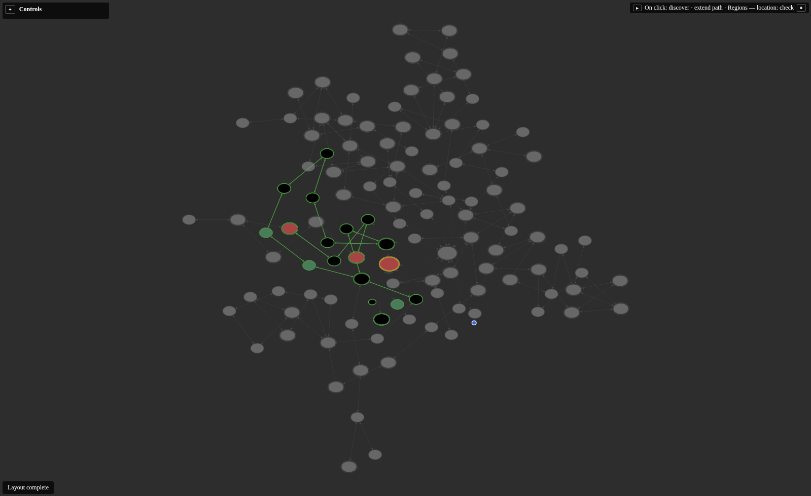
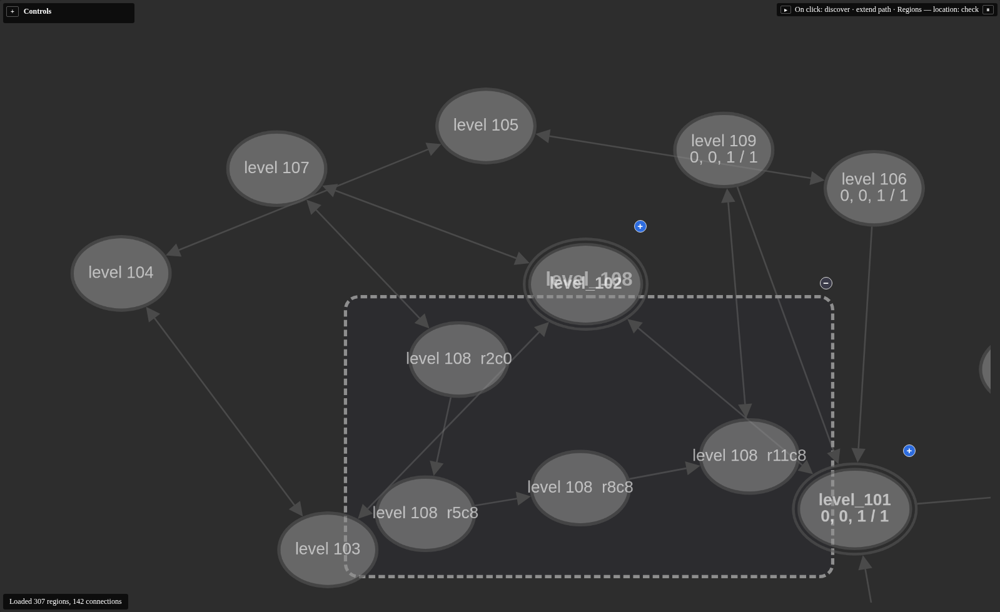
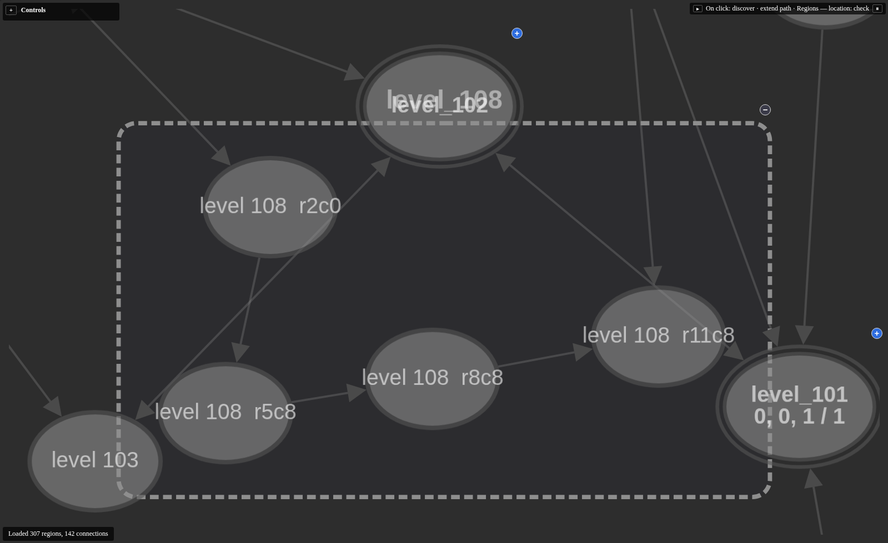
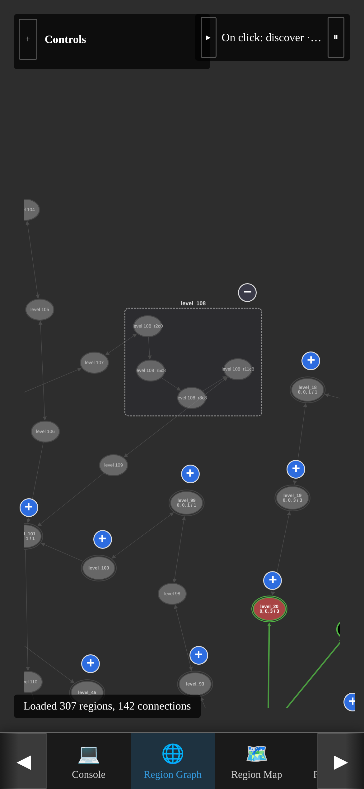

# Region Graph groups C: collapsible sub-region groups (+ / − badges)

**Status: built, gated.** The Region Graph's **Sub-regions → Draw as** setting
(`moduleSettings.regionGraph.subRegionView`) has a fourth value, `collapsible` (option C). It draws every region split
into sub-regions as B's merged node, with a small **+** badge on its corner. The **+** opens that one region into A's
box, and a **−** on the box closes it again. `separate` (the default), `nested` (A) and `merged` (B) are unchanged.

With this slice the setting has all four values, so switching it **is option D** (§ 7).

Slice 3 of 3 (A, then B, then C). Base: `146d8f6ef8` (`git merge-base HEAD origin/main` =
`146d8f6ef8efc85c0ac5ee651582072458d0967e`, origin/main after groups-b landed). Code tip and **packet tip: `40125ea131`**. origin/main had not moved since the cut (`146d8f6ef8` at packet time), so
there was nothing to merge and the gates ran at the tip itself. This report and its shots are committed after it, and touch no code.
Planner: archipelago-cc-23. Reviewer and landing queue: js-23.

## ⚖ The rulings (session 84c8ab35)

- 2026-11-23: *"For grouping subregions in the region graph, I'll eventually want D, but we can start by implementing
  the other options first."* Option C was offered as: *"Collapsed with expand on click: like B by default, and
  clicking a region opens it into its subregions, as in A."*
- **2026-11-24T16:53:39.143Z: "Small +/− badge (Recommended)"**. The option read: *"Each collapsed region gets a small
  + badge on its corner. Clicking the badge opens it into option A's box, and a − badge on the box closes it again.
  Clicking the node itself still runs your click actions, as in B."*

js-23's review (GO WITH 4 EDITS) is answered in §2 (edit b: the badge is not a child node), §4 (edit c: the open set
is session-only), §2 (edit d: the badge size and its hit test) and §6 (edit a: one row, its cost). The planner's
addendum (no digest pin over a live preset) is answered in §6.

## 1. What the user sees

The shots and timings come from `scripts/dev/shot-region-graph-groups-c.mjs` on :8144, in fresh browser profiles,
with the live rule engine. The badge clicks in it are real pointer clicks (desktop) and a real touch tap (phone).

- **Controls → Sub-regions → Draw as:** a fourth option, *Collapsible (click + to open)*.
- **Every group starts closed**, drawn exactly as B's merged node: the same double border, colours, label, hover,
  merged edges and click rule (the element set is equal to `merged`'s: §6). Each closed node has a round blue **+**
  badge on its top-right corner. seedling_playthrough: **60 closed nodes, 60 badges**, 56 plain regions, 139 edges.
- **Clicking a +** opens that one group into A's box: a dashed box labelled with its key, its sub-regions inside, and
  edges to the exact sub-regions. Every other group stays closed. The box has a dark **−** badge on its top-right
  corner; clicking it closes the group back into one node.
- **Clicking the node itself** runs the **On click** actions, as in B (on `regionOfCell(key, members)`). An open
  box does nothing, as in A, and its sub-regions run their own. **A badge never runs a click action.**
- Opening or closing moves no other node and keeps the view where it is (no fit, no layout).
- **Phone, 390 px:** the same, in the mobile tab, with no horizontal scroll. The phone run logged A's and B's one page
  error (*"SecurityError … Blocked a frame … from accessing a cross-origin frame"*, from an iframe panel at boot; not
  a Region Graph code path). The desktop run logged none.
- **alttp, the maze, and every world without a `displayRegionOf` hook** draw exactly as `separate`, with no badge
  (§6).

## 2. The badge

**It is a DOM button, not a Cytoscape element** (`frontend/modules/regionGraph/groupBadgeLayer.js`):
- one `<button class="rg-group-badge">` per group node, in a layer (`.region-graph-group-badges`) over the canvas,
  beside the node-overlay layer that `nodeOverlayManager.js` uses for ActionNodes cards;
- placed in screen pixels on the node's top-right corner (`badgeCentre(node.renderedBoundingBox())`), and moved on
  every pan, zoom, drag, resize and layout stop (one `requestAnimationFrame` per burst);
- no new library: plain DOM and the cy events the panel already uses.

**Edit (b): no child node, so no reader needs teaching.** The badge never enters the element set, so the picker, the
pathfinder, the status line, hub detection, labels, saved and exported positions and every layout never see it. The
vitest checks the element ids are the same with the badge layer built and without it. `isRegionGroupNode` is
unchanged (still the one predicate), and there is no second predicate.

**A badge press can never run a click action.** The layer is not inside the Cytoscape container, so the canvas
never receives the press. The button also stops `pointerdown`, `mousedown`, `touchstart`, the matching up events and
`dblclick` where they land. Its click calls `GraphDataManager.setSubRegionGroupOpen(key, open)` and nothing else.

**Size and hit area (edit d):**

| | desktop | 390 px phone |
|---|---|---|
| visible badge (the round glyph) | **20 × 20 px** | **20 × 20 px** (CSS px; 60 × 60 device px at DPR 3) |
| hit area (the button's own box) | **36 × 36 px** | **36 × 44 px** (the mobile layout's 44 px minimum button height applies) |

- The hit square is centred on the node's corner, so it overlaps the node body only at that corner.
- **The tap test, at the zoom where labels first show (0.5):**
  - on the 390 px phone, `document.elementFromPoint` at the badge's centre is the badge (`BUTTON`), and a
    `touchscreen.tap` there opened `level_108` (4 sub-regions inside, 0 nodes selected, so no click action ran);
  - on desktop, the same at zoom 1.57 for both a + and a − badge;
  - in the in-app row, the same on seedling_atlas.
- **Zoom:** a badge shows at every zoom where region names show (`zoom ≥ zoomLevels.showRegionNames` = 0.5): 60 of
  60 shown at 0.5. **Below that zoom it is hidden** (0 of 60 at 0.49): the labels are gone too, the node body still
  runs its click actions, and you zoom in to open or close a group. It is also hidden on a node that discovery hides.

## 3. Edges with open and closed groups

The builder runs ONE pass:
- `collapsibleGroups(groups, openKeys)` splits the display groups;
- the **closed** ones take B's branch (`mergedGroupElements`);
- the **open** ones take A's (`groupNodeElements`: the box, members as children).

The edges are `mergeGroupEdges(separateEdges, nodeOf)` with `nodeOf` holding **only the closed groups' members**
(B § 7). So:

| edge between | drawn as |
|---|---|
| two plain regions | kept, byte for byte |
| an open member and a plain region | kept, byte for byte |
| two members of the same open group | kept (inside the box) |
| members of two different open groups | kept: open ↔ open ends on the exact members |
| an open member and a closed group | re-targeted to the closed node at that end only, merged with any parallel ones, every exit kept |
| two closed groups, or a closed group and a plain region | as in B |
| two members of the same closed group | dropped (internal) |

The vitest restates the rule edge by edge on seedling_playthrough with 3 groups open (both ends of one cross-group
edge and one end of another):
- every separate edge maps each end in a CLOSED group to its node and leaves an open member as itself;
- the drawn node pairs equal that set, one edge per pair;
- every kept edge is the original;
- all six kinds occur (closed–closed, closed–open, closed–region, open–open, open–region, region–region);
- the ids equal `mergeGroupEdges` over the closed `nodeOf`;
- each exit of a merged edge with an open end runs between that edge's two nodes.

Counts there: 168 edges; kept 68, dropped 395, re-targeted 112, merged away 12, merged edges 100. Edge state, hover and
discovery are B's, unchanged ("best state wins").

## 4. Open / close: behaviour and state

- **The open set is per world and SESSION-ONLY (edit c).** It is `ui.openSubRegionGroups`, an in-memory
  `Map<worldKey, Set<displayKey>>`, where the world key is the rules' `seed_name | game_directory | player`.
  - It is **not persisted**: a reload starts every group closed. There is no storage key, nothing to declare, and
    the storage census does not move (`storageCensus`, `storageDeclarationPins` green). Nothing can leak into a later
    row.
  - **A switch to another view and back KEEPS it** (vitest): the open groups are still open when you come back to
    `collapsible`.
  - Another world has its own set, and starts all closed.
- **Opening or closing does not run the layout.** `setSubRegionGroupOpen(key, open)`:
  1. records every drawn node where it stands now, so a node dragged since the last layout stays put;
  2. **open:** places the members round the closed node's position. It uses their last arrangement in this view,
     else `separate`'s saved one, shifted so its centre is the node's and scaled down to at most
     `openRadius(n) = 60 + 30·√n` px from it. With neither, it uses a ring of radius `50 + 12·n`;
  3. **close:** puts the merged node at its members' centre, and keeps their arrangement for the next open;
  4. rebuilds the elements from the loaded rules with no fit and no layout, restores the zoom and pan, and puts the
     player marker back.
- **Positions have their own store**, `ui.collapsibleNodePositions` (in memory, like B's): closed nodes, open members
  and plain regions, **never a box**. `collapsible` READS `separate`'s and `merged`'s stores to place nodes on its
  first build, but **never writes them** (vitest: `nodePositions` byte-equal before and after; `mergedNodePositions`
  never created). A first switch after a `separate` layout places every node from it and runs no layout.
- **Timing on seedling_playthrough** (307 regions, opening and closing `level_108`, 4 sub-regions; 5 opens and 4
  closes by real pointer clicks):

  | | in code (`setSubRegionGroupOpen`, the rebuild included) | wall (click → the next frame with the box drawn) |
  |---|---|---|
  | open | **median 90.9 ms** (118.6 / 86.8 / 105.0 / 75.3 / 90.9) | **median 271 ms** (314 / 253 / 281 / 209 / 271) |
  | close | **median 73.6 ms** (70.0 / 88.7 / 73.6 / 54.7) | **median 202 ms** (195 / 226 / 202 / 177) |

  Headless (the vitest), the open and close take about 40 ms each. On seedling_atlas (the in-app row), the open takes 92–96 ms and the close 32–35 ms, from the press to the box drawn
  (or gone), over three local runs.

## 5. The readers (some groups open, some closed)

`graphNodeIdOf` maps a closed group's member to its node, and an open member to itself: `ui.mergedNodeOf` holds the
closed groups only, and is null when every group is open.

| reader | with mixed open / closed groups | proof |
|---|---|---|
| tap → click actions (`onNodeTap`) | a closed node runs the REGION actions on `regionOfCell` (B); an open box runs nothing (A); an open member runs its own; a badge runs none | vitest + in-app row |
| node picker / Go to | a closed group's member resolves to its group node, and the click runs on that member (B); an open member is its own node | vitest |
| centring (`centreGraphOn`, pending centre) | through `graphNodeIdOf`: an open member centres on itself, a closed member on its group node | vitest |
| pathfinding | unchanged (rules regions) | B's vitest |
| path highlighting | `pathNodeSteps` over the closed `nodeOf`: an open member is a step of its own, a closed group one step; the lit edges are the step pairs | vitest |
| player marker / current | on the open member itself, or on the closed group's node; put back after every open / close | vitest |
| location nodes | a closed node carries all its members' locations in one ring (B); after the group opens, each member carries its own (A). The ids are the same either way (`loc_<member>_<name>`) | vitest |
| colouring | a closed node and an open box are both coloured from their members (`groupState`); members colour as regions | vitest |
| hub detection | a box is skipped; a closed node counts | vitest |
| status line | `Loaded N regions` counts the rules regions | vitest |
| discovery | A's and B's rule (`groupState`'s visibility), per node; a badge is hidden on a node discovery hides | rule shared with A and B |
| Loop mode | the same click path (`onNodeTap`) and path state; no collapsible-specific path. A badge press publishes nothing | — |
| saved positions | `collapsible`'s own store, never a box; `separate`'s and `merged`'s stores are never written (§4) | vitest |
| export positions | A's filter: no box; in `collapsible` it lists the nodes drawn (closed nodes, open members, regions) | — |
| layouts | as A for boxes and B for merged nodes (`isRegionGroupNode(n, 'box')` / `'merged'`); the badge is not an element | A's and B's |
| node overlays (ActionNodes cards) | select `.region`: no card on a group node; a different layer from the badges | — |

## 6. Proof

**Identity**, computed at test time (`subRegionView.collapsible.test.js`), never a digest over a live preset:

| claim | how | result |
|---|---|---|
| `separate`, `nested`, `merged` = base | A's and B's pins, now over FROZEN presets (below), plus B's and A's own vitest | green |
| `collapsible`, every group closed = `merged` | digest of both, seedling_playthrough and seedling_atlas, 3 states each | equal; mid `0fb64911a2883c90` (seedling_playthrough; = B's merged digest), `d8d9df10aacdca02` (atlas) |
| every group open = `nested` | the same | equal; mid `a3a725caf18021cc` / `5a0190adc37ada33`. **The difference is the badges only**: one − button per box in the DOM layer, not in the element set |
| open then close one group = the pre-open set | digest before, while open, after | pre `0fb64911a2883c90`, open (`level_12`) `2f7f0f9442abc719`, post `0fb64911a2883c90` |
| no sub-regions (alttp, maze) | `collapsible` = `separate`, 3 states | equal, 0 group nodes, 0 badges |

**The planner's addendum: no digest pin over a live preset.**
- A's identity pins (`subRegionView.identity.test.js`: 3 presets × 3 states), B's round-trip literal
  (`subRegionView.merged.test.js`, `8760984c763bdf2e`) and A's seedling count pin (`subRegionView.nested.test.js`,
  60 / 251 / 56) now read **frozen copies** of their presets: `frontend/modules/regionGraph/fixtures/sub-region-view/
  <preset>.rules.json.gz`. Each holds the fields the builder reads (`regions`, `start_regions`, `preset_sidecars`,
  and the world's names), taken from the presets at `146d8f6ef8`. Total 56 KB gzipped.
- **The digests are unchanged**: the frozen copies give exactly A's recorded digests (`4f315a341e062bf8` /
  `8760984c763bdf2e` / `1fc2aacecc19bb36`, and alttp's and the maze's). So the conversion lost nothing.
- **One live smoke row, not a digest:** on the live seedling_playthrough, every `subRegionView` value builds without
  error, with region nodes and edges, and group nodes in every grouped view.
- **L25's real change does NOT go red:** with "Wand" added to the reverse exit `level_25__r3c2 → level_25__r2c7`
  (its `HasAny` list) in the LIVE preset, all four sub-region vitest files pass (66 / 66). Under the same change the
  OLD live-pin file went red on seedling_playthrough (`bf878da807f59821` / `cd0c83e36df081f9` / `300bc3c374478680`).
- **A builder mutant DOES go red:** with the edge label's `" / "` join changed to `"/"` in `graphDataManager.js`, the
  identity pins fail on all three frozen presets.
- rules-12's L25 had not re-pinned anything (js-23, 2026-11-25), so there was nothing to merge first.

**Vitest** `subRegionView.collapsible.test.js` (22 tests) covers:
- the setting;
- the identities above;
- the mixed edge rule;
- the badge: one per group, DOM only; a press opens / closes and runs no click; the press stops at the button;
- a body tap runs the click actions (closed node, open box, member);
- the corner, the zoom rule and the size;
- positions: no layout, round the node, at the centre, the stores untouched, the ring;
- the open set: per world, kept across a view switch;
- the readers.

**In-app row (edit a): B's row EXTENDED, no new row.** `test_region_graph_sub_region_merged` (category Region
Graph → fast) keeps B's checks on seedling_atlas, then on the same graph and setup:
- sets `collapsible` session-only and reads every group closed (**2 merged nodes = 2, 0 boxes, 2 + badges**);
- checks a tap at the + badge's centre hits the badge (`elementFromPoint`);
- clicks it and reads the group opened (**1 box, 6 members = 6, 1 still closed**);
- clicks the − and reads it closed;
- reads that no badge press ran a click action (**0 `regionClicked`**);
- taps a closed node's body and reads its click action ran once, on `regionOfCell` (**`overworld_start__r1c6`**);
- RESTORES the default (B's restore: `separate`, every region its own node).

The row PASSES locally on both boots: **1.7 s unbundled and 1.7 s bundled** (B's part alone was 1.3 s), and in both TT
samples (§8). C's added cost: **+0.3 s** in CI (the row's mean is 1.15 s against main's 0.85 s), well under the 1.5 s
limit. The row after it in fast is
`test_region_graph_click_default`, which PASSES too.

**Local runs at the code tip, both boots:** every Region Graph row (15) plus the 4 walks that drive the graph
(`tutorial-walk-guided-tour`, `-depgraph-extras`, `-tracker-region-graph`, `-tracker-region-map`):
**19 / 19 PASS unbundled (at `40125ea131` exactly) and 19 / 19 PASS bundled** (the same tree, before the
commit) (`npm test -- --mode=test-substrates --test=…`, and
with `--bundled`), on :8144.

## 7. Option D, as a whole

The setting now has four values. Switching between them is option D:

| value | a region split into sub-regions draws as | click on it | edges |
|---|---|---|---|
| `separate` (default) | each sub-region its own node | each runs its own actions | exact |
| `nested` (A) | a dashed box, the sub-regions inside | the box: nothing; a sub-region: its own | exact |
| `merged` (B) | one node | the region actions on `regionOfCell` | merged, best state wins |
| `collapsible` (C) | B's node with a +; per region, + opens it into A's box and − closes it | B's on a closed node, A's on an open box; a badge runs none | B's for closed groups, exact for open members |

Each value keeps its own layout: `separate` and `nested` share one store, `merged` and `collapsible` each have their
own, and none is persisted.

**Follow-ups (not built):**
- **Open all / close all:** a pair of buttons in *Sub-regions* would help on Seedling's 60 groups. Today, opening
  every group means 60 clicks, and switching to `nested` is the quick way to see them all open.
- **An opened box can overlap its neighbours.** No layout runs on an open, as the brief asks, so a box can cover
  nearby nodes (the one-open shot). **Re-layout** with a force-directed layout tidies it. A local "make room"
  nudge for the neighbours is possible.
- **Below the label zoom** the badges are hidden; a long-press or the hover box could open a group from there.
- **The open set does not survive a reload.** It could become a declared key if wanted (edit c preferred not).

## 8. Gates (at the packet tip `40125ea131` = the merge SHA; origin/main unmoved)

**CI runs at `40125ea131`** (each run's headSha = `40125ea1314e436c89433384cd62c0bce6a0f3d3`):

| run | id | result |
|---|---|---|
| JSUT (push) | 45676222088 | ✅ **1442 files / 30194 tests**, 0 failed. Main `146d8f6ef8` (45551296805): 1441 / 30170, so **+F 1 / +T 24**: the new `subRegionView.collapsible.test.js` (22); `subRegionView.identity.test.js` 3 → 4 (the live smoke row); `regionView/nodeSelectedRetired.test.js` 31 → 32 (a per-file census over the Region Graph module, which enrolled the new `groupBadgeLayer.js`) |
| unittests (push) | 45676221996 | ✅ |
| TT (dispatch) | 45676231987 | ✅ 9 / 9 jobs |
| TT, second sample (dispatch) | 45676307341 | ✅ 9 / 9 jobs |
| `-f batch=tutorials` | 45676238244 | ✅ 24 / 24 (161.4 s, 27%) |
| `-f batch=tutorials-tracker` | 45676241832 | ✅ 9 / 9 (68.6 s, 11%) |

No `train_only` run: no train-tier path is touched.

The TT jobs (both samples), each ✅:
- ALTTP spoiler + regression;
- fast and fast-bundled, 137 / 137 each;
- seedling-wasm;
- seedling-js;
- seedling-js-solver;
- apworld;
- playback-bot;
- on-push list.

**Headroom** (`check-batch-headroom.js` in each TT job; span over the 600 s budget). Main `146d8f6ef8`: TT 45671781215
(push) and 45676332942 (a dispatch at the same SHA, run beside this slice's samples).

| batch | tip, sample 1 | tip, sample 2 | main 1 / main 2 | means (tip / main) | row (tip / main) |
|---|---|---|---|---|---|
| fast | 326.1 s (54%) | 324.1 s (54%) | 327.7 / 323.9 s | 325.1 / 325.8 (**−0.7**) | 1.2 / 0.8 s |
| fast-bundled | 328.1 s (55%) | 331.2 s (55%) | 327.4 / 327.6 s | 329.7 / 327.5 (**+2.2**) | 1.1 / 0.9 s |

- Every span is 54–55%: under js-23's 60% STOP and the 70% rule.
- The largest single pairing is +3.8 s (fast-bundled, 331.2 vs 327.4), far from +20 s.
- The row after it, `test_region_graph_click_default`, takes 4.2–4.7 s at the tip and 4.0–4.7 s on main.

**Engine closure:**
- **Closure ∩ diff = ∅**: 0 of the files in `git diff --name-only origin/main...HEAD` are among the 42 files of
  `node scripts/procgen/seedlingDerivedRuleTable.js --print-engine-closure`.
- **engineMd5 `74ae60f575531492ed9eaec1839e1fe3`**: the same as base (A's and B's reports), measured at the tip.

**Gitlinks: 0.**

**Bounded vitest** (⚖ 52) at the tip: **34 files / 560 tests** ✅, over:
- `regionGraph/`, `regionView/` and `tutorials/`;
- every other test that imports a touched file (`grep -a -l`): `regionView/clickActions.equivalence`,
  `panelClickActions.equivalence` and `nodeSelectedRetired` (all inside `regionView/`);
- `docsBase`, `centralRegistry`, `settingsManager`, `moduleDocsPins`, `storageCensus`, `storageDeclarationPins`,
  `bundledTestCases`, `moduleImportOrder` and `testBatches`.

**Pins moved:**
- `subRegionView.nested.test.js` › *the setting*: the enum is now `['separate', 'nested', 'merged', 'collapsible']`.
  `collapsible` now reads back as `collapsible`, and the "unknown value reads as the default" probe uses `no-such-view`.
- `subRegionView.merged.test.js` › *the setting*: the enum, and `normaliseSubRegionView('collapsible')` is now
  `collapsible` (the unknown probe is `no-such-view`).
- **Converted to frozen presets (the planner's addendum; the same digests):**
  - `subRegionView.identity.test.js`: all 9 digests;
  - `subRegionView.merged.test.js`: the round trip's `8760984c763bdf2e`;
  - `subRegionView.nested.test.js`: seedling's 60 / 251 / 56.
- **New:** `subRegionView.collapsible.test.js`, the identity file's live smoke row, and the frozen fixtures.
- **No doc-census pin moved**: `moduleDocsPins`, `docsBase` and `tutorials/` are green with the user page's new
  bullet.

**Files:**
- **New:**
  - `regionGraph/groupBadgeLayer.js`;
  - `regionGraph/subRegionView.collapsible.test.js`;
  - `regionGraph/fixtures/sub-region-view/*.rules.json.gz` (4);
  - `scripts/dev/shot-region-graph-groups-c.mjs`;
  - the shots and this report.
- **Changed:**
  - `regionGraph/{subRegionGroups, graphDataManager, layoutControlsManager, regionGraphUI, regionGraphElements.testkit}.js`;
  - `regionGraph/subRegionView.{identity, nested, merged}.test.js`;
  - `tests/testCases/regionGraphPanelTests.js` (B's row extended; no new row, so the substrates config did not move);
  - `docs/json/user/modules/regionGraph.md`.
- No gitignored planning path is cited. `seedling-bot-log.md` and `architecture.md` are untouched. The `separate`,
  `nested` and `merged` code paths are unchanged, apart from `merged` now sharing the builder's group branch with
  `collapsible` (its element set is pinned equal).
