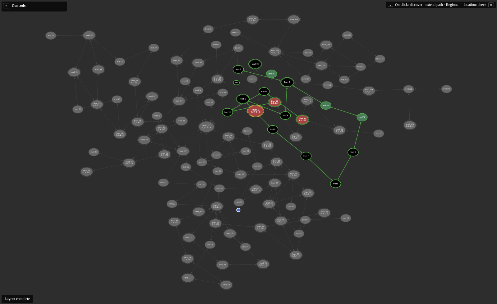
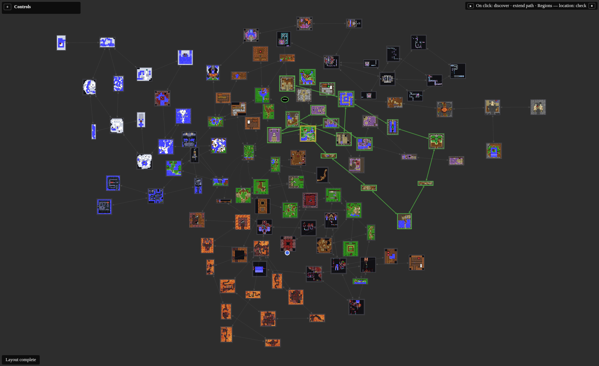
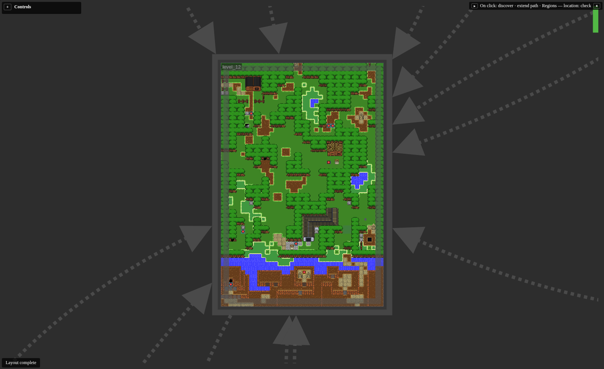
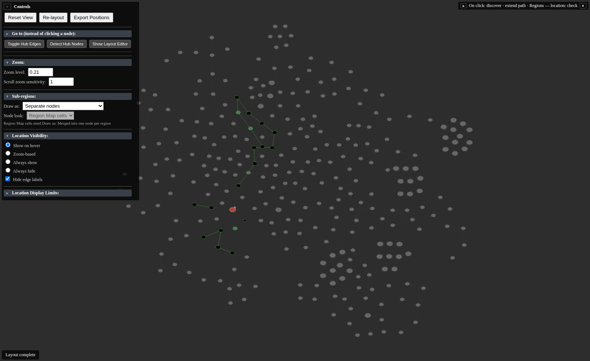
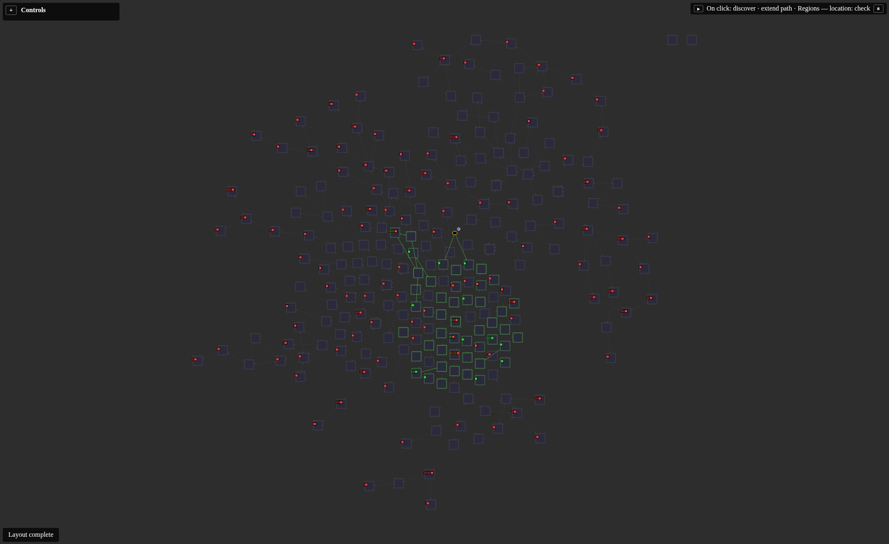
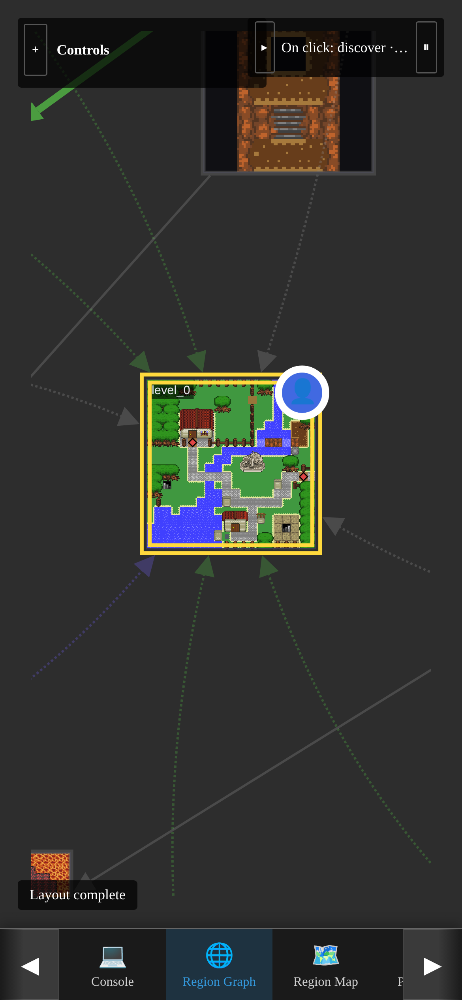

# Region Graph map look: each node drawn as its Region Map cell

**Status: built, gated.** The Region Graph has a new setting, **Node look**
(`moduleSettings.regionGraph.nodeLook`, `graph` | `map`, default `graph`). With `map`, and **Draw as** set to
**Merged into one node per region**, each node is drawn as that region's Region Map cell: the level art, the location
squares coloured by state, and the label. The drawing is the Region Map's own code, moved into one shared module that
both panels call. Node positions are untouched: they still come from the Graph's own layouts.

Base: `75ac248ea6` (`git merge-base HEAD origin/main` at launch = `75ac248ea643fc6292d263a455ee9d5edab4df04`).
origin/main moved during the slice; it was merged at `aaff37e4da`. The **packet tip is the merge SHA `90c5db2cd9`**, and
every gate below ran there. This report, its shots, the shot script and the digest instrument are committed after it;
they touch no code that CI runs.
Planner: archipelago-cc-23. Reviewer and landing queue: js-23.

## ⚖ The rulings (session 84c8ab35)

- **2026-11-26T02:25:14.974Z**: *"What I want to do next is add an option for the Region Graph to display the nodes the
  same way as the Region Map. Preferably by using shared code rather than duplicating existing code."*
- **2026-11-26T02:26:18.879Z** (AskUserQuestion): **"Node look only (Recommended)"**. The option read: *"Each node draws
  as its Region Map cell: the level art, location squares coloured by state, and the label. Node positions still come
  from the Graph's own layouts. Placing nodes by direction is left to the layout work you want to do next."*
- **2026-11-26T02:29:27.084Z**: *"To clarify, I only want the new drawing mode for the Region Map to work in the mode
  where it groups the subregions into one node, the same way the Region Map does."* ("Region Map" here means the
  Region Graph's map look.) So `map` takes effect only with `subRegionView` = `merged`.

js-23's review (GO WITH 5 EDITS) is answered here:
- edit 1, the headroom guard: §9;
- edit 2, heavy local builds: none were run; graded evidence is CI's;
- edit 3, the Region Map digest is evidence, not a pin: §8;
- edit 4, the memory and time STOPs: §7;
- edit 5, the duplicate-launch check: the handshake reported exactly one CLAUDE (pid 2922475).

## 1. What the user sees

The shots come from `scripts/dev/shot-region-graph-map-look.mjs` at `90c5db2cd9` on :8144, in fresh browser profiles,
with the live rule engine (box lock taken at head `90c5db2cd`). The graph and map shots are the SAME view: one
Force-Directed run, then the switch. The script checks that no node moved (`samePositions: true`). Each map shot waits
until the Seedling painter's bakes have landed. A level whose bake is still queued draws the painter's placeholder (the
substrate's name on a dark box), on the Region Map as here.

- **Controls → Sub-regions → Node look**: *Graph nodes* (the default) or *Region Map cells*. The box sits under
  **Draw as**.
- **With Draw as: Merged**:
  - each node is a rectangle shaped like its level (72 model px on its long side);
  - it is filled with the Region Map's cell: the level art (the painter, else the generic cell), the location squares
    in the Region Map's colours (green accessible, red not yet, grey checked, light grey unknown; events are diamonds),
    and the label (the display key, top-left, once the cell is at least 60 px wide on screen);
  - the node's border keeps the graph's state colours (accessible green, current yellow, path purple, selected red,
    a merged node's double border), and edges end on the rectangle's border;
  - edges, location nodes and the player marker are drawn above the cell.
- **With any other Draw as**: the nodes draw exactly as today. The Node look box is disabled with the hint *"Region
  Map cells need Draw as: Merged into one node per region"*. The stored value is kept and takes effect again on
  switching back to Merged.
- **Switching Node look** does not rebuild or re-layout the graph. A Draw as switch rebuilds, as it always has.
- **Phone, 390 px**: no horizontal scroll. The phone run logged A's one known page error (*"SecurityError … Blocked a
  frame … from accessing a cross-origin frame"*, an iframe panel at boot, not a Region Graph code path; it is in the
  groups-b and groups-c reports too). The desktop runs logged none.

## 2. The shared drawing code: `frontend/modules/regionMap/regionMapCellDraw.js`

The cell drawing moved out of `RegionMapUI` into one module that both panels call:

| function | was | what |
|---|---|---|
| `drawCellArt` | `RegionMapUI._drawArt` | the painter (`compositeMapPainterFor`), else `drawGenericRegion`, under `BAKE_TILE_PX` scaling; a cell with no region object is a generic fill; then the cell border |
| `drawPlaceholderCell` | inline in `RegionMapUI.paint` | an undiscovered placeholder: fog and `?` |
| `drawCellSquares` | `RegionMapUI._drawSquares` | the squares by `frameSquares` (with tiled-squares-cap's `capToTile`), coloured by `squareColorKey`, pushed onto a hit-test list |
| `drawCellLabel` | `RegionMapUI._drawLabel` | the screen-sized label (`labelFontPx`, `LABEL_MIN_CELL_PX`) |
| `cameraOntoBox` | new | the camera (`procgenCore/mapCamera.js` form) that puts a frame's cell on a screen box |

- Each function takes the same statements, in the same order, as the code it replaced. `RegionMapUI`'s `_drawArt`,
  `_drawSquares` and `_drawLabel` stay as one-line calls into them, because the Region Map's vitests call those methods
  on stand-in panels. `BAKE_TILE_PX` lives in the new module, and `regionMapUI.js` re-exports it.
- **Why `regionMap/`, not `regionView/`:**
  - the cell drawing depends on the Region Map's pure geometry (`regionMapOverlay.js`, `regionMapFrames.js`) and its
    model (`regionMapModel.js`);
  - `regionView/` is the renderer-free library (its README: no DOM, no renderer);
  - the brief offered either place.
  The Region Graph imports from `regionMap/` for the first time: `mapLookLayer.js` imports the model, the frames, the
  overlay's `squareAt` / `MIN_SQUARE_PX` and the cell drawing.
- **No copied drawing code in `regionGraph/`**: a vitest row scans every non-test file in `regionGraph/` for
  `.fillRect( .strokeRect( .drawImage( .fillText( .arc( .moveTo( .lineTo(`. There are 0 hits.
  `mapLookLayer.js` has one `getContext('2d')` and one `clearRect`.
- `procgenCore/mapCamera.js` is called (`worldToScreen`, through the shared functions), never changed.

## 3. How it is attached, and why it stays legible at every zoom

`frontend/modules/regionGraph/mapLookLayer.js` (`MapLookLayer`, `ui.mapLook`):

- **One canvas UNDER Cytoscape's**:
  - `canvas.rg-map-look-canvas`, appended to the cy container at `z-index: -1`;
  - the container is made a stacking context (`isolation: isolate`) only while the layer is on;
  - it is not the container's first canvas, so `nodeOverlayManager`'s `querySelector('canvas')` still finds
    Cytoscape's.
- **Each map node gets a STYLE BYPASS**: `shape: rectangle`, `width` / `height` at its cell's aspect
  (`mapNodeSize`: 72 on the long side, at least 16 on the short side), `background-opacity: 0`, `text-opacity: 0`.
  - Cytoscape still draws the border, every edge, the location nodes and the player marker, above the cell.
  - A bypass outranks the stylesheet, so the `.current` / `.hub` / `.start-region` sizes and the label rules that
    `updateLabelVisibility` appends at run time cannot undo it.
  - Element ids, data and classes are untouched. The cell key is kept in `scratch('_rgMapKey')`.
- **Drawn at screen resolution, every frame**:
  - the layer paints on Cytoscape's `render` event (pan, zoom, drag, a class change), on each region-view recompute,
    and when a painter's bake lands (`geom.requestRedraw`);
  - each visible node's cell is drawn under its rendered box through `cameraOntoBox`, exactly as the Region Map draws a
    cell under its own camera;
  - so the squares keep their minimum size and the tiled-squares cap, the label keeps its 60 px threshold, and the art
    is drawn from the painter's own bakes (16 px per tile, shared with the Region Map) at whatever scale the box needs.
  - **There is no bake of our own and no re-bake threshold.** A fixed bake would blur when zoomed in and waste memory
    when zoomed out. A per-zoom re-bake would cost a rebuild per zoom step. Drawing per frame costs a median 2.8 ms on
    115 cells (§7).
- **The squares' colours** come from the shared region view (`regionView/regionViewState.js`, the Region Map's).
  The layer creates its own view state while it is on and disposes of it when it turns off. A recompute (at most one
  per frame) repaints. Nothing is rebuilt.
- **Off** (any other `nodeLook` / `subRegionView`): no canvas, no view, no bypass, no listener.
- **Which cell a node draws**:
  - a merged node draws its `groupKey`;
  - a region node draws the cell its region folds into (the model's members);
  - anything with no cell keeps the graph look. On Seedling that is `Menu`: it is not on the Region Map.

## 4. With each `subRegionView` value (the 02:29:27.084Z narrowing)

| Draw as | what a node draws as with nodeLook = map | proof |
|---|---|---|
| `separate` | the graph look, byte-identical; the Node look box is disabled with its hint | vitest identity (elements + bypasses) on seedling_playthrough and alttp; shot `seedling-map-separate.png` |
| `nested` | the graph look, byte-identical; box disabled | vitest identity |
| `merged` | **its Region Map cell**: a merged node as the whole level (the Region Map's display-group cell, undimmed); a region of one as its own cell | vitest; in-app row; shots |
| `collapsible` | the graph look, byte-identical; box disabled (open or closed groups alike) | vitest identity; the in-app row checks no map canvas and no map node in collapsible with `map` stored |

## 5. Location nodes

**They stay as today.** The **Location visibility** setting (hover / zoom / always show / always hide) still governs
them, and with *Show on hover* (the default) they ring the node on hover. The squares show the same locations inside
the cell. Hiding the location nodes would have silently overridden a setting the user chose, so the setting keeps
its meaning. No new setting was added. The ring's radius (`80 + 15·√n` model px) clears the 72-px node, so the ring
does not cover the cell.

## 6. The readers

| reader | with nodeLook = map (merged) | proof |
|---|---|---|
| a click on a location SQUARE | runs the LOCATION click actions on that location, as on the Region Map: `LOCATION_CLICKED`, then `runClick('location', { region, location })`. The region is the location's rules region from the view, else `regionOfCell` | vitest (`onNodeTap` with a rendered position on a square); in-app row (a real pointer click via mouse events, once); shots run (Playwright's mouse: `locationClicked = "Level 012 - Witch"`) |
| a click elsewhere on the node | unchanged: the REGION click (`regionOfCell` for a merged node) | vitest; the merged row's existing tap |
| hover | unchanged: a merged node lists its sub-regions; a region node shows its location ring (hover mode). Squares get no tooltip of their own | — |
| the picker / Go to | unchanged (it selects nodes, not drawing) | — |
| path highlighting | unchanged: borders and edges are Cytoscape's, drawn above the cell | shots |
| the player marker | unchanged: a Cytoscape node above the cell | shots (phone) |
| current region | the yellow border on the node | shots (phone) |
| discovery placeholders | a node with `undiscovered-placeholder` / `group-placeholder` draws the Region Map's fog cell (`drawPlaceholderCell`); a `discovery-hidden` node draws nothing (`node.visible()` false); a square follows its location's view visibility (hidden: none; placeholder: `unknown`) | code path shared with the Region Map |
| Loop mode | the same click path (`onNodeTap`); no map-specific branch | — |
| saved positions | untouched: the switch moves no node (`samePositions: true`) and writes no store | shots run |
| node overlays (ActionNodes cards) | select `.region`; a world with ActionNodes cards has no sub-regions today, so no overlap | — |
| the status line, export positions | unchanged | — |

## 7. Performance (seedling_playthrough, merged: 116 nodes, 115 with a cell)

From the shots run at `90c5db2cd9` (headless Chromium, `--enable-precise-memory-info --js-flags=--expose-gc`):

| measure | value | limit |
|---|---|---|
| switch to `map`: the setting write → the first paint with cells (wall) | **317 ms** (alttp: 237 ms) | STOP > 2 s |
| first paint after turning on (layer clock) | 109.5 ms. That includes the Region Map model, **37.5 ms**, and the bypasses, **20.8 ms** | — |
| every bake landed (the painter, 2 at a time) | 3.5 s after the switch; the cells draw the placeholder until then | — |
| steady paint (20 one-frame pans) | median **2.8 ms**, max 6.3 ms | — |
| re-colour per snapshot (20 recomputes: the view's recompute + the repaint) | median **8.2 ms**, max **9.2 ms** | STOP > 50 ms |
| re-colour after a real square click (the worker's own snapshot) | 5.4 ms, 2 recomputes, model not rebuilt | — |
| JS heap after GC, graph → map (after the bakes landed) | 128.1 → 147.7 MB, **+19.6 MB** | STOP > ~150 MB |

- The re-colour samples drive the view's `refresh()`, which is what its `stateManager:snapshotUpdated` trigger calls.
  A probe cannot publish that event: the bus drops an unregistered publisher. The script refuses a sample whose
  recompute did not run. An earlier draft that published the event measured nothing (20 identical stale readings).
  That run was discarded.
- The painter's bakes are canvases: their pixels live in canvas backing stores, outside the JS heap. They are the
  same bakes the Region Map uses for the same levels, so with both panels open a level is baked once.

## 8. Identity

**The Region Map is byte-identical (draw-call digest, packet evidence, not a pin; js-23 edit 3).**
`scripts/dev/digest-region-map-draw.mjs --base=75ac248ea6` (run at the tip; the output is in
`map-look-shots/region-map-draw-digest.json`):
- on one live Region Map panel, `paint()` runs with the base commit's `RegionMapUI` prototype and with the tip's;
- each paint goes into a recording 2D context: every call with its arguments, every property set;
- the cameras: Fit all, Fit all × 4, and the start cell at zoom 0.5, 2 and 6; each waits until every bake has landed.

| preset | camera | zoom | calls | cells (art / generic) | squares | base = tip digest |
|---|---|---|---|---|---|---|
| seedling_playthrough | fit | 0.0881 | 4384 | 115 (115 / 0) | 89 | `c03394ed15d76e12` ✅ |
| seedling_playthrough | fitX4 | 0.3523 | 901 | 11 (11 / 0) | 12 | `20cf4578b777c1f9` ✅ |
| seedling_playthrough | start05 | 0.5 | 1121 | 10 (10 / 0) | 13 | `dff49cbffe622140` ✅ |
| seedling_playthrough | start2 | 2 | 308 | 1 (1 / 0) | 2 | `022f88075fc480f9` ✅ |
| seedling_playthrough | start6 | 6 | 201 | 1 (1 / 0) | 2 | `ae99079fb4d7c30a` ✅ |
| seedling_playthrough_maze | fit | 0.1086 | 73063 | 306 (116 / 190) | 89 | `9ada12027e67a13b` ✅ |
| seedling_playthrough_maze | fitX4 | 0.4344 | 17264 | 56 (25 / 31) | 16 | `c88eef1d649c02b7` ✅ |
| seedling_playthrough_maze | start05 | 0.5 | 15696 | 45 (25 / 20) | 19 | `57ea21ca580c80bd` ✅ |
| seedling_playthrough_maze | start2 | 2 | 688 | 9 (3 / 6) | 3 | `b3e3a251afe6b76e` ✅ |
| seedling_playthrough_maze | start6 | 6 | 135 | 1 (0 / 1) | 2 | `aee7efe9e0c3e4ba` ✅ |
| procgen_maze | fit | 1.1324 | 376 | 3 (3 / 0) | 3 | `15591b19e6c695e0` ✅ |
| procgen_maze | fitX4 | 4.5298 | 356 | 3 (3 / 0) | 3 | `da650c023d191bef` ✅ |
| procgen_maze | start05 | 0.5 | 376 | 3 (3 / 0) | 3 | `b821a5fa5ef9e73a` ✅ |
| procgen_maze | start2 | 2 | 366 | 3 (3 / 0) | 3 | `ab5df37c7983bb97` ✅ |
| procgen_maze | start6 | 6 | 119 | 1 (1 / 0) | 0 | `46a49cdd2471244b` ✅ |
| alttp | fit | 0.0987 | 6292 | 238 (0 / 238) | 268 | `6e3897d1469d36b9` ✅ |
| alttp | fitX4 | 0.3947 | 2297 | 52 (0 / 52) | 60 | `cbc7c49f0cac089e` ✅ |
| alttp | start05 | 0.5 | 2010 | 45 (0 / 45) | 39 | `0e85666c9d36c175` ✅ |
| alttp | start2 | 2 | 651 | 9 (0 / 9) | 11 | `268c0ffa768db7a8` ✅ |
| alttp | start6 | 6 | 221 | 1 (0 / 1) | 1 | `fbc8aa3e9d0dae64` ✅ |

**20 / 20 identical** (box lock taken at head `90c5db2cd`, 0 page errors). Every view drew art, squares or generic cells, and the logs run from 119 to 73,063 calls, so the comparison is not vacuous. A first run before the merge (at `aaa047b6d`, with a scratch copy of the instrument) gave the same 20 digests.

**The Region Graph's `graph` look is byte-identical, pinned structurally** (`regionGraph/nodeLook.test.js`, over the
FROZEN fixture presets of groups-c, never a live preset digest):
- for seedling_playthrough and alttp, and every `subRegionView` value;
- with no layer at all, nodeLook unset, `graph`, and `map` in every view but merged;
- the element set (ids, data, classes) and every node's style bypass are equal.
- The existing groups-a identity pins (`subRegionView.identity.test.js`, the base digests) pass unchanged.
- With `map` + merged, ids, data and classes are still equal to merged's. Only the bypasses differ, and the capture
  reads them back (it is not vacuous). Turning `map` off restores the no-layer capture exactly.

## 9. Gates

**CI runs at `90c5db2cd9`** (each run's headSha = `90c5db2cd9ca8cc13a8ba5f3503bb6449ae4de77`):

| run | id | result |
|---|---|---|
| JSUT (push) | 45746136350 | ✅ **1449 files / 30267 tests**, 0 failed (slow battery 40 / 461). Main `aaff37e4da` (45735600239): 1448 / 30247, so **+F 1 / +T 20**: the new `regionGraph/nodeLook.test.js` (17), and `regionView/nodeSelectedRetired.test.js` 32 → 35 (its per-file census over `regionGraph/`, `regionMap/`, `regionView/` enrolled `mapLookLayer.js`, `nodeLook.js` and `regionMapCellDraw.js`) |
| unittests (push) | 45746136127 | ✅ |
| TT (dispatch) | 45746203202 | ✅ 9 / 9 jobs: ALTTP spoiler + regression; fast and fast-bundled, 139 / 139 each; seedling-wasm; seedling-js; seedling-js-solver; apworld; playback-bot; on-push list |
| TT, re-sample (dispatch) | 45749836062 | ✅ 9 / 9 jobs; fast and fast-bundled 139 / 139 each |
| fast bundled, re-sample (`-f batch=fast -f bundled=true`) | 45749838640 | ✅ 139 / 139 (342.0 s, 57%) |
| `-f batch=tutorials` | 45746205762 | ✅ 24 / 24 (167.1 s, 28%) |
| `-f batch=tutorials-tracker` | 45746208055 | ✅ 9 / 9 (49.6 s, 8%) |

No `train_only` run: no train-tier path is touched. No local heavy build (`npm run build`, `--bundled`) was run; the
bundled evidence is CI's (js-23 edit 2).

**Headroom (js-23 edit 1)** (`check-batch-headroom.js` in each job; the span over the 600 s budget). The main baseline
is the MEDIAN of 3 TT samples at main's SHA `aaff37e4da`: 45745346285 (push) and 45746275203 / 45746286994 (dispatched
beside this slice's runs).

| batch | tip | re-sample | main ×3 | main median | tip − median | the merged row (tip samples / main) |
|---|---|---|---|---|---|---|
| fast | 329.2 s (55%) | 341.7 s (57%), **+3.8 s** | 324.3 / 337.9 / 340.8 s | 337.9 s | **−8.7 s** | 1.5 / 1.6 s / 1.1–1.4 s |
| fast-bundled | 338.5 s (56%) | 336.8 s (56%), **+9.4 s** (TT); 342.0 s (57%), **+14.6 s** (manual bundled) | 327.4 / 343.1 / 325.1 s | 327.4 s | **+11.1 s** | 1.6 / 1.5 / 1.7 s / 1.1–1.2 s |

- Every span is 55–57%: under js-23's 60% line (no split to plan), the 70% STOP and +20 s. The largest is fast-bundled's
  manual re-sample, **+14.6 s** over the median.
- The extended row's own added cost in CI is **≈ +0.3 s** (1.5–1.7 s at the tip against 1.1–1.4 s on main). The
  main samples alone spread 16.5 s (fast) and 18.0 s (fast-bundled), so the span deltas are noise around that.

**Engine closure:**
- **Closure ∩ diff = ∅**: 0 of the files in `git diff --name-only origin/main...HEAD` are among the 42 files of
  `node scripts/procgen/seedlingDerivedRuleTable.js --print-engine-closure`.
- **engineMd5 `74ae60f575531492ed9eaec1839e1fe3`** at the tip: the same as base (the groups-c report's value; no
  closure file changed).
- **0 gitlinks**: `git diff origin/main HEAD` names no submodule.

## 10. Tests

- **Vitest** `frontend/modules/regionGraph/nodeLook.test.js`, 17 tests:
  - the schema default (`graph`), the panel's schema registration, and normalisation;
  - `map` applies only with merged;
  - the identity rows (§8);
  - map + merged on seedling_playthrough: 116 nodes, 115 cells, `Menu` without one; a rectangle at each cell's aspect;
  - alttp: every cell generic, nothing throws;
  - SHARED CODE: the four `regionMapCellDraw.js` functions, spied, are called by the Region Map's methods and by the
    layer's paint; no drawing calls in `regionGraph/`;
  - square colours follow `squareColorKey` across four view states, with the same model object (no rebuild);
  - a square tap → the location click; off-square → region; `graph` → region.
- **In-app** `test_region_graph_sub_region_merged` (extended, not a new row; it stays in the Region Graph category,
  `fast`):
  - after the merged tap, it sets `nodeLook = map` (session-only);
  - it reads that every node with a cell painted (`4 cells = 4 nodes with a cell, of 5` on seedling_atlas: `Menu`
    has none), with no rebuild;
  - a pointer click on a square (`Starting House - Chest`) publishes the LOCATION click once;
  - in collapsible, the stored `map` takes no effect;
  - restored: nodeLook reads `graph`, and no canvas is left.
  - Solo on :8144: **4.4 s, the map step ≈ 0.5 s** (under the 1.5 s line, so no separate row).
- **Bounded vitest at the merge SHA**: `regionGraph/ regionMap/ regionView/ tutorials/ quickLaunch/` (every test file
  that imports a touched file is in these directories), `--maxWorkers=3`. **46 files / 661 tests passed.**
  - The first try at the merge, with the box at load 18 from other sessions, reported
    `regionMapAtlasCache.test.js` as a failed FILE with 0 failed tests (6 skipped: it never ran).
  - It passes alone (6/6), and the immediate re-run of the whole set was green.
  - Before the merge: 39 files / 547 tests over the first four directories.
- **Docs**:
  - `docs/json/user/modules/regionGraph.md` (the Node look setting);
  - `docs/json/developer/modules/regionGraph.md` (the two files, the view-state exception);
  - `docs/json/developer/modules/regionMap.md` (the new file).
  - **No doc-census pin moved**: `generate-docs-index.mjs --check` and `generate-tutorial-docs.mjs --check` are
    current, `check-procgen-docs.mjs` exits 0, and the quickLaunch docs pins pass (7 files / 114 tests).

## 11. What the layout arc (direction-aware placement) can reuse

- **`cameraOntoBox(frame, box, vp)`** draws any Region Map cell into any screen box. A layout that places nodes by
  the Region Map's own grid only has to set node positions; the drawing follows.
- **`framesOfModel(model)` / `mapNodeSize(frame)`** give every display region's level extent and the node size at
  its aspect. A direction-aware layout can size and space nodes from the real levels: for instance, place each at
  `regionMapFrames.cellFrames(model.layout.positions, …)`, scaled, which IS the Region Map's arrangement.
- **`cellKeyOfNode` / `keyOfRegion`** map a Graph node to its Region Map cell (merged node → group key; region →
  its fold).
- **`buildRegionMapModel`** already resolves the substrate's `layoutGraph` (Seedling's up / down / edge links) and
  `links` / `neighbourLinks` with door tiles. These are the inputs a direction-aware placement needs, already computed
  once per rules load by the layer.
- Not done here (the next arc's): positions, the procgen-grid layout in map look, and edges ending at door tiles
  rather than at the node border.

## 12. Known limits

- Edges crossing a node pass over its cell (Cytoscape draws edges above the canvas). Edges END on the border.
- Overlapping nodes: the lower node's cell can show through the upper node's transparent body. The force layouts
  rarely overlap at 72 px.
- The label is the display key (the Region Map's). It ignores the graph's substituted names / label provider, and
  the graph's counts text is hidden (the squares carry the counts).
- The squares use the Region Map's default minimum (`MIN_SQUARE_PX`, 6 px), not the Region Map panel's
  `minSquarePx` setting.
- The square hit-test is a node tap's rendered position. A tap on a square that sits under an edge or a location node
  goes to that element instead.
