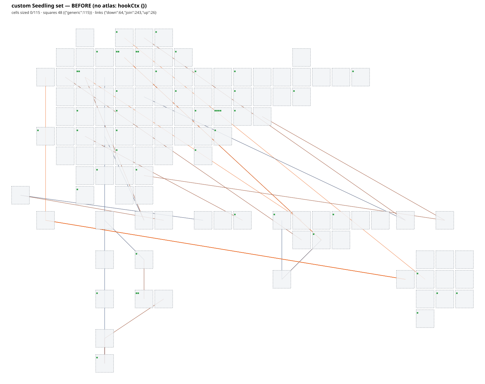
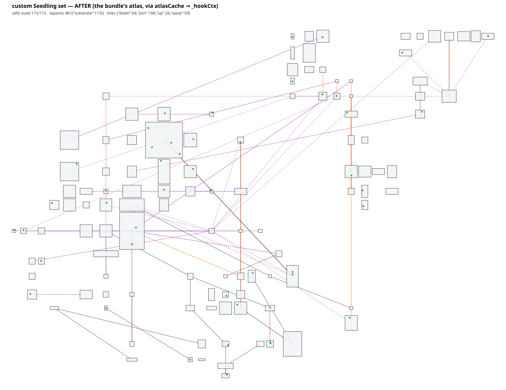

# Region map: a custom world's derived atlas reaches the panel (the atlas cache)

Slice `region-map-atlas-cache`, base `9c658aba76` (origin/main, train 143). Planner archipelago-cc-23; reviewer js-21;
lab owner lab-6.

**The ruling:** the user, session 84c8ab35 (archipelago-cc-23), 2026-11-17T02:25:35Z: *"I agree with your
recommendation for question 2"*. Question 2 was the custom-world atlas; the recommendation was option (b), a shared
cache keyed by `atlas_id`. lab-6 agreed on 2026-11-17 with four constraints:
1. the writer is HOST-side;
2. the cache is game-neutral;
3. the writer is not `setEditorView.js`;
4. editing a lab file is a STOP, with the diff sent to lab-6.

js-21's review added five edits: per-player reads, a staleness rule, the host bundle cost of option (i), "(ii) is a
STOP", and quoting the ruling.

**What landed:** the HOST-ONLY half.
- The cache.
- The writer on the one host entry path that holds an atlas: the `.zip` bundle.
- The Region Map reader.

The lab hand-over writer needs a lab diff under either option. It was measured, sent to lab-6 and **not folded**
(lab-6, 2026-11-17: *"Don't fold any lab hunk; land your host-only half as planned"*). See § The lab hand-over.

## Rulings since

- 2026-11-17, the user: placement's 5 "right" groups stay as they are (*"Leave as is"*). This closes
  [`placement.md`](placement.md) residue 3.
- 2026-11-17, the user (relayed by lab-6): the lab hand-over is *"Not now (Recommended)"*. No lab hunk is folded; this
  slice lands the host-only half, and the hand-over is residue 3.

## The entry-path survey

Every path by which a custom world's rules reach the host stateManager, and so the Region Map
(`regionMapUI._rulesOf` → `getLastRawJsonData()`). Measured at `9c658aba76`.

| path | how the rules arrive | atlas (or the record to derive one) on the HOST? |
|---|---|---|
| **lab hand-over** | Set editor `editOpenApworldEditor` → `apworldEditor.open(rep.rules)` (`setEditorView.js:1954`) → the watch page's `open: (rules) => hostBridge.openInApworldEditor(rules, source)` (`watchViewer.js:9923`) → `procgenLab:openInApworldEditor {substrate, iframeId, rules, source}` (`labBridge.js:204`, `labProtocol.js` field list) → `procgenLabPanelUI.js:377` forwards `apworldEditor:loadRules {jsonData, source}` → the hub's Apply → `files:jsonLoaded` | **No.** Only `rules` crosses. `rep.atlas` and the set record stay in the iframe. The rules name the atlas (`region_atlas[p] = {atlas_id, game, map_document}`) and carry no body. |
| **file load** (plain `.json` / `.json.gz`) | `#json-file-input` → `presetUI.loadDocumentFile` → `displayLoadedJsonFileDetails` → `processManuallyLoadedRules` → `files:jsonLoaded` | **No.** A rules document alone. |
| **bundle** (`.zip`) | the same door; `readBundle` sorts the members by kind (`documentBundle.js`) and the `rules` member is loaded | **Yes.** The set editor's bundle download zips `rep.atlas` as a `region-atlas` member beside `rep.rules` (`setEditorView.js:2037`). Before this slice, the loader named the member as "NOT loaded". |
| **preset** | `presetUI.loadRulesFile` → `files:jsonLoaded` | **Shipped atlases only.** No committed preset is a custom set. Every `region_atlas` id is content-hashed (`seedling-9ff3df2a`, `seedling-77a4c0ea`, `seedling-5f90f079`). The first two are the library's `KNOWN_ATLASES`, which the hooks already merge in. |
| procgen pipeline (*Load into frontend*) | `procgenPipelineUI._publishRulesToFrontend` → `files:jsonLoaded` | Not a custom-set path: it compiles shipped atlases. |
| `.archipelago` | `loadArchipelagoFile`, the first `*_rules.json` | **No.** |

**So the writer goes in two places:** the bundle (host-only, landed) and the lab hand-over (a lab diff, held).

## The design

### The cache: `frontend/modules/procgenCore/atlasCache.js`

It is pure and game-neutral, and it has no top-level imports. A grep pin in `atlasCache.test.js` checks that its
source names no game or substrate and that its code has no `import`, `eventBus`, `document.` or `window.`.

- `createAtlasCache({limit})` (`:28`) returns `put(atlasId, atlas)`, `get`, `has`, `ids`, `size` and `clear`.
  - `put` refuses a key that is not the atlas's own `atlas_id`.
  - The module exports one shared instance, `atlasCache` (`:60`). There is one per realm: a lab iframe has its own,
    which is why the writer must be on the host side.
- **Staleness: put OVERWRITES.** A re-load or re-hand-over under the same `atlas_id` replaces the cached atlas, and
  the old one is never served again.
- **The bound: `ATLAS_CACHE_LIMIT = 8`, FIFO by last put** (`:22`).
  - A put past the limit evicts the atlas put longest ago.
  - A re-put moves its id to the newest end; `get` does not reorder.
  - The vanilla 116-room derived atlas is about 117 KB of JSON, so 8 atlases take less than 1 MB.
- `putAtlases(docs)` (`:63`) puts every document that is an atlas and skips the rest.
- `hookCtxFor(rules, player)` (`:78`) is the reader's question.
  - It returns `{atlases: {[id]: atlas}}` when `rules.region_atlas[player].atlas_id` is in the cache, and `{}`
    otherwise.
  - **Per player:** it reads the player the panel resolved, never the first player or a global id.

### The writer (bundle): `frontend/modules/presets/presetUI.js:1729`

`loadDocumentFile` puts every `region-atlas` member in the cache **before** `displayLoadedJsonFileDetails`, so the
atlas is there before `files:jsonLoaded` publishes the rules. The notification names the member as **CACHED for the
Region Map** (by kind, entry name and id) and still lists the members it does not load.
`check-preset-bundle-load.mjs` claim 4 (*the members are NAMED by kind*) passes: ALL CHECKS PASSED against `:8142`.

### The reader: `frontend/modules/regionMap/regionMapUI.js:321`

The ONLY `regionMap/` change: `_hookCtx(got = this._rulesOf())` returns
`got ? hookCtxFor(got.rules, got.playerId) : {}`. `_rebuild` passes the `got` it already holds (`:330`). The import
is `:31`.

- `regionExtent`, `locationTiles` and `layoutGraph` already merge `ctx.atlases` over `KNOWN_ATLASES`
  (`flashSeedlingLibrary.js:870–873`). Nothing else changed.
- `seedling_playthrough`'s rules name `seedling-77a4c0ea`, which no host writer puts in the cache. Its hook context
  is therefore `{}`, exactly the base's `_hookCtx() { return {}; }`, and its model is byte-identical.

### (i) or (ii): measured, and why neither is host-only

- **(i) derive on the host through the registry.** `deriveAtlasOf(record, deps)` needs `record.set.rooms` and
  `record.overlay`, and the hand-over carries neither.
  - (i) would have to send the whole set record over the bridge: a lab diff.
  - The host would also need the derivation's deps (`parseOel`, `tileTypeForPlacement`, the rules schema) and
    `seedlingDemo/*` in its closure. js-21's edit 3 is exactly that cost.
- **(ii) carry the atlas in the payload.** `rep.atlas` already exists, because `reportOver` returns
  `atlas: derived.atlas` (`setEditorCore.js`).
  - The payload is the atlas the rules were compiled from, so it cannot be stale against them. It costs no second
    derivation and puts no `seedlingDemo/*` on the host.
  - It edits the SENDER (`setEditorView.js`, `watchViewer.js`), the bridge (`labBridge.js`, `labProtocol.js`) and
    the host receiver (`procgenLabPanelUI.js`, where `putAtlases` would go).

**Choice: (ii)**, which per js-21 edit 4 is a STOP. The bundle writer is (ii)'s idea on a path that already carries
the atlas, so it needed no lab edit. **js-21 edit 3 does not arise:** no host file imports `seedlingDemo/*`. The
in-app row loads the set editor's modules by a document-relative URL at run time, so they never join the bundle.

## The lab hand-over (held, not folded)

The exact diff is [`atlas-cache-lab-handover.diff`](atlas-cache-lab-handover.diff): 7 files, +59/−9, and
`git apply --check` is clean at `9c658aba76`.
1. `labProtocol.js`: a required `atlases` field (an array of `{atlas_id,…}`, `[]` when there are none) and its
   validator.
2. `labBridge.js`: `openInApworldEditor(rules, source, atlases = [])`.
3. `watchViewer.js`: the `open` passthrough.
4. `setEditorView.js`: `open(rep.rules, rep.atlas ? [rep.atlas] : [])`.
5. `procgenLabPanelUI.js`: `putAtlases(data.atlases)` before it forwards the rules.
6. The test updates. Measured with the diff applied: 103/103 pass across `labProtocol.test.js` and
   `procgenLabPanel.test.js`, including a new forward + re-hand-over row.

lab-6 put the options to Robert, who ruled **(1) "Not now"**:
1. (Rec) not now: land the host-only half;
2. a hand-over for the maze lab's mixed worlds only, which would add a `mazeLabView.js:2610` passthrough and a
   content-hashed id;
3. a read-only study of making the watch page's custom sets real Seedling worlds.

Two measurements decided it:
- **The watch page's sets reach no Seedling hook at all** (residue 1). The diff alone would change nothing on the
  map for them.
- **The derived atlas_id is never content-hashed** (residue 2).

## Before / after

`node scripts/dev/region-map-atlas-cache-dump.mjs <dir> [--svg]` drives the REAL writer
(`PresetUI.prototype.loadDocumentFile` on a bundle written in node) and the REAL reader
(`RegionMapUI.prototype._hookCtx`, player 1). Each dump is the model as canonical JSON: cells with extents, tile
source and squares `[location, x, y, kind]`; the unplaced locations; and every layout link `[from, to, kind, dir]`.
The dumps are in [`atlas-cache/`](atlas-cache/).

**The custom set:** the editor's vanilla 115 rooms plus the committed vanilla overlay
(`seedlingDemo/fixtures/seedling-vanilla-overlay.json`), compiled by the set editor's own `rulesJsonOf` with
`game: 'seedling'`.
- BEFORE is the base panel's context, `{}`.
- AFTER is the bundle through the cache.

| world | state | sized cells | squares | cell tile source | links |
|---|---|---|---|---|---|
| custom set | BEFORE | **0/115** | 48 (item 48) | generic 115 | down 64 · join 243 · up 26 |
| custom set | AFTER | **115/115** | **48/48**, none unplaced | **substrate 115** | down 64 · join **184** · up 26 · **warp 59** |
| `seedling_playthrough` | BEFORE | 115/115 | 89 (item 48, event 41) | substrate 115 | down 64 · join 184 · up 26 · warp 46 |
| `seedling_playthrough` | AFTER | 115/115 | 89 (item 48, event 41) | substrate 115 | down 64 · join 184 · up 26 · warp 46 |

- **`seedling_playthrough`: `cmp` → byte-identical**
  (`atlas-cache/seedling_playthrough.{before,after}.json`). The cache still held the custom atlas while the AFTER
  file was produced.
- **The custom set's 59 warps come OUT of its joins:** 243 − 184 = 59, and the link set is the same 333. This is
  `placement.md`'s residue 2, which said *"59 warps stay `join`"*.
- This set has no event locations. The vanilla overlay authors items only, so "item and event squares" is shown on
  the items, and events take the same `locationTiles` path.

**Pictures:** both are drawn with the panel's own `cellFrames` geometry in `level` mode.
- Dashed grey frame: an ESTIMATED extent.
- Solid frame: the level's real size.
- Green square: an item at its tile.
- Link colours: join grey, down orange, up blue, warp purple dashed.

| BEFORE | AFTER |
|---|---|
|  |  |

## Proof

**Vitest:**
- `procgenCore/atlasCache.test.js`: put/get/clear, overwrite, the FIFO bound, the limit, the key check,
  `putAtlases`, a 2-player `hookCtxFor` row, and the no-game-names / no-imports grep pins.
- `regionMap/regionMapAtlasCache.test.js`:
  - the bundle writer caches before the display;
  - writer → cache → `_hookCtx` → `buildRegionMapModel` gives real extents, N/N squares on their tiles inside their
    extents, and warps split from joins (BEFORE gives no extents and no warps);
  - **a re-load row:** the same `atlas_id` with a different atlas replaces the cached one;
  - **a 2-player row:** `set-p1` and `set-p2`, each map its own, and never another player's;
  - `_hookCtx()` with no argument reads `_rulesOf`;
  - `seedling_playthrough`'s context is `{}` with a custom atlas cached, and its canonical model is identical to the
    base's.

**In-app row `region-map-custom-set-atlas`** (category "Region Map: Seedling", batch playback-bot, no `batch`
field; `regionMapTests.js:808`).
- It SETS its own state: it loads `seedling_playthrough` and opens the panel, then clears the cache.
- It builds the custom set in the page with the set editor's own modules, zips it with the Presets panel's JSZip, and
  hands it to the LIVE Presets panel's `loadDocumentFile`, the call a file pick makes.
- It asserts:
  - the atlas is in the cache;
  - the panel rebuilt on the custom set (its own `source.rules`);
  - **115/115** real extents;
  - **48/48** squares, none unplaced;
  - squares on the substrate's tiles in every cell;
  - warps classified.
- It clears the cache and reloads the world it found.
- Locally on `:8142`: PASSED, 18.2 s.

## Residue

1. **The watch page's custom sets reach no Seedling hook at all.**
   - The page derives with `game: 'seedling-watch-edit'` (`watchViewer.js:9143`). Through `substrateIdFor`
     (`regionAtlasCompiler.js:109`), every sidecar becomes `substrate: 'flash_seedling_watch_edit'`, which no
     registry entry knows. `mazeSetLab.js:475` already calls it *"a substrate nothing plays"*.
   - The Region Map therefore lays such a set out GENERICALLY: all 333 links `join`, no up/down, 0/115 extents,
     squares on generic places. An atlas, handed in or not, changes nothing (measured both ways).
   - Step-3b item 9's *"what a custom world gets today"* was measured with `game: 'seedling'` deps
     (`preview-region-layout.mjs`), not the page's.
   - The cache helps `game: 'seedling'` sets: the derivation's default (`seedlingAtlasDerivation.js:490`) and the
     maze set lab's `SEEDLING_ATLAS_GAME`.
   - Making the watch page's sets real Seedling worlds (map and play) is lab-6's option 3, a study.
2. **A set's derived `atlas_id` is not content-hashed.** It is `deps.atlas.game` (`'seedling-watch-edit'` on the
   page, `'seedling'` by default), and the atlas is *"DELIBERATELY UNSTAMPED"* (`setEditorCore.js`).
   - Two different sets loaded in turn share one key, and **the last one wins**. A Region Map still holding the
     first set's rules would read the second set's atlas on its next `_rebuild` (a grouping or cell-size toggle).
   - Both the bundle and a future hand-over carry the same unstamped `rep.atlas`.
   - The fix belongs on the sending side: stamp a copy at the hand-over or the download with `stampAtlasIdentity`
     (`regionAtlasValidator.js:119`), and write the same id into a copy of `rules.region_atlas[p]`. That is lab-6's
     option 2.
   - ⛔ Not host-side: re-keying there means rewriting the rules' `atlas_id`, which mutates the document the hub
     files.
3. **The lab hand-over** (§ above): not now (⚖ 2026-11-17). The diff stays here as the measured design.
4. **A cache put after the panel has built** does not rebuild it. Every host writer puts before `files:jsonLoaded`,
   so this does not arise today; a future writer that puts later would need a rebuild nudge.
5. Out of scope, as briefed: clicks, the maze `layoutGraph` hook (placement residue 1), bake memory tiers, the
   tutorial and the Region Graph.
