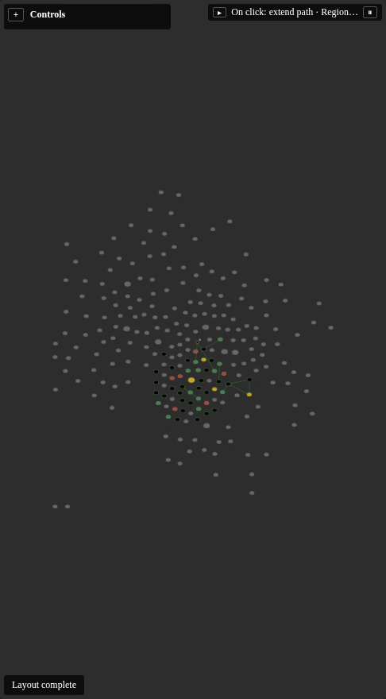
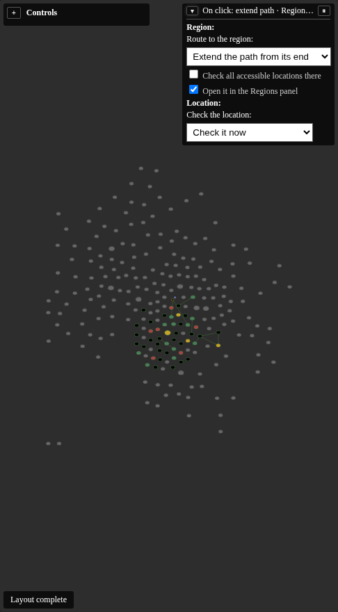

# Click actions S2: the "On click" strip, the Region Graph's adoption, and no "one step"

**Status: built, gated.** The Region Graph's seven "On Region Node Click" checkboxes are gone. A click on a region or
a location now runs the panel's registered click actions (`runClickActions`) over
`moduleSettings.regionGraph.clickActions`. The shared "On click" strip shows and edits them; it sits at the top right
of the panel, outside Controls. The "move player one step" option is removed everywhere in the new model.

The design is the mode-toggle discussion's (rulings R1–R8, 2026-11-16). This is its slice CA-S2, after CA-S1
(`click-actions-s1.md`). Base: `41561f8094` (train 157). Code tip: `9471cb1492`. Planner: archipelago-cc-23.

## ⚖ Rulings this slice carries (session 84c8ab35)

- **R1–R8 (2026-11-16):**
  - R2: named choices, not 7 checkboxes.
  - R3: actions are registered and owned by panels, with a master switch.
  - R4: per-panel state.
  - R5: location clicks use the same registry.
  - R6: the strip is its own collapsible section at the top, keeping ⏸ when collapsed.
  - R7: path moves dispatch with `regionView-path-<panelId>`.
  - R8: path first, then checks, then panel actions; `regionGraph:nodeSelected` stays until S5.
- **2026-11-17T18:08:42Z, the order:** *"Yes, go ahead (Recommended)"* (… → RG checks repair → CA-S2 → CA-S3 …).
- **2026-11-17T23:00:54Z, one step:** *"I think I want to entirely remove the "move player one step" option. I don't
  remember what I thought it would be useful for."*
- **Planner, 2026-11-19 (archipelago-cc-23, with js-21):** a strip save MIRRORS `addLocationsToPath` (§5).

## 1. What changed

| File | Change |
|---|---|
| `regionView/clickActionsUI.js` (new) | The strip (§2) |
| `regionView/clickActions.js` | No "one step" (§3). `onClickActionsChanged` (`:90`), `getClickAction` (`:140`), the display-only `summary` / `choiceLabels` fields, `routeStatusText` (`:224`) / `clickStatusOf` (`:243`): the status-bar texts |
| `regionGraph/graphInteractionManager.js` | The 7 boxes' change handlers and the handler branches that read them are gone. `handleLocationNodeClick` (`:178`) and `handleRegionNodeClick` (`:190`) call `runClick` (`:228`), which runs `runClickActions('regionGraph', …)` with `clickHandles()` (`:212`) and maps the route result to the status bar. `dispatchLocationCheckEvent` / `checkAllLocationsInRegion` went with them |
| `regionGraph/layoutControlsManager.js` | The "On Region Node Click:" `
` and its 7 rows in the persisted-checkbox table (`:106`) are gone |
| `regionGraph/navigationManager.js` | `attemptMovePlayerOneStepToRegion`, `attemptMovePlayerDirectlyToRegion`, `addToPath`, `overwritePath` are gone (`:283`): the click handlers were their only callers. `_handles`, `_flashNoPath`, `setShowAllRegions`, `takeRestartStepToward` stay |
| `regionGraph/regionGraphUI.js` | It mounts the strip (`:152-166`) and loads or migrates `clickActions` (`loadClickActions`, `:203`). A `clickActions` write does NOT rebuild the graph (`:946`). It destroys the strip on teardown (`:1265`). The four move wrappers and `setShowAllRegions` are gone |
| `regionGraph/clickActionsSettings.js` (new) | `loadRegionGraphClickActions` (`:32`: the one-time migration), `saveRegionGraphClickActions` (`:62`: the strip's save plus the mirror), the schema entry |
| `regionGraph/index.js` | Schema `clickActions` (`:126`), default `defaultClickActions()`. `addLocationsToPath`'s entry is KEPT, because the Region Map and the Regions panel still read it. The AN-3a block is untouched |
| `regions/regionsClickActions.js` (new), `regions/index.js` | `regions.open` (§4): registered in `initialize` (`:294`), unregistered in its cleanup (`:311`) |
| `app/core/settingsManager.js` | `hasStoredSetting(key)`: an override or a stored or preset value, not a schema default. It is the migration's "never written" test (`getSetting` cannot tell, because the schema default always answers) |
| `frontend/settings/settings-{depgraph,vibecoding,apcalc,check-all-from-graph,metamath,textadventure}.json` | `clickActions` ADDED at the top of each `regionGraph` block. The old keys are byte-unchanged (pure insertions: `git diff` shows 0 deleted lines) |
| `regionView/README.md`, `docs/json/user/modules/regionGraph.md`, `docs/json/developer/path-and-queue-settings.md` | The strip, the settings, and the removal of `movePlayerOneStep` |
| `tutorials/content/tracker/panels.js` | A new step, `open-click-strip`. `open-controls` no longer names "On Region Node Click" |

**The presets' added `clickActions`** (each is `migrateRegionGraphClickKeys` of its own old keys, pinned by
`clickActionsSettings.test.js`):

| Preset | `clickActions` |
|---|---|
| depgraph, check-all-from-graph, metamath | `{"enabled":true,"region":{"path.route":false,"path.checkAll":true,"regions.open":false},"location":{"path.check":"now"}}` |
| vibecoding, apcalc | `{"enabled":true,"region":{"path.route":false,"path.checkAll":false,"regions.open":false},"location":{"path.check":"now"}}` |
| textadventure | `{"enabled":true,"region":{"path.route":{"from":"pathEnd"},"path.checkAll":false,"regions.open":false},"location":{"path.check":"now"}}` |

## 2. The strip's contract (`regionView/clickActionsUI.js`)

`mountClickActionsStrip({ panelId, container, getSettings, saveSettings, doc? })` → `{ element, render, setExpanded,
isExpanded, destroy }`.

- **The host** keeps its `clickActions` in memory. `getSettings()` is synchronous. `saveSettings(next)` stores
  `next`, which is always a NEW object (the strip never mutates what it was given). The Region Graph's
  `saveSettings` is `saveRegionGraphClickActions`.
- **It knows no panel and no action by name.** It renders `listClickActions('region' | 'location')`:
  - a `toggle` is a checkbox;
  - a `choice` is a select whose first option is "off" (`false`). With `choices` as an array, it is one select and the
    value is the choice. With `choices` as `{ field: [values] }`, it is one select per field and the value is
    `{ field: value }`, holding only the declared fields (a stale `distance` is dropped on the next edit of that row);
  - labels come from the descriptor: `label`, `choiceLabels`, and `summary` for the collapsed line.
- **Collapsed:** one line plus the master switch: `On click: extend path · Regions — location: check` and **⏸**.
  Paused, it reads `On click: ⏸ paused` and the switch shows **▶**. `data-expanded` on the root says which state it
  is in (the tutorial's click targets the collapsed one).
- **Unknown ids are kept.** An enabled id with no registered action shows greyed, `<id>: <value> (not loaded)`. An
  edit elsewhere never drops a key it does not know.
- **Re-render:** on `onClickActionsChanged` (a plain listener list in the registry; no event bus), and on the host's
  `render()` (the Region Graph calls it when `clickActions` changes from outside).

## 3. The one-step removal

**Deleted** (`regionView/clickActions.js`): `ROUTE_DISTANCE`, the `distance` field, and the one-step branches of
`routeTo` (the one-step plan and the `oneAndAll` double move). A route is `{ from: 'pathEnd' | 'start' | 'player' }`
and always goes all the way: `pathEnd` → `addToPath`, `start` → `overwritePath`, `player` → `planDirectMove` +
`publishRegionMove`. `migrateRegionGraphClickKeys` ignores `movePlayerOneStep`: a config migrates exactly as it does
with that key false. `movePlayerOneStep` alone migrates to the route OFF.

- `validRoute` checks `from` only. A stored route with a `distance` is read without it, not refused.
- Measured: no stored `distance` exists outside tests. `git grep -a` for `oneAndAll|ROUTE_DISTANCE|distance: '`
  finds only `clickActions.{js,test.js}`, `regionView/README.md` and the CA-S1 record.

**Deleted in `regionGraph/`:** the checkbox, its handler branches, its change handlers, and
`navigationManager.attemptMovePlayerOneStepToRegion`. Its only caller was the click handler. The restart rows of
`navigationManager.restart.test.js` now drive `takeRestartStepToward`.

**Kept:**
- `regionActions.moveOneStep`: its caller is `regionMap/regionMapClicks.js:130` (the Region Map, until CA-S3).
- `regionActions.planOneStepMove`: its callers are `regionActions.moveOneStep` (`regionActions.js:153`) and
  `regionActions.test.js`.
- `regionActions`' `moveOnlyOneStep` option: `regionMapClicks.js:121/126` passes it.
- CA-S3 retires all three with the Map's interim reader.

**What changes for a user who had "one step" ticked.** Measured by `clickActions.equivalence.test.js`: each row's
base handlers vs the adopted ones, for a click on `Field` (it has locations), discovery off, Show All on. Key: D =
movePlayerDirectly, S = showRegionInPanel, A = addToPath, O = overwritePath, L = addLocationsToPath, C =
checkAllLocationsInRegion. The other box was always ticked alongside one step. Totals (both click kinds, 128 rows):
- 72 path-edit-one-step→all;
- 12 one-step-move→none;
- 12 one-step+direct→direct;
- 32 the same.

| # | Other boxes ticked | Region click: before → now | Location click: before → now |
|---|---|---|---|
| 1 | — | **one-step move → no move** (`move(one)` → `—`) | same |
| 2 | D | **one-step + direct → direct only** (`move(one) move(direct)` → `move(direct)`) | same |
| 3 | S | **one-step move → no move** (`move(one)` → `—`) | same |
| 4 | D S | **one-step + direct → direct only** (`move(one) move(direct)` → `move(direct)`) | same |
| 5 | A | **path edit: one step → whole path** (`addToPath(one step)` → `addToPath`) | same |
| 6 | D A | **path edit: one step → whole path** (`addToPath(one step)` → `addToPath`) | same |
| 7 | S A | **path edit: one step → whole path** (`addToPath(one step)` → `addToPath`) | same |
| 8 | D S A | **path edit: one step → whole path** (`addToPath(one step)` → `addToPath`) | same |
| 9 | O | **path edit: one step → whole path** (`overwritePath(one step)` → `overwritePath`) | same |
| 10 | D O | **path edit: one step → whole path** (`overwritePath(one step)` → `overwritePath`) | same |
| 11 | S O | **path edit: one step → whole path** (`overwritePath(one step)` → `overwritePath`) | same |
| 12 | D S O | **path edit: one step → whole path** (`overwritePath(one step)` → `overwritePath`) | same |
| 13 | A O | **path edit: one step → whole path** (`addToPath(one step)` → `addToPath`) | same |
| 14 | D A O | **path edit: one step → whole path** (`addToPath(one step)` → `addToPath`) | same |
| 15 | S A O | **path edit: one step → whole path** (`addToPath(one step)` → `addToPath`) | same |
| 16 | D S A O | **path edit: one step → whole path** (`addToPath(one step)` → `addToPath`) | same |
| 17 | L | **one-step move → no move** (`move(one)` → `—`) | **one-step move → no move** (`move(one) addLocationCheckToPath` → `addLocationCheckToPath`) |
| 18 | D L | **one-step + direct → direct only** (`move(one) move(direct)` → `move(direct)`) | **one-step + direct → direct only** (`move(one) move(direct) addLocationCheckToPath` → `move(direct) addLocationCheckToPath`) |
| 19 | S L | **one-step move → no move** (`move(one)` → `—`) | **one-step move → no move** (`move(one) addLocationCheckToPath` → `addLocationCheckToPath`) |
| 20 | D S L | **one-step + direct → direct only** (`move(one) move(direct)` → `move(direct)`) | **one-step + direct → direct only** (`move(one) move(direct) addLocationCheckToPath` → `move(direct) addLocationCheckToPath`) |
| 21 | A L | **path edit: one step → whole path** (`addToPath(one step)` → `addToPath`) | **path edit: one step → whole path** (`addToPath(one step) addLocationCheckToPath` → `addToPath addLocationCheckToPath`) |
| 22 | D A L | **path edit: one step → whole path** (`addToPath(one step)` → `addToPath`) | **path edit: one step → whole path** (`addToPath(one step) addLocationCheckToPath` → `addToPath addLocationCheckToPath`) |
| 23 | S A L | **path edit: one step → whole path** (`addToPath(one step)` → `addToPath`) | **path edit: one step → whole path** (`addToPath(one step) addLocationCheckToPath` → `addToPath addLocationCheckToPath`) |
| 24 | D S A L | **path edit: one step → whole path** (`addToPath(one step)` → `addToPath`) | **path edit: one step → whole path** (`addToPath(one step) addLocationCheckToPath` → `addToPath addLocationCheckToPath`) |
| 25 | O L | **path edit: one step → whole path** (`overwritePath(one step)` → `overwritePath`) | **path edit: one step → whole path** (`overwritePath(one step) addLocationCheckToPath` → `overwritePath addLocationCheckToPath`) |
| 26 | D O L | **path edit: one step → whole path** (`overwritePath(one step)` → `overwritePath`) | **path edit: one step → whole path** (`overwritePath(one step) addLocationCheckToPath` → `overwritePath addLocationCheckToPath`) |
| 27 | S O L | **path edit: one step → whole path** (`overwritePath(one step)` → `overwritePath`) | **path edit: one step → whole path** (`overwritePath(one step) addLocationCheckToPath` → `overwritePath addLocationCheckToPath`) |
| 28 | D S O L | **path edit: one step → whole path** (`overwritePath(one step)` → `overwritePath`) | **path edit: one step → whole path** (`overwritePath(one step) addLocationCheckToPath` → `overwritePath addLocationCheckToPath`) |
| 29 | A O L | **path edit: one step → whole path** (`addToPath(one step)` → `addToPath`) | **path edit: one step → whole path** (`addToPath(one step) addLocationCheckToPath` → `addToPath addLocationCheckToPath`) |
| 30 | D A O L | **path edit: one step → whole path** (`addToPath(one step)` → `addToPath`) | **path edit: one step → whole path** (`addToPath(one step) addLocationCheckToPath` → `addToPath addLocationCheckToPath`) |
| 31 | S A O L | **path edit: one step → whole path** (`addToPath(one step)` → `addToPath`) | **path edit: one step → whole path** (`addToPath(one step) addLocationCheckToPath` → `addToPath addLocationCheckToPath`) |
| 32 | D S A O L | **path edit: one step → whole path** (`addToPath(one step)` → `addToPath`) | **path edit: one step → whole path** (`addToPath(one step) addLocationCheckToPath` → `addToPath addLocationCheckToPath`) |
| 33 | C | **one-step move → no move** (`move(one) checkAccessibleLocationsInRegion` → `checkAccessibleLocationsInRegion`) | same |
| 34 | D C | **one-step + direct → direct only** (`move(one) move(direct) checkAccessibleLocationsInRegion` → `move(direct) checkAccessibleLocationsInRegion`) | same |
| 35 | S C | **one-step move → no move** (`move(one) checkAccessibleLocationsInRegion` → `checkAccessibleLocationsInRegion`) | same |
| 36 | D S C | **one-step + direct → direct only** (`move(one) move(direct) checkAccessibleLocationsInRegion` → `move(direct) checkAccessibleLocationsInRegion`) | same |
| 37 | A C | **path edit: one step → whole path** (`addToPath(one step) checkAccessibleLocationsInRegion` → `addToPath checkAccessibleLocationsInRegion`) | same |
| 38 | D A C | **path edit: one step → whole path** (`addToPath(one step) checkAccessibleLocationsInRegion` → `addToPath checkAccessibleLocationsInRegion`) | same |
| 39 | S A C | **path edit: one step → whole path** (`addToPath(one step) checkAccessibleLocationsInRegion` → `addToPath checkAccessibleLocationsInRegion`) | same |
| 40 | D S A C | **path edit: one step → whole path** (`addToPath(one step) checkAccessibleLocationsInRegion` → `addToPath checkAccessibleLocationsInRegion`) | same |
| 41 | O C | **path edit: one step → whole path** (`overwritePath(one step) checkAccessibleLocationsInRegion` → `overwritePath checkAccessibleLocationsInRegion`) | same |
| 42 | D O C | **path edit: one step → whole path** (`overwritePath(one step) checkAccessibleLocationsInRegion` → `overwritePath checkAccessibleLocationsInRegion`) | same |
| 43 | S O C | **path edit: one step → whole path** (`overwritePath(one step) checkAccessibleLocationsInRegion` → `overwritePath checkAccessibleLocationsInRegion`) | same |
| 44 | D S O C | **path edit: one step → whole path** (`overwritePath(one step) checkAccessibleLocationsInRegion` → `overwritePath checkAccessibleLocationsInRegion`) | same |
| 45 | A O C | **path edit: one step → whole path** (`addToPath(one step) checkAccessibleLocationsInRegion` → `addToPath checkAccessibleLocationsInRegion`) | same |
| 46 | D A O C | **path edit: one step → whole path** (`addToPath(one step) checkAccessibleLocationsInRegion` → `addToPath checkAccessibleLocationsInRegion`) | same |
| 47 | S A O C | **path edit: one step → whole path** (`addToPath(one step) checkAccessibleLocationsInRegion` → `addToPath checkAccessibleLocationsInRegion`) | same |
| 48 | D S A O C | **path edit: one step → whole path** (`addToPath(one step) checkAccessibleLocationsInRegion` → `addToPath checkAccessibleLocationsInRegion`) | same |
| 49 | L C | **one-step move → no move** (`move(one) checkAccessibleLocationsInRegion` → `checkAccessibleLocationsInRegion`) | **one-step move → no move** (`move(one) addLocationCheckToPath` → `addLocationCheckToPath`) |
| 50 | D L C | **one-step + direct → direct only** (`move(one) move(direct) checkAccessibleLocationsInRegion` → `move(direct) checkAccessibleLocationsInRegion`) | **one-step + direct → direct only** (`move(one) move(direct) addLocationCheckToPath` → `move(direct) addLocationCheckToPath`) |
| 51 | S L C | **one-step move → no move** (`move(one) checkAccessibleLocationsInRegion` → `checkAccessibleLocationsInRegion`) | **one-step move → no move** (`move(one) addLocationCheckToPath` → `addLocationCheckToPath`) |
| 52 | D S L C | **one-step + direct → direct only** (`move(one) move(direct) checkAccessibleLocationsInRegion` → `move(direct) checkAccessibleLocationsInRegion`) | **one-step + direct → direct only** (`move(one) move(direct) addLocationCheckToPath` → `move(direct) addLocationCheckToPath`) |
| 53 | A L C | **path edit: one step → whole path** (`addToPath(one step) checkAccessibleLocationsInRegion` → `addToPath checkAccessibleLocationsInRegion`) | **path edit: one step → whole path** (`addToPath(one step) addLocationCheckToPath` → `addToPath addLocationCheckToPath`) |
| 54 | D A L C | **path edit: one step → whole path** (`addToPath(one step) checkAccessibleLocationsInRegion` → `addToPath checkAccessibleLocationsInRegion`) | **path edit: one step → whole path** (`addToPath(one step) addLocationCheckToPath` → `addToPath addLocationCheckToPath`) |
| 55 | S A L C | **path edit: one step → whole path** (`addToPath(one step) checkAccessibleLocationsInRegion` → `addToPath checkAccessibleLocationsInRegion`) | **path edit: one step → whole path** (`addToPath(one step) addLocationCheckToPath` → `addToPath addLocationCheckToPath`) |
| 56 | D S A L C | **path edit: one step → whole path** (`addToPath(one step) checkAccessibleLocationsInRegion` → `addToPath checkAccessibleLocationsInRegion`) | **path edit: one step → whole path** (`addToPath(one step) addLocationCheckToPath` → `addToPath addLocationCheckToPath`) |
| 57 | O L C | **path edit: one step → whole path** (`overwritePath(one step) checkAccessibleLocationsInRegion` → `overwritePath checkAccessibleLocationsInRegion`) | **path edit: one step → whole path** (`overwritePath(one step) addLocationCheckToPath` → `overwritePath addLocationCheckToPath`) |
| 58 | D O L C | **path edit: one step → whole path** (`overwritePath(one step) checkAccessibleLocationsInRegion` → `overwritePath checkAccessibleLocationsInRegion`) | **path edit: one step → whole path** (`overwritePath(one step) addLocationCheckToPath` → `overwritePath addLocationCheckToPath`) |
| 59 | S O L C | **path edit: one step → whole path** (`overwritePath(one step) checkAccessibleLocationsInRegion` → `overwritePath checkAccessibleLocationsInRegion`) | **path edit: one step → whole path** (`overwritePath(one step) addLocationCheckToPath` → `overwritePath addLocationCheckToPath`) |
| 60 | D S O L C | **path edit: one step → whole path** (`overwritePath(one step) checkAccessibleLocationsInRegion` → `overwritePath checkAccessibleLocationsInRegion`) | **path edit: one step → whole path** (`overwritePath(one step) addLocationCheckToPath` → `overwritePath addLocationCheckToPath`) |
| 61 | A O L C | **path edit: one step → whole path** (`addToPath(one step) checkAccessibleLocationsInRegion` → `addToPath checkAccessibleLocationsInRegion`) | **path edit: one step → whole path** (`addToPath(one step) addLocationCheckToPath` → `addToPath addLocationCheckToPath`) |
| 62 | D A O L C | **path edit: one step → whole path** (`addToPath(one step) checkAccessibleLocationsInRegion` → `addToPath checkAccessibleLocationsInRegion`) | **path edit: one step → whole path** (`addToPath(one step) addLocationCheckToPath` → `addToPath addLocationCheckToPath`) |
| 63 | S A O L C | **path edit: one step → whole path** (`addToPath(one step) checkAccessibleLocationsInRegion` → `addToPath checkAccessibleLocationsInRegion`) | **path edit: one step → whole path** (`addToPath(one step) addLocationCheckToPath` → `addToPath addLocationCheckToPath`) |
| 64 | D S A O L C | **path edit: one step → whole path** (`addToPath(one step) checkAccessibleLocationsInRegion` → `addToPath checkAccessibleLocationsInRegion`) | **path edit: one step → whole path** (`addToPath(one step) addLocationCheckToPath` → `addToPath addLocationCheckToPath`) |

## 4. `regions.open` (where it is registered)

It is registered **from the Regions panel's side**: `regions/regionsClickActions.js` (the descriptor, 39 lines with
its docblock) plus 8 lines in `regions/index.js`, which registers it in `initialize` and unregisters it in the
cleanup that `initialize` returns. A layout without the Regions module offers no such action; a stored
`regions.open: true` then shows as "(not loaded)".

- **Behaviour** = the stand-in from CA-S1's equivalence test, now the REAL action in the re-run:
  1. set the Regions panel's Show All to !(`path.route.from` is `pathEnd` or `start`);
  2. publish `ui:activatePanel` + `ui:navigateToRegion` on the clicking panel's bus (`h.eventBus`, the publisher those
     events were registered for).
- **CA-S4:** adds the location action (scroll to the location) beside it. It may move the Show All rule into the
  Regions panel's own state.

## 5. The interim, until CA-S3: the Region Map and the Regions panel

- **The Region Map** (`regionMap/regionMapClicks.js`) still reads the seven `regionGraph.*` keys. The presets keep
  them, so its LOAD-TIME config is byte-identical base → tip for the six presets and the default. That is pinned
  against the JSON measured at base (`clickActionsSettings.test.js` § the Region Map).
- **The mirror** (⚖ planner, 2026-11-19): a strip SAVE writes `addLocationsToPath` =
  (`location['path.check'] === 'addToPath'`), and nothing else. The migration and the load path never write it.
  - The old box drove three readers: the Graph, the Region Map, and the Regions panel's own location clicks
    (`regions/regionBlockBuilder.js:1085, :1183`). That third reader was not in the brief.
  - So an edit of the strip's location choice still moves the other two as the box did.
- **The ONE interim behaviour change:** after a strip save, the Region Map follows the strip on `addLocationsToPath`.
  Its other six keys stay at their stored values; the strip no longer writes them. Pinned in the mirror row.
- **`regionMap/regionMapClicks.test.js`** pinned the Map's seven defaults to the Graph's checkbox list. That list is
  gone, so the row now pins them to `LEGACY_REGION_GRAPH_CLICK_DEFAULTS`: the same values, which CA-S1 pinned to that
  list. This is the one `regionMap/` edit, a test-only re-point.
- **`regionMapTests.js` `rgToggleLeg`** clicked the Graph's boxes to change Map clicks. It now writes the stored keys
  itself, session-only (`ctx.setSetting`, restored after).

## 6. Proof

**Equivalence, re-run** (`clickActions.equivalence.test.js`, CA-S1's method).
- BEFORE: the base's handler and navigation methods, kept VERBATIM in `regionView/legacyRegionGraphClicks.testkit.js`
  (extracted with `git show` from base; only the imports and wrappers are new).
- AFTER: the real adopted `GraphInteractionManager`, the real `NavigationManager` and the real `regions.open`.
- **2^6 = 64 combinations (`movePlayerOneStep` forced false) × 12 scenarios = 768 rows: 768/768 equal** on:
  - the play channel in order;
  - the Regions-panel channel in order;
  - the `regionGraph:nodeSelected` channel;
  - the multiset of all calls.
- Named deltas, counted:
  - `source`: 504 swaps, and 504 rows carry the new source (`regionView-path-regionGraph` for the base's `regionGraph-*`);
  - the R8 interleaving between channels: 228 rows;
  - from the one-step removal: **none**.
- 584 rows have a non-empty play channel.
- Mutations turn it red:
  - overwrite beats add in the migration: 12 tests fail;
  - `regions.open` always sets Show All on: 9 fail.
- The one-step=true rows: §3.

**Strip vitest** (`clickActionsUI.test.js`, 11 rows, on `procgenCore/fakeEditorDom.testkit.js`):
- the collapsed summary;
- master off → `runClickActions` runs nothing, and the switch toggles back;
- register / unregister re-renders;
- an unknown id is kept and greyed;
- a test-registered toggle and choice render generically;
- a stale `distance` is dropped on edit.

**Migration pins** (`clickActionsSettings.test.js`, 21 rows):
- it writes once; a second load writes nothing;
- a stored `clickActions` is never overwritten (3 loads, 0 writes);
- the old keys are left in place;
- a fresh user gets `defaultClickActions()`;
- a non-object stored value is not overwritten;
- the presets carry their migration (and the set of presets naming an old key is SCANNED, = the 6);
- the Map's config per preset is byte-identical to base;
- the mirror flips both ways on a save, the Map follows on that key alone, and a load never writes it.

**In-app rows** (category "Region Graph", fast batch; each sets its own state):

| Row | What | Repeat ×8 at `9471cb1492` |
|---|---|---|
| `test_region_graph_click_default` | ALTTP; a tap on a region one exit from the path end extends the path to it, then `ui:activatePanel regionsPanel` + `ui:navigateToRegion`; `nodeSelected` first | **8/8** (run 44560991507) |
| `test_region_graph_click_master_off` | `enabled:false`: no move, no path edit, no Regions-panel publish; `nodeSelected` still published | **8/8** (44560997738) |
| `test_region_graph_click_location_check` | location action "check it now": a location click (the Go to picker) checks it | **8/8** (44561003729) |

- Two earlier rounds were red, and both causes were in the rows' setup:
  - at `b42adc32af` the default row picked an "accessible" region with no walk to it, and both rows recorded their
    own setup's `ui:activatePanel`;
  - at `8f794217c8` / `c26d6751ee` the rows ran solo (0/8). The world a solo run boots into has no reachable exit
    from its start, so the default row now loads ALTTP; master-off needs no walk.
- **All 8 existing Region Graph rows** pass, locally (8141, with `region-map-clicks-generated`) and in TT's fast and
  bundled batches:
  - `test_node_selection`, the picker and `…location_nodes_survive_rebuild` are named in region-graph-checks §4;
  - the picker's handler names and signatures are unchanged (`nodePicker.js:111/124`).

**The census** (`grep -a` over `tests/`, `tutorials/`, `test-configs/` for the 7 key names, plus the whole tree for
the checkbox ids and "On Region Node Click"):
- `regionMapTests.js` `rgToggleLeg`: moved to the stored keys (§5), with its config `_comment` and description;
- `tutorials/content/tracker/panels.js` `open-controls`: a new `open-click-strip` step;
- `nodePicker.js:10` and `regionGraphPanelTests.js:341`: comments;
- `client/core/messageHandler.outOfLogicGate.test.js:12`: a comment naming `dispatchLocationCheckEvent`.

**D0** (`scripts/dev/region-graph-class-snapshot.mjs`, 3 presets × S1–S7, default config):
- BEFORE at base; AFTER at `9471cb1492`;
- `diff -r`: **byte-identical** (22 files);
- a first-load migration writes `clickActions`, which does not rebuild the graph.

## 7. Gates

| Gate | Result |
|---|---|
| Bounded vitest (⚖ 52) | 44 files, 958 tests passed. The list: every test importing a touched file, plus `regionView/`, `regionGraph/`, `regionMap/`, `regions/`, `loops/loopModeExemptions`, `loops/blockModes`, `procgenCore/bindingContract`, `tests/moduleImportOrder`, `storagePanel/storageCensus` + `storageDeclarationPins`, `procgenDocs/docLinks`, `lintGateLabels` |
| JSUT at `9471cb1492` | run 44560993092 success: 1369 files / 29014 tests, 0 failed; slow 36/438. Base `41561f8094` (run 44464925624): 1367 / 28974. **+2 files, +40 tests** |
| unittests at `9471cb1492` | run 44560993160 success (the Python legs skip: no Python changed) |
| TT at `9471cb1492` | run 44561008195 success, read job by job: ALTTP spoiler & regression, fast, fast-bundled, seedling-js, seedling-js-solver, seedling-wasm, apworld and playback-bot all success. fast 122/122 |
| Headroom fast | 293.5 s / 600 (49%). Base push run 44547551847: 293.2 s (49%): **+0.3 s**. New rows 4.6 + 1.5 + 0.4 s |
| Headroom fast-bundled | 293.1 s / 600 (49%). Base: 288.4 s (48%): **+4.7 s**. New rows 3.7 + 1.1 + 0.4 s |
| feature-checks at `b42adc32af` | run 44555210117: 10/10 |
| tutorials-tracker | Tip `b42adc32af` (run 44555216033): 8/8; `tutorial-walk-tracker-region-graph` PASSED 5.6 s, 8 steps, `open-click-strip 0.1s`. Base `41561f8094` (run 44555286536): 8/8, PASSED 7.1 s, 7 steps |
| Closure ∩ diff | ∅. 42 closure files; 35 files changed |
| engineMd5 | `bec369878feb67081187edca62baa951` at base and at tip |
| Gitlinks | 0 |

**Census pins:** `lintGateLabels` caught two count-stating test names in the equivalence file. Both now interpolate
`OTHER_KEYS.length` or name the classification; no allowlist row was added. No docs-link census covers the docs I
edited (`procgenDocs/docLinks` scans `docs/json/developer/procgen/` only).

## 8. Notes for CA-S3 (the Region Map's adoption)

1. **Mount** `mountClickActionsStrip({ panelId: 'regionMap', … })`, as `regionGraphUI.js:152-166` does. Give the
   Map its own `moduleSettings.regionMap.clickActions`. A write must not trigger a rebuild (`regionGraphUI.js:946`).
2. **First run copies the Graph's resolved config (R4):** read `moduleSettings.regionGraph.clickActions` (after the
   Graph's migration, or run `loadRegionGraphClickActions` yourself; it is idempotent).
   - ⚠ Use `settingsManager.hasStoredSetting` for "never written": the schema default makes `getSetting` always
     answer.
3. **`statusOf`** was NOT moved. Moving it would have meant editing `regionMapClicks.js`, so the mapping is COPIED as
   `clickActions.routeStatusText` / `clickStatusOf`, keyed by the route's `from`. The Map can drop its `statusOf`
   for them. The texts are the same, except that the `oneStep` branch is gone.
4. **Retire**, with `regionMapClicks.js`'s reader:
   - `moveOneStep` / `planOneStepMove` / `moveOnlyOneStep` (their last callers);
   - the presets' old keys, plus the "no preset names an old key" pin;
   - `REGION_GRAPH_SOURCES` (only tests name it now);
   - the `addLocationsToPath` schema entry and the mirror. These must wait until the Regions panel reads
     `clickActions` or owns its option (CA-S4).
5. **The equivalence oracle** `legacyRegionGraphClicks.testkit.js` is the Graph's, at base. The Map's own oracle is
   `regionMapClicks.js` itself until CA-S3 replaces it.

## 9. Notes for AN-3b (the strip as host of `actionNodes.act`)

- Register `{ id: 'actionNodes.act', owner: 'actionNodes', target: 'region' | 'location', kind: 'toggle', label,
  summary?, run }`. The strip shows it with no change to the strip. Unregister it when its worlds unload: the strip
  re-renders, and a stored `true` shows greyed "(not loaded)".
- `run(h, ctx)` gets the clicking panel's handles: `h.dispatcher`, `h.eventBus`, `h.stateManager`, `h.gameState`, …
  `ctx` is `{ panelId, target, regionName, locationName?, discovery, settings, value }`.
- With no `order` it runs after path and checks (`ORDER.panel`, 300). Give `order` explicitly if "perform once" must
  come before a route.
- `choice` with `{ field: [values] }` choices renders one select per field. `choiceLabels` labels the values.
