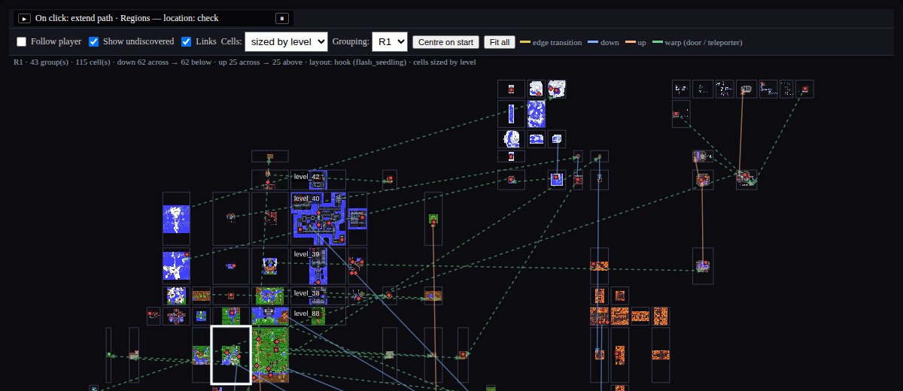
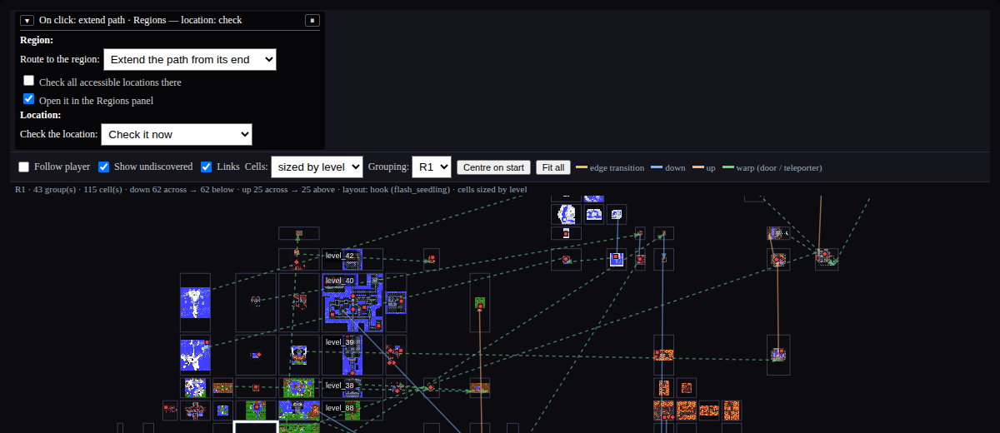

# Click actions S3: the Region Map adopts the click-action registry

**Status: built, gated.** The Region Map has its own "On click" strip, the first row of the panel, with its own
`moduleSettings.regionMap.clickActions`. The first time it loads, it copies the Region Graph's resolved config. Its
region clicks and location-square clicks run `runClickActions('regionMap', …)`. Every Map click publishes the
generic `regionView:regionClicked` / `regionView:locationClicked` events. Step 4's interim reader
(`regionMap/regionMapClicks.js`) is gone, and with it everything only it kept alive.

The design is the mode-toggle discussion's (rulings R1–R8, 2026-11-16). This is its slice CA-S3, after CA-S2
(`click-actions-s2.md`). Base: `3a1909b2dc` (train 170). Code tip: `1af7b57a6f`. Planner: archipelago-cc-23.
Reviewer: js-21.

(Headless Chromium's font draws the ⏸ and ▸ glyphs as boxes; the in-app rows read the real `▶`.)

## ⚖ Rulings this slice carries (session 84c8ab35)

- **R1–R8 (2026-11-16):**
  - R4: per-panel state. *"Per panel (Recommended)"*: `moduleSettings.regionMap.clickActions`; "The Map's first-run
    default copies the Graph's current setup."
  - R5: location clicks use the same registry.
  - R6: the strip is its own collapsible section at the top, keeping ⏸ when collapsed.
  - R7: path moves dispatch with `regionView-path-<panelId>`.
  - R8: path first, then checks, then panel actions.
- **2026-11-17T18:08:42Z, the order:** *"Yes, go ahead (Recommended)"* (… → CA-S2 → CA-S3 → CA-S4 → CA-S5 → Region Map
  tutorial …).
- **2026-11-17T23:00:54Z, one step:** *"I think I want to entirely remove the "move player one step" option. I don't
  remember what I thought it would be useful for."*
- **js-21's review (2026-11-19), four edits:** the first-run copy goes through the Graph's own resolver, all three
  sources pinned (§2); `regions.open` measured as a delta or not (§5); the old stored keys (§4); each Region Map row
  named in the packet (§6).

## 1. What changed

| File | Change |
|---|---|
| `regionMap/regionMapClickActions.js` (new) | `loadRegionMapClickActions` (`:55`, the first-run copy, §2), `saveRegionMapClickActions` (`:67`, the Map's key only), `regionMapClickActionsSchemaEntry` (`:72`), `regionOfCell` (`:87`, moved from the retired reader), `withClickHandles` (`:97`: the Map's originators, and *Show All Regions* off before a path edit), `runRegionMapClick` (`:114`: the selection, the generic event, then `runClickActions`; the status via `clickStatusOf`), the event names (`:41`) |
| `regionMap/regionMapUI.js` | Mounts the strip as the panel's first row, above the toolbar (`:220`). Loads `clickActions` (`_loadClickActions`, `:331`; `clickActionsReady`, `:130`). A write of the key reloads the click actions and the strip, and returns before the view-settings reload: no repaint, no rebuild (`:126`). `clickAt` (`:602`) runs `runRegionMapClick`; the Map's `statusOf` is gone. `_handles` (`:584`) adds `withClickHandles`. `getDebugState` reports `clickActions` and the strip (`:879`); `dispose` destroys the strip (`:901`). The header comment names `procgenCore/mapCamera.js` (the fold-in) |
| `regionMap/regionMapSettings.js` | Schema `clickActions` (`:36`), default `defaultClickActions()`. It is listed in `SEPARATELY_LOADED` (`:41`), so it is not in `REGION_MAP_SETTING_DEFAULTS` and the view-settings loop never reads it |
| `regionMap/index.js` | Registers `regionView:regionClicked` and `regionView:locationClicked` as event-bus publishers (`:51-52`), beside `regionMap:nodeSelected`. Header comment updated |
| `regionMap/regionMapClicks.js` | **Deleted** (moved to `legacyRegionMapClicks.testkit.js`, verbatim under a new header: the equivalence oracle, §5). `regionMapClicks.test.js` deleted |
| `regionView/regionActions.js` | `planOneStepMove`, `moveOneStep`, `moveDirectly` and the `moveOnlyOneStep` option of `addToPath` / `overwritePath` / `walkAndDispatch` deleted (§3) |
| `regionView/clickActions.js` | `routeTo` (`:207`) no longer passes `moveOnlyOneStep: false` |
| `regionGraph/regionGraphOriginators.js` | `REGION_GRAPH_SOURCES` deleted (§3) |
| `regionGraph/index.js` | The `addLocationsToPath` schema entry's comment (`:130`): its reader is now the Regions panel, until CA-S4 |
| `regionGraph/clickActionsSettings.js` | Header and mirror comments: the Map's interim reader is gone |
| `loops/loopModeExemptions.js` + `.test.js` | The `regionMap-*` comment; the pin re-pointed (§3) |
| `frontend/settings/settings-{depgraph,vibecoding,apcalc,check-all-from-graph,metamath,textadventure}.json` | The six retired `regionGraph.*` click keys removed (§4). `addLocationsToPath` and `clickActions` stay |
| `tests/testCases/regionMapTests.js` + the substrates config | Four new rows, two rows moved (§6) |
| `docs/json/user/modules/regionMap.md`, `docs/json/developer/modules/regionMap.md`, `docs/json/developer/path-and-queue-settings.md`, `regionView/README.md` | The strip, the clicks through the registry, the events, the retirement |

## 2. The first-run copy (⚖ R4; js-21 edit 1)

`loadRegionMapClickActions(settings)`:

1. If the Map's key has been written (`settingsManager.hasStoredSetting('moduleSettings.regionMap.clickActions')`;
   `getSetting` cannot tell, because the schema default always answers), read it. A non-object value is not
   overwritten: the panel runs `defaultClickActions()` in memory.
2. Otherwise take what the Region Graph's own resolver answers, `regionGraph/clickActionsSettings.js`
   `loadRegionGraphClickActions`:
   1. the Graph's stored or preset `clickActions`;
   2. else `migrateRegionGraphClickKeys` over the old keys, stored or preset (the resolver saves that as the Graph's,
      its own idempotent one-time migration);
   3. else the defaults (the migration of the old defaults).
3. Save a deep copy (`structuredClone`) once as the Map's.

So a second load writes nothing, and a stored Map config is never overwritten. After the copy the two panels are
independent. **The Map does not mirror `addLocationsToPath`.** The Region Graph's strip does, for the Regions panel,
until CA-S4. The Map's location choice is its own (R4).

**Pinned** (`regionMap/regionMapClickActions.test.js`):
- each of the three sources;
- idempotent (three loads, one write);
- a stored Map config is never overwritten;
- a non-object value is kept;
- a Graph strip save never writes the Map's key, and a Map save writes only its own key.

`regionGraph/clickActionsSettings.test.js` adds, per preset and the default, that the Map's first-run copy equals
the migration of the click config the interim reader measured at base (`MAP_CONFIG_AT_BASE`, recorded by CA-S2).

## 3. What was retired, and what was kept

Callers measured with `git grep -a -n` at base `3a1909b2dc`:

| Retired | Its callers at base | Now |
|---|---|---|
| `regionMap/regionMapClicks.js` | `regionMapUI.js:40`, `index.js:22`, `regionMapTests.js:28`, `loopModeExemptions.test.js:26`, `clickActionsSettings.test.js:16`, its own test | Deleted. Its code is the equivalence oracle (`legacyRegionMapClicks.testkit.js`, verbatim; nothing else imports it) |
| `regionActions.moveOneStep` | `regionMapClicks.js:130` (the last app caller); `regionActions.test.js:70, :102` | Deleted; the restart rows now drive `takeRestartStep` directly |
| `regionActions.planOneStepMove` | `regionActions.js:153` (`moveOneStep`); `regionActions.test.js`; `legacyRegionGraphClicks.testkit.js:225` (the CA-S2 oracle, under its test's recorder) | Deleted. The CA-S2 oracle still names it, and its test's recorder supplies it |
| `regionActions.moveDirectly` | `regionMapClicks.js:131` (the last caller: the click actions use `planDirectMove` + `publishRegionMove`); `regionActions.test.js` | Deleted; its row drives `planDirectMove` + `publishRegionMove`. Not in the brief's list; the same reason |
| `moveOnlyOneStep` (`addToPath` / `overwritePath`) | `regionMapClicks.js:121, :126` (the last caller that could pass `true`); `clickActions.js:213-214` (always `false`); `regionActions.test.js:142`; the CA-S2 oracle | Deleted. The CA-S2 equivalence recorder drops a `false` on both sides and keeps a `true`, so its one-step classification is unchanged |
| `REGION_MAP_SOURCES` | `loopModeExemptions.test.js:26` | Gone with the reader. **The loop-mode pin's new form** (`loopModeExemptions.test.js:45`): the Map's moves are classified by `pathSourceFor(PANEL_ID)` (the Map module's own constant, = `regionView-path-regionMap`), and the four old `regionMap-*` strings stay pinned as literals, because `isLoopModePlanningSource` keeps the `regionMap` prefix for older callers (as `regionGraph*`, R7) |
| `REGION_GRAPH_SOURCES` | `regionMapClicks.test.js:16, :175`; `clickActions.equivalence.test.js:108`; `legacyRegionGraphClicks.testkit.js:24` (tests only) | Deleted from `regionGraphOriginators.js`. Its base value lives in the CA-S2 oracle (`legacyRegionGraphClicks.testkit.js:30`), where the frozen bodies read it; the CA-S2 equivalence test imports it from there |
| The comments naming `regionMapClicks.js` | `regionMap/index.js:12/22`, `regionMapUI.js:19`, `loopModeExemptions.js:19`, `regionGraph/index.js:128`, `regionGraph/clickActionsSettings.js:9` | Re-written |

**Kept:**
- `addLocationsToPath`, in the Region Graph's schema and in the five presets that set it: the Regions panel's own
  location clicks read it (`regions/regionBlockBuilder.js:1085, :1183`) until CA-S4.
- The CA-S2 mirror (`saveRegionGraphClickActions`): a Region Graph strip save still writes `addLocationsToPath`, so
  the Regions panel follows that strip as it followed the old box. It retires with the key in CA-S4.
- `takeRestartStep` (the Region Graph's `navigationManager.takeRestartStepToward` calls it).

## 4. The presets, the schema, and the old stored keys (js-21 edit 3)

**Removed from the six presets:** `movePlayerOneStep`, `movePlayerDirectly`, `showRegionInPanel`, `addToPath`,
`overwritePath`, `checkAllLocationsInRegion` (textadventure named only `showRegionInPanel`). `git diff`: 33 lines
deleted, 2 changed (a trailing comma).

**The schema:** none of the six was still in it (CA-S2 left only `addLocationsToPath`). The new pin checks that the
Region Graph's `registerSettingsSchema` block names `addLocationsToPath` and none of the six.

**The pin** (`regionGraph/clickActionsSettings.test.js`): no `frontend/settings/*.json` names a removed key. It is
scanned over every file in the directory, not a list. Beside it: each preset's `clickActions` equals the migration
of the keys it named at base.

**Users' stored keys.** A user who ticked the old boxes before CA-S2 has the six keys in localStorage. They are left
there, orphaned and unread. Nothing writes or deletes them. Since CA-S2 they have no schema entry, so the Storage
panel already showed them as it shows any undeclared key. Measured: no storage census or declared-keys pin names
any of them (`git grep -a` over `frontend/` for the six names finds only the click-actions code, its tests, and the
loop-mode literals). **No census pin moved.**

## 5. The equivalence (CA-S1's method; `regionMap/regionMapClicks.equivalence.test.js`)

- **BEFORE:** step 4's reader at base, verbatim (`legacyRegionMapClicks.testkit.js`). `readClickOptions` reads the
  seven `regionGraph.*` keys from a settings manager, and `readDiscoverySettings` reads the discovery settings, as the
  base's `clickAt` did. Then `onRegionClick` / `onLocationClick` run, with the base's status callback.
- **AFTER:** the real `RegionMapUI.prototype.clickAt` and `_handles`, on a stand-in panel. Its `clickActions` is what
  `loadRegionMapClickActions` returns over THE SAME settings (nothing stored but the old keys: the Graph's migration
  path). So the table also proves R4's copy is exact. This is exact only through the Graph's resolver: the copy is
  what `loadRegionGraphClickActions` answers (js-21 edit 1).
- The real `regions.open` is registered. One recorder replaces `regionActions.js` on both sides.

**2^6 = 64 combinations (`movePlayerOneStep` forced false) × 12 scenarios = 768 rows: 768/768 equal.** The scenarios
are CA-S1's 12: a region click on `Field` (has locations) and on `Empty` (none), and a location click on `Field`, each
with discovery allowed and blocked, and with Show All starting on and off.

Compared on each row:
- the play channel, in order;
- the Regions-panel channel, in order (`showRegionInRegionsPanel` and every change of Show All);
- the selection channel (`regionMap:nodeSelected`);
- the multiset of all calls;
- the status text.

**Named deltas, counted:**
1. `source`: 504 swaps (`regionMap-*` → `regionView-path-regionMap`), and the 504 rows carry the new source.
2. The R8 interleaving between channels: **32 rows**. They are the rows with both `checkAllLocationsInRegion` and
   `showRegionInPanel` on, on a region with locations and discovery allowed. The base ran the Regions panel, then the
   bulk check; R8 runs checks before panel actions.
3. The generic event: 768 rows publish exactly one `regionView:*Clicked` with its payload; the base published none.

**`regions.open` is NOT a delta** (js-21 edit 2). The Map at base already opened the Regions panel, with
`showRegionInPanel` on by default. In `regionMapClicks.js:148-150` (base), `onRegionClick` sets Show All to
!(addToPath or overwritePath), then calls `actions.showRegionInRegionsPanel(h, region)`. The registered
`regions.open` does the same (`regions/regionsClickActions.js`), and the Regions-panel channel is equal on all 768
rows (256 of them open it).

**Normalised** (the same behaviour, a different call shape):
- the bulk check is compared by the locations it dispatches: the base passed `{ originator }` and let the action read
  the latest state; the registry reads the same state first and skips a region with no locations;
- `planDirectMove` is compared by its target (the registry passes an `onError`; the base passed none);
- a path edit's options are compared as `{ source, beforeExecute }` (`moveOnlyOneStep` is gone; the base passed `false`).

**The one-step rows.** With `movePlayerOneStep` true, the Map behaves as the Graph does since CA-S2 (its §3 table).
The Map's copy is the Graph's migration, which ignores the key, and the interim reader had the Graph's precedence.

## 6. Proof

**Vitest (bounded, ⚖ 52):** 38 files, 1030 tests passed. The list:
- every test importing a file this slice touches (`git grep -a`);
- `regionView/`, `regionGraph/`, `regionMap/`, `regions/`;
- `loops/loopModeExemptions`, `loops/blockModes`;
- `procgenCore/bindingContract`, `tests/moduleImportOrder`, `storagePanel/storageCensus` + `storageDeclarationPins`;
- `procgenDocs/docLinks`;
- the tests that read the presets or the substrates config (`tests/testBatches`, `tutorials/tutorials`,
  `scripts/test/testWebgpu`, `tests/bundledTestCases`, `tests/testLogic`, `scripts/procgen/rosterCategories`,
  `app/initialization/settingsModeBeforeModules`, `quickLaunch/moduleDocsPins`).

New: `regionMapClickActions.test.js` (13), `regionMapClicks.equivalence.test.js` (14). Re-pointed:
`clickActionsSettings.test.js` (22), `regionActions.test.js`, `loopModeExemptions.test.js`,
`clickActions.equivalence.test.js` (still 768/768 and its one-step table unchanged).

**In-app rows** (each sets its own state; no new category):

| Row | Category / batch | What |
|---|---|---|
| `region-map-click-default` (new) | Region Map / fast | procgen_topdown AP_1, default `clickActions`: a cell click extends the path to its region and opens the Regions panel at it (`ui:activatePanel regionsPanel`, `ui:navigateToRegion`); `regionMap:nodeSelected` then `regionView:regionClicked { panelId: 'regionMap', regionName }` first; the strip is the panel's first child and reads its summary |
| `region-map-click-master-off` (new) | Region Map / fast | `enabled: false`: the collapsed strip shows ▶; a cell click runs nothing (`ran: false, reason: 'disabled'`), no move, no path edit, no Regions-panel publish; the selection and the generic event are still published |
| `region-map-click-location-check` (new) | Region Map / fast | location action "check it now": a green square click checks it; `regionView:locationClicked { panelId, regionName, locationName }`; no `regionMap:nodeSelected` |
| `region-map-click-settings-independent` (new) | Region Map / fast | the Region Graph's strip ⏸ pressed (its real save path): the Graph's stored `enabled` flips; the Map's `clickActions`, in the panel and in storage, unchanged; pressed back, the Graph's value is restored |
| `region-map-clicks-generated` (**moved**) | Region Map / fast | `rgToggleLeg` (wrote the old `regionGraph.*` keys) → `mapRouteLeg`: the Map's own route off → no move; route `{ from: 'player' }` → a direct move |
| `region-map-clicks-loop-mode` (**moved**) | Region Map: Seedling / playback-bot | asserts the `path.route` result (`path`/`single`) instead of the old `moves[0].kind === 'addToPath'`; the source it names is `regionView-path-regionMap` |
| `region-map-clicks-seedling` | Region Map: Seedling / playback-bot | `setClickOptions` now sets the Map's `clickActions`; assertions unchanged |

The default and master-off rows first check up to 8 green squares under the default actions, until a second cell is
reachable (procgen_topdown AP_1 needs 7, as `clicks-generated` does). Then they set their own actions. The world is
reloaded after.

Local (port 8141, at the code tip): the 6 fast Region Map rows and the 3 CA-S2 Region Graph click rows, 9/9; the 6
playback-bot Region Map rows, 6/6.

**CI at the code tip `1af7b57a6f`** (each run's headSha = `1af7b57a6f729e11b80be9bc5d871c47cc3f8788`):

| Gate | Result |
|---|---|
| Repeat ×8 (`test-substrates-repeat.yml`) | `region-map-click-default` **Rate: 8/8** (run 44657570962); `region-map-click-master-off` **8/8** (44657573537); `region-map-click-location-check` **8/8** (44657576406); `region-map-click-settings-independent` **8/8** (44657579400) |
| JSUT | run 44657501034 success: 1377 files / 29129 tests, 0 failed; slow 36/438. Base `3a1909b2dc` (run 44642945346): 1376 / 29114. **+1 file, +15 tests** (+2 new files, −`regionMapClicks.test.js`) |
| unittests | run 44657501048 success |
| TT (dispatch) | run 44657565770 success, read job by job: ALTTP spoiler & regression, fast, fast-bundled, seedling-js, seedling-js-solver, seedling-wasm, apworld, playback-bot all success. fast 126/126 (base 122) |
| Headroom fast | 306.6 s / 600 (51%). Base push run 44653230546: 305.1 s (51%): **+1.5 s**. New rows 3.8 + 4.2 + 0.8 + 0.6 s |
| Headroom fast-bundled | 310.5 s / 600 (52%). Base: 294.3 s (49%): **+16.2 s**. New rows 3.8 + 4.2 + 0.8 + 0.6 s |
| Headroom playback-bot | 102.4 s / 600 (17%). Base: 107.3 s (18%): **−4.9 s** (no new row) |
| feature-checks | run 44657568436: 10/10 |
| tutorials / tutorials-tracker | not run: `git grep -a` finds no walk that drives the Map's clicks or names `regionMapClicks` (`tutorials/content/coverage.js:44` only plans a Region Map tutorial) |
| Closure ∩ diff | ∅. 42 closure files; 33 files changed at the code tip |
| engineMd5 | `bec369878feb67081187edca62baa951` at base and at the code tip (measured in this worktree, base checked out detached) |
| Gitlinks | 0 |

**The Region Map rows in CI at the code tip** (seconds, TT run 44657565770; base in brackets, run 44653230546):
- fast: `region-map-classic-world` 0.2 (0.2), `region-map-clicks-generated` 3.5 (3.9), `region-map-click-default`
  3.8, `region-map-click-master-off` 4.2, `region-map-click-location-check` 0.8,
  `region-map-click-settings-independent` 0.6; all PASSED, and the same in fast-bundled;
- playback-bot: `region-map-seedling-paints` 10.2 (10.0), `region-map-follow-player` 1.3 (1.3),
  `region-map-discovery` 12.5 (12.6), `region-map-clicks-seedling` 8.1 (10.3), `region-map-clicks-loop-mode` 13.8
  (16.5), `region-map-custom-set-atlas` 7.0 (7.5); all PASSED.
- All 11 Region Graph rows passed in the fast and fast-bundled batches.

**D0** (`scripts/dev/region-graph-class-snapshot.mjs`, 3 presets × S1–S7, default config): BEFORE at base, AFTER at
`1af7b57a6f`; `diff -r` **byte-identical** (22 files). The Region Graph did not move.

## 7. Notes for the next slices

**CA-S4 (panel-owned actions):**
- **The Regions panel's location option and the mirror.** `regions/regionBlockBuilder.js:1085, :1183` still read
  `regionGraph.addLocationsToPath`. Only the Region Graph's strip writes it, through the mirror. When the Regions panel
  owns its option (or reads a `clickActions`), delete the schema entry (`regionGraph/index.js:130`), the key in the
  five presets, `MIRRORED_LEGACY_KEY` and the mirror, and extend the presets pin (`clickActionsSettings.test.js`
  `REMOVED_KEYS`) to the seventh key.
- **The listeners to move** (`regionGraph:nodeSelected` → `regionView:regionClicked`): discovery, flashPanel, apcalc,
  vibeCodingSim. The Map publishes the generic event now, so a listener that moves starts hearing Map clicks too.
  Check each: Flash's teleport-on-click from a Map click is new behaviour.
- **The Region Graph does not publish the generic events yet.** That is ~3 lines in
  `graphInteractionManager.runClick` plus 2 `registerEventBusPublisher` lines in `regionGraph/index.js`. It belongs
  with the listener move, so the listeners never hear a click twice.
- **The Map's `regionMap:nodeSelected`** is the selection, not a click action. CA-S5 decides whether it retires with
  `regionGraph:nodeSelected`.

**The Region Map tutorial:**
- The strip is the panel's first row, `.region-map-click-strip-host`, above the toolbar. Its parts are the shared
  strip's classes: `.click-actions-strip-summary`, `.click-actions-strip-master` (⏸ / ▶),
  `.click-actions-strip-toggle` (▸ / ▾). `data-expanded` is on the root.
- Collapsed, the default reads *On click: extend path · Regions — location: check*.
- `getDebugState().clickStrip` = `{ expanded, summary }`, and `getDebugState().clickActions` is what a click reads.
- Rows a walk can lean on: `region-map-click-default`, `region-map-click-master-off`,
  `region-map-click-location-check`, `region-map-click-settings-independent`.
- A fresh procgen_topdown start reaches no other cell until 7 green squares are checked.

**AN-3b (`actionNodes.act`):** nothing changes from CA-S2 §9. The Map shows a registered action with no change to the
Map: the strip renders the registry, and `runClickActions('regionMap', …)` runs it. The handles are the Map's
(`dispatcher`, `eventBus`, `stateManager`, `gameState`, `pathFinder`, `getRules`, `restart`, `originators`,
`beforePathExecute`). `ctx` is `{ panelId: 'regionMap', target, regionName, locationName?, discovery, settings, value }`.
A stored `actionNodes.act: true` copied from the Graph on the Map's first run is kept, and shows greyed "(not loaded)"
until the action registers.
