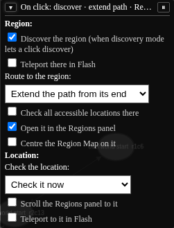
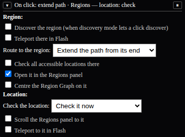

# Click actions S4: the panel-owned actions, and the click listeners on the generic events

**Status: built, gated.** Flash, Discovery, the Regions panel and the two maps register their click actions into the
shared "On click" strip. The four `regionGraph:nodeSelected` listeners no longer need that event: Flash and Discovery
became registered actions, while apcalc and vibeCodingSim listen to the generic `regionView:regionClicked`, filtered to
the Region Graph. The Region Graph publishes the generic events. The last old click key (`addLocationsToPath`) and
CA-S2's mirror of it are retired.

The design is the mode-toggle discussion's (rulings R1–R8, 2026-11-16). This is its slice CA-S4, after CA-S3
(`click-actions-s3.md`). Base: `d358d50e02` (origin/main at launch; `git merge-base HEAD origin/main` =
`d358d50e0219975dc8c7e4205a36f2db6c6b887d`). Code tip: `5f7a72fb7f`. Planner: archipelago-cc-23. Reviewer: js-21.

Both shots come from a fresh browser profile with no stored settings. The Flash panel loaded seedling_atlas on js,
then the Region Map opened for the first time. The Graph's *Teleport there in Flash* is unticked: its first value was
the box at that moment, and the box is unticked on every page load (§3). *Discover the region* is ticked on the Graph
(today's behaviour) and unticked on the Map. Each strip offers to centre the OTHER map.

## ⚖ Rulings this slice carries (session 84c8ab35)

- **R1–R8 (2026-11-16)**, verbatim in the design §3:
  - R3: *"it's not just about which panels are shown, it's about which panel's actions are triggered by the click"*;
  - R4: per panel;
  - R7: a panel-owned play action keeps its own source and stays gated;
  - R8: *"I agree with this plan, and your recommendations"*, with the Flash box kept until S4 measures its other
    callers.
- **2026-11-17T18:08:42Z, the order:** *"Yes, go ahead (Recommended)"* (… CA-S3 → **CA-S4** → CA-S5 → Region Map
  tutorial …).
- **2026-11-20T16:29:00Z, Flash teleport on a Map click:** *"Per-map option (Recommended)"*:
  - each map's "On click" strip gets its own "Teleport in Flash" option;
  - the Region Graph's starts with the current box setting, and the Region Map's starts OFF;
  - Flash's box keeps working only for clicks outside the two maps.
- **js-21's review (2026-11-20), four edits:**
  1. teleport proved in-app, four legs (§7);
  2. new `fast` rows ≤ 8 s in bundled;
  3. the old-key-only user of the Regions panel (§5);
  4. the AN-3b overlap (§8).

## 1. The census: every `regionGraph:nodeSelected` subscriber at base

Measured with `git grep -a -n "regionGraph:nodeSelected\|REGION_GRAPH_NODE_SELECTED"` at `d358d50e02`.

| Subscriber (base lines) | What a click did | Became |
|---|---|---|
| **Flash** `flashPanel/flashPanelUI.js:1687-1691` (subscribed in `_setupTeleportUI` when a teleport-capable game loads; intent `flashPanel/index.js:338`) | With "TP on UI click" ticked: `_teleportToRegion(nodeId)` | REPLACED by the registered `flash.teleport` (region) and `flash.teleportLocation` (location) actions (§2). No map click teleports through the box any more. The intent registration is removed |
| **Discovery** `discovery/index.js:285` → `handleRegionClicked` (`:485-501`) | With `enableDiscoveryMode` and `clickDiscoversRegion`: discover the region (and auto-discover its locations and exits) | REPLACED by the registered `discovery.discover` (region), which runs the same handler, still bundle-gated. `ui:regionHeaderClicked` (the Regions panel, `:286`) is unchanged |
| **apcalc** `apcalc/index.js:69-78` (intent `:43`) | Region `C` with a game: `gameState.reset()`; otherwise `panelInstance.setPathFilter(nodeId)` | `regionView:regionClicked` FILTERED to `panelId === 'regionGraph'` (`apcalc/index.js:72-73`). It IS an action in the sense that it changes state (`C` resets the calculator; any other region filters its panel). It stays a filtered listener in this slice |
| **vibeCodingSim** `vibeCodingSim/index.js:85-92` (intent `:54`) | `panelInstance.selectFeatureByRegion(nodeId)` | `regionView:regionClicked` FILTERED to the Region Graph (`vibeCodingSim/index.js:87-88`). It changes the panel's selection, so it is close to an action; it stays a filtered listener |
| Tests: `seedlingJsRuntimeTests.js:5316` | Published `regionGraph:nodeSelected` to drive Flash's teleport | Moved: the TP leg runs the Graph's `flash.teleport` through `runClickActions` (§7) |
| Tests: `regionGraphPanelTests.js:346, :395, :612, :660` | Subscribe to assert the Graph publishes the event | Unchanged: the event is still published (CA-S5) |

The publishers at base:
- `regionGraph/graphInteractionManager.js:202`, a node tap and the "Go to" picker;
- `regionGraph/nodeOverlayManager.js:344`, an overlay card's body;
- `regionGraph/index.js:67` (registration);
- the test's publish above.

None changed in this slice.

**The box's other callers, measured.** The box has a second path, `handleUserLocationCheck` (`flashPanelUI.js:1701`).
It is a dispatcher receiver on `user:locationCheck` and `system:locationCheck` (`flashPanel/index.js:161-168`), so it
hears every location check that passes Flash in the chain. The senders of `user:locationCheck`
(`registerDispatcherSender`):
- apcalc, bounceDemo, cloudberryDemo, flashSubstrate, jtaArchipelago, locations, mazeRoom, noiz2saSubstrate,
  proofGraph, proofQueue, spoilerTest, textAdventureSubstrateWrapper, timer, vibeCodingSim;
- the Regions panel's location click (`regions/regionBlockBuilder.js`);
- the two maps (the Region Graph and the Region Map);
- Flash itself (already ignored: originator `FlashPanel`).

`system:locationCheck` comes from `mazeRoom` (`mazeRoomUI.js:2379, :5076`) and the Playback Bot. **The box therefore
keeps real callers:** every location check from a panel that is not a map. So it is NOT a candidate for removal.
CA-S4 filters out only the two maps' originators (`RegionGraphCheck`, `RegionGraphBulkCheck`, `regionMapCheck`,
`regionMapBulkCheck`; `clickActions.js` `MAP_CLICK_ORIGINATORS`, pinned equal to the panels' constants).

## 2. The actions

The registry gained three optional descriptor fields and one order (`regionView/clickActions.js`):
- `initial(panelId)`: the value an action has in a panel whose settings do not name it (`effectiveValue`).
- `offeredTo(panelId)`: `false` hides the action from that panel's strip and clicks. A panel never offers to centre
  itself.
- `ORDER.select = 50`: before the path. Flash's region teleport and Discovery's discover run there, because the Graph
  published `regionGraph:nodeSelected` before any action. So a Graph click still calls them in the base's order (see
  §6, delta I, for the one interleaving that moves).
- The strip's `seed()` (`clickActionsUI.js`) writes the initial values into the panel's settings ONCE. The host calls
  it after its load (`regionGraphUI.js:213`, `regionMapUI.js:342`), and from then on each new registration is seeded.
  From that point the stored value decides.
- A seeded save keeps a session override session-only (`hasOverride`), so a test row's own click settings are never
  cleared.

| Id | Owner (registration) | Target | Order | Region Graph starts | Region Map starts |
|---|---|---|---|---|---|
| `flash.teleport` | Flash (`flashPanel/flashClickActions.js`; `flashPanelUI.js:1692` `_registerClickActions`, `:1708` `_unregisterClickActions` on teardown `:1014, :2962` and on a game without `teleport` `:1663`) | region | select | the box AT THE SEED | off |
| `flash.teleportLocation` | Flash (same) | location | panel | the box at the seed | off |
| `discovery.discover` | Discovery (`discovery/discoveryClickActions.js`; `discovery/index.js:299`, unregistered `:309`) | region | select | on (today's listener) | off (the Map never discovered) |
| `regions.scrollTo` | Regions panel (`regions/regionsClickActions.js`; `regions/index.js:297`, `:315`) | location | panel | off | off |
| `regionGraph.centre` | Region Graph (`regionGraph/regionGraphCentreAction.js`; `regionGraph/index.js:157`) | region | panel | not offered | off |
| `regionMap.centre` | Region Map (`regionMap/regionMapClickActions.js` `makeRegionMapCentreAction`; `regionMap/index.js:65`; `RegionMapUI.centreOnRegion`, `regionMapUI.js:519`) | region | panel | off | not offered |

**The Region Map's first-run copy** of the Graph's config (⚖ R4) now leaves these six ids out
(`withoutPerPanelInitials`, `regionMapClickActions.js:66`), so the Map seeds its own values, all off. The CA-S3 copy
kept every id. An id outside these six (an unknown one, `actionNodes.act` included) is still copied.

**What "the current box setting" means at first run (measured).** The box is not a setting
(`flashPanelUI.js:1416`, "the panel's own switch"). Every page load builds it unticked, and it stays hidden until a
teleport-capable game is up. That is also the moment `flash.teleport` registers, and the moment the loaded Graph's
strip seeds it. So on a real first run the Graph's value is `false`, unless a script ticked the box first. Measured
on a fresh profile (the screenshot above): the Graph seeded `false`. The in-app row also sets the box ticked before
the Graph's next load, and the seed then writes `true` (§7, leg 1).

## 3. What the Flash box does now

- **A click in the Region Graph or the Region Map never teleports through the box.** A region click no longer reaches
  it (the listener is gone). A location click's `user:locationCheck`, and a bulk check's, carries a map originator,
  which `handleUserLocationCheck` ignores (`flashPanelUI.js:1726`).
- **Every other location check still follows the box.** That covers the Regions, Locations, maze, timer and spoiler
  panels, the substrates, and `system:locationCheck` from the maze and the Playback Bot. Flash's own checks are
  ignored, as before.
- A map click teleports only through that map's own `flash.teleport` / `flash.teleportLocation` option.

The box keeps callers, so its removal is **not** proposed. If the user later wants the non-map panels on a strip too,
that is a new design question (those panels have no "On click" strip).

## 4. The filtered listeners, and a question

apcalc and vibeCodingSim hear `regionView:regionClicked` only from the Region Graph (`isClickFromPanel(data,
'regionGraph')`). That is exactly what they heard before, since the Map never published `regionGraph:nodeSelected`.

**Question for the planner/user (not acted on; archipelago-cc-23 2026-11-20: it goes to the user separately, and any change lands in a later slice):** should apcalc and vibeCodingSim hear Region Map clicks too? Each
click changes their panel state: apcalc's `C` resets the calculator, and any region filters its paths;
vibeCodingSim selects a feature. With the filter dropped, a Map click would do the same. No ruling licenses that
behaviour change, so the filter stays.

## 5. The retirements (and the Regions panel)

- **The Regions panel's location click** (`regions/regionBlockBuilder.js:1087` (queued-in-path display) and `:1186`
  (the click)) reads `regionGraphLocationAddsToPath(settingsManager)` (`regionGraph/clickActionsSettings.js:68`). That
  is the Region Graph's RESOLVED `clickActions.location['path.check'] === 'addToPath'`, read only, through
  `readRegionGraphClickActions`: the stored (or preset) value, else the migration of the old keys. The coupling is the
  same as before (the Regions panel follows the Graph's strip), with no new UI.
  - **js-21 edit 3 (the old-key-only user)** is pinned (`clickActionsSettings.test.js`). A user whose only stored state
    is `addLocationsToPath` true or false, with no `clickActions` yet, reads that value through the migration, and
    nothing is written. The Graph's own one-time migration later agrees. A stored `clickActions` wins over a stale old
    key, as the mirror made it.
- **The CA-S2 mirror is retired.** `saveRegionGraphClickActions` writes `clickActions` only, and `MIRRORED_LEGACY_KEY`
  is gone (pinned `undefined`).
- **The `addLocationsToPath` schema entry is retired** (`regionGraph/index.js`). The Graph's schema now names no old
  key (pinned).
- **The five presets** that named it are rewritten, the key removed:
  - `settings-apcalc.json`;
  - `settings-check-all-from-graph.json`;
  - `settings-depgraph.json`;
  - `settings-metamath.json`;
  - `settings-vibecoding.json`.

  Each had `false`, and each preset's `clickActions` already said `'now'`, so behaviour is unchanged. Their
  `clickActions` still equals the migration of the keys they named at CA-S2's base (the existing pin).
- **The pin is extended.** `REMOVED_KEYS` in `clickActionsSettings.test.js` is now all seven old keys, so no
  `frontend/settings/*.json` names any of them.
- **The orphaned stored key.** A user who ticked the old box (or saved the Graph's strip since CA-S2, through the
  mirror) has `moduleSettings.regionGraph.addLocationsToPath` in localStorage. It is left there. Nothing writes or
  deletes it, and since CA-S4 it has no schema entry. Its only reader is the Graph's one-time migration (and
  `regionGraphLocationAddsToPath` until that migration runs), exactly as for the other six since CA-S3. No storage
  census or declared-keys pin names it, and the census tests pass (§7).

## 6. The equivalence (CA-S1's method; `regionView/panelClickActions.equivalence.test.js`)

The two sides:
- **BEFORE:** the four listeners and Flash's check handler at base, VERBATIM (`legacyNodeSelectedListeners.testkit.js`).
  They are subscribed to `regionGraph:nodeSelected` in module order: Discovery, apcalc and vibeCodingSim at
  initialize, then Flash when its game loads. The registry holds what base registered.
- **AFTER:** the tip's real modules:
  - Discovery's `initialize`, which registers `discovery.discover`;
  - apcalc's and vibeCodingSim's `initialize` (their filtered listeners);
  - Flash's `_setupTeleportUI` and `handleUserLocationCheck` on a FlashPanelUI stand-in;
  - `regions.scrollTo` and the two centre actions.
- **The configs:** the Graph's is seeded as its strip seeds it (`withInitialValues`, with the box as it is at the seed).
  The Map's is the tip's first-run copy, seeded for the Map.
- **Both sides click through** the real `GraphInteractionManager` / `NavigationManager` and the real
  `runRegionMapClick`, with the real `regionActions`, over a recording dispatcher. A `user:locationCheck` reaches the
  side's Flash check handler, as Flash's dispatcher receiver does.

**Dimensions:** 7 configs (the default and the 6 presets with `clickActions`) × 3 discovery bundles (off,
click-discovers, loop mode's) × 5 clicks (Graph region `Field`, Graph region `C`, Graph location `chest`, Map region
`Field`, Map location `chest`) × 2 (box at the seed) × 2 (box at the click) = **420 rows**. Each row compares the
ordered log of every observable call:
- dispatches;
- the Regions-panel events and Show-All changes;
- selection events;
- teleports;
- discoveries;
- apcalc's and vibeCodingSim's calls.

**Result: 420/420 within the named deltas; no other difference** (`tally.other = []`). 223 rows are equal outright.

| Delta | Rows | What |
|---|---|---|
| **G**: the generic event | 252 (every Graph click) | The Region Graph publishes one `regionView:regionClicked` / `locationClicked` (`graphInteractionManager.js:184, :207`); the base published none. The Map's equals base (it published since CA-S3). The file moved by exactly these two publishes (pinned) |
| **F**: Flash, the ruled change | 172 | See below |
| **I**: independent listeners interleaved | 56 | Only with discovery's click-discovers bundle, on the two Graph region clicks (2 × 7 configs × 4 box states). apcalc/vibeCodingSim now hear the generic event, published before the actions, so they run before `discovery.discover`. The base ran Discovery first (both on one event). Each channel's own order is equal, and the calls are the same multiset. No preset combines apcalc/vibeCodingSim with discovery mode. **Accepted:** "delta I accepted, archipelago-cc-23 2026-11-20" (planner ruling) |

**F, by kind** (base teleports → tip teleports):

| Click | Box at the seed / at the click | Rows | Base → tip |
|---|---|---|---|
| Graph region `Field` | unticked / ticked | 15 + 6 | 1 → 0; 3 → 0 (a `checkAll` preset: the region plus two bulk-checked locations) |
| Graph region `C` | unticked / ticked | 21 | 1 → 0 |
| Graph location `chest` | unticked / ticked | 14 | 1 → 0 (not under loop mode, whose checks are blocked: no base teleport) |
| Map location `chest` | either / ticked | 14 + 14 | 1 → 0 |
| Map region `Field` | either / ticked | 6 + 6 | 2 → 0 (a `checkAll` preset's bulk-checked locations) |
| Graph region `Field` / `C` / location `chest` | **ticked** / unticked | 21 + 21 + 21 | 0 → 1: the Graph seeded `true` teleports with the box off (the strip decides) |
| Graph region `Field` | ticked / ticked | 6 | 3 → 1: the strip's region teleport stays, the bulk checks' box teleports go |
| Graph location `chest` | ticked / ticked | 7 | 0 → 1: under loop mode (checks blocked) the base had no check, so no box teleport. The strip's option teleports regardless of the check; the teleport keeps its own source and is gated by loop mode downstream (R7) |

On a real first run (box unticked at the seed), the only F rows are the ones where the box is ticked at the click:
**105 rows**, every one a map click's box teleport that is gone. That is the ruling.

## 7. Proof

**Vitest (bounded, ⚖ 52):** 160 files, 3250 tests passed. Run with `--maxWorkers=3` over:
- every test importing a touched file (`git grep -a -l`);
- `regionView/`, `regionGraph/`, `regionMap/`, `regions/`, `flashPanel/`, `discovery/`, `apcalc/`, `vibeCodingSim/`;
- `loops/loopModeExemptions`, `loops/blockModes`;
- `procgenCore/bindingContract`, `tests/moduleImportOrder`, `storagePanel/storageCensus` + `storageDeclarationPins`;
- `procgenDocs/docLinks`;
- the readers of the presets and the substrates config.

After the docs and rows: `procgenDocs/`, `quickLaunch/`, `tests/`, `tutorials/`, `scripts/test/` and
`scripts/procgen/rosterCategories`, 36 files, 1012 tests.

| New / changed | What it pins |
|---|---|
| `regionView/panelClickActions.test.js` (16) | `initial` / `effectiveValue` / `withInitialValues`; `offeredTo` (not listed, not run, not "unloaded"); `ORDER.select` first; `withoutPerPanelInitials`; the strip lists per panel and `seed()` writes once (and seeds a later registration); the Map seeds every CA-S4 action off; each action's run and first values; apcalc and vibeCodingSim hear the Graph and ignore the Map |
| `flashPanel/flashClickActions.test.js` (12) | registration with and without `teleport`, idempotent, a second panel never steals or drops it; first values (Graph = the box, Map = off); seeded once, then the box changes nothing; the run; the box ignores the four map originators and Flash's own; the panel no longer subscribes to or registers `regionGraph:nodeSelected` |
| `discovery/discoveryClickActions.test.js` (3) | registered by `initialize`, the old listener gone, `ui:regionHeaderClicked` kept; the bundle gate (off; loop mode's `clickDiscoversRegion: false`; on); the Map's and an off Graph's do nothing; the cleanup unregisters |
| `regionView/panelClickActions.equivalence.test.js` (5) | §6 |
| `regionGraph/clickActionsSettings.test.js` | the mirror retired; the seeded save; `regionGraphLocationAddsToPath` both values, the old-key-only user (js-21 edit 3), stored wins; `REMOVED_KEYS` = all seven; the schema names no old key |
| `regionMap/regionMapClickActions.test.js` | the copy drops the six panel-action ids and keeps the rest; the seeded save |
| `regionGraph/regionGraphDispatch.test.js` | the Graph publishes the generic events (master off included), after `regionGraph:nodeSelected` |

**In-app rows** (each sets its own state; session-only settings, the box put back):

| Row | Batch | What |
|---|---|---|
| `seedling-js-runtime-click-teleport` (new) | seedling-js | js-21 edit 1, four legs on seedling_atlas: **(1) Graph:** with the box ticked when the Graph's config (naming no `flash.teleport`) loads, the seed writes `true`; with the box then UNTICKED, a Graph click teleports into the dungeon; set `false` with the box TICKED, a Graph click does not. **(2) Map default OFF:** the Map seeds `false`; a Map click runs no `flash.teleport` and does not teleport, with the box ticked. **(3) Map ON:** a Map click teleports into the dungeon. **(4) Non-map source:** through the real dispatcher chain, a ticked box teleports for another originator's check and never for `RegionGraphCheck` / `regionMapCheck` |
| `test_region_graph_click_discover` (new) | fast | `discovery.discover` on the Graph: with discovery on and `clickDiscoversRegion`, a tap discovers; with loop mode's bundle, nothing |
| `test_regions_location_click_follows_graph_strip` (new) | fast | the Regions panel's location click follows the Graph's strip: "add to path" queues it in the path (not checked), "check it now" checks it |
| `seedling-js-runtime-tools-restart-teleport` (**moved**) | seedling-js | its TP leg runs the Graph's `flash.teleport` through `runClickActions` with the box OFF (it published `regionGraph:nodeSelected` with the box on) |
| the three CA-S2 Region Graph click rows (**changed**) | fast | the expected summary leads with "discover · " when Discovery is loaded (its action starts on for the Graph) |
| the Region Map rows' `setClickOptions` (**changed**) | fast / playback-bot | the panel holds the row's config plus the Map's seeded panel-action values (all off) |

Local runs, on port 8141:
- the 6 Region Graph click rows: 6/6;
- the 7 Region Map click rows (fast and playback-bot): 7/7;
- the two Seedling JS rows: 2/2;
- the whole `fast` batch: 124/128 before the Region Map helper fix (the four Map rows' strict compare), then those four
  passed.

**CI at the code tip `5f7a72fb7f`** (each run's headSha = `5f7a72fb7f1303b742469df0c25488d004e3c14b`):

| Gate | Result |
|---|---|
| Repeat ×8 (`test-substrates-repeat.yml`) | `seedling-js-runtime-click-teleport` **Rate: 8/8** (run 44783249881); `test_region_graph_click_discover` **8/8** (44783240603); `test_regions_location_click_follows_graph_strip` **8/8** (44783245097) |
| JSUT | run 44783140097: 1384 files / 29212 tests, 0 failed; slow 36/438. Base `d358d50e02` (run 44772660633): 1380 / 29171. **+4 files, +41 tests** (the four new test files) |
| unittests | run 44783140089 success |
| TT (dispatch) | run 44783232151 success, read job by job: ALTTP spoiler & regression, fast (128/128), fast-bundled (128/128), seedling-js (40/40), seedling-js-solver, seedling-wasm (12/12), apworld, playback-bot (15/15) all success |
| feature-checks | run 44783236682: 10/10 (70.3 s, 12%) |
| tutorials | not run: `git grep -a` over `tutorials/` finds no walk that ticks Flash's box, makes a Discovery click, clicks a Regions-panel location or names `addLocationsToPath` / `clickActions` |
| seedling-wasm | in TT (`list-test-batches.js --on-push --changed=` keeps it: `flashPanel/` is in its closure): 12/12 |

**Headroom** (TT run 44783232151; base = the `main` push run 44772660941 at `d358d50e02`):

| Batch | Tip | Base | Δ | New rows (s) |
|---|---|---|---|---|
| fast | 311.3 s / 600 (52%) | 296.0 s (49%) | +15.3 s | `test_region_graph_click_discover` 1.9, `test_regions_location_click_follows_graph_strip` 0.6 |
| fast-bundled | 308.1 s / 600 (51%) | 312.5 s (52%) | −4.4 s | the same two: 1.9 + 0.6 = **2.5 s** (js-21's budget: ≤ 8 s) |
| seedling-js | 226.8 s / 600 (38%) | 221.7 s (37%) | +5.1 s | `seedling-js-runtime-click-teleport` 10.4 |
| playback-bot | 86.3 s / 600 (14%) | 94.8 s (16%) | −8.5 s | none |
| seedling-wasm | 163.6 s / 600 (27%) | 220.7 s (37%) | −57.1 s | none |

The fast +15.3 s is variance, not the rows: they add 2.5 s, the bundled run of the same roster is −4.4 s, and the
CA-S3 base of fast was 305.1 s. All under 70% and under +20 s.

**D0** (`scripts/dev/region-graph-class-snapshot.mjs`, 3 presets × S1–S7, the default config): BEFORE at base
`d358d50e02` (this worktree, detached), AFTER at `5f7a72fb7f`. `diff -r` is **byte-identical** (22 files).

**Closure ∩ diff = ∅** (the 42 files of `--print-engine-closure`, and the evidence `closure.txt`). **engineMd5**
`bec369878feb67081187edca62baa951` at base and at the tip, measured both in this worktree. **Gitlinks: 0.**

## 8. The AN-3b overlap (js-21 edit 4)

AN-3b (`actionnodes-an3b`) changes the overlay card's body click (`nodeOverlayManager.js:342-345`, which publishes
only `regionGraph:nodeSelected`) to call `handleRegionNodeClick`. CA-S4 publishes the generic events from
`handleRegionNodeClick` / `handleLocationNodeClick` and does not touch `nodeOverlayManager.js` or
`loops/loopModeExemptions.js` (CA-S4 adds no loop-mode prefix: its panel actions keep their own sources, R7).

**If CA-S4 lands first,** a card click until AN-3b publishes only `regionGraph:nodeSelected`. So in that window it no
longer teleports through Flash's box (the ruling), no longer discovers, and no longer reaches apcalc or vibeCodingSim.
vibeCodingSim registers node overlays, so its feature cards are the visible case: a card click would stop selecting
the feature. AN-3b's change makes the card run `handleRegionNodeClick`, which restores all of it through the actions
and the generic event. Whichever slice packets second merges the other and re-measures the `loopModeExemptions` pins.

## 9. Notes for the next slices

**CA-S5 (retire `regionGraph:nodeSelected`).** What is left at this tip (`git grep -a -n`):
- **Publishers:**
  - `regionGraph/graphInteractionManager.js:205` (`publishNodeSelected`, before the generic event at `:207`);
  - `regionGraph/nodeOverlayManager.js:344` (the overlay card, unless AN-3b has moved it);
  - the registration `regionGraph/index.js:71`;
  - the constant `regionGraph/regionGraphOriginators.js:14` and its import `graphInteractionManager.js:8`;
  - the generic helper `regionView/regionActions.js:263` (`publishNodeSelected`, shared with the Map's
    `regionMap:nodeSelected`).
- **Subscribers in the app: none.**
- **Tests:**
  - `regionGraphPanelTests.js:339, :346, :371-372, :395, :612, :622-623, :637, :660-664`, and the row descriptions;
  - `regionGraph/regionGraphDispatch.test.js:82, :88, :115, :124`;
  - `regionView/regionActions.test.js:180-183`;
  - the CA-S2 oracle `regionView/legacyRegionGraphClicks.testkit.js:27, :130` and its equivalence test `:16`;
  - the CA-S4 oracle `regionView/legacyNodeSelectedListeners.testkit.js` and its test (they name the event as BASE
    behaviour; keep them as records, or retire them with the event);
  - the substrates config comments `:2145, :2163, :2169`.
- **Comments only:** `discovery/index.js:490`, `discovery/discoveryClickActions.js:3, :11`,
  `flashPanel/flashClickActions.js:19`, `flashPanel/flashPanelUI.js:1690`, `apcalc/index.js:70`,
  `regionView/clickActions.js:57`.
- **The Map's `regionMap:nodeSelected`** is the selection, not a click action; CA-S5 decides whether it goes too.
- **apcalc / vibeCodingSim** hear only the Graph (§4); CA-S5 is the natural place for the user's answer.

**The Region Map tutorial:**
- The strip now lists the panel actions. On the Map they all start off, so a walk that wants *Teleport there in
  Flash* ticks it in the Map's strip (`.region-map-click-strip-host`, the row's `data-action-id="flash.teleport"`
  checkbox).
- The Map offers *Centre the Region Graph on it*, never itself.
- The collapsed summary of the default config is unchanged: *On click: extend path · Regions — location: check*.
- Rows a walk can lean on: `seedling-js-runtime-click-teleport` (Map off / on with Flash), the CA-S3 Map rows.
- `RegionMapUI.centreOnRegion(name)` eases the camera onto a region's cell (it turns Follow off).
