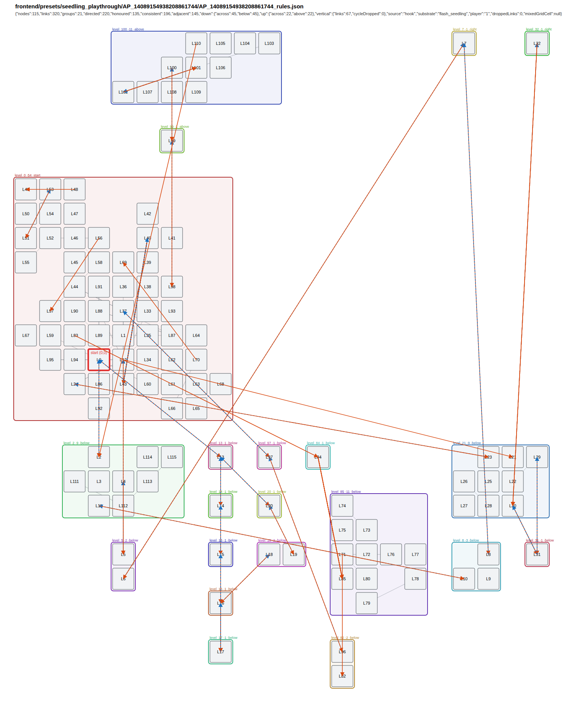
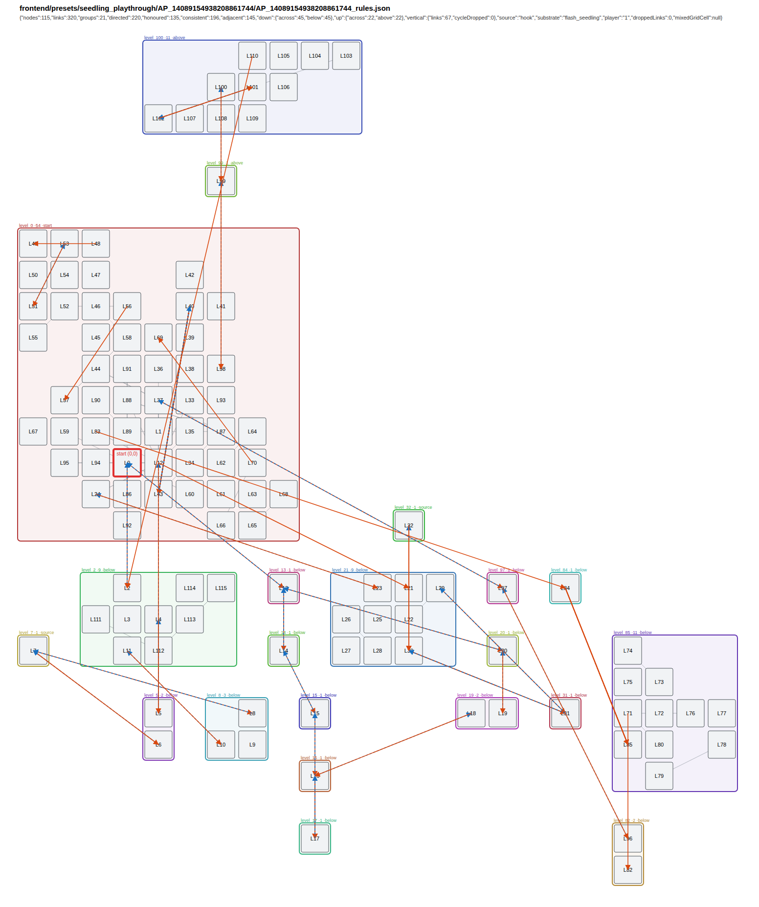
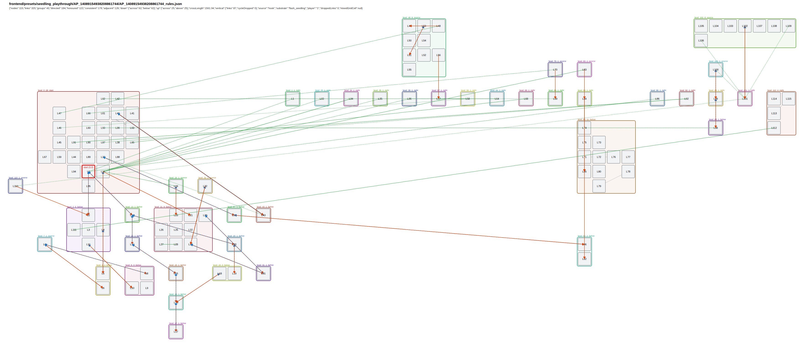
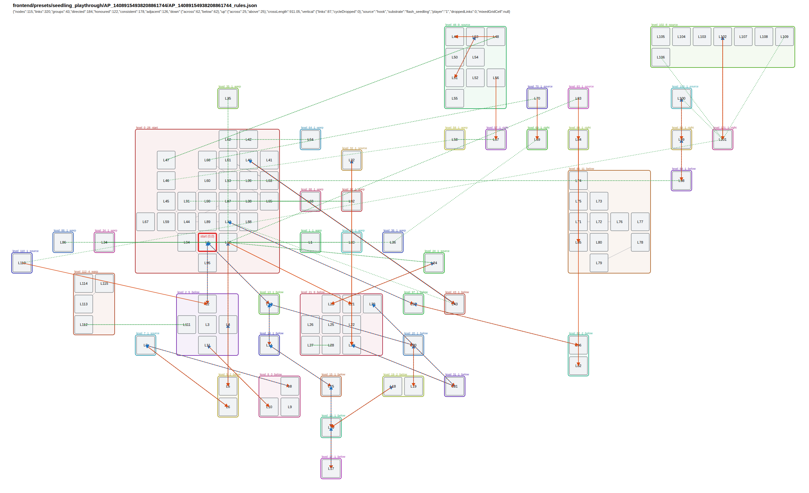

# Region map: placement, the join audit and "edge transition"

Slice `region-map-placement`, base `d3f74f4978` (origin/main, train 138). It has four parts:

- **(P)** A source group sits just above its first successor.
- **(A)** The join audit: only an edge transition is a `join`. A doorway or teleporter becomes a `warp`.
- **(ii)** A warp-only group sits beside its first warp predecessor. This part was added mid-slice by Robert's ruling.
- **(R)** "Edge transition" replaces "teleporter" where a walk-off link was meant.

**The rulings:**
- 2026-11-16: *"If walking off one side of a level brings the player to another level, then those levels should appear directly beside each other on the map"*. No new grouping rule.
- 2026-11-16: source placement *"just above its first successor"*.
- 2026-11-16: the term "edge transition".
- 2026-11-17: fold (A) and (R) into this slice.
- 2026-11-17: *"Beside warp source"*, which is (ii).

| commit | part |
|---|---|
| `16f2752d67` | (P), `crossLength` in `groupedStats`, the dump script, the BEFORE dumps and pictures |
| `a3d939a339` | (A): `warp`, `seedlingEdgeTransitionOf`, the panel's warp colour and legend, docs |
| `216f7f49e1` | (R): the census renames |
| `87593de16f` | (ii) |
| (this commit) | the report, the stage and AFTER dumps, the pictures |

## The numbers, stage by stage

`crossLength` is the summed Euclidean length, in cells, of every link between two groups (`groupedStats`, `regionLayout.js:559`).

| world | stage | groups | largest | links across groups | crossLength |
|---|---|---|---|---|---|
| `seedling_playthrough` | before | 21 | 54 | 67 | 486.81 |
| | (P) | 21 | 54 | 67 | **354.73** |
| | (P)+(A) | **43** | **28** | 131 | 1561.94 |
| | (P)+(A)+(ii) | 43 | 28 | 131 | **911.05** |
| vanilla 116 as a custom set (with its derived atlas) | before | 17 | 77 | 64 | 459.3 |
| | (P) | 17 | 77 | 64 | 421.37 |
| | (P)+(A) | 43 | 28 | 144 | 1805.44 |
| | (P)+(A)+(ii) | 43 | 28 | 144 | 1045.51 |
| `procgen_topdown` AP_1 (generated, `grid_cell`) | every stage | 1 | 9 | 0 | 0 |
| `adventure` (classic, generic) | every stage | 1 | 9 | 0 | 0 |

- Every `down` link still lands below and every `up` link above at every stage. At the tip, `seedling_playthrough` has 62/62 down and 25/25 up, with 0 cycle edges.
- (A) splits groups, so it adds cross-group links and length: the links inside the 54-level block are now between groups. (ii) wins back most of that length.

**Pictures** (`scripts/dev/preview-region-layout.mjs`: one box per level, groups outlined, down solid, up dashed, warp dotted green):

| stage | `seedling_playthrough` |
|---|---|
| before |  |
| (P) |  |
| (P)+(A) |  |
| (P)+(A)+(ii) |  |

- The custom set: [before](placement-before-vanilla-set.png) and [after](placement-after-vanilla-set.png).
- The generated world, unchanged: [procgen_topdown](placement-procgen_topdown.png).
- The panel itself at the tip, with the link legend in the toolbar and the warps green and dashed: [panel](placement-panel-after.png). The pre-slice panel is `step3b-shots/seedling_playthrough-level.png`.

## (P) Source-group placement

`procgenCore/regionLayout.js`. The rule is documented as step 7 (`:276`); the code is at `:441` (the wait) and `:497` (the placement).

- **A source** is a group that nothing lies over but that lies over something, and is neither the start's group nor one of its ancestors.
- Nothing in the downward pass waits for a source. Once every other group is placed, each source (in group order) goes `gap` cells over the **highest** group it lies over, so every one of its links still lands below it.
- Its linking cell is aligned over the linked cell of its **first successor**: of the groups it lies over, the one placed **earliest** (`order`). Between two links into that group, the first in link order wins.
- It slides clear right, left or up, whichever moves it least (`slide`, `:345`; `commit`, `:363`). Ties go in that order. All three keep it over everything it lies over.
- `placedBy` is `'source'`.

On `seedling_playthrough`, `level_7` moves from top-right to over `level_6` (slid left, 4 cells), and `level_32` to over `level_30`. Cross length goes 486.81 → 354.73.

The (P) diff moves 36 positions, not 2. The groups placed "right" after the old source spots now start further left, because nothing is to their right any more.

## (A) The join audit

**The rule** (the user's): ONLY a walk-off-edge transition is a `join`. `LINK_KINDS` gains `warp` (`regionLayout.js:196`): it is drawn, it never joins two groups, and it places only a warp-only group (ii). `groupsR1` (`:205`) already joins only `join`, so its code is unchanged.

**The Seedling producer** (`flashPanel/seedlingCompositeMap.js`):
- Every Seedling exit is the game's own Teleporter object, so the data has no "door" or "edge" label. `seedlingEdgeTransitionOf` (`:199`) reads the geometry instead.
- An exit is an **edge transition** when both of these hold:
  - its door tile (`exit_tiles[0]`) lies ON its level's border;
  - its arrival (`target_spawn`) lies within `EDGE_ARRIVAL_TILES` = 1 tile (`:198`) of the target level's OPPOSITE border.
- `seedlingLayoutGraph` turns every other would-be `join` into `warp`, with no `dir` (`:273`).
- With no level sizes it returns null, and the link stays `join`.

**Measured on `seedling_playthrough`:** 230 would-be joins. The rule needs no tuning: there is a clean gap between the two populations.
- **184** are edge transitions. Each arrives 0 or 1 tiles from the opposite border (181 at 1, 3 at 0).
- **46** are warps. Each has an interior door or an arrival ≥ 2 tiles from the opposite border.
- **The borderline case is `level_28 → level_27`**: a door on level_28's south border whose arrival is exactly **2** tiles from level_27's north border. It went to **warp**. Its partner, `level_27 → level_28`, has a door at tile (10, 1) of a 16×6 room, one row in from the border, so it is a warp too.

| producer | what makes a link `join` | links reclassified |
|---|---|---|
| Seedling hook (`seedlingCompositeMap.js:273`): `seedling_playthrough`, `seedling_er`, `seedling_atlas`, custom Seedling sets | `seedlingExitLayoutKind` = `join` (any exit but stairs/pits) AND `seedlingEdgeTransitionOf` ≠ false | `seedling_playthrough` 46; `seedling_er` 46; `seedling_atlas` 4 (3 groups); the vanilla 116 custom set 59 (with its atlas) |
| generic (`regionLayoutResolve.js:126`): classic AP worlds, the maze worlds (`seedling_playthrough_maze`, `seedling_atlas_maze`) | every rules exit | 0 — **unclassifiable**: rules exits carry no geometry |
| custom / generated worlds with `grid_cell` (`procgen_*`, `seedling_generated_*`) | n/a: one group, placed as stored | 0 (kinds are not read) |
| the maze | no `layoutGraph` hook: the generic or the `grid_cell` path | 0 |

**The 46 warps on `seedling_playthrough`** (door and arrival in tiles):

| # | from → to | exit_id | door tile (level w×h) | border side | arrival tile (target w×h) | tiles from the opposite border |
|---|---|---|---|---|---|---|
| 1 | level_0 → level_1 | `out_teleporter_80_96` | (5,6) in 20×20 | interior | (4,6) in 9×8 | — |
| 2 | level_0 → level_86 | `out_teleporter_160_272` | (10,17) in 20×20 | interior | (3,3) in 6×5 | — |
| 3 | level_1 → level_0 | `out_teleporter_64_112` | (4,7) in 9×8 | S | (5,7) in 20×20 | 7 |
| 4 | level_12 → level_35 | `out_teleporter_112_96` | (7,6) in 40×60 | interior | (2,3) in 7×5 | — |
| 5 | level_12 → level_36 | `out_teleporter_168_368` | (10,23) in 40×60 | interior | (2,7) in 9×9 | — |
| 6 | level_12 → level_33 | `out_teleporter_432_352` | (27,22) in 40×60 | interior | (2,3) in 6×5 | — |
| 7 | level_12 → level_24 | `out_teleporter_40_688` | (2,43) in 40×60 | interior | (3,8) in 10×10 | — |
| 8 | level_12 → level_83 | `out_teleporter_32_848` | (2,53) in 40×60 | interior | (2,3) in 5×5 | — |
| 9 | level_12 → level_34 | `out_teleporter_336_688` | (21,43) in 40×60 | interior | (2,8) in 11×10 | — |
| 10 | level_24 → level_12 | `out_teleporter_32_144` | (2,9) in 10×10 | S | (2,44) in 40×60 | 44 |
| 11 | level_24 → level_12 | `out_teleporter_48_144` | (3,9) in 10×10 | S | (2,44) in 40×60 | 44 |
| 12 | level_27 → level_28 | `out_teleporter_168_16` | (10,1) in 16×6 | interior | (8,18) in 20×20 | — |
| 13 | level_28 → level_27 | `out_teleporter_128_304` | (8,19) in 20×20 | S | (10,2) in 16×6 | **2** (borderline) |
| 14 | level_33 → level_12 | `out_teleporter_32_64` | (2,4) in 6×5 | S | (27,23) in 40×60 | 23 |
| 15 | level_34 → level_12 | `out_teleporter_32_144` | (2,9) in 11×10 | S | (21,44) in 40×60 | 44 |
| 16 | level_34 → level_12 | `out_teleporter_128_0` | (8,0) in 11×10 | N | (27,35) in 40×60 | 24 |
| 17 | level_35 → level_12 | `out_teleporter_32_64` | (2,4) in 7×5 | S | (7,7) in 40×60 | 7 |
| 18 | level_36 → level_12 | `out_teleporter_32_128` | (2,8) in 9×9 | S | (10,24) in 40×60 | 24 |
| 19 | level_43 → level_37 | `out_teleporter_144_64` | (9,4) in 19×35 | interior | (18,11) in 40×20 | — |
| 20 | level_47 → level_48 | `out_teleporter_216_112` | (13,7) in 30×30 | interior | (7,18) in 20×20 | — |
| 21 | level_48 → level_47 | `out_teleporter_112_304` | (7,19) in 20×20 | S | (13,8) in 30×30 | 8 |
| 22 | level_57 → level_58 | `out_tentaclebeast_80_48` | (6,4) in 13×13 | interior | (3,6) in 8×8 | — |
| 23 | level_58 → level_46 | `out_teleporter_80_16` | (5,1) in 8×8 | interior | (22,8) in 30×30 | — |
| 24 | level_58 → level_57 | `out_teleporter_48_112` | (3,7) in 8×8 | S | (6,4) in 13×13 | 4 |
| 25 | level_58 → level_57 | `out_teleporter_64_112` | (4,7) in 8×8 | S | (6,4) in 13×13 | 4 |
| 26 | level_62 → level_64 | `out_teleporter_112_64` | (7,4) in 20×20 | interior | (2,5) in 7×7 | — |
| 27 | level_64 → level_62 | `out_teleporter_32_96` | (2,6) in 7×7 | S | (7,5) in 20×20 | 5 |
| 28 | level_65 → level_68 | `out_teleporter_184_64` | (11,4) in 15×15 | interior | (1,4) in 5×6 | — |
| 29 | level_66 → level_70 | `out_teleporter_72_64` | (4,4) in 10×12 | interior | (2,3) in 5×5 | — |
| 30 | level_68 → level_65 | `out_teleporter_16_80` | (1,5) in 5×6 | S | (11,5) in 15×15 | 5 |
| 31 | level_69 → level_36 | `out_lightbosscontroller_72_72` | (4,4) in 10×10 | interior | (7,6) in 9×9 | — |
| 32 | level_70 → level_66 | `out_teleporter_32_64` | (2,4) in 5×5 | S | (4,5) in 10×12 | 5 |
| 33 | level_83 → level_12 | `out_teleporter_32_64` | (2,4) in 5×5 | S | (2,54) in 40×60 | 54 |
| 34 | level_86 → level_0 | `out_teleporter_48_64` | (3,4) in 6×5 | S | (10,18) in 20×20 | 18 |
| 35 | level_87 → level_92 | `out_teleporter_16_32` | (1,2) in 30×20 | interior | (17,8) in 20×10 | — |
| 36 | level_91 → level_92 | `out_teleporter_240_48` | (15,3) in 20×10 | interior | (2,8) in 20×10 | — |
| 37 | level_92 → level_91 | `out_teleporter_32_144` | (2,9) in 20×10 | S | (15,4) in 20×10 | 4 |
| 38 | level_92 → level_87 | `out_teleporter_272_144` | (17,9) in 20×10 | S | (1,3) in 30×20 | 3 |
| 39 | level_93 → level_98 | `out_teleporter_112_80` | (7,5) in 15×18 | interior | (7,11) in 15×13 | — |
| 40 | level_98 → level_93 | `out_teleporter_112_192` | (7,12) in 15×13 | S | (7,6) in 15×18 | 6 |
| 41 | level_100 → level_101 | `out_teleporter_288_96` | (18,6) in 23×13 | interior | (18,15) in 23×20 | — |
| 42 | level_101 → level_110 | `out_teleporter_104_24` | (6,1) in 23×20 | interior | (3,7) in 10×11 | — |
| 43 | level_106 → level_101 | `out_teleporter_64_48` | (4,3) in 20×10 | interior | (18,15) in 23×20 | — |
| 44 | level_109 → level_101 | `out_teleporter_160_48` | (10,3) in 20×10 | interior | (18,15) in 23×20 | — |
| 45 | level_111 → level_112 | `out_teleporter_128_48` | (8,3) in 20×14 | interior | (2,13) in 15×15 | — |
| 46 | level_112 → level_111 | `out_teleporter_32_224` | (2,14) in 15×15 | S | (8,4) in 20×14 | 4 |

**What split, and what did not.** The 3b report expected levels 33–70 to leave the overworld block. The data says otherwise:
- **Split off:** the doorway levels: the houses `level_1` and `level_86` off level_0; `level_24`, `level_33`–`36` and `level_83` off level_12; and the paired interior doors listed above.
- **Stayed:** levels 37–47 and 59–67 are reached by real walk-off edges (`level_12 → level_37`; `level_12 → level_95 → level_59`), so by the user's rule they stay beside the overworld. The start group drops from 54 to 28 levels.

**Unclassifiable, for the user:**
- **Every link of a generic-path world** (a classic AP world, and the two maze worlds that resolve generically). A rules exit has no tile, so "edge or doorway" cannot be read. Left `join`.
  - The maze worlds' atlas exits do carry `kind: edge | teleporter`. A future maze `layoutGraph` hook could read it; no maze hook exists today, so that is not in this slice.
- **A custom Seedling set whose derived atlas the caller does not hand in** (`hookCtx.atlases`). With no level sizes, its 59 warps stay `join` (17 groups, as before). Custom worlds' atlas reaching the panel is 3b residue item 9, out of scope here.
- On `seedling_playthrough` itself, every exit could be judged: 0 unclassifiable.

**js-21 edit 1 (`seedlingCompositeMap.js` is not display-only): option (a).** The changed field is the hook's link `kind`. Its readers:
- `compositeMap.layoutGraph` has one caller, `regionLayoutResolve.js:145`.
- Its `kind` is read by `regionLayout.js` (grouping and placement), `regionMap/regionMapModel.js:142` (`groupLinks`, the line colour) and `tests/testCases/regionMapTests.js` (an independent resolve).
- `seedlingLevelBake.js`, `seedlingDoorDirection.js` and `mazeCompositeMap.js` import nothing from the file; they name it in comments only. `flashSeedling(Gen)Library.js` only wrap `seedlingLayoutGraph` as the hook.
- No sidecar, rule, engine or bot reads it. The sidecar's own `kind: "teleporter"` is untouched.

js-21 verified and accepted this on 2026-11-17.

**The panel** (`regionMap/regionMapUI.js`):
- `LINK_COLORS.warp` is `#6fd08c`, dashed (`:45`, `:753`).
- A toolbar legend (`LINK_LEGEND`, `:47`) reads: edge transition, down, up, warp (door / teleporter).

## (ii) Warp-only groups beside their first warp predecessor

`regionLayout.js`. The rule is documented as step 8 (`:283`); the code is at `:443` (the wait) and `:475` (the placement).

- **A warp-only group** has no `down`/`up` link at all, and some other group warps into it. It is placed after the downward pass and before the sources.
- It goes beside its **first warp predecessor**: of the PLACED groups that warp into it, the one placed **earliest**. Between two warps from that group, the first in link order wins.
- Its warped-to cell starts ON the warping cell, and the group slides clear right, left, down or up, whichever moves it least. Ties go in that order.
- One warped into only by another unplaced warp-only group waits for it. One that nothing placed warps into goes right, as before.
- `placedBy` is `'warp'`.
- Grouping is untouched: only (A) changes it.

At the tip, `seedling_playthrough` places its groups as start 1, below 17, **warp 11**, source 9, right 5. The 11 warp-placed groups are `level_1`, `33`–`36`, `58`, `64`, `68`, `86`, `92` and `112`.

The 5 still placed right are `level_57`, `69`, `84`, `99` and `101`. Each has a source group over it (a stairs/pit link from `level_56`, `70`, `83`, `100`/`99`, `102`) and nothing placed over it. So each is not "warp-only" under the ruling's wording: it goes right, and its source then sits above it by (P). Only `level_57` and `level_101` also have warps into them.

## (R) The rename

**The census** at base (`git grep -a -n -i teleport` over `frontend/modules`, `docs/json`, `scripts` and `frontend/test-configs`, submodule trees excluded by `git grep`) finds **7060 hits in 854 files**. Class 1 was read line by line among the 381 non-JSON hits where "teleport" sits next to *edge, walk, join, neighbour, adjacent, beside, side of* or *border*. The class 2/3 split below is by path, with the rule stated.

| class | hits (files) | what | action |
|---|---|---|---|
| 1, renamed | **3** (2) | `docs/json/user/modules/regionMap.md:10` and `:56` (grouping "by doors and teleporters"); `procgenCore/regionLayoutResolve.test.js:219` (a comment) | renamed: edge transition / warp / `join` exits |
| 1, persisted, NOT renamed | (inside the JSON count below) | Seedling atlas region exits and preset sidecar exits carry `kind: "teleporter"` on EVERY exit: 640 on `seedling_playthrough`, stairs and pits included. The 184 edge exits also carry `out_teleporter_*` ids and `in_L*` partners. The names come from Seedling's Teleporter object | listed for js-21; not renamed |
| 2, kept | 759 (126) | the generator's / atlas's teleporter: an exit to a non-neighbour cell. Schema `kind: edge \| teleporter`, `isTeleporter`, `teleporterEdges`, `Grid.teleporters`. Paths: `procgenPipeline`, `procgenCore` (but region-layout), `mazeRoom`, `apworldEditor`, `shared/procgen`, `regionMarkingTool`, `bounceRegionEditor`, `procgenPlayer`, the maze/stepped/atlas docs, non-Seedling `scripts/procgen` | kept |
| 3, kept | 3991 (601) | an in-game teleporter: Seedling's Teleporter object (bot, runtime, walker, `.oel` x/y), the page's teleport tool, the loop reset teleport, Doodle-Jump teleport hosts in bounce, other games | kept |
| persisted data (JSON) | 2308 (126) | atlases, presets and fixtures (Seedling's object names; class 1 persisted as above) | not moved |

- **Class 1 is tiny**, as the brief allowed. The codebase already says "edge" for a walk-off exit: the atlas schema's `kind: edge | teleporter`, `edge exit` in the tools.
- Two other text changes describe the new kind rather than rename an old hit, so they are not counted above: the `seedlingCompositeMap.js` layout-kind comment and the `substrate-registry.md` `layoutGraph` contract row (now naming `warp`).
- **Exported identifiers:** none in class 1, so none were renamed or listed. `isTeleporter` and `teleporterEdges` are class 2.
- **UI text:** the tutorial content and `playwright_tests_config-substrates.json` hits are classes 2 and 3 (the `.oel` teleporter at (432, 352), the atlas tool's "Teleporter", the page's teleport tool). Nothing renamed there, so no walk asserts a renamed string.
- The rename is behaviour-free: comments and docs only.

## Proof

**Dumps** (`scripts/dev/region-map-placement-dump.mjs`: canonical JSON, sorted keys, one file per world the Region Map rows load, plus the custom set) are in `placement-dumps/{before,stage-P,stage-PA,after}/`. Each step of the diff belongs to one part:

| step | `seedling_playthrough` | custom set | `adventure`, `procgen_topdown` |
|---|---|---|---|
| before → stage-P (P) | 36 positions; `level_7`, `level_32` `right` → `source`; 0 links; groups identical | 32 positions; 1 source; groups identical | byte-identical |
| stage-P → stage-PA (A) | 46 links `join` → `warp` (the table above) and their `dir` → null; groups 21 → 43; 109 positions; 25 `placedBy` | 59 links `join` → `warp`; 17 → 43 | byte-identical |
| stage-PA → after (ii) | 56 positions; 11 `right` → `warp`; 0 links; groups identical | 55 positions; 11 `warp`; groups identical | byte-identical |

**Vitest rows** (new: 15):
- `regionLayout.test.js` (P):
  - a source lands directly above its first successor;
  - the first successor is the one placed earliest, over the highest;
  - the shortest slide, with ties;
  - a no-vertical group and a source-only successor go right;
  - over 300 random DAGs, every source is above all it lies over.
- (A):
  - `LINK_KINDS`;
  - **`groupsR1` equals the pre-(A) function over 400 random graphs with no `warp`**;
  - a warp only splits (each warped grouping refines the all-join one, 100 graphs).
- (ii):
  - the exact spot and the slide order;
  - first warp predecessor and a waiting chain;
  - nothing-placed → right;
  - 300 random graphs with warps: no overlap, the gap kept, every down/up honoured on a DAG.
- `seedlingCompositeMap.test.js` (the Seedling producer):
  - `seedlingEdgeTransitionOf` on edge, interior, border-but-deep and the borderline case, plus null without data;
  - `seedlingLayoutGraph` on `seedling_playthrough`: `level_0 → level_12` join, `level_0 → level_1` and `level_12 ↔ level_33` warp, blind → no warp.
- `regionLayoutResolve.test.js`:
  - the generic producer stays all-`join` (alttp);
  - the `seedling_playthrough` pin re-measured: 43 groups, largest 28, 184/46/64/26 by kind, `placedBy` counts, `crossLength` 911.05;
  - the custom set: blind 17 groups, sighted 43.

**Moved pins:** `regionLayoutResolve.test.js`'s `seedling_playthrough` row:
- groups 21 → 43; directed 220 → 184; honoured 135 → 122; consistent 196 → 178;
- down 45/45 → 62/62; up 22/22 → 25/25;
- the start's group 54 → 28;
- the kind set gains `warp`.

Each value is measured, with the 3a values kept in its comment.

**Bounded vitest** (⚖ 52): 64 files (every test importing a touched file, plus `regionMap/`, `regionView/` and `procgenDocs/`):
- base `d3f74f4978`: **1629/1629**, measured in a throwaway checkout;
- tip: **1644/1644**;
- the difference is exactly the 15 new rows.

**Other checks:**
- `generate-procgen-reference.mjs --check`: *ALL 7 GENERATED MODULES AND 5 MARKDOWN REGIONS MATCH THE CODE*. The docs index moved only by word and line counts for `region-layout.md`.
- Doc-census pins: none moved.
- `architecture.md` and `seedling-bot-log.md` are not touched.

**In-app rows** (the 7 Region Map rows, port 8142, at `87593de16f`): 7/7 passed. Every row derives its counts at run time from an independent `resolveRegionLayout`, so **none needed re-recording**.

**Closure:**
- closure ∩ diff = ∅;
- `seedlingDerivedRuleTable.js --print-engine-closure` engineMd5 is `bec369878feb67081187edca62baa951` at base (throwaway checkout) and at the tip.
- 0 gitlinks.
- Nothing under `frontend/presets/`, `worlds/`, `apworlds/`, `frontend/schema/` or an atlas.

CI run ids and the batch headroom go in the packet to js-21.

## Residue

1. **A maze `layoutGraph` hook.** The maze worlds resolve generically, so every link is an unclassifiable `join`. Their atlas exits already say `edge` or `teleporter`.
2. **Custom-world atlas to the panel** (3b item 9). Until it lands, a custom Seedling set's warps stay `join` in the panel. ⛓ 2026-11-17: landed host-side for a set loaded as a bundle ([`atlas-cache.md`](atlas-cache.md): the 59 warps are classified); the lab hand-over and the watch page's own sets are that report's residue.
3. **The 5 groups still placed right** (`level_57`, `69`, `84`, `99`, `101`) have a source over them. A rule for "a group whose only placed-group links in are warps" would move `level_57` and `level_101` too. That is a wording question for the user, not a defect. ⚖ Closed 2026-11-17: the user ruled *"Leave as is"* ([`atlas-cache.md`](atlas-cache.md) § Rulings since).
4. **`EDGE_ARRIVAL_TILES` = 1** is measured on two compiles of the vanilla rooms: 0–1 tiles against ≥ 2, with one case at exactly 2. A hand-made set could put an edge arrival 2 tiles in. It would then read as a warp: drawn, but not joined.
