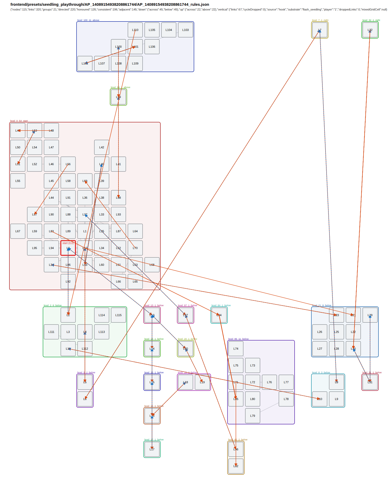
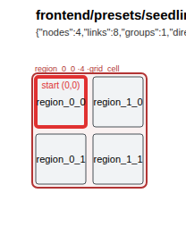
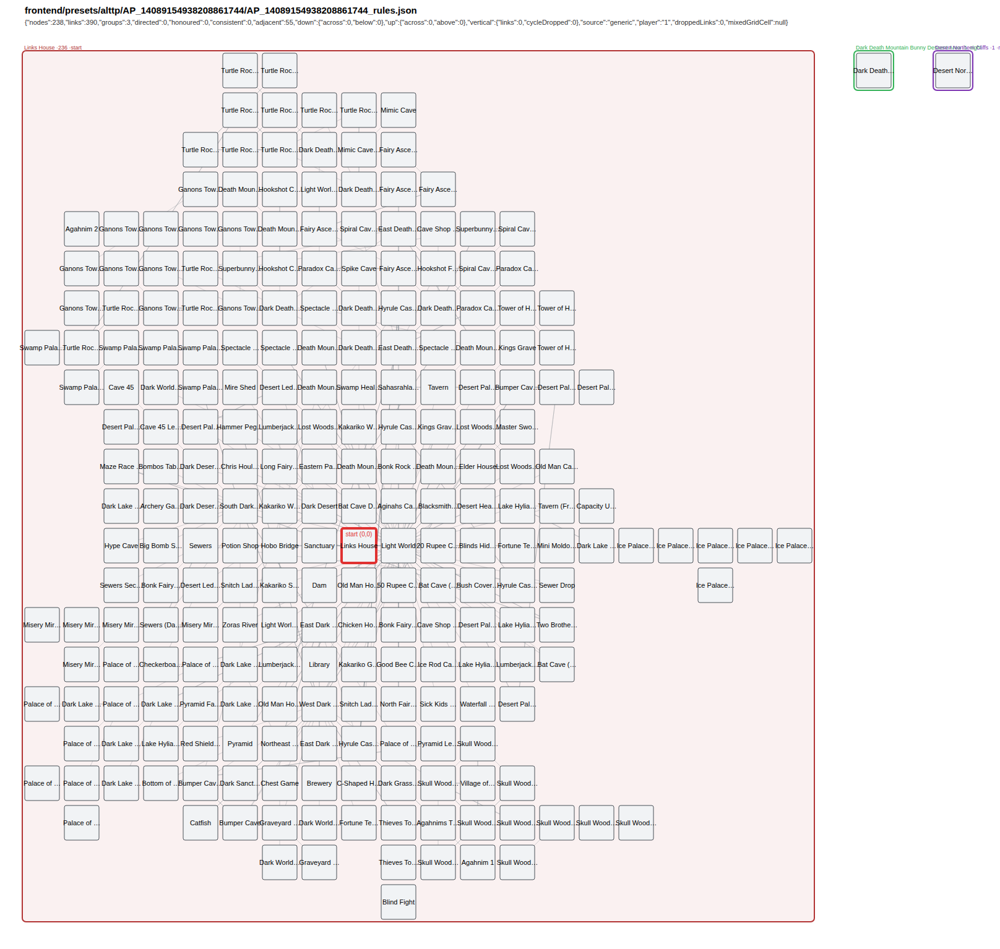
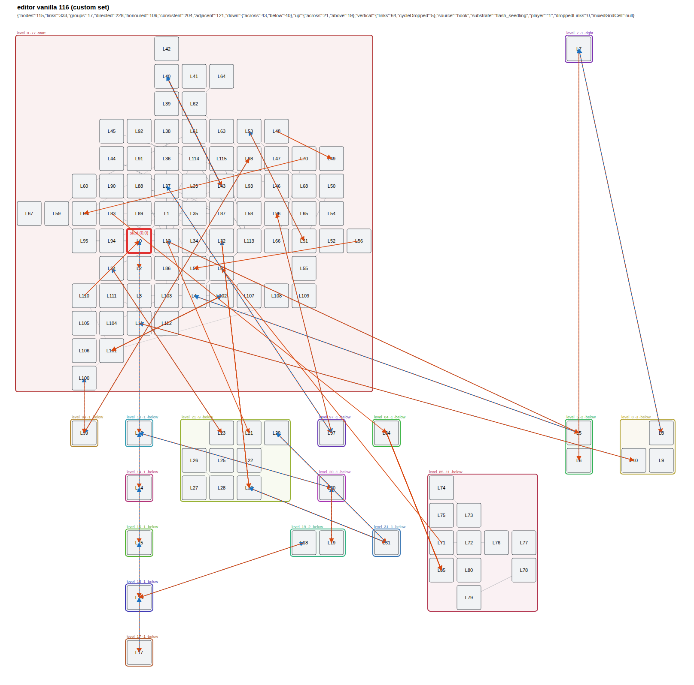

# Region Map step 3a — the shared region layout (report)

Session `region-map-layout`, branch `region-map-layout`, base `9b99178fa75bb2fc818cd40435c00af0347b40de` (origin/main = train
seedling-maze-link). Brief: `NewDocs/plans/region-map-step3a-layout-prompt.md`. Reviewer: seedling-js-planning-19.

## What landed

| Commit | Step |
|---|---|
| `7f1084f8cb` | D1 + D2: `procgenCore/regionLayout.js`; `setMapLayout.canonicalLayout` becomes a wrapper |
| `0d16149150` | D3: `procgenCore/regionLayoutResolve.js`, the Seedling `compositeMap.layoutGraph` hook, the registry row + regenerated reference |
| `ce01d5e10c` | D5: `docs/json/developer/procgen/region-layout.md`, the docs index, doc-link census 416 → 419 |
| `fca6763585` | D4: `scripts/dev/preview-region-layout.mjs` |
| this commit | the report and the preview PNGs |

- 0 gitlinks.
- Closure ∩ diff = ∅.
- No panel, no canvas viewer, no `regionGraph/` / `regionView/` edits, and no new npm dependency.

## The API and the coordinate contract

**Coordinates.** `{gx, gy}` integer cells, **signed and start-relative: the start is exactly (0, 0)**. Nothing is
min-shifted, and +gy is below (screen y points down). Only a consumer that indexes arrays normalises.

**`layoutRegions({nodes, start, links})`** (`frontend/modules/procgenCore/regionLayout.js:102`):
- It is `canonicalLayout`'s algorithm keyed by id: BFS, directed links first, the quarter-plane rule for
  `CONSISTENT_RINGS` (`:66`), the fixed ring order, and new components at `(maxX+2, minY)`.
- It returns `Map<id,{gx,gy}>` in `nodes` order.
- The helpers `DIRS`, `OPPOSITE`, `ring` and `CONSISTENT_RINGS` MOVED here. `setMapLayout.js` re-exports them, so every
  importer is unchanged.
- It refuses by name (`RegionLayoutError`, `:32`) on a duplicate node, a start that is not a node, a link to an unknown
  node, or a bad `dir`.

**Order (js-19 edit a).** There is no rng and no internal sort. The `nodes` array order is the canonical order: it
decides the BFS tie-breaks and which unreached node starts the next component.
- Callers with unordered input sort it: `canonicalGraphOrder` (`regionLayoutResolve.js:53`) uses a numeric-aware
  `naturalCompare` (`:33`).
- The "permuted input → same output" row is on `resolveRegionLayout`.

**Groups.**
- **`groupsR1`** (`regionLayout.js:196`) is the connected components over `join` links. `GROUPING_RULES` (`:223`) and
  `groupsOf` (`:226`) take a rule by name or function, so an R2 is one more `(graph) → string[][]`.
- **`layoutGrouped(graph, {rule, gap})`** (`:274`):
  - Each group is laid out by `layoutRegions` over its own joins. The root is the start; else the first member entered
    by `down`; else by `up`; else the first member.
  - Between groups, the vertical relation (`down` a→b: a's group above; `up`: the mirror) is made acyclic by a DFS from
    the start's group.
  - The start's ancestors are placed upward. Everything else is placed downward in topological order, each group
    `gap` cells under the lowest group it lies under, aligned under the linking cell.
  - An unreached group goes right of everything, top-aligned.
  - On overlap a group slides right.
  - Returns `{positions, groups:[{id, root, members, bbox, placedBy}], stats}`.
- **`groupedStats`** (`:451`) ports `layoutCensus`'s idea: groups, sizes, directed links honoured and consistent,
  adjacent links, `down {across, below}`, `up {across, above}`, `vertical {links, cycleDropped}` and the bbox.
  `seedlingSetMap.layoutCensus` is untouched.

**`resolveRegionLayout({rules, player, sidecars, registry, hookCtx, rule, gap})`** (`regionLayoutResolve.js:169`):
1. **`grid_cell`.** Every display region has one: the cells minus the start's.
2. **Hook.** Otherwise `compositeMap.layoutGraph`, when every sidecar's substrate declares the same function. It is found
   through the registry (`hookFor`); no substrate is named.
3. **Generic.** Otherwise `genericLayoutGraph` (`:112`): the rules' regions and exits, no dir, all `join`.
4. **Mixed.** Laid out by 2 or 3, and reported in `stats.mixedGridCell = {with, without}`.

Steps 2 and 3 are then grouped. `stats.source` says which step answered.

The start follows `worldStartOf` (`:82`), which uses `layoutTopDown`'s hub rule. A declared start with exits and no
locations is stripped: its first exit is the start, and each further exit is a root joined to the start. The rule is
restated rather than imported from the engine, and a test pins it equal to `isVirtualStart` over three presets.

**The Seedling hook.** `seedlingLayoutGraph` (`flashPanel/seedlingCompositeMap.js:210`) is declared at
`flashSeedlingLibrary.js:868` (with the shipped atlases) and `flashSeedlingGenLibrary.js:556`.
- **nodes:** display regions, folded by `displayRegionOf`.
- **links:** the sidecar exits with a `targetRegion`. Same-level links are dropped.
- **`kind`:** `seedlingExitLayoutKind` (`:177`) reads the `exit_id` prefix.
- **`dir`:** for joins, `seedlingSetMap.dirOfExit` is reused (not re-derived). The door is the first `exit_tiles` cell ×
  `tile_size`, the arrival is `target_spawn`, and the sizes are the atlas region `bounds` (or a generated room's
  `record`) × `tile_size`. Stairs and pits get no dir. Interior doors get `null` from `dirOfExit` itself.
- **The registry row** is in `docs/json/developer/procgen/substrate-registry.md` § Entry contract. The generated
  `registry.js` / `capabilities.js` / `procgen-substrates.md` were regenerated in this slice, and `--check` is green.

## The wrapper proof

`setMapLayout.canonicalLayout` (`setMapLayout.js:108`) now maps room `i` to the id `String(i)`, with `nodes` in index
order, calls `layoutRegions`, maps back and min-shifts. A refusal is rethrown through the caller's `fail`, named as
`setMapLayout:`.
- **`seedlingSetMapLift.test.js`** pins the digest of everything the Seedling map answers: links, graph, layout, census,
  frames, shapes, picks, sticky state. It covers the editor's vanilla 116 and a generated set, and both digests are
  unchanged.
- **`regionLayout.test.js`** keeps the pre-move function verbatim as `ORACLE_canonicalLayout`. It is equal, as JSON, on
  400 random index graphs.
- **`check-seedling-editor-e3.mjs`** is identical BEFORE and AFTER: 35 PASS lines. The only differing token is a
  wall-clock `LOAD→map` time. Row 1's census is the same: `{"links":307,"directed":253,"honoured":48,"consistent":190,
  "adjacent":75,"meanLength":2.779151670598625,"cols":17,"rows":14}`.
- **The bounded vitest set**, BEFORE: 27 files / 1113 tests green. AFTER, with the new and census files added: 31 files.
  The only reds were the doc-link census pins, which moved by the new page's 3 links and were re-recorded with a
  provenance line. The procgenDocs suite then ran 494/494.

## R1 on `seedling_playthrough`

These are measured values, pinned in `regionLayoutResolve.test.js`.
- **Source:** `hook` (`flash_seedling`). The 263 regions fold to **115 display levels** (Menu stripped), with **320
  links**.
- **Groups:** **21**. Sizes are 54, 9, 2, 1, 3, 1, 1, 1, 1, 1, 2, 1, 9, 1, 1, 11, 2, 1, 1, 1, 11.
- **Directed links:** 220. 135 are honoured (one cell that way) and 196 consistent (right quarter-plane). 145 links join
  adjacent cells.
- **`down` across groups:** 45, all **45 strictly below**. **`up` across groups:** 22, all 22 strictly above. 0 cycle
  edges.
- **Bbox:** x −3..18, y −13..13. **Cost:** ≈ 8.5 ms per resolve.

**Where the levels went.** The atlas carries no dungeon names, so the groups are described by level.

| group (root) | n | placed | members |
|---|---|---|---|
| level_0 | 54 | start | 0 1 12 24 33–70 83 86–95 98 |
| level_2 | 9 | below | 2 3 4 11 111–115 |
| level_21 | 9 | below | 21–23 25–30 |
| level_85 | 11 | below | 71–80 85 |
| level_100 | 11 | above | 100–110 |
| level_8 | 3 | below | 8 9 10 |
| level_5, level_19, level_82 | 2 each | below | 5 6 · 18 19 · 82 96 |
| level_13 → 14 → 15 → 16 → 17 | 1 each | below, stacked | one floor per group, stairs between |
| level_20, 31, 84, 97 | 1 each | below | |
| level_99 | 1 | above | |
| level_7, level_32 | 1 each | **right** (sources) | |

- **The overworld group absorbs 54 levels.** Levels 33–70 (the stretch the planner read as Dungeons 4–6) and 86–95 are
  joined to the overworld by teleporters, so R1 cannot separate them. Their own stairs are then drawn INSIDE the group
  (the arrows inside the red box). This is the same shape the planner measured: 21 groups here against their 23 on the
  vanilla 116.
- **A stairs-only dungeon fragments into one group per floor** (13 → 14 → 15 → 16 → 17), stacked in a column. That is
  arguably right for "down sits below".
- **Sources** (`level_7`, `level_32`: groups nothing lies over) go top-right with long arrows down to their successors.

**Other previews:**
- **Generated preset** (`seedling_generated_chestdoor`, the `grid_cell` path): one group, the stored 2×2 grid, start
  `region_0_0` at the origin.

  
- **Classic AP world** (`alttp`, generic): 238 regions, 3 groups (236 + two singletons), no directions, the Menu hub
  stripped, start `Links House` at (0,0).

  
- **The vanilla 116 as a CUSTOM set**, through the hook (`--vanilla-set`), described in the next section.

  

## What custom Seedling worlds carry

A set built in the set editor compiles through `seedlingSetAdapter.rulesJsonOf` → `compileRegionAtlas`, the same
compiler as the presets. Its sidecars have the **same payload shape as `seedling_playthrough`**:
- `substrate: flash_seedling` (for an atlas whose `game` is `seedling`);
- `atlas_ref`, `atlas_region` and `level`;
- `exits[]` with `exit_id` (same prefixes, plus a few new ones like `out_oracle_*`, which read as `join`), `exit_tiles`,
  `targetRegion` and `target_spawn`.

There are two differences:
- **Whole-level regions**, with no `__rRcC` sub-regions.
- **An `atlas_ref` nobody ships.** The derived atlas is returned beside the rules but is not in the library's
  `KNOWN_ATLASES`.

⇒ The hook lays a custom world out from the sidecars alone, with `kind` from the prefixes but **no directions** (no level
sizes), and with them once the caller hands in the derived atlas: `hookCtx.atlases = {[atlas.atlas_id]: atlas}`. On the
editor's vanilla 116:

| | directed | groups | `down` across → below | `up` across → above | vertical cycle edges |
|---|---|---|---|---|---|
| without the atlas | 0 | 17 | 43 → 40 | 21 → 19 | 5 |
| with the atlas | 228 | 17 | 43 → 40 | 21 → 19 | 5 |

Directions affect positions inside a group, not the grouping. The 3 down links that cannot land below are **cycles R1
creates**: `level_71 → level_82`, `level_97 → level_96` and `level_99 → level_98` all drop INTO levels that R1 joined to
the overworld by teleporters. (`seedling_playthrough` has 0 such cycles; it is a different compile of the game's rooms, with sub-regions.)

## Residue for 3b

1. **Cell-size policy.** The layout is one uniform cell per display region, but Seedling levels run from 5×5 to 60×58
   tiles. Candidates:
   - (a) a uniform cell with the level letterboxed, as `frameOf` does today (small levels become specks);
   - (b) cells sized by the level and the layout's cells as ANCHORS, with a per-row/column max width, as a "max-of-column"
     grid;
   - (c) log-scaled level size per cell.

   (b) keeps the layout's adjacency and costs one pass over the sizes; it is the one to try first. The layout itself
   needs no change for any of them.
2. **The mixed-`grid_cell` follow-up.** v1 ignores the stored cells when only some regions have them (`stats.mixedGridCell`
   says so). The follow-up is to pin the stored cells as fixed and lay out the rest around them. That needs
   `layoutRegions` to accept pre-placed nodes (a `fixed: Map`), which is a NEW option: the wrapper's byte identity is
   unaffected when it is absent.
3. **Two hooks in one world.** `flash_seedling` and `flash_seedling_gen` declare DIFFERENT closures, so a world mixing them
   falls to the generic path. Today every such preset has `grid_cell`, so this does not bite. If it ever does, the
   libraries can share one function, with the atlases bound inside it.
4. **Candidate R2 rules**, from what R1 got wrong:
   - **R2a, "teleporters join only within a level band."** Drop a teleporter `join` between two levels that ALSO have a
     vertical path between them. This would break the overworld's absorption of levels 33–70 and the three custom-set
     cycles.
   - **R2b, "a group is a dungeon: what stairs/pits reach below the overworld, closed under joins that do not lead back
     to the start's group."** A BFS from each down-entry that refuses to cross into the start's group.
   - **R2c, "merge single-floor chains."** Collapse a vertical chain of 1-level groups (13 → 17) into one group laid out
     top-down, so a stairs-only dungeon reads as one column rather than five islands.
5. **Source placement.** A group nothing lies over (`level_7`, `level_32`) goes top-right, far from the groups it feeds.
   Placing a source just above its first successor (still `gap` clear) would shorten those arrows. This changes
   placement only, not grouping.
6. **`exit_tiles` vs side squares.** The hook reads `dir` from the real door tile. Step 1's renderer still draws exit
   squares at the cell edge by side, so 3b should draw link endpoints from the same door tile.

## Gates

**Local, at the code tip `fca6763585`:**
- The bounded vitest set (gate list + new tests + `bindingContract` + `seedlingCompositeMap`) is green. That covers
  `regionLayout.test.js` (13), `regionLayoutResolve.test.js` (13) and `procgenDocs/` (494).
- `check-seedling-editor-e3.mjs`: identical BEFORE/AFTER.
- `check-procgen-docs.mjs`: ALL CHECKS PASSED.
- `generate-procgen-reference.mjs --check`: 7 modules + 5 regions match.
- `--print-engine-closure`: `engineMd5 3e333bfa0a7692f8120aeaa9a1591119 (42 files)`, the same as base. Closure ∩ diff = ∅.

**In-app:** `npm test -- --port=8131 --mode=test-substrates --batch=apworld` ran 142 rows: 142 passed, 0 failed.

**CI:** the run ids at the exact tip are in the packet message to seedling-js-planning-19. This commit (the report)
adds only `CC/docs/`, so the code runs at `fca6763585` are quoted there too.
