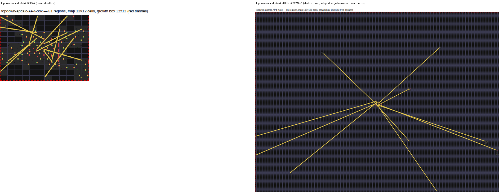
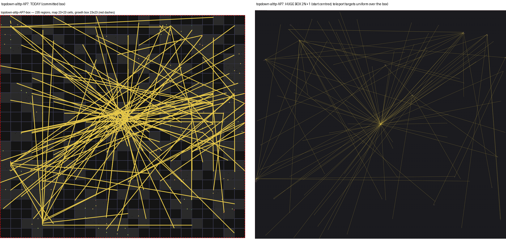
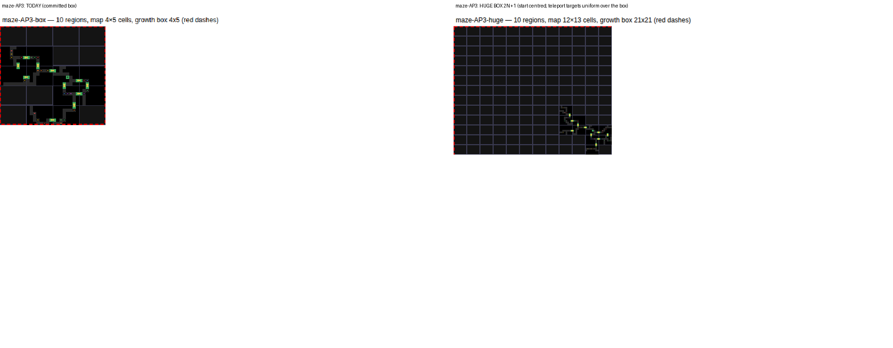
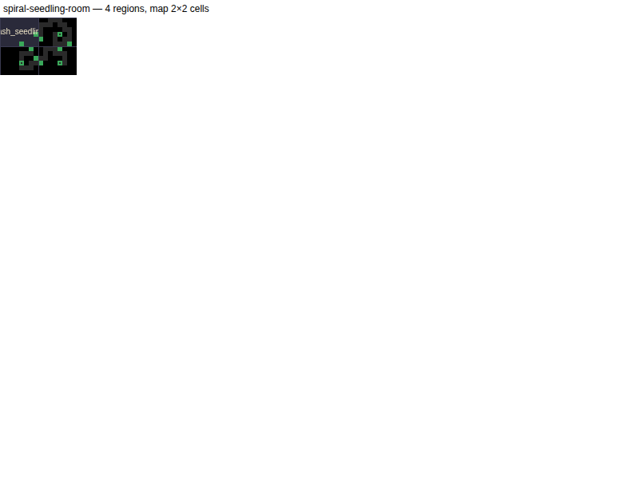
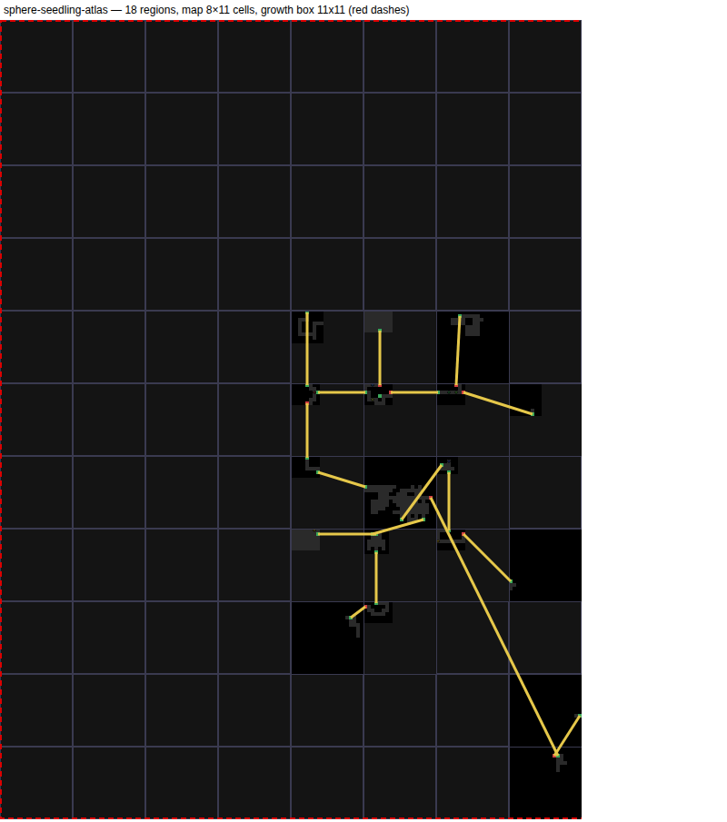

# Unbounded generation: survey (report)

Session `unbounded-grid-survey` (Opus, survey only: no product code changed). Branch `unbounded-grid-survey`, base
**`d29f2c0dafc8b0eb47918c12a742b68c39ac3512`** (origin/main at launch, train `sdc-server-item-groups`). Planner
archipelago-cc-23; reviewer and landing-queue owner seedling-js-planning-20; lab owner seedling-lab-planning-5. The
origin slice (`region-map-origin`, tip `8764eacc5d`) had **not** landed on main at this base; its report was read from
its branch.

⚖ The user's rulings (2026-11-15, via archipelago-cc-23), quoted:
1. *"If possible, I want to remove the requirement for the top left to be (0,0) in all of this code. If possible, I also
   want to remove the restriction to a fixed size box during generation. If possible, I want to delay choosing a box
   size until after all of the data has been generated, for the places where a fixed box size is still needed."*
2. *"I don't want to force regions that should be neighbors to be teleporters instead just because our initial guess
   about the size of the bounding box was too small."*
3. *"Rather than deleting the existing code entirely, we can keep the bounding box as a setting for generation, and
   instead just change the default to unlimited. That would still allow a way to reduce sprawl, if we discover that
   it's enough of a problem to be worth fixing in this way."*
4. *"I accept that this will be a big change, and that it will require regenerating the presets."*

## 0. The answer, in eight lines

- **The box forces few teleporters.** Of the **776** forward teleporter exits in the committed generated presets, only
  **39 (5.0 %)** were placed because the neighbour cell was outside the box. The other **737** would exist without a
  box: **317** because every neighbour was already built, and **420** because they link to a region another branch
  had already placed. All 39 are in the top-down presets AP_5–AP_9. (§2)
- **Simply making the box huge does not work.** With a 2N+1 box and the start in the centre, the 81-region APCalc world
  goes from a 12×12 map to a **160×127** one. The teleport targets are picked uniformly over the whole box, so they land
  far away. The core grows a little (its largest connected piece goes from 7×8 to 11×11), and the teleporter count
  drops by only **63 of 775** (−8 %). Unbounded generation needs a rule for **where teleport targets go**. (§2, §3,
  Q3)
- **The biggest pin impact is the region NAMES, not the coordinates.** Grid-growth and sphere-growth regions are named
  from their cell (`regionIdForCell` → `region_<gx>_<gy>`, engine `:1053`), and **150** such names exist across **37**
  committed preset files. Their locations carry the names, and **59** files under `worlds/` (6 `_worldgen` worlds), **91**
  vitest files, **12** in-app test files, 13 scripts and the substrates config hard-code them. Any change to the
  emitted frame renames all of these. (§6, Q1)
- **Census:** 143 sites. **(a)** storage/readout 37, **(b)** drawing/indexing 24, **(c)** generation input 46, **(d)**
  setting/persisted param 36. 60 of them break on a negative coordinate. **The Python side has 0 hits.** (§1)
- **Closure:** no census file is in the js-gate closure, and none of the proposed slices touches a closure file. At this
  base `engineMd5` = `bec369878feb67081187edca62baa951` (42 files). The derived-rule table and the
  `seedling_playthrough_maze` / `seedling_atlas_maze` presets carry no `grid_cell`, so they do not move in any slice.
  (§6)
- **One driver needs the box to know when to stop:** grid growth in mix mode with no pool stop and no `maxRegions` (the
  shipped `grid-growth-demo`) grows "until the frontier is empty". Unbounded, it never ends. (§5, Q5)
- **Sphere growth's box never forced anything.** It is auto-sized at 2⌈√N⌉+1, and **0** of its committed presets'
  teleporters were box-forced. Flipping it to unbounded changes only the frame, and with it the names. (Q2)
- **Proposed order:** four slices, and the first three move no preset. **S1** readers signed-safe; **S2** `Grid` with an
  origin and an "unbounded" representation (default unchanged); **S3** the generation setting (0 = unlimited) plus the
  teleport-target rule, default still bounded; **S4a/b/c** flip the default and regenerate (top-down / grid-growth +
  non-Seedling sphere / Seedling). Only S4 moves presets. No slice touches the closure, a gitlink or the derived table.
  (§7)

## 1. The census

`grep -a` over `frontend/modules`, `scripts`, `world_generator`, `exporter`, `frontend/schema`. The sweep was delegated
to a read-only search agent, and every row below was spot-checked against the source at this base (the engine rows,
`presetRun`, `sphereSteps`, `compositeMapDocument`/`Renderer`, `apworldEditor/regionLayout`, `sidecarIssues`). Tile grids
*inside* one region (atlas analyzers, Seedling physics, bounce, hazard runtime's own `isInBounds`) are excluded: only
REGION-cell grids count. The commands:

```
P='grid_cell|gridDims|grid_dims|gridWidth|gridHeight|\bGrid\b|isInBounds|(grid|dims|gridDims|Dims)\.(width|height)\b|gx = 0|gy = 0|- min(X|Y|Gx|Gy)|min(Gx|Gy)\b|\[gy\]\[gx\]|gy \* |TOPDOWN_GRID_KEYS|topDownGridSide|gridDimsForSource|sourceSizedParams|pinnedGridKeys|TOPDOWN_GRID_INPUT_MAX|GRID_GROWTH_INPUT_MAX'
grep -arnE "$P" frontend/modules scripts frontend/schema --include='*.js' --include='*.mjs' --include='*.json' --include='*.py' --include='*.html' | grep -v '\.test\.js'
grep -arnE 'grid_cell|grid_dims|gridDims|\bgx\b|\bgy\b' world_generator exporter --include='*.py'      # → 0
grep -arnE '\bg[xy] *(>=|<|>) *0\b|\.g[xy] *(>=|<) *0\b|maxG[xy]|gridW\b|gridH\b|spiralCells\(' frontend/modules scripts --include='*.js' --include='*.mjs'
```

Classes: **a** storage/readout; **b** drawing/indexing (needs a box after the fact); **c** a GENERATION input (the box
changes the world); **d** a user-facing setting or persisted param. **neg** = breaks on a negative coordinate.

### procgenPipeline/procgenPipelineEngine.js (the generator)
| line | cls | what | neg |
|---|---|---|---|
| 264-270 | c | `Grid` constructor: `width × height ≥ 1`, no origin field | y |
| 284-287 | c | `isInBounds`: `0 ≤ gx < width`, `0 ≤ gy < height` | y |
| 297-308 | c | `resize`: grow-only, keeps the origin (can't grow to the negative side) | y |
| 318-321 | c | `placeRegion` throws out of bounds | y |
| 369-371 | c | `relocateRegions` throws out of bounds | y |
| 397-402 | c | `neighborCell` → null out of the box (**every driver's teleporter/skip decision starts here**) | y |
| 458-465 | c | `openSides` frontier: in-bounds neighbours only | y |
| 537-545 | a | `serializeGrid` writes width/height (no origin) | n |
| 556-560 | a | `deserializeGrid`: `new Grid({width,height})` | y |
| 582-600 | c | `findDisconnectedCell`: empty grid → box centre; candidates scan `0..W × 0..H` | y |
| 613-632 | c | `findDisconnectedCellFromOccupied`: the same scan over `dims` | y |
| 703 | c | `stitchGrid`: an exit at the box edge gets a null target | y |
| 1053-1055 | c | **`regionIdForCell` = `region_${gx}_${gy}`: a region's NAME is its cell** (grid growth, sphere growth) | n (a `-` in the name) |
| 1076-1079 | c | `pickStartExitSides`: in-bounds sides only | y |
| 1093-1100 | c | `pickChildExitSides`: drops out-of-bounds sides (**this is what makes grid growth terminate**) | y |
| 1304-1306, 1358 | c | `growMaze` requires `gridDims`; `new Grid(gridDims)` | n |
| 1380-1383 | c | grid growth's start = box centre | n |
| 1479-1486 | c | neighbour out of box/built → teleporter via `findDisconnectedCell` | y |
| 1664-1667 | c | `findAdjacentEmptyCell` filters out-of-box cells | y |
| 1884, 1906, 1958-1961 | c | `layoutTopDown`: default 12×12, `new Grid`, start = box centre | n |
| 2036, 2062 | c | BFS: no adjacent empty cell → disconnected cell (teleporter) or dropped edge; Menu roots → disconnected cells | y |
| 2173 | c | exit side found by `neighborCell` match | y |
| 4110-4123 | c | spiral: grows from (0,0) UNBOUNDED, then min-shifts to ≥ 0; `gridDims` = the extent (**already "box after the fact"**) | n |
| 4430-4448, 4477 | c | spiral realise: `new Grid(plan.gridDims)`, sides via `neighborCell` | y |
| 5302-5308 | b | sphere-tree rebuild: width = max(`grid_dims`, gx+1), floored at 5 | y |
| 5356-5357 | c | rebuild start fallback = box centre | n |
| 5430 | a | envelope `dims` | n |
| 6456 | c | `linkIsAdjacentOnSide` via `neighborCell` (box edge → teleporter flag) | y |
| 6544 | c | `moveSphereRegion` refuses a target outside the box | y |
| 6848-6866 | c | `placeSphereTreeCells`: no open side → remote cell over `dims`; throws "pass larger growthParams.gridDims" | y |
| 7159-7166, 7363-7370 | c | `growSpheresGen` / batched: side = max(5, 2⌈√n⌉+1), start = centre | n |
| 7657 | a | emits `grid_cell` | n |
| 8108-8125 | a | **`grid_dims` = maxGx+1 × maxGy+1** (assumes min 0; it is the extent, NOT the growth box) | y |

### procgenPipeline/ (the rest)
| file:line | cls | what | neg |
|---|---|---|---|
| sphereSteps 224-231 | c | `gridSizeFor`: the sphere step runner's own box (reads **no** input) + centred start | n |
| sphereSteps 267-270, 911 | a | `env.dims` / `startCell` stash; envelope field | n |
| sphereSteps 392-402 | c | `new Grid(sizing.dims)` at batch 0 (re-derived from the allocation, overwriting `env.dims`) | n |
| sphereSteps 420-422 | c | sphere-append: `grid.resize` (grow-only, positive side) | y |
| spiralSteps 163; topDownSteps 320-332, 466 | a | `gridDims` / `startCell` passed through | n |
| presetRun 48-51 | d | `DEFAULT_PARAMS.gridWidth/gridHeight = 3` | n |
| presetRun 132-134, 162-167 | c | `topDownGridSide` = max(3, ⌈√(1.5N)⌉); `gridDimsForSource` | n |
| presetRun 147, 154 | d | `TOPDOWN_GRID_INPUT_MAX = 52`, `GRID_GROWTH_INPUT_MAX = 10` | n |
| presetRun 177-180, 195-202, 739-740 | d | `pinnedGridKeys`, `sourceSizedParams`, applied in `buildRunFromState` | n |
| presetRun 580-587, 608-616 | c | `buildTopDownRun` / `buildGridRun`: `gridDims` from params verbatim | n |
| presetDefs 944-945 | d | shipped `grid-growth-demo`: `gridWidth/gridHeight: 3` | n |
| presetDefs 1015, 1032-1035 | d | `TOPDOWN_GRID_KEYS`; `capturePresetState` drops unpinned grid keys | n |
| procgenPipelineUI 410-418, 746-749, 2164-2174, 2194-2200, 5443-5449 | d | hand-edited grid keys; apply; the Grid width/height inputs (max by mode); `_applyGridDimsFromSource` | n |
| procgenPipelineUI 3673-3680, 3739, 3817-3818 | b | composite canvas = `grid.width × regionSize × TILE_PX`; `dataset.gridW/H`; click → cell | y |
| procgenPipelineUI 4457-4459 | a | spiral feedback "grid W×H" | n |
| compositeMapDocument 134-155 | b | `mapBoundsFor`: max+1 vs `grid_dims`; an all-negative layout → no map | y |
| compositeMapDocument 204-207, 215, 238 | b | `new Grid(bounds)`; `placeRegion(sc.grid_cell)` throws out of bounds | y |

### procgenCore/, regionGraph/, regionMap/, presets/
| file:line | cls | what | neg |
|---|---|---|---|
| compositeMapRenderer 186-193 | b | `cellAtPoint`: `gx < 0` → null | y |
| compositeMapRenderer 366-367, 433-437, 454-463, 482-491 | b | exit pixels `cell.gx*cellW`; draw loop `0..H × 0..W`; grid lines; selection | y |
| regionLayoutResolve 177-197 | a | `grid_cell − start cell`: **already signed** | n |
| setMapLayout 132-135, 185-189 | b | `canonicalLayout` min-shift + `frameOf` cols = max+1 (**the origin slice makes both signed**, not yet on main) | (fixed there) |
| regionGraph/layoutControlsManager 519-533 | b | Cytoscape positions shifted by min (signed-safe) | n |
| regionGraph/regionGraphUI 934-939, 957 | a | reads `grid_cell`; Menu at target −0.5 | n |
| regionMap/regionMapFrames 76-93 | b | signed frames: **already safe** | n |
| regionMap/regionMapUI 363 | a | stat text | n |
| presets/presetUI 771, 2474-2475, 2563 | a | `grid_dims` label, density = count/(W·H), "Grid w×h" column | n (density reads the extent) |

### apworldEditor/
| file:line | cls | what | neg |
|---|---|---|---|
| apworldEditorUI 1753, 4781, 5183-5189, 6517 | a | summary text; "no grid data"; move-op `to`; cell facts | n |
| apworldEditorUI 4887-4892 | b | Map canvas from `grid.width/height`; `dataset.gridW/H` | y |
| apworldEditorUI 7825-7840 | d | Initialise "Grid side" input + auto checkbox | n |
| initialiseFlow 87, 107-113, 124, 259 | d/a | side/sideAuto; `autoGridSide`; `gridDims` = side×side; text | n |
| menuMarker 63; regionContent 441-451; regionRegenerate 368-372, 612-620, 911-920; regionRoundTrip 167 | a | keep/match `grid_cell` | n |
| **regionLayout 96-98** | b | **`isGridCell` requires gx, gy ≥ 0: a negative cell is "unusable"** | **y** |
| regionLayout 113-129 | b | `slotLayout`: `Grid` sized by `mapBoundsFor`, `placeRegion` | y |
| rulesDocOps 2530-2551, 2570 | a | `mapRegion` refusals; writes back `grid_cell` | n |
| **rulesDocOps 2624-2627** | c | **move-region refused outside the box ("a move never grows the map")** | y |
| rulesDocOps 3132-3137, 3279-3294, 3346, 3367 | d/a | op `gridDims ≥ 1`; describe text; provenance | n |
| **sidecarIssues 516-530** | a | **lint `GRID_CELL_OUTSIDE`: `gx < 0` or `≥ dims`** | **y** |
| slotInitialise 59, 177-211, 332-337, 417-425 | c | `initialiseGridSide` = `topDownGridSide`; `autoGridSide` grows while unplaced; `layoutTopDown` | n |
| slotInitialise 489, 653, 684 | d | `gridDims` in result / op provenance | n |
| slotInitialise 535-545, 637 | a | `cellExtent` = max+1 → `grid_dims` | y |

### scripts/ and frontend/schema/
| file:line | cls | what | neg |
|---|---|---|---|
| utils/generate-procgen-rules.js 42-197 | d | `--grid-width/height` (default 3) → `growMaze` | n |
| utils/generate-topdown-preset.js 98-145 | d | `--min-grid-dim`, `--grow-step`, `--max-retries` | n |
| utils/generate-topdown-preset.js 191-197, 238-305 | c | `autoSizeGrid` (**a second copy of the √1.5N rule**); grow-and-retry on `partial_layout` | n |
| utils/generate_all_templates.sh 692-696 | d | maze presets' grid flags | n |
| procgen/topdown-step.js 190; dump-sphere-growth.js 401; dump-grid-growth.js 176 | d | CLI grid → `gridDims` | n |
| procgen/check-topdown-steps.mjs 172-179; dump-topdown-byteidentity.mjs 180-187 | d | fixed 4×4/5×5 grids in byte-identity pins | n |
| procgen/check-region-step-editing.mjs 273-277, 381-386 | b | empty-cell scan `0..W` | y |
| procgen/check-topdown-steps-ui.mjs 119, 289-321; check-grid-growth-ui.mjs 70; check-procgen-presets.mjs 124-512 | d/b | grid params; canvas scan by `dataset.gridW/H`; grid input pins | y (scan) |
| procgen/shot-loaded-composite-map.mjs 96; dev/preview-region-layout.mjs 95-99 | b | reads `dataset.gridW/H`; SVG shifted by min (signed-safe) | n |
| test/generate-jta-mixed-test-preset.py 115, 121 | a | hand-written `grid_cell` | n |
| schema rules.schema.json 390-398 | d | `procgen_metadata.grid_dims` {width,height} | n |
| schema rules.schema.json 1352-1360 | d | `grid_cell`: integer, **no minimum** (negatives already validate) | n |
| schema envelopes/{sphere,spiral,topdown}-envelope 151/53/38 | d | `dims` / `gridDims` | n |

**Counts:** a **37** sites / 20 files; b **24** / 13; c **46** / 6 files (`procgenPipelineEngine.js`, `sphereSteps.js`,
`presetRun.js`, `rulesDocOps.js`, `slotInitialise.js`, `generate-topdown-preset.js`); d **36** / 22. **60** break on a
negative coordinate. **Python: 0**. `world_generator/` and `exporter/` never read `grid_cell`, `grid_dims` or gx/gy;
they carry only the *names*. Test files (counted, not listed): 61 `*.test.js` under `frontend/modules` (409 lines), 5
under `scripts`, and 4 in-app `tests/testCases` files.

## 2. The teleporter measurement

**Instrument:** `scripts/dev/unbounded-grid-teleporters.py` (read-only). The roster is derived: every
`frontend/presets/*/AP_*/*_rules.json` with a `procgen_metadata[p].driver`. That gives **41 slot rows over 40
files**. 50 preset files carry `grid_cell`. The other 10 have no driver, and `grep -a '"isTeleporter": true'` finds 0 in
each of them.

**Method (exact, from the recorded data):**
- The sphere drivers record the placement tree (`sphere_tree.nodes`) in placement order. A teleporter node's
  candidates at that moment are its parent's neighbours. For sphere growth that is the free sides (no entrance side and
  no sibling-taken side); for top-down it is all four. Occupancy is the cells of the earlier nodes.
- A node is **BOX-FORCED** when at least one candidate neighbour lay outside the box. With no box, that neighbour was
  free. It is **OCCUPIED** when every candidate was a built cell.
- Grid growth checks the exit's own side, so each forward teleporter exit is classified the same way.
- **OTHER** = forward teleporter exits that are not a tree teleporter edge: links to a region another branch already
  placed, which are never adjacent.
- Check: for top-down, 0 tree teleporters had a free in-box neighbour (0 "contradictions" on AP_1–12), so the tree
  order is the placement order.

`python3 scripts/dev/unbounded-grid-teleporters.py` at the base:

| preset | driver | box | regions | fwd tele exits | back | **BOX-FORCED** | OCCUPIED | OTHER |
|---|---|---|---|---|---|---|---|---|
| procgen_topdown AP_1,2,3,10,11,12 (Adventure) | top-down-sphere | 4×4 | 9 each | 0 | 0 | 0 | 0 | 0 |
| procgen_topdown AP_4 (APCalc s1) | top-down-sphere | 12×12 | 81 | 48 | 12 | **0** | 12 | 36 |
| procgen_topdown AP_5 (APCalc s2) | top-down-sphere | 11×11 | 74 | 38 | 16 | **1** | 15 | 22 |
| procgen_topdown AP_6 (APCalc s3) | top-down-sphere | 11×11 | 78 | 56 | 18 | **4** | 14 | 38 |
| procgen_topdown AP_7 (ALTTP s1) | top-down-sphere | 23×23 | 235 | 221 | 80 | **16** | 95 | 110 |
| procgen_topdown AP_8 (ALTTP s2) | top-down-sphere | 23×23 | 235 | 206 | 73 | **1** | 98 | 107 |
| procgen_topdown AP_9 (ALTTP s3) | top-down-sphere | 23×23 | 235 | 206 | 73 | **17** | 82 | 107 |
| seedling_atlas_sphere | sphere-growth | (8×11 extent) | 18 | 1 | 1 | 0 | 1 | 0 |
| the other 28 rows (sphere-growth ×12, shuffled-spiral ×8, grid-growth ×7 incl. procgen_maze 1–3 + multiworld ×4, action-graph ×1) | | | 2–10 | 0 | 0 | 0 | 0 | 0 |
| **TOTAL (41 rows)** | | | | **776** | | **39** | **317** | **420** |

- **Ruling 2's case is real but small:** 39 of 776 (5.0 %), all in APCalc s2/s3 and ALTTP. ALTTP's box was already
  grown twice by the recipe's own retry: `attempt 0: 19×19 → placed 221/238, skipped=2`, then 21×21, then 23×23.
- **Most teleporters exist for reasons no box size changes:** 317 crowding + 420 cross-links. The 420 are the source
  graph's cycles. A 2-D grid cannot make every edge of a non-planar or high-degree graph adjacent.
- ⚠ `grid_dims` records the cells' **extent** (max+1, engine `:8123`), not the growth box. They match whenever the cells
  reach the box's far edges (true for every top-down row above; the recipe logs give the box). Where the extent is
  smaller, a BOX count from it is an **upper** bound. The sphere rows read 0 even so.

### The "huge box" variant (no product edit)

**Instrument:** `scripts/dev/unbounded-grid-variants.mjs <outDir>` regenerates each recipe line of
`scripts/utils/generated_commands.sh` twice, into a scratch directory:
- **the control**, exactly as committed. **All 15 controls are byte-equal to the committed presets**
  (procgen_topdown 1–12, procgen_maze 1–3).
- **"huge"**: top-down `--min-grid-dim 2N+1` (N = source regions); grid growth `--grid-width/height 2R+1`. The start
  sits in the box centre, N cells from every edge, so BFS adjacency cannot leave the box. Wall time: 1m47s for all 30
  runs. ALTTP huge takes ~27 s each, against 3.6 s for the control, because the disconnected-cell scan is O(box ×
  built).

Then `unbounded-grid-teleporters.py` with `path@WxH` (the real box, from each run's log):

| preset | fwd tele exits box → huge | BOX-FORCED huge | map extent box → huge | largest adjacency piece box → huge | pieces box → huge |
|---|---|---|---|---|---|
| AP_4 APCalc (81) | 48 → **46** | 0 | 12×12 → **160×127** | 38 regions 7×8 → 47 regions 11×11 | 13 → 11 |
| AP_5 APCalc (74) | 38 → **33** | 0 | 11×11 → **148×114** | 40 → 47 | 17 → 12 |
| AP_6 APCalc (78) | 56 → **50** | 0 | 11×11 → **139×150** | 30 → 34 | 19 → 13 |
| AP_7 ALTTP (235) | 221 → **197** | 1 | 23×23 → **480×477** | 11 regions 5×3 → 41 regions 8×10 | 112 → 94 |
| AP_8 ALTTP (235) | 206 → **193** | 0 | 23×23 → **471×471** | 19 → 32 | 100 → 91 |
| AP_9 ALTTP (235) | 206 → **193** | 0 | 23×23 → **463×471** | 14 → 44 | 100 → 92 |
| AP_1–3, 10–12 (9 each) | 0 → 0 | 0 | 4×4 → 3×3..5×4 | | |
| procgen_maze 1–3 | 0 → 0 | 0 | 3×2, 4×4, 4×4 → 2×2, 2×3, 4×5 (shape changed: different rng path) | | 1 → 1 |
| **total (15)** | **775 → 712 (−63, −8.1 %)** | **1** | | | |

(Pieces and extents: `python3 scripts/dev/unbounded-grid-components.py <files>`. A piece is cells joined by a
non-teleporter exit.)

- **The drop (63) is larger than the box-forced count (39).** Without the edge the BFS takes different random paths,
  so the crowding count moves too. Still, ~92 % of teleporters remain.
- **The sprawl in the huge variant is an ARTIFACT of the teleport-target rule, not of unboundedness.**
  `findDisconnectedCell` picks uniformly over the whole box, so in a 163×163 box the targets land up to ~80 cells away.
  The adjacency core itself stays small (≤ 11×11 everywhere).
- **The 3 unplaced ALTTP regions** (235/238 in both variants) are unreachable from the start in the source. That is not
  a box issue, and the huge box confirms it.

### What CANNOT be measured without an edit, and the smallest edit that would allow it
1. **Sphere growth unbounded.** Both sphere paths size their own box. The step runner (`sphereSteps.js:224`
   `gridSizeFor`) reads no input, and ③ grow re-derives it from the allocation (`:392`), overwriting even a hand-set
   `env.dims`. `growSpheresGen`'s `growthParams.gridDims` is honoured, but no preset path reaches that function.
   **Smallest edit:** `gridSizeFor(allocation, fillerCount, configDims)` returns `configDims` when it is set (one
   parameter, one line), with the caller passing `env.config.gridDims`.
   Measured already, without it: **0** box-forced teleporters in every committed sphere preset.
2. **"Unbounded with a sensible teleport-target rule"** (the variant that would show the real proposed sprawl). Needs:
   - `findDisconnectedCell` / `…FromOccupied` scan a WINDOW = the built cells' bbox grown by `minGap + 1` on every side,
     not `0..W × 0..H` (two functions, ~6 lines each);
   - `Grid.isInBounds` true when the grid is unbounded (the S2/S3 change below).
   - ⚠ The window must not depend on the box; the rng draw stays one `rng.next()` per pick.

## 3. Pictures

Drawn by the app's own renderer: `reconstructResultFromSidecars` → `drawCompositeMap`, artwork off (generic cells),
the whole registry loaded. The page is `scripts/dev/unbounded-grid-render.html` and the driver is
`scripts/dev/unbounded-grid-shots.mjs --port=8141 --out=<dir> label=path@WxH#tilePx …` (takes the box lock). The pairs
come from `scripts/dev/unbounded-grid-pairs.py`. Red dashes mark the growth box, and yellow lines are teleporter links.

| | today (box) | huge box (2N+1) |
|---|---|---|
| **top-down, APCalc s1 (81)** |  | (right half) |
| **top-down, ALTTP s1 (235): the worst sprawl** |  | (right half; the 10560 px original was shrunk) |
| **maze-grown, procgen_maze AP_3** |  | (right half) |

- **Spiral** (`seedling_spiral_room`, 4 regions): . The spiral already grows
  unbounded and min-shifts afterwards (engine `:4110-4123`). It never had a box to remove, so there is no second picture.
- **Seedling-generated, sphere growth** (`seedling_atlas_sphere`, 18 regions, 1 teleporter):
  . There is no unbounded twin: item 2.1 needs an edit. Its 1 teleporter
  is OCCUPIED, so no box size changes it.
- Single shots: `topdown-apcalc-AP4-{box,huge}.png`, `maze-AP3-{box,huge}.png`. `shots.json` lists every shot's canvas
  size and cell counts, including the two ALTTP singles, which were deleted after pairing (1.8 MB + 0.4 MB; rerun the
  driver to get them).

## 4. What the box still has to do after generation (class b)

With signed cells, every class-(b) consumer asks the same question: what is the extent? One helper answers it:
`cellExtent(cells) → {minX, minY, width, height}` (min/max over the cells, plus 1). A canvas then draws cell (gx, gy)
at `(gx − minX) · cellPx`. The origin slice already did this for `setMapLayout.frameOf`, and `regionMapFrames` /
`regionLayoutResolve` are already signed.

| consumer | today | after |
|---|---|---|
| `compositeMapDocument.mapBoundsFor` + `reconstructResultFromSidecars` | max+1 vs `grid_dims`, `new Grid(bounds)` | `{minX,minY,width,height}` from cells; a Grid with that origin (S2) |
| `compositeMapRenderer.drawCompositeMap`, `cellAtPoint`, `drawConnections`, selection | `gx*cellW` from 0 | `(gx − grid.minX)*cellW`; `cellAtPoint` adds `minX` back |
| `procgenPipelineUI` composite canvas + click, `dataset.gridW/H` | `grid.width` | extent width; `dataset` gains `gridMinX/Y` |
| `apworldEditorUI` Map canvas; `regionLayout.slotLayout` / **`isGridCell`** | non-negative only | extent; `isGridCell` = finite integers |
| `sidecarIssues` `GRID_CELL_OUTSIDE` | `gx < 0 or ≥ dims` | dropped, or redefined against an explicit box setting when one is set |
| engine sphere-tree rebuild (`:5302`) | width = max(dims, gx+1), floor 5 | from the extent + origin |
| `presetUI` density / "Grid w×h" | `grid_dims` | the extent (already what `grid_dims` holds) |
| scripts: `check-region-step-editing`, `check-topdown-steps-ui` canvas scans | `0..W` | scan the extent |

**Where `gridDims` comes from then:** the **extent after generation**, which is what `grid_dims` already records
(engine `:8123`, `slotInitialise.cellExtent`). Two changes: it should be `max − min + 1`, and a `grid_origin: {gx, gy}`
(the min) should be emitted **only when the min is negative**, so every existing document is byte-identical. The
schema's `grid_cell` already allows negatives. `grid_dims` needs no schema change; `grid_origin` needs one optional
field.

## 5. The setting (ruling 3)

- **Param shape:** `gridWidth` / `gridHeight` **absent or 0 = unlimited**, a positive integer = the box as today. The
  engine side is a `gridDims` of `null` (or `{width: 0, height: 0}`) → an unbounded `Grid`. The two axes are
  independent: one may be capped and the other not.
- **The default flips in S4, not before.** Until then `DEFAULT_PARAMS.gridWidth/gridHeight = 3`, `sourceSizedParams` and
  `topDownGridSide` behave as today, so S1–S3 move no world.
- **Presets/bundles that pin a size today keep it.**
  - `pinnedGridKeys` already distinguishes pinned axes (present in the sparse `params`) from derived ones. After the
    flip, a pinned axis is honoured as a cap, and an unpinned one is unlimited.
  - **Shipped presets that pin:** only `shipped:grid-growth-demo` (`gridWidth/gridHeight: 3`, presetDefs `:944`). It
    keeps its 3×3, and must, because see the next point.
  - User presets saved in top-down mode pin only hand-edited axes (`capturePresetState`), so they keep exactly what the
    user typed.
- **Grid growth needs the box, or another stop.** In mix mode without `stopOnPoolEmpty` or `maxRegions`, its only
  termination is "the frontier is empty", which happens because `pickChildExitSides` drops out-of-box sides (`:1093`).
  Unbounded, it never ends.
  - **Proposal:** grid growth refuses "unlimited" unless `maxRegions` or `stopOnPoolEmpty` is set, with a sentence naming
    both.
  - **Alternative:** grid growth keeps its box default and is excluded from the flip (Q5).
- **`sourceSizedParams` / `topDownGridSide` / `gridDimsForSource`:** after the flip, the top-down path no longer needs a
  derived box. `sourceSizedParams` becomes "fill unpinned axes with 0 (unlimited)".
  - `topDownGridSide` stays as the APWorld Editor's *Initialise* "auto" suggestion only, if a box is chosen there.
  - `generate-topdown-preset.js`'s duplicate `autoSizeGrid` and its grow-and-retry loop become dead in unbounded mode.
    Under a cap, the retry stays.
- **Panel inputs:**
  - The two Grid inputs gain `min=0` and a "0 = unlimited" hint. `TOPDOWN_GRID_INPUT_MAX` / `GRID_GROWTH_INPUT_MAX` stay
    as maxima of a *cap*.
  - The APWorld Editor's *Initialise* "Grid side" gets the same 0 = unlimited option.
  - The editor's move-region refusal "a move never grows the map" (`rulesDocOps:2624`) is a separate, user-facing rule:
    with no box, a move to an empty cell anywhere is legal (Q6).
- **Sphere growth** has no user-facing box today (`gridSizeFor` ignores params). Ruling 3's setting would be NEW there:
  the same two params read by `gridSizeFor`.

## 6. Determinism and pin impact

Measured at the base:

| thing | value | moves in |
|---|---|---|
| `engineMd5` (`node scripts/procgen/seedlingDerivedRuleTable.js --print-engine-closure`) | `bec369878feb67081187edca62baa951`, 42 files | **never**: no slice touches a closure file |
| `NewDocs/plans/js-gate-tools/closure.txt` | 42 lines (no `learnLattice.js`; the live closure has it) | **never** |
| derived-rule table `frontend/modules/flashPanel/atlases/seedling-playthrough-derived-rules.json` (file md5) | `5f1770b7aaa1ca072bd6ddfcb7bcabd1`; its `inputs`: payloadMd5 `2c844d31…`, engineMd5 `bec36987…`, witnessMd5 `2e4e3caa…` | **never**: its inputs carry no `grid_cell` |
| `seedling_playthrough_maze/AP_1` | `9c33e926970c40393b2dc7ff1b9bd209`, 0 `grid_cell` | **never** |
| `seedling_atlas_maze/AP_1` | `5bab9687d79e52c73af6722c7ac7f488`, 0 `grid_cell` | **never** |
| `procgen_maze/AP_1, AP_2, AP_3` | `2051fd42…`, `890c7dac…`, `24489878…` | **S4b** (real world change: names `region_gx_gy` change) |
| `cloudberry_maze_mix_worldgen` | `ae485bcf…` | **S4b** |

⚠ The values tile-primitives-design-6 cited (table `0dd3c692…`, engineMd5 `3e333bfa…`) are **not** the values at this
base. Either they were measured at another base, or a different md5 is meant (e.g. of the table's rows rather than the
file). The table's own recorded `engineMd5` equals the live one (`bec36987…`). Whichever it is, no slice here changes
any of the three.

**Closure ∩ census = ∅.** The closure files that mention cells (`mazeRoomEngine.js:1512`, `mazeArrival.js:10`) mention
a `region_x_y` in a comment only. `shared/procgen/*`, `shared/rng.js` and the `mazeAlgorithms/*` are untouched.
`procgenPipelineEngine.js`, `presetRun.js`, `sphereSteps.js` and the renderers are all outside the closure. **No
gitlink:** nothing in the census lives in a submodule (`frontend/modules/shared/` has no census hit).

**What moves at S4 (the flip), by kind:**
- **Position-only re-records (no world change), at S1–S3:** none. Those slices are byte-identical by construction.
- **Positions move but names don't** (top-down: source region names):
  - `procgen_topdown` AP_1–3 and AP_10–12. 0 teleporters, so only `grid_cell` / `grid_dims` / the tree cells move.
    That is still a byte change: the `regenerate-procgen-topdown-presets.mjs --check` producer gate goes red until
    `--write`.
- **Real world changes:**
  - `procgen_topdown` AP_4–9: the teleporter sets and exits change (−63 measured in the huge variant).
  - every **grid-growth** and **sphere-growth** preset: their **region names change** whenever the start cell or frame
    changes. Every sphere world's start today is the box centre (e.g. `region_2_2`).
- **Cell-named regions (`region_<gx>_<gy>`) in committed data:** 150 regions in 37 preset files. Measured by a regex
  (`region_-?\d+_-?\d+`, full match) over every `regions[p]` key of `frontend/presets/*/AP_*/*_rules.json`. Their locations name the cell too: **347** location names (e.g. `omsi_randomized_test` 91,
  `jta_randomized_test` 32).
- **Hard-coded in other files:**

  | where | files | lines |
  |---|---|---|
  | `worlds/` | 59 | 364 |
  | `frontend/modules` | 130 (91 `*.test.js`, 12 in-app `testCases`, the engine snapshot `procgenPipelineEngine.test.js.snap`) | 1343 |
  | `scripts/` | 13 | 68 |
  | `frontend/test-configs/playwright_tests_config-substrates.json` | 1 | 14 |

  The `worlds/` files are 6 `_worldgen` worlds: `bounce`, `cloudberry_double_jump`, `cloudberry_hero_physics`,
  `cloudberry_maze_mix`, `cloudberry_sphere` and `procgen_maze`. The `scripts/` files include
  `seedlingDivergenceLegs.test.js`, but its cell names belong to `seedling_playthrough`, which is not generated, so it
  does not move. `check-seedling-spiral-room-play.mjs` and `probe-seedling-wasm-generated-playback.mjs` do move.

  Command: `grep -arlE 'region_-?[0-9]+_-?[0-9]+' <root> | wc -l`.
- **NOT affected:** presets whose ids are source names (every non-procgen game), the Seedling playthrough presets, the
  atlases (0 files carry `grid_cell` / `grid_dims` under `flashPanel/atlases`, `region-libraries`, `packs`) and the
  derived-rule table.

**Gates and pins that S4 moves:**
- vitest:
  - the engine snapshot;
  - `presetDefs.generate.slow.test.js` (its two-run byte identity still holds; its world shapes change);
  - the 22 `procgenPipeline` + 12 `apworldEditor` + 7 `seedlingDemo` test files that assert `gridDims` / `grid_cell` /
    `grid_dims` values (`grep -arlE 'gridDims|grid_dims|grid_cell|gridWidth' frontend/modules --include=*.test.js`);
  - the 91 that name a cell region.
- check scripts:
  - `regenerate-procgen-topdown-presets.mjs` (producer `--checks`);
  - `dump-topdown-byteidentity.mjs` and `check-topdown-steps.mjs` (fixed 4×4/5×5: unaffected **if** those pinned boxes
    are kept as caps);
  - `check-procgen-presets.mjs` (the Grid-input pins);
  - `check-grid-growth-ui.mjs`, `check-topdown-steps-ui.mjs`;
  - `check-seedling-spiral-room-play.mjs` (unaffected if the spiral keeps its shift, below).
- in-app rows: the substrates config rows naming `region_x_y` (14 lines), the apworld rows (`apworldEditorTests.js`, 65
  hit lines), and the playback-bot / seedling-wasm rows over regenerated generated presets.
- `worlds/*_worldgen` (6): regenerated from the regenerated presets (`python -m world_generator … --force
  --canonical-seed 1`), followed by the template YAMLs.

## 7. Proposed slice order

Each slice is one session. Per slice, the addenda's marks:
- **closure** = touches a `closure.txt` file (engineMd5 moves, then derived-table regen and Robert's SHA-bound OK);
- **presets** = which committed presets it regenerates;
- **gitlink** = a submodule edit;
- **Seedling legs** = Seedling survey/leg-list impact;
- **3 md5s** = whether the derived-table md5, `engineMd5` or the maze preset md5s move.

| slice | what | byte-identical | gates | closure | presets | gitlink | Seedling legs | 3 md5s |
|---|---|---|---|---|---|---|---|---|
| **S1 readers signed-safe** | the class-(b) consumers of §4 take an extent `{minX,minY,w,h}`. `isGridCell` accepts negatives. `GRID_CELL_OUTSIDE` reads the extent. `mapBoundsFor` returns an origin. The renderer, `cellAtPoint`, the panel and editor canvases offset by min. `grid_origin` is read when present | **every preset, every pixel** of every existing map (all mins are 0 today) | bounded vitest: `compositeMapDocument`, `compositeMapRenderer`, `apworldEditor/regionLayout`, `sidecarIssues`, `presetUI`, `regionMap/`; a NEW fixture with negative `grid_cell` drawn and clicked; in-app `--batch=apworld` + the 4 region-map rows; `check-procgen-presets` | no | none | no | none | none move |
| **S2 `Grid` with an origin** | `Grid({width,height} \| null)`: optional `minX/minY`, unbounded when null, `resize` both ways, `serializeGrid` carries the origin only when ≠ 0. `buildRulesJson` writes `grid_dims` = max−min+1 and `grid_origin` only when min < 0. `cellExtent` likewise | **every preset** (all bounded, min 0) | bounded vitest: `procgenPipelineEngine*.test.js` + snapshot unchanged, `presetDefs.generate.slow.test.js`, `slotInitialise`/`rulesDocOps` tests; `regenerate-procgen-topdown-presets --check` green; `dump-topdown-byteidentity`; TT not needed (no solverBot / generator-capacity file) | no | none | no | none | none |
| **S3 the setting, default bounded** | `gridWidth/gridHeight` 0 = unlimited end to end (presetRun, `sphereSteps.gridSizeFor` honours it, CLI flags, panel/editor inputs). Unbounded mode: start at (0,0); `findDisconnectedCell*` scan a bbox ± (gap+1) window; grid growth refuses unlimited without `maxRegions`/`stopOnPoolEmpty`; the editor move rule follows the box setting | **every preset** (the default is still a box) | bounded vitest of the touched files + NEW unbounded rows (no out-of-box teleporter ever; termination; determinism ×2); this survey's instruments re-run with real unbounded mode → the true sprawl numbers for Q3 | no | none | no | none | none |
| **S4a flip: top-down** | the top-down default → unlimited; regenerate `procgen_topdown` AP_1–12 | everything but those 12 | `regenerate-procgen-topdown-presets --write` then `--check`; the snapshot/test re-records named per row; in-app top-down rows | no | procgen_topdown ×12 | no | none (no Seedling preset) | none |
| **S4b flip: grid growth + non-Seedling sphere** | regenerate `procgen_maze` 1–3, the cloudberry ×4, `concept_trial`, `meta_trial`, multiworld, bounce/omsi/jta/noiz2sa test presets as their recipes say, and the 6 `worlds/*_worldgen` + YAMLs | the Seedling presets | all cell-name re-records; producer checks; in-app fast/playback-bot/apworld; cloudberry e2e (⚠ cloudberry push to main deploys) | no | ~25 files | no | none | **maze preset md5s move** (`procgen_maze` 1–3, `cloudberry_maze_mix`): needs tile-primitives-design-6's word + Robert's |
| **S4c flip: Seedling generated** | regenerate the 7–8 `seedling_*` sphere/spiral presets | everything else | the seedling-wasm / seedling-js batches, `check-seedling-spiral-room-play`, `probe-seedling-wasm-generated-playback`; its own train | no | seedling_* ×7 (spiral ×3 unchanged if it keeps its shift) | no | **yes**: rows naming `region_x_y` of generated Seedling presets; `seedlingDivergenceLegs` is unaffected (`seedling_playthrough`) | table + engineMd5 unchanged |

S1–S3 are free of all four marks. S4a–c are each one mover per train. If Q2 is answered "sphere keeps its auto box",
S4c and most of S4b disappear: only `procgen_maze` and the top-down presets would move.

## 8. Open questions for the user

- **Q1. The emitted frame.** Should stored `grid_cell` be signed, with the start at (0,0), or min-shifted (≥ 0, the
  spiral's rule today)? Either way the code stops REQUIRING (0,0) (S1–S2).
  - **Signed:** the start is at (0,0) in the data too, and names become `region_-1_0`.
  - **Min-shifted:** names stay non-negative. The Region Map already subtracts the start cell.
  - Both rename every cell-named region when the layout changes (150 regions / 347 locations in 37 files, measured).
    The renaming comes from the regen, not from the sign.
  - *Recommendation:* min-shift at emit. It keeps the spiral presets byte-identical and keeps `-` out of AP names.
- **Q2. Sphere growth.** Its auto box (2⌈√N⌉+1) forced **0** of its teleporters in every committed preset. Should it
  flip too (renaming its 13 presets: 7 Seedling, 4 cloudberry, `concept_trial`, `meta_trial`), or keep its auto box as its
  default?
- **Q3. Where do teleport targets go when there is no box?** Picture: the APCalc pair above, 12×12 → 160×127 with
  uniform targets. Proposed: a window = the built cells' bbox ± (gap+1). The real sprawl number then comes from S3's
  re-run.
- **Q4. The 737 teleporters the box did not cause** (317 crowding, 420 cross-links). Confirm they stay, since ruling 2
  covers only the 39.
- **Q5. Grid growth** uses the box as its only stop in mix mode (the shipped `grid-growth-demo`). Should unlimited be
  refused there unless `maxRegions` / pool-empty is set, or should grid growth keep a box default?
- **Q6. The APWorld Editor's move rule** "a move never grows the map" (`rulesDocOps:2624`). With no box, may a move go to
  any empty cell, or only within the current extent ± 1?
- **Q7. Sprawl at its worst, measured:** ALTTP s1 with the huge box, 480×477 for 235 regions (fill 0.1 %). With today's
  box it is 23×23 (fill 44 %). The core's largest piece is 8×10 in both variants. Whether the window rule (Q3) keeps
  ALTTP near ~30×30 is S3's measurement, not this survey's.

## Instruments (all read-only; none writes under `frontend/presets/` or any other tree)

| file | does |
|---|---|
| `scripts/dev/unbounded-grid-teleporters.py` | the per-preset teleporter split (§2); `path@WxH` overrides the box |
| `scripts/dev/unbounded-grid-variants.mjs` | control + huge regenerations into a scratch dir (§2) |
| `scripts/dev/unbounded-grid-components.py` | adjacency pieces + extents (§2) |
| `scripts/dev/unbounded-grid-render.html` + `unbounded-grid-shots.mjs` | composite-map PNGs via the app's renderer (§3) |
| `scripts/dev/unbounded-grid-pairs.py` | side-by-side pairs (§3) |

The variants were served from the gitignored `frontend/downloads/ugs/` (removed after the shots). The dev server ran on
:8141 and was stopped by PID. No vitest was run: nothing in the product changed.
